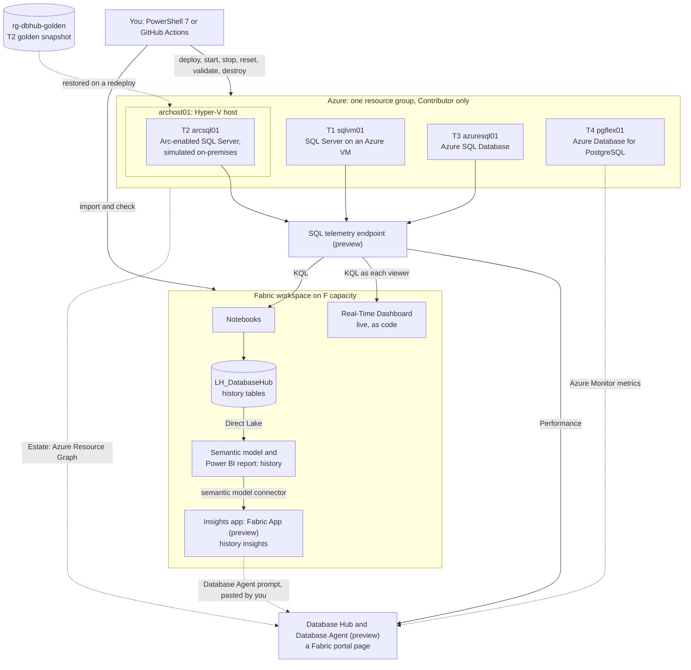
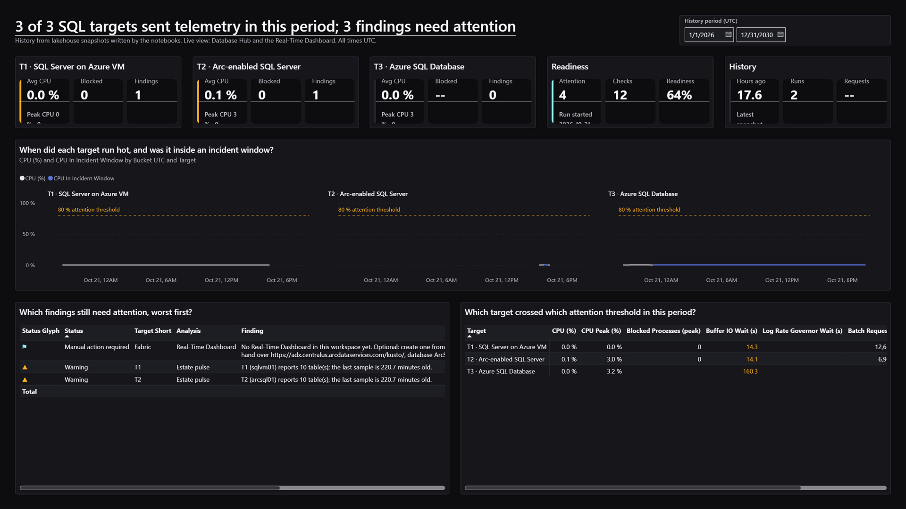
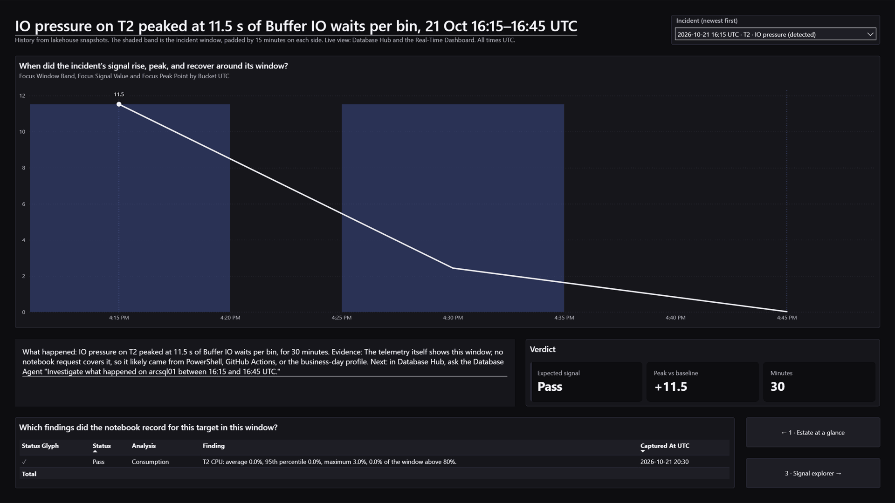
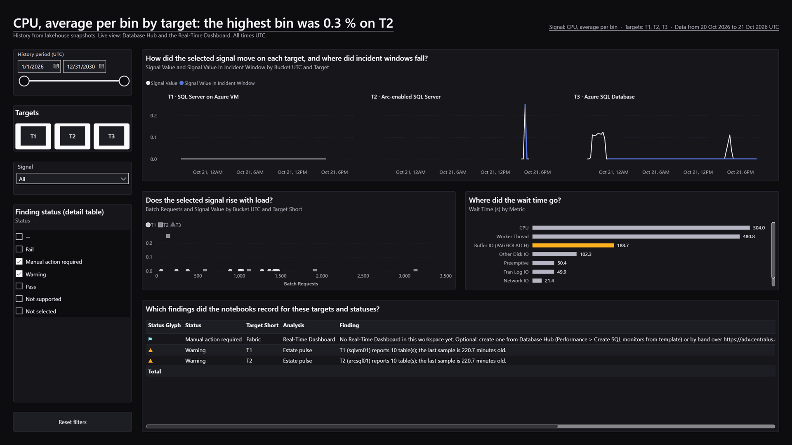
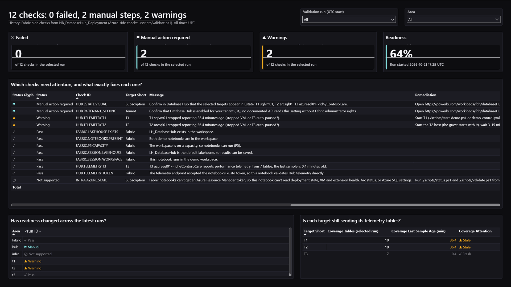

# Fabric Database Hub hybrid SQL demo

A low-cost, repeatable customer demo of **Microsoft Fabric Database Hub (preview)** and its in-Hub **Database Agent (preview)** across three SQL targets and one PostgreSQL target in one Azure resource group.

**The story:** fragmented visibility before; one hybrid estate in Database Hub after; then a live incident (locking, CPU, IO, a missing index, or an inefficient query) that the presenter investigates with the Database Agent. Every action the agent proposes needs human approval.

> **Preview disclosure:** Database Hub, the Database Agent, SQL VM performance monitoring, unified inventory, the Arc SQL monitoring setting, the telemetry endpoint, and Fabric Apps are previews and can change. This repo uses only documented interfaces and says plainly what's manual, unsupported, or not yet proven ([limitations](docs/limitations.md)).

## At a glance

`deploy.ps1` deploys everything below that has documented automation, with one command after `az login`, in parallel tracks: T1 with T3, T2, T4, and Fabric. In the default T2 mode it stops once, for about 10 minutes of a person's time, and finishes T2 in the same run (Phase 28). With Phase 22's overlaps, a redeploy with the T2 golden snapshot took **63.7 minutes** end to end on 2026-10-23: T1 and T3 were ready at +26.8 minutes, 9.5 minutes sooner than in Phase 20, but T2 waited about 29.5 minutes for the SQL Server extension's download in its guest. Phase 20's redeploy, before those overlaps, took **38.8 minutes** on 2026-10-22. Neither run had a manual step, and the 30-minute target isn't met yet ([quick start](#quick-start)). [Deploy it, step by step](#deploy-it-step-by-step) comes next, then [automated vs manual](#automated-vs-manual), which lists every step, automated or not.

| What | Where | What it is | Deployed by |
|---|---|---|---|
| **T1** `sqlvm01` | Azure VM | SQL Server 2022 Standard, pay-as-you-go. Shows in Database Hub through the SQL IaaS Agent extension | `deploy.ps1` |
| **T2** `arcsql01` | Nested Hyper-V guest on the Azure VM `archost01` | SQL Server 2022 Standard, pay-as-you-go, presented as a **simulated** on-premises server. Shows in Hub through SQL Server enabled by Azure Arc | `deploy.ps1`, with one [guided stop](#the-guided-stop-about-10-minutes) of about 10 minutes per guest build, in the same run. A redeploy restores the finished guest from its golden snapshot ([ADR 0018](docs/adr/0018-fast-redeploy-parallel-tracks-golden-snapshot.md)), with no manual step |
| **T3** `azuresql01-<id>` | Azure SQL Database | The `ContosoCare` database, General Purpose serverless, Microsoft Entra-only. Native in Hub | `deploy.ps1` |
| **T4** `pgflex01-<id>` | Azure Database for PostgreSQL flexible server | PostgreSQL 18 with the `contosocare` database, Microsoft Entra only, no public access. Shows in Hub through Azure Monitor metrics. Its size is `t4SkuName`: `Standard_B1ms` by default, and `Standard_B2s` by itself when Azure refuses B1ms (Phase 28). `t4Enabled: false` turns it off ([ADR 0019](docs/adr/0019-t4-postgresql-flexible-server.md)) | `deploy.ps1` |
| Workload | T1 to T4 | A workload runner with activity profiles and bounded incident scenarios that act only inside `ContosoCare` (`contosocare` on T4) | `deploy.ps1`; driven by `demo-control.ps1` |
| Fabric notebooks | Fabric workspace | `NB_DatabaseHub_Deployment` (validator) and `NB_DatabaseHub_LiveActivity` (live analysis), which save the demo's history to the lakehouse `LH_DatabaseHub` | `deploy.ps1`'s Fabric track (`configure-fabric.ps1`) |
| Real-Time Dashboard | Fabric workspace | `RTD_DatabaseHub_LiveView`: the live view, defined as code, over the telemetry endpoint | `deploy.ps1`'s Fabric track (`configure-fabric.ps1`) |
| Power BI history report | Fabric workspace | `RPT_DatabaseHub_History`: four pages over its Direct Lake semantic model, `SM_DatabaseHub_History` | `deploy.ps1`'s Fabric track (`configure-powerbi.ps1`) |
| [Fabric App](fabric/app/README.md) (preview, **optional**) | Fabric workspace | The Insights app, `APP_DatabaseHub_Insights`: a read-only app over the same model, built with the Rayfin SDK and CLI, with custom visuals, DAX and CSV export on every visual, and ready-made prompts for Database Hub's Database Agent. The demo is complete without it | `deploy.ps1`'s Fabric track (`configure-fabric-app.ps1`), after two tenant settings and a one-time browser sign-in |
| Database Hub | Fabric portal | Nothing to deploy: a portal page that finds the targets through Azure Resource Graph and charts their telemetry | — |

Also included: start, stop, reset, status, cost estimate, and destroy, from PowerShell or GitHub Actions; a [Database Agent prompt pack](fabric/agent/README.md); and validation in six statuses: **Pass**, **Fail**, **Warning**, **Manual action required**, **Not supported**, and **Not selected**. A successful deployment alone is never **Pass**.



**Status (2026-10-27):** all three targets sent performance telemetry live on 2026-10-20 and 2026-10-21. The notebooks, the Real-Time Dashboard (14 of 14 tiles with data), and the history model and report (98 of 103 measures with data before any scenario ran, and all 103 after Phase 20's scenarios) were deployed and checked live on 2026-10-21 and 2026-10-22. Since Phase 16's follow-up fixes, a fresh build onboards T2 reliably (the T2 host's DNS forwarder now waits for its gateway address), and the subscription guard recovers by itself from a Continuous Access Evaluation token challenge. Destroy is verified live in a disposable test environment (Phase 16, 2026-10-22): a subscription snapshot compared with the one before deploy shows nothing of the demo left behind. Phase 20 then destroyed the demo environment and redeployed it in 38.8 minutes, with T2 restored from its golden snapshot as Standard pay-as-you-go with monitoring on (2026-10-22); it also ran every scenario and the reset live, a second `deploy.ps1` converged with no duplicate Arc resources, and a repeat session's start took about 8 minutes. The Fabric App is live too (Phase 19b, 2026-10-22): with its Database Agent prompts, it redeployed in place in 47 s, all 14 of its queries return rows, including 9 incident windows from Phase 20's run, and it loads and connects when opened from its workspace item. Phase 22 (2026-10-23) built the redeploy's overlaps: the tracks' guards run while the template deploys, T2's restore starts as soon as its host exists and sends T2's artifacts meanwhile, T1's bundle and runner go in one wave with T1's monitoring merged alongside its bootstrap, and T3 is set up first. Its measured redeploy took 63.7 minutes with no check **Fail** and T1 and T3 ready 9.5 minutes sooner, while T2 stayed the critical path ([quick start](#quick-start)); a second `deploy.ps1` converged in 19.2 minutes with nothing to change. Phase 22 also fixed the golden snapshot's Release and proved the fix live: the restored copy's Arc identity is reset while its guest is still air-gapped, before any reconnect. The Fabric capacity was an F4 for that run (an F16 in Phase 20), so the Fabric track's times aren't comparable. T4 (Phase 24) was proven live on 2026-10-26 on the General Purpose `Standard_D2ds_v5`, after West US 3 refused `Standard_B1ms` and `Standard_B2s` for this subscription (`SkuNotAvailable`). The deploy that created T4 took 40.3 minutes, a convergence 20.1 minutes with no changes, and a stop, a start, and a stop 6.7, 7.9, and 6.2 minutes ([ADR 0019](docs/adr/0019-t4-postgresql-flexible-server.md), [report](docs/implementation-report.md#phase-24-t4-an-azure-database-for-postgresql-flexible-server)). `deploy.ps1` also keeps a VM disk type that the subscription's automation switched while the VMs were deallocated, with a **Warning** ([deployment](docs/deployment.md#disks-the-subscriptions-automation-switched-phase-24)). Phase 25d proved the eight newer scenarios and the on-demand activity control live on 2026-10-27. Each scenario ran for 8 minutes on T1, T2, and T3 at once, and the telemetry showed the waits it's designed for, from lock chains and deadlocks to tempdb latches, memory-grant queues, parallelism, log flushes, network waits, and CPU at 97 to 100 %. The live-activity notebook found CPU windows on T1 and T2 for the first time. A request from the control notebook reached its runbook about 3 minutes after it was sent, and started the targets and their scenarios; a second request was refused while the first was active, and **Stop now** and the run's own auto-stop each stopped everything ([report](docs/implementation-report.md#phase-25d-phases-25b-and-25c-live)). Still open: a browser check of the app's Database Agent prompts (**Manual action required**), and `validate.ps1`'s output scan, which reads the Fabric App's third-party packages under `out/` and reports a **Fail** for patterns in them ([troubleshooting](docs/troubleshooting.md#the-insights-app-fabric-app)). Evidence and the acceptance checklist are in the [final report](docs/implementation-report.md#final-report).

## Deploy it, step by step

**Where it goes:** into **your own Azure subscription** and **your own Fabric capacity**, in the same Microsoft Entra tenant. The demo is tested that way.

- **Azure:** the resource group `rg-dbhub-demo`, in West US 3 by default (`location` in your configuration; preflight checks that Database Hub supports the region). It holds T1 to T4, their network (no VM has a public IP), and the workload runner. Two more groups appear only if you use what they hold: `rg-dbhub-golden` keeps the T2 golden snapshot, and `rg-dbhub-control` holds the optional [on-demand activity control](#on-demand-activity-control-optional).
- **Fabric:** the workspace **Database Hub Demo**, with the lakehouse `LH_DatabaseHub`, on an F or Trial capacity. The scripts find both by name and create them when they're missing, so you never look up an ID.
- **Where you run the scripts:** your computer, the repository's [dev container](.devcontainer/devcontainer.json), or GitHub Codespaces. GitHub Actions is optional ([quick start](#quick-start)).

**Before you start** (once; people do these):

| You need | Who provides it |
|---|---|
| **Contributor** on the Azure subscription | The subscription's Owner |
| An **F or Trial Fabric capacity** you can assign, **running** while you deploy | You, or the capacity's administrator |
| The Fabric tenant setting **Users can access the Database hub (preview)**, and **Create workspaces** unless you already have a workspace | Your Fabric administrator |
| *Optional, for the Insights app only:* the Fabric tenant settings **Fabric Apps (preview)** and **Dataset Execute Queries REST API**. The demo is complete without them | Your Fabric administrator |
| Quota for about **8 vCPUs** of VM sizes with nested virtualization in the region | The subscription; preflight checks it |
| PowerShell 7.4, the Azure CLI with Bicep, the .NET SDK, Node.js 24, and Git, or a codespace that has them | You |

**Steps** (about 2–3 hours the first time, mostly T2's build, an estimate from documented step times; a person is needed once, for about 10 minutes, about 60 to 90 minutes in):

1. **Get the code:** select **Use this template** on GitHub for your own copy, clone it with `git clone https://github.com/MarcBushong/fabric-database-hub-demo.git`, or open it in [GitHub Codespaces](https://codespaces.new/MarcBushong/fabric-database-hub-demo?quickstart=1).
2. **Sign in to Azure:** `az login` (in a codespace or a container, `az login --use-device-code`). The scripts never sign in for you, and never change your default subscription.
3. **Deploy, with one command:** `./scripts/deploy.ps1`. On the first run it writes your configuration from your sign-in, as `./scripts/init.ps1 -CreateAdminGroup` does: it picks your subscription and Fabric capacity, asking when there's more than one, creates the Microsoft Entra group `dbhub-demo-sql-admins`, which administers T3 and T4, with you as its owner, and asks for T2's mode (`PaygWizard`, the default; [options](#options-productkey-and-developer)). Then it checks everything (preflight), deploys T1, T3, T4, and the Fabric items in parallel while T2 builds, and waits for T2. It keeps your PC awake, opens a [live status page](#while-it-runs), and prints what to expect.
4. **The guided stop** (`PaygWizard` only): about 60 to 90 minutes in, the run asks for you once, with a banner, a beep, the browser on the right page, and the same steps on the status page. You sign in to the T2 host through Bastion, choose **pay-as-you-go** and **Standard** in a pre-filled SQL Server setup, and sign in to Azure on its Azure page: about 10 minutes, then 10 to 15 while setup installs ([the guided stop](#the-guided-stop-about-10-minutes)). The run then finishes T2 by itself.
5. **The ending:** the run ends with one banner. **DONE** means Database Hub shows every target, with where to look. **NOT DONE** says why, the single next action, and the exact command, usually `./scripts/deploy.ps1` again, which continues where it stopped. If the window closes or the PC restarts, run `./scripts/deploy.ps1` again; you never need a flag to continue.
6. **See it:** open **Database Hub** in the Fabric portal ([Database Hub](https://learn.microsoft.com/fabric/database/hub/overview)) and look at Estate and Performance. Then start an incident, for example `./scripts/demo-control.ps1 -Target T1 -Scenario incident:blocking-chain -Duration 15`, and investigate it with the Database Agent, approving or cancelling each action it proposes.
7. **Keep the finished build** (recommended): `./scripts/capture-t2-golden.ps1`, then `./scripts/test-t2-golden.ps1 -Onboard`, so the next redeploy restores T2 in about 30 to 45 minutes with no build and no guided stop.
8. **The Insights app** (optional): when the two optional tenant settings are on, `./scripts/configure-fabric-app.ps1 -SignIn`, with one browser sign-in that only you can do. Open the app from its item in the workspace. When `deploy.ps1` couldn't add it, the **DONE** banner and the status page say why, never as a **Fail**, and what to do first.
9. **Between sessions:** `./scripts/stop-demo.ps1`, and `./scripts/start-demo.ps1` next time, which takes about 8 minutes. The VMs also shut down every evening at `autoShutdownTime`.
10. **Remove it:** `./scripts/destroy.ps1`.

### The guided stop (about 10 minutes)

Pay-as-you-go SQL Server without a product key is documented only in setup's wizard, so a person makes that choice once per guest build ([ADR 0006](docs/adr/0006-sql-editions-and-licensing.md)). Everything around it is automated:

- **When:** about 60 to 90 minutes after the start (an estimate; it can be later, and the run waits). The start banner and the status page say so, and the run prints its progress with an estimate of when it comes. Keep the window open.
- **What you see:** a large **WAITING FOR YOU** banner, a beep, and the console window flashing; the browser opens `archost01`'s page in the Azure portal; the status page turns **Waiting for you**, with the steps, the link, and a countdown; a short reminder every 5 minutes; and one plain line for an assistant to relay, `HUMAN ACTION REQUIRED: DEPLOY.T2.GUIDEDSTOP ...`.
- **What you do:**
  1. In the portal, select **Connect**, then **Bastion**, and sign in to `archost01` as its administrator. The password: a one-time password is already on your clipboard (never shown or saved), or in the demo's key vault with the [Key Vault opt-in](docs/deployment.md#opt-in-the-password-in-key-vault-instead-of-the-clipboard). **Without a working clipboard** (GitHub Codespaces, Cloud Shell, an SSH session, or Linux without a desktop and `xclip`), nothing is set or shown: first open `archost01` in the portal, then **Help**, then **Reset password**, keep the user name, and type a password of your own choosing ([reset a password](https://learn.microsoft.com/troubleshoot/azure/virtual-machines/windows/reset-rdp)). Either way, it's rotated afterward.
  2. Virtual Machine Connection to the guest `arcsql01` opens by itself. The guest has signed itself in, once, for this step, and SQL Server setup is open and pre-filled.
  3. On the **Edition** page, choose **Use pay-as-you-go billing through Microsoft Azure**, then **Standard**; accept the license terms.
  4. On the **Azure Extension for SQL Server** page, select **Use Azure Login** and sign in with your own Azure account.
  5. Select **Next** on the pre-filled pages, then **Install**. When setup is complete, select **Close**, and close the Bastion tab.
- **Then, by itself:** the host checks what you installed (Standard, the default instance, the Azure extension). If something's wrong, such as Evaluation or a named instance, it shows the documented fix and keeps waiting. Otherwise it signs the guest out, turns its automatic sign-in off, and removes the sign-in data that setup leaves; Arc gets pay-as-you-go and monitoring; Bastion is removed; and the host password is rotated.
- **How long the run waits:** at least 45 minutes after it asks, until a time it prints. After that, it ends **NOT DONE**; run `./scripts/deploy.ps1` again when you have about 15 minutes, and it guides you again.

### While it runs

- **The status page,** `out/deploy-status.html`, opens at the start and updates itself every 10 to 15 seconds, offline. Its banner says **Deploying, no action needed** (you can step away), **Waiting for you**, **Done**, or **Stopped, not done**, with every step of every track below it: its status, its time, and a one-line message. An Azure-side wait, such as an extension that a policy in your tenant installs, says "no action needed". `./scripts/status.ps1 -Watch` shows the same in a second terminal, anywhere.
- **Keep the machine on:** `deploy.ps1` keeps a Windows PC and its display awake until it ends; plug a laptop in and leave it open. On macOS and Linux, keep it awake yourself.
- **If something goes wrong:** run `./scripts/deploy.ps1` again. When **NOT DONE** repeats, `./scripts/collect-diagnostics.ps1` writes a redacted zip for a **Deployment problem** issue ([getting help](#getting-help)).
- **To stop it:** Ctrl+C stops the run within seconds, its background processes too; the PC may sleep again, and the status page says **Stopped, not done** with the command that continues where it stopped. Stopped at the guided stop, Bastion stays up and the host password isn't rotated until the next run finishes that step; if you're done for the day, `./scripts/stop-demo.ps1` removes Bastion and rotates the password ([details](docs/deployment.md#one-command-one-guided-stop-phase-28)).

### Options: ProductKey and Developer

`t2SqlInstallMode` in your configuration (`init.ps1` and the first run ask):

| Mode | What you do | What T2 gives in Database Hub |
|---|---|---|
| `PaygWizard` (default) | The guided stop, about 10 minutes per guest build | Estate, Performance, and the Database Agent's findings, billed pay-as-you-go through Azure |
| `ProductKey` | Nothing during the run: fully unattended, with your own SQL Server Standard product key (P10), license type PAYG or Paid per your entitlement. Put the key in the session before you deploy, never in a file: `$env:DBHUB_SQL_PRODUCT_KEY = Read-Host -MaskInput 'Product key'`; `deploy.ps1` hands it only to the T2 track and removes it from the environment | The same as `PaygWizard` |
| `Developer` | Nothing: fully unattended | Estate only: **no T2 performance data and no Database Agent findings**, which Developer edition doesn't get |

A golden snapshot (step 7) makes every later redeploy unattended in any mode.

### In GitHub Codespaces

The repository's dev container has every tool, in a codespace or on your machine. A codespace stops after 30 minutes without activity by default; terminal output counts as activity, and `deploy.ps1` prints progress at least every 5 minutes, but raise the timeout before a first run to be safe: **Settings** > **Codespaces** > **Default idle timeout**, up to 240 minutes, for codespaces you create afterward, or `gh codespace create --idle-timeout 240m` ([GitHub Docs](https://docs.github.com/codespaces/setting-your-user-preferences/setting-your-timeout-period-for-github-codespaces)). A codespace has no clipboard for the script, so the guided stop uses the portal's **Reset password** (above), and it can't open a browser: preview the status page through a forwarded port, as `deploy.ps1` prints, or use `./scripts/status.ps1 -Watch`.

**Cost:** the default ceilings are $15 a session and $250 a month (`sessionCeilingUsd`, `monthlyCeilingUsd`). Preflight prices the deployment for your region at run time and warns when an estimate passes either ceiling ([cost](#cost)). **Stuck?** See [troubleshooting](docs/troubleshooting.md), or open an issue with the **Deployment problem** template ([getting help](#getting-help)).

## Running it with an AI assistant

An assistant such as GitHub Copilot can drive the deployment for you, but a person is still needed once, for about 10 minutes, and no assistant should do these sign-ins for you.

- **What the assistant can do:** run `./scripts/deploy.ps1`, `./scripts/status.ps1 -Watch`, and `./scripts/collect-diagnostics.ps1`; read the results and the status page; and run `./scripts/deploy.ps1` again after an interruption, since it continues where it stopped with no flag. `deploy.ps1` notices a session that can't take keyboard input, says so at the start, and goes on; on a first run in such a session it never asks, and a choice it can't make is **NOT DONE** with the parameter to pass (`./scripts/init.ps1` takes them).
- **What you must do, and when** (`PaygWizard` mode, about 60 to 90 minutes after the start, for about 10 minutes): sign in to `archost01` through Bastion; choose **pay-as-you-go** and **Standard** in the pre-filled setup; and sign in to Azure on setup's Azure page ([the guided stop](#the-guided-stop-about-10-minutes)). Without a clipboard, you first set the host's password yourself in the portal (**Help** > **Reset password**). Plan to be at a browser then; the start banner says when, as `PLAN FOR A PERSON: DEPLOY.T2.GUIDEDSTOP ...`.
- **The handoff:** at the guided stop, the run prints one plain line for the assistant to relay to you, `HUMAN ACTION REQUIRED: DEPLOY.T2.GUIDEDSTOP - ...`, with the time limit and the status page's path, and repeats it every 5 minutes.
- **It waits, then resumes:** the run waits at least 45 minutes once it asks, and continues by itself when setup is done. If nobody came in time, it ends **NOT DONE**; `./scripts/deploy.ps1` again guides you from that step.
- **Also yours:** `az login` itself, and the Insights app's browser sign-in (`./scripts/configure-fabric-app.ps1 -SignIn`), which is optional.
- **Fully unattended:** use `ProductKey` mode with your own SQL Server Standard product key, set in the session as above ([options](#options-productkey-and-developer)), which gives the same Database Hub views with no person needed. `Developer` mode is unattended too, but T2 then shows in Estate only.

## Automated vs manual

The scripts automate every step that has a documented interface. Each step that's left is manual for a stated reason, and the scripts report it as **Manual action required** with its exact steps, so nothing is hidden. The [automation support matrix](docs/automation-support-matrix.md#what-stays-manual-and-why) gives each reason with its Microsoft Learn source.

- **Automated:** a script does it, unattended.
- **Manual (one time):** once per tenant, subscription, or environment; the setup wizard, once per T2 guest build.
- **Manual (each session):** around each demo session.
- **Presenter-driven:** done live in a product's UI, by design.

"You" is the person who deploys, with Contributor on the subscription. In the **Time** column, a date means measured that day, and ≈ means an estimate.

| Step | Type | Why it's manual | Time | Who |
|---|---|---|---|---|
| **Before the first deployment** | | | | |
| Sign in to Azure: `az login` (in a codespace or a container, `az login --use-device-code`) | Manual (one time) | By design: no script signs in, signs out, or changes your default subscription, so none holds your credentials. Sign in again when the session expires | ≈ 1 min | You |
| Write `config/demo.config.json` from your sign-in: `./scripts/deploy.ps1` does it on its first run (Phase 28), or `./scripts/init.ps1 -CreateAdminGroup` on its own. It reads your subscriptions (`az account list`, the one call before the subscription guard), runs the guard, and fills in your subscription, tenant, account, budget-alert address, Fabric capacity, workspace name, and P6 group, asking only when there's a real choice: the subscription, the capacity, and T2's mode | Automated, after the sign-in | — | ≈ 1 min: 44 s for a read-only run (2026-10-27) | You |
| Contributor on the subscription (P1) | Manual (one time) | Assigning a role needs Owner or User Access Administrator; the demo needs nothing more. `init.ps1` checks it and prints the Owner's exact command | ≈ 2 min | Subscription Owner |
| Fabric tenant settings: **Users can access the Database hub (preview)** (P4); and, optional, for the Fabric App only, **Fabric Apps (preview)** (P12) and **Dataset Execute Queries REST API** (P13; newer portals say "Semantic Model"), which the report's data check also uses | Manual (one time) | No supported automation: tenant-wide administrator settings, outside the demo's permissions. The Hub setting has no documented internal name, so `configure-fabric.ps1 -FabricAdmin` can only read it, by its title. Without P12 and P13 the demo is still complete: the run ends **DONE** and lists the app as optional | ≈ 5 min | Fabric administrator |
| A Fabric F or Trial capacity you can assign (P5) | Manual (one time) | The capacity belongs to its administrator, and the scripts never create one. On it, `deploy.ps1` finds or creates the workspace and the lakehouse `LH_DatabaseHub` by name, and imports the notebooks (ADR 0021). Creating the workspace needs the Fabric tenant setting "Create workspaces" for you | ≈ 5 min | The capacity's administrator |
| T3's administrators: a Microsoft Entra security group you own (P6) | Automated with `init.ps1 -CreateAdminGroup`; Manual (one time) where the tenant restricts it | `init.ps1` finds the group by name or creates it with you as its owner. Where only administrators may create groups, it prints the exact steps for one. With the group, `deploy.ps1` adds T1's identity to it, and T1 creates T3's schema, seed data, and users | Seconds, or ≈ 5 min for an administrator | You, or an Entra administrator |
| T3's T-SQL setup, run interactively | Manual (one time), fallback only | Only when T1 can't join the group (you don't own it, or the GitHub identity runs the deployment): a group owner runs the printed command, or a group member runs T3's T-SQL once ([ADR 0008](docs/adr/0008-identity-rbac-abac.md#phase-8-addendum-t1-and-the-p6-group-as-built-2026-10-20)) | ≈ 10 min | A group owner or member |
| T2's pay-as-you-go SQL Server setup (`PaygWizard`, the default mode; the first run asks): the [guided stop](#the-guided-stop-about-10-minutes) in `deploy.ps1`'s run, where you sign in to the host through Bastion, choose pay-as-you-go and Standard in the pre-filled setup, and sign in to Azure on its Azure page | Manual (once per guest build), guided | No supported automation: pay-as-you-go without a product key is documented only in the setup wizard, whose **Use Azure Login** page needs your interactive sign-in. Since Phase 28 everything around it is automated: Bastion, the password hand-over, the guest's one automatic sign-in, setup pre-filled from a configuration file, the check of what you installed, and everything after it. A product key (P10) or `Developer` mode (Estate only) avoids it, and so does a redeploy from the T2 golden snapshot (`capture-t2-golden.ps1`), which keeps the finished guest (no manual step, 2026-10-22) | About 10 min of your time plus 10–15 min while setup installs, about 60 to 90 min after the start (Phase 28, an estimate). By hand: about 1 hour, after about 8 min for Bastion (2026-10-21) | You, with your Azure account |
| Rayfin CLI sign-in for the Fabric App (P14, optional): `./scripts/configure-fabric-app.ps1 -SignIn` | Manual (one time), one command | A person signs in: `-SignIn` runs the pinned CLI's `rayfin login --tenant <tenantId>` in your console, which opens a browser, then checks the sign-in and deploys. An assistant can't do this sign-in for you. The CLI's service principal sign-in is listed but not supported yet, so `-SignIn` is refused in CI and there's no CI deploy. The CLI then renews its token by itself; the script never sees it. The demo is complete without the app | ≈ 1 min | The operator, as the demo's Fabric user |
| GitHub Actions (P7, optional): `gh auth login`, then `./scripts/setup-github-oidc.ps1 -ConfigureGitHub` creates the GitHub identity, then the environment `demo`, with you as its required reviewer and the default branch only, and its four environment secrets; `-ScheduleEnvironment` (optional) adds an environment without reviewers for the scheduled workflows. The identity still needs Contributor on the subscription | Automated with `-ConfigureGitHub`, after the GitHub CLI sign-in; the role assignment is Manual (one time) | Assigning a role needs more than Contributor, so the script prints the one command for an Owner, User Access Administrator, or Role Based Access Control Administrator (with `assignRoles` and those rights, it assigns it itself). Without `-ConfigureGitHub`, it writes nothing to GitHub and prints the `gh secret set` commands. The identifiers are secrets so that GitHub masks them in a public repository's logs; on a private repository, environment secrets and reviewers need a paid GitHub plan ([deployment](docs/deployment.md#private-repositories)) | ≈ 10 min | You, as an administrator of the repository; then an Owner or User Access Administrator for the role |
| Presenter access (P8, optional): Reader, plus the Arc telemetry role | Manual (one time) | Role assignments need more than Contributor. With `assignRoles`, the scripts make them when you can | ≈ 2 min per person | An Owner or User Access Administrator |
| Viewer licenses (P11, optional) | Manual (one time) | Licenses are assigned outside Azure | Varies | Each viewer's license administrator |
| The on-demand activity control (P15, optional): `setup-activity-control.ps1`, then `setup-activity-control.ps1 -GrantRole` | Manual (one time) | Setup needs only Contributor, but the control's one custom role and its three assignments need an Owner, signed in with multifactor authentication ([ADR 0020](docs/adr/0020-on-demand-activity-control.md)) | 521 s for setup on the private path, and 79 s for `-GrantRole` (2026-10-27) | You, then an Owner |
| Share the report with viewers outside the workspace (optional) | Manual (one time) | By choice: sharing grants permissions to people | ≈ 5 min | A workspace administrator |
| **Each session** | | | | |
| Resume the Fabric capacity before, and pause it after | Manual (each session); Automated with `fabric.manageCapacity` for a capacity that's yours alone | By default, no script resumes, pauses, or scales a capacity: it's outside the demo's resource group, often shared, and bills while it runs; Database Hub doesn't need it. With `fabric.manageCapacity` true (opt-in, an F capacity in the same subscription), `start-demo.ps1` resumes it when it's paused and records that in the resource group's tag `DbHubFabricCapacityResumed`, and `stop-demo.ps1` and `destroy.ps1` pause only what that tag records. Keep it false for a shared capacity | ≈ 1 min | Its administrator, or `start-demo.ps1` and `stop-demo.ps1` |
| Run `NB_DatabaseHub_LiveActivity` to save the session's history for the report and the app | Automated with `stop-demo.ps1 -SaveHistory` (or `fabric.saveHistoryOnStop`); otherwise Manual (each session) | `-SaveHistory` runs the notebook on demand after the VMs stop, at most 15 minutes, before anything pauses the capacity; it writes only the lakehouse tables. By hand, **Run all** is safe: with the defaults, no cell changes Azure or Fabric resources | About 2 min (2026-10-21, by hand) | You, or `stop-demo.ps1` |
| Check the Fabric App in a browser after a deploy: open it from its workspace item and see **"Connector check passed"** on its **Live links** page | Manual (one time), after each deploy | No supported automation: only a person can check the app in the portal (the repo never automates it), so `FABRIC.APP.BROWSER` stays **Manual action required**. The browser check of the Database Agent prompts is still open (2026-10-22) | ≈ 2 min | You |
| Open the Fabric App from its workspace item | Manual (each session) | A documented preview limitation: the app's static assets are `protected`, so opening the hosted URL directly fails the sign-in hand-off ("Page not accessible directly"), and an anonymous request gets HTTP 401. From the workspace item, it loads and connects (2026-10-22) | Seconds | The presenter or a viewer |
| Database Hub (Estate and Performance), the Database Agent, and Copilot | Presenter-driven | No supported automation: no API, ARM, or Bicep resource, and Learn documents them only as portal experiences. Every action the agent proposes needs your approval | During the session | The presenter |
| Ask the Database Agent from the Fabric App: **Ask the agent** on an incident window or on the replay (four prompts per window, built from its resource, UTC times, peak, baseline, and ratio), or the prompt library on Estate and Readiness; then **Copy**, or **Copy and open Database Hub**, and paste the prompt into the agent | Presenter-driven | No supported automation: the agent is UI-only, with no API, so the app copies and links, and never sends or runs anything. Every panel says **Preview**, that you approve each action, and that it's investigation only; read a proposal aloud, then cancel it. A switch rewrites the prompts for GitHub Copilot CLI or VS Code | ≈ 1 min | The presenter |
| Hub's **Create SQL monitors from template** wizard (optional) | Presenter-driven | UI-only, with no API. The Real-Time Dashboard is its governed counterpart, as code | ≈ 3 min | The presenter |
| The missing-index fix | Presenter-driven | By design: a person reviews and runs `remediation.sql`, and `reset --undo-remediation` reverts it | ≈ 1 min | The presenter |
| **What the scripts do** | | | | |
| First run (`init.ps1`, or `deploy.ps1` when there's no configuration yet): your configuration from your sign-in, the P6 group with `-CreateAdminGroup`, and the exact next steps. Git ignores the file, it holds no secrets, and it's never replaced without `-Force` | Automated, after the sign-in | — | 44 s for a read-only run, 50 s with `-WhatIf` (2026-10-27) | You |
| Preflight (`preflight.ps1`): the guard, P1–P6, providers, region, sizes, quota, the policy inventory, and the cost against both ceilings | Automated | — | 215 s with the cached policy inventory (2026-10-22); 12.5 min without it, of which about 7 for the policy inventory (2026-10-21). Since Phase 28, with `networkMode` `private`, `deploy.ps1` runs the policy inventory beside the deployment instead of before it | You |
| Deploy (`deploy.ps1`): the first-run configuration when it's missing, preflight and infrastructure, then parallel tracks for T1 with T3, T2 (restored from the golden snapshot when there's one, otherwise built, with the guided stop in `PaygWizard` mode), T4, and Fabric (the notebooks, the dashboard, the model and report, and the optional app), with Arc onboarding, then validation and one ending, **DONE** or **NOT DONE**; it keeps the PC awake, shows a live status page, and continues where it stopped when run again | Automated, apart from the guided stop | — | 63.7 min for a redeploy with the T2 golden snapshot (2026-10-23, with Phase 22's overlaps; about 29.5 of them waiting for the SQL Server extension in T2's guest), against 38.8 min before them (2026-10-22); 19.2 and 21.8 min for a second run that changes nothing (2026-10-23 and 2026-10-22); a first run about 2–3 hours (an estimate); more in the [quick start](#quick-start) | You, or the **deploy** workflow |
| T2 golden snapshot (`capture-t2-golden.ps1`, then `test-t2-golden.ps1 -Onboard`), once per guest build after the setup wizard: keeps the finished host in `rg-<prefix>-golden`, and proves a copy in quarantine before it's used | Automated | — | Proving it took 75 min, the extension download included (4,492 s, 2026-10-22) | You |
| Notebooks and the Real-Time Dashboard (`configure-fabric.ps1 -ImportDashboard`): imported, read back, and every tile checked for data | Automated | — | 35 s for the dashboard and 61 s for its tile check (2026-10-21) | You |
| Power BI model and report (`configure-powerbi.ps1`): deployed, refreshed, and every measure checked with DAX | Automated | — | 265 s (2026-10-22) | You |
| Fabric App (`configure-fabric-app.ps1`): `rayfin up` to the same item, then every query of the app's catalog checked for rows through its connector, and a check that the hosted app refuses anonymous requests | Automated, after the one-time sign-in | — | 47 s for `rayfin up`, which updated the item in place, and 265 s for the whole script; all 14 queries returned rows (2026-10-22) | You |
| Start (`start-demo.ps1`): the cost check, both VMs at once, T3, the activity profiles, and the warm-up in the background | Automated | — | 481 s, every check **Pass** (2026-10-22) | You, or the scheduled workflow |
| Scenarios (`demo-control.ps1`): an activity profile, or one bounded incident with a hard time limit | Automated | — | Up to the limit you set, for example `-Duration 15` | You, the notebook, or the **demo-control** workflow |
| On-demand activity control (`NB_DatabaseHub_Control`, optional): one request from Fabric starts the targets and their scenarios, with the run's own auto-stop, and Stop now ends it | Automated, after the one-time setup | — | The runbook starts 3 to 4 minutes after the request, 2 to 3 of them for the control workspace's Spark start, and dispatches the activity within 2 minutes, after starting the stopped VM and T4; **Stop now** reaches the runbook in about 3 minutes (2026-10-27) | The presenter |
| Status and validation (`status.ps1`, `validate.ps1`) | Automated | — | 58 s for `status.ps1` (2026-10-21) | You |
| Reset (`reset-demo.ps1`): back to a known state without a redeploy | Automated | — | Not timed; it passed on T1, T2, and T3 in Phase 20's live run (2026-10-22) | You |
| Stop (`stop-demo.ps1`), and the nightly auto-shutdown | Automated | — | About 6 min in the demo environment (349 and 367 s, 2026-10-22); 4.2 min in the test environment, with T1 already stopped | You, or the schedule |
| Destroy (`destroy.ps1`): the Arc resources, then the resource group, then the deployment record and the group's budget, which outlive the group, then a check for anything left. It keeps `rg-<prefix>-golden` unless `-IncludeGolden` | Automated | — | 18.4 min for the demo environment (1,102 s, 2026-10-22); in the test environment, the group in 4 min, and 24 min with the residual check's polling and the live teardown tests | You, or the **destroy** workflow |
| **After destroy** | | | | |
| Remove a role assignment that your tenant's governance automation gave one of the demo's identities, if it did | Manual (one time) | Not the demo's: the demo creates no role assignments, and removing one needs Owner or User Access Administrator. Destroy's residual check reports it | ≈ 2 min | An Owner or User Access Administrator |
| Grant the on-demand activity control's A1 again after a redeploy (only with the control, and only when `assignRoles` is false) | Manual (after each redeploy) | A1 lives in the demo resource group, which destroy deletes; `deploy.ps1` grants it again by itself when `assignRoles` is true, and otherwise lists the exact `-GrantRole` command in `DEPLOY.SUMMARY` | ≈ 1 min | An Owner |

## Prerequisites

Contributor on an existing Azure subscription is the only Azure role the default path needs. `preflight.ps1` checks everything it can and reports each item in the six statuses. The full list, with how to satisfy each item, is in [prerequisites](docs/prerequisites.md), and the role matrix is in [permissions](docs/permissions.md).

| # | You need | Who provides it | How it's checked |
|---|---|---|---|
| P1 | **Contributor** on the subscription. The default deployment creates no role assignments and no Key Vault | Subscription Owner | `PREFLIGHT.P1.CONTRIBUTOR`, a **Fail** without it |
| P2 | The resource providers the demo uses, registered | Preflight registers them (Contributor can) | `PREFLIGHT.P2.PROVIDERS` |
| P3 | Quota for about 8 vCPUs of sizes that support nested virtualization in the region (West US 3 by default), and one public IP for on-demand Bastion | The subscription; request more quota if needed | `PREFLIGHT.P3.*`: region, sizes, security types, quota, and the public IP, with alternatives when one fails |
| P4 | The Database Hub tenant setting, and a Fabric Free license for each Hub user | Fabric administrator | `PREFLIGHT.P4.HUBSETTING` is always **Manual action required**: no documented API reads the setting without administrator rights. `configure-fabric.ps1 -FabricAdmin` reads it |
| P5 | Contributor or higher on a Fabric workspace on F or Trial capacity, with the lakehouse the notebooks write to; the capacity must be running for imports and runs | Workspace and capacity administrators | `configure-fabric.ps1`: `FABRIC.P5.WORKSPACE` and `FABRIC.P5.CAPACITY` through Fabric REST. A paused capacity is **Manual action required** |
| P6 | A Microsoft Entra security group you own, used as T3's administrator | You (`init.ps1 -CreateAdminGroup` creates it with you as its owner), or an Entra administrator where only administrators may create groups | `INIT.P6.GROUP` and `PREFLIGHT.P6.GROUP` |
| P7 | *Optional:* GitHub Actions with OpenID Connect: Contributor for the identity that `setup-github-oidc.ps1` creates | An Owner, User Access Administrator, or Role Based Access Control Administrator | `setup-github-oidc.ps1` prints the one command |
| P8 | *Optional:* Reader for presenters and viewers who aren't Contributors, plus the Arc telemetry role for T2's performance data | The same | `configure-fabric.ps1` with `assignRoles`: `HUB.PRESENTER.*`, or the exact commands |
| P9 | *Optional:* a GitHub token in Key Vault, so the live-activity notebook can trigger activity profiles | You | The notebook; without it, it prints the Actions link and command |
| P10 | *Optional:* a SQL Server Standard product key, for an unattended T2 with no wizard step | Your licensing | `configure-arc.ps1 -ProductKey` when `t2SqlInstallMode` is `ProductKey` |
| P11 | *Optional:* Pro, PPU, or a trial for each viewer of Power BI content on a capacity smaller than F64 | Each viewer's license administrator | `PREFLIGHT.FABRIC.VIEWERLICENSE`: a **Warning** below F64, **Pass** on F64 or larger |
| P12 | *Optional:* the Fabric tenant setting **Fabric Apps (preview)**, enabled for the deploying user and every viewer of the Insights app | Fabric administrator | `configure-fabric-app.ps1`: with `-FabricAdmin`, read through the Fabric admin API (`FABRIC.APP.TENANTSETTING`); without it, **Manual action required**, which turns into **Pass** when the app's deploy passes |
| P13 | *Optional:* the Fabric tenant setting **Dataset Execute Queries REST API** (Integration settings; newer portals say "Semantic Model"), for the Insights app's connector and the report's data check | Fabric administrator | The same (`FABRIC.APP.EXECUTEQUERIES`), which turns into **Pass** when the app's connector check passes; `configure-powerbi.ps1`'s data check reports **Manual action required** while it's off |
| P14 | *Optional:* a one-time sign-in of the Rayfin CLI as the demo's Fabric user, on the machine that deploys, and Node.js 20, 22, or 24 | The operator, with `configure-fabric-app.ps1 -SignIn` | `configure-fabric-app.ps1`: `rayfin login status --json` (`FABRIC.APP.SIGNIN`), **Manual action required** with the exact command until it passes (`-SignIn` runs it in your console; it's **Not supported** in CI), and `node --version` (`FABRIC.APP.NODE`), a **Warning** for a newer Node.js |
| P15 | *Optional:* the on-demand activity control ([ADR 0020](docs/adr/0020-on-demand-activity-control.md)): an Owner runs `setup-activity-control.ps1 -GrantRole` once, and again for A1 after each redeploy unless `assignRoles` is true | Subscription Owner | `setup-activity-control.ps1` and `validate.ps1`: `CONTROL.ROLE.*`, **Manual action required** with the exact command until they pass |

- **Viewer licensing (P11):** "On F SKUs smaller than F64, each user viewing Power BI content must have Pro, PPU, or an individual trial" ([Fabric licenses](https://learn.microsoft.com/fabric/enterprise/licenses)). The demo's capacity is an F16 (2026-10-21), so everyone who opens the Power BI report needs one. A presenter who shares their screen needs only their own. Database Hub and the Real-Time Dashboard aren't Power BI content, so a Fabric Free license is enough for them. Learn doesn't list a Fabric App as Power BI content, but the Insights app reads the model as each viewer, so plan for the report's rule until that's verified. Its viewers also need access to the app item, **Read** and **Build** on `SM_DatabaseHub_History`, and P12 and P13.
- **The Real-Time Dashboard needs Azure read access:** it queries the telemetry endpoint as each viewer, so every viewer needs Reader on the subscription (P8; Contributors have it), and viewers who are only Readers also need the Arc telemetry role to see T2. Sharing the dashboard doesn't grant that access: a viewer without it sees empty tiles.
- **Tools:** PowerShell 7.4, the Azure CLI with Bicep, and the .NET SDK pinned in `config/versions.json`, or Azure Cloud Shell (without the SDK, `deploy.ps1 -SkipRunner` skips the workload runner). The Fabric App also needs Node.js 20, 22, or 24 with npm (P14); 26 also worked, with npm's warning. The repository's [dev container](.devcontainer/devcontainer.json) has all of them at the pinned versions, locally or in GitHub Codespaces; sign in there with `az login --use-device-code`.
- **Region:** West US 3 by default. Any region you choose must be in Database Hub's performance-monitoring list and the SQL VM unified-inventory list; preflight checks both.

## Screenshots

Captured from live data by the agents that built each surface, without automating any portal. Nothing identifying is visible: no tenant, subscription, or resource IDs, no emails, account names, or IP addresses. T3's server suffix shows as `<id>`, and the notebook's run ID is masked.

### The Power BI history report

Power BI Desktop's render of the deployed report against the live model, captured on 2026-10-22 from the history that the notebooks saved on 2026-10-20 and 2026-10-21; times are UTC. No scenario had run yet, so the incident shown is a detected IO-pressure window, not a requested one.

| 1. Estate at a glance | 2. The incident, minute by minute |
|---|---|
|  |  |
| Telemetry coverage, CPU per target against the 80 % attention line, and the findings that still need attention | One incident's signal before, during, and after its window, with a verdict and the notebook's evidence |

| 3. Signal explorer | 4. Readiness checks |
|---|---|
|  |  |
| Any signal on any target over time, against load, with the wait time by category | The deployment notebook's checks by status, with the exact fix for each one |

### The Fabric App (preview)

No screenshots yet. The [app's guide](fabric/app/README.md#whats-in-it) describes its four pages: Estate, Incidents, Readiness, and Live links.

### Command output

Real output, shortened: `[...]` marks omitted text, and T3's server suffix is masked.

`./scripts/status.ps1` between sessions, on 2026-10-21 at 19:49 UTC, with both VMs deallocated and T3 paused (the guard's and the deployment's lines are left out):

```text
checkId                     status  message
-------                     ------  -------
STATUS.VM_SQLVM01           Pass    sqlvm01 is deallocated; start-demo.ps1 starts it.
STATUS.VM_ARCHOST01         Pass    archost01 is deallocated; start-demo.ps1 starts it.
T1.SQLVM.ASSOCIATEDSERVICES Pass    Unified inventory lists only the database engine for sqlvm01 (MSSQLSERVER, Standard 16.0.4255.1).
STATUS.T3                   Pass    azuresql01-<id>/ContosoCare is Paused.
T2.ARC.CONNECTED            Warning The Arc machine arcsql01 is Disconnected while archost01 is PowerState/deallocated; it reconnects within minutes of the host starting.
T2.ARC.DISCONNECTEDDAYS     Pass    The Arc machine arcsql01 has been Disconnected for 0.1 days, which is fine while the host is stopped.
STATUS.BASTION              Pass    No Bastion host or Bastion public IP exists.
STATUS.COST                 Pass    Month-to-date cost: 13.37 USD of the 250 ceiling (Cost Management, actual cost; it lags by up to a day).
STATUS.SHUTDOWN             Pass    Next auto-shutdown: 2026-10-21 23:00 UTC (1900 Eastern Standard Time).
```

`./scripts/validate.ps1` on 2026-10-21 from 14:20 to 14:33 UTC, for T1 and T3 while `sqlvm01` was deallocated: the checks that need a running VM are **Warnings**, never **Pass**. Here are 11 of its 73 checks, then its summary:

```text
checkId                       status                 message
-------                       ------                 -------
PREFLIGHT.GUARD.CONTEXT       Pass                   The Azure CLI context matches the configured subscription and tenant, and a token is available.
PREFLIGHT.P2.PROVIDERS        Pass                   Every required resource provider is registered.
PREFLIGHT.P3.QUOTA            Pass                   vCPU quota in westus3 covers the lowest-cost profile.
INFRA.VM.SQLVM01              Warning                sqlvm01 is deallocated [...], so its bootstrap and health checks can't run; start it to run them.
T3.ENTRAONLY                  Pass                   T3 is Microsoft Entra-only, its administrator is the P6 group, and it requires TLS 1.2 or later.
HUB.ESTATE.T1                 Pass                   T1 (sqlvm01) is in Azure Resource Graph as a SQL virtual machine, which is how the Hub Estate discovers it. [...]
TELEMETRY.T3                  Pass                   T3 (azuresql01-<id>/ContosoCare) sends performance telemetry: 3814 CPU samples [...], the newest 0.9 minutes ago.
FABRIC.P4.HUBSETTING          Manual action required Confirm that the Fabric tenant setting "Users can access the Database hub (preview)" is enabled; [...]
HUB.PRESENTER.READER          Not selected           No presenters are listed in presenterObjectIds, so Reader on the subscription [...] isn't needed; [...]
SECURITY.RBAC.ROLEASSIGNMENTS Pass                   No role assignments at or below rg-dbhub-demo: the deployment created none (ADR 0008). [...]
SECURITY.NETWORK.NOPUBLICIP   Pass                   None of the 3 network interfaces in rg-dbhub-demo has a public IP.
[...]

Status                 Checks
------                 ------
Pass                       44
Fail                        0
Warning                    18
Manual action required      2
Not supported               0
Not selected                9
```

## Quick start

The shortest correct path from a clone to a running demo, in your own subscription and tenant, with no IDs to look up. [Deployment](docs/deployment.md) has every option, and [troubleshooting](docs/troubleshooting.md) helps with anything that isn't **Pass**.

[](https://codespaces.new/MarcBushong/fabric-database-hub-demo?quickstart=1)

Every tool is in the repository's [dev container](.devcontainer/devcontainer.json), on your machine or in GitHub Codespaces (a 4-core machine). Without it, you need PowerShell 7.4, the Azure CLI with Bicep, the .NET SDK, Node.js 24, and Git ([tools](docs/prerequisites.md#tools)).

```powershell
# Once: clone (a codespace already has the clone) and sign in
git clone https://github.com/MarcBushong/fabric-database-hub-demo.git
cd fabric-database-hub-demo
az login                                     # you sign in; in a codespace or a container: az login --use-device-code

# Deploy: one command. The first run writes config/demo.config.json from your sign-in (as init.ps1 does), then
# preflight, the infrastructure, and T1 with T3, T2, T4, and Fabric as parallel tracks; it waits for T2, with one
# guided stop in PaygWizard mode, and ends DONE or NOT DONE. Run it again to continue where it stopped.
./scripts/deploy.ps1
./scripts/status.ps1 -Watch                  # optional, in a second terminal: the live status page's view
./scripts/configure-fabric-app.ps1 -SignIn   # optional, the Insights app: one browser sign-in, then it deploys

# Optional, before the first deploy: write the configuration or check, on their own
./scripts/init.ps1 -CreateAdminGroup         # writes config/demo.config.json from your sign-in; asks only when there's a choice
./scripts/preflight.ps1                      # checks only (it registers missing providers), and the cost against both ceilings

# Once per guest build, after the guided stop: keep the finished T2 host, so a redeploy needs no manual step
./scripts/capture-t2-golden.ps1
./scripts/test-t2-golden.ps1 -Onboard

# Fabric: deploy.ps1's Fabric track runs these; run one yourself to repeat it
./scripts/configure-fabric.ps1 -ImportDashboard
./scripts/configure-powerbi.ps1
./scripts/configure-fabric-app.ps1

# Each session
./scripts/start-demo.ps1 -WarmUpMinutes 30
./scripts/status.ps1                          # read-only: health, profiles, Bastion, and the cost so far
./scripts/validate.ps1 -Area Hub, Telemetry   # Estate and fresh telemetry for each target
./scripts/demo-control.ps1 -Target T1 -Scenario incident:locking-blocking -Duration 15
./scripts/reset-demo.ps1                      # back to a known state, without a redeploy
./scripts/stop-demo.ps1 -SaveHistory          # saves the session's history for the report and the app, then stops

# When a run doesn't finish: a redacted zip for a Deployment problem issue
./scripts/collect-diagnostics.ps1

# For good
./scripts/destroy.ps1
```

- **`init.ps1`** ([deployment](docs/deployment.md#first-run-initps1)), which `deploy.ps1` runs by itself when there's no configuration, reads the subscriptions your sign-in can see with `az account list`, the one Azure CLI call before the subscription guard, and asks which one when there's more than one; it never changes your default subscription. After the guard, it fills in your tenant, account, and budget-alert address, the Fabric capacity you can assign (it asks when there's more than one), and the workspace name, "Database Hub Demo" by default. With `-CreateAdminGroup`, it creates the P6 group `dbhub-demo-sql-admins` with you as its owner when no group has that name; where only administrators may create groups, it prints their steps instead. It asks for T2's mode: `PaygWizard`, the default, shows T2 in Database Hub's Performance after one guided stop of about 10 minutes per guest build, and `Developer` needs no person but shows T2 in Estate only. It writes only the Git-ignored file, validated against the schema and never over an existing one without `-Force` (the old one goes to `out/config-backup` first), and prints the exact next steps. `-WhatIf` writes nothing and creates nothing.
- **The Fabric items, with no IDs:** `deploy.ps1`'s Fabric track finds the workspace and the lakehouse `LH_DatabaseHub` by name, and creates them on your capacity when they're missing ([ADR 0021](docs/adr/README.md)). It imports the notebooks that are missing, so a new workspace gets them without asking; `fabric.importNotebooks` true, which `init.ps1` writes for a new workspace, also updates them from the repository on every deploy. A new lakehouse gets its history tables from one run of `NB_DatabaseHub_LiveActivity`. Creating a workspace needs the Fabric tenant setting "Create workspaces" for you, and an F or Trial capacity that you can assign and that's running.
- **Still manual, by design:** the sign-in; Contributor (P1, which an Owner assigns); the Fabric tenant settings (P4, and the optional P12 and P13); the capacity itself; T2's guided stop in `PaygWizard` mode; and the optional Rayfin CLI's browser sign-in, which `-SignIn` runs for you in one command. [Automated vs manual](#automated-vs-manual) gives each reason.

| Step | Measured time |
|---|---|
| **Redeploy** with the parallel tracks, Phase 22's overlaps, and the T2 golden snapshot, from the destroyed resource group to every target ready (2026-10-23) | **63.7 min**, measured with no manual step and no sleep (the operator's PC was kept awake for the whole run), and no check **Fail**. T1's and T3's telemetry **Pass** at **+26.8 min**, 9.5 min sooner than in Phase 20; the Fabric track done at +17.1 min, on an F4 capacity, so it isn't comparable with Phase 20's F16; T2 ready at **+61.7 min**, of which about 29.5 min went to failed downloads of the SQL Server extension in its guest ([R72](docs/deployment.md#faster-redeploy-phase-22)). **Without R72: about 35.5 min, an estimate, not a measurement.** Within it: the subscription guard 22 s, preflight 169 s with the cached policy inventory, and the infrastructure 449 s |
| The same redeploy before Phase 22's overlaps, for comparison (Phase 20, 2026-10-22) | **38.8 min**, with no manual step. T1's and T3's telemetry **Pass** at +36.3 min; T2, restored from the snapshot as Standard pay-as-you-go with monitoring on, telemetry **Pass** at +37.7 min; the Fabric track (the dashboard with its 14 tiles, the model, and the report) about 2.4 min. Within it: the subscription guard 68 s, preflight 215 s with the cached policy inventory, and the infrastructure 428 s |
| Fresh build on the old sequential pipeline, for comparison (Phase 16's test environment, `Developer` mode, 2026-10-21 and 2026-10-22) | T1's telemetry at +58.5 min, and T3's at +62.9 min. T2 ready after about 103 min across two runs: about 75 min until its host waited for Arc onboarding (the guest build took about 35 of them), then, with Phase 16's DNS fix, the Arc machine **Connected** 7.1 min and the Arc SQL instance 27.9 min after the T2 stage started. In `PaygWizard` mode, the one-time setup wizard comes on top |
| Fresh build with the parallel tracks, without a snapshot | Not measured yet. Estimate from documented step times (Phase 28): about 2–3 hours in `PaygWizard` mode, with a person needed about 60 to 90 minutes after the start, for about 10 minutes; about 1.5–2.5 hours in `ProductKey` or `Developer` mode |
| A second `deploy.ps1` on the deployed environment (it converges, with no duplicate Arc resources) | 19.2 min with nothing changed after Phase 22's redeploy (2026-10-23); 21.8 min with nothing changed, and 25.9 min with changed code (2026-10-22) |
| A repeat session's start (`start-demo.ps1`) | **481 s (about 8 min)**, every check **Pass** (2026-10-22): both VMs at once, T1's monitoring restored, T3 resumed, and the profiles set; the warm-up runs in the background unless `-WaitForWarmUp` |
| Preflight alone | 215 s with the cached policy inventory (2026-10-22); 12.5 min without it, of which about 7 for the policy inventory (2026-10-21) |
| Stop (`stop-demo.ps1`) | About 6 min in the demo environment (349 and 367 s, 2026-10-22); 4.2 min in the test environment, with T1 already stopped |
| Destroy (`destroy.ps1`) | 18.4 min for the demo environment (1,102 s, 2026-10-22), and 18.8 and 19.9 min before Phase 22's two redeploys (1,127 and 1,191 s, 2026-10-23); in the test environment, the group in 4 min, and 24 min with the residual check's polling and the live teardown tests |
| Proving the golden snapshot (`test-t2-golden.ps1 -Onboard`) | 75 min, the extension download included (4,492 s, 2026-10-22) |
| The one-time setup step (`PaygWizard`) | By hand: about 1 hour, after about 8 min for Bastion (2026-10-21). With Phase 28's guided stop: about 10 min of your time, plus 10 to 15 min while setup installs (an estimate; not measured yet) |
| Fabric: the dashboard's import and its tile check, the model and report, then the app | 35 s and 61 s (2026-10-21); 265 s for the model and report (2026-10-22); 265 s for the app with its Database Agent prompts, of which 47 s for `rayfin up` (2026-10-22). In Phase 20's redeploy, the dashboard, model, and report took about 2.4 min together; in Phase 22's, the whole track, the app included, took 371 s on an F4 capacity (2026-10-23) |

- **The 30-minute target isn't met:** Phase 22 built the redeploy's overlaps (the guards during the template deployment, T2's restore as soon as its host exists with its artifacts sent meanwhile, T1's bundle and runner together, T1's monitoring alongside its bootstrap, and T3 set up first), and T1 and T3 are ready 9.5 min sooner. T2 is still the critical path: its Release now resets the copy's Arc identity unless the agent names another one (1,007 s, against 531 s in Phase 20), and the SQL Server extension's download in its guest (R72) took about 29.5 min in the measured run, against about 5 in Phase 20's. Next, not built: the Release can skip its wait for an answer it no longer needs (about 3.5 min); R72 has no documented fix. The machine that runs `deploy.ps1` must stay awake ([deployment](docs/deployment.md#one-command-deployps1)): Phase 22's first run went to sleep and doesn't count. Since Phase 28, `deploy.ps1` keeps a Windows PC awake itself.
- **Your default subscription stays as it is.** You sign in; the scripts never do. Every Azure call names the configured subscription, and the subscription guard checks the account, the tenant, and every authentication path before anything is written. When Microsoft Graph refuses a cached token with a Continuous Access Evaluation challenge, the guard gets one fresh token and tries again by itself. On a machine whose Azure CLI profile is shared with other work, you can give the demo its own profile with `AZURE_CONFIG_DIR` ([prerequisites](docs/prerequisites.md#optional-a-separate-azure-cli-profile)).
- **The guided stop:** in the default `PaygWizard` mode, the T2 host stops once per guest build for SQL Server setup's pay-as-you-go choice. Since Phase 28, `deploy.ps1` waits for it in the same run, opens Bastion and the right portal page, has the guest open a pre-filled setup, prompts you, and finishes T2 by itself afterward ([the guided stop](#the-guided-stop-about-10-minutes); [deployment](docs/deployment.md#the-guided-stop-paygwizard)). `-NoWaitForT2` returns earlier instead, and a later `./scripts/deploy.ps1` continues T2. Then capture the golden snapshot, so the next redeploy needs no guided stop. `ProductKey` mode (P10) is unattended, and so is `Developer` mode, which shows Estate only.
- **The Fabric App** (optional; [its guide](fabric/app/README.md)) deploys with `configure-fabric-app.ps1` on an **Active** capacity, after the two optional tenant settings (P12, P13) and the one-time Rayfin CLI sign-in (P14): `configure-fabric-app.ps1 -SignIn` runs it in your console when it's missing, or run `npx --yes --package=@microsoft/rayfin-cli@<version> -- rayfin login --tenant <tenantId>` yourself. Without them, `deploy.ps1` still ends **DONE** and lists the app with how to add it later. Open it from its workspace item in the Fabric portal, not from its hosted URL. Its browser check stays **Manual action required** until you've opened it and seen "Connector check passed" on **Live links**.
- **GitHub Actions:** after a one-time setup (`gh auth login`, then `./scripts/setup-github-oidc.ps1 -ConfigureGitHub`, and the one role assignment it prints), run **deploy**, **demo-control**, or **destroy** from the Actions tab, and approve each run as the environment's reviewer ([deployment](docs/deployment.md#set-up-your-fork-one-time-prerequisite-p7)). Sign-in uses OpenID Connect, so no credential is stored; the identifiers are environment secrets only so that GitHub masks them.
- **Deploy to Azure (infrastructure only):** [](https://portal.azure.com/#create/Microsoft.Template/uri/https%3A%2F%2Fraw.githubusercontent.com%2FMarcBushong%2Ffabric-database-hub-demo%2Fmain%2Fazuredeploy.json) Then finish with `./scripts/deploy.ps1 -Resume`. The button works only while the repository is public.

## Presentation surfaces

Four surfaces show the same SQL estate: two live, and two over the history that the notebooks save. [Presentation surfaces](docs/presentation.md) has the details, including what each viewer needs.

| Surface | Live or history | When to use it | Needs |
|---|---|---|---|
| [Database Hub](https://powerbi.com/workloads/fdh/databaseHub) | **Live:** a Fabric portal page, not a workspace item | The customer demo itself: it's the product, it's free, and it needs no capacity | A Fabric Free license, the tenant setting (P4), and Reader on the subscription |
| [Real-Time Dashboard](fabric/realtime/README.md) | **Live,** as code: `RTD_DatabaseHub_LiveView` | Showing that monitoring can be governed and versioned, or a cockpit on a second screen during an incident | The capacity running, and Reader on the subscription, because it queries as each viewer |
| [Power BI report](fabric/powerbi/README.md) | **History:** `RPT_DatabaseHub_History`, from the notebooks' lakehouse snapshots | Reviewing earlier sessions, past the telemetry's 7-day retention | The capacity running; Pro, PPU, or a trial below F64 (P11) |
| [Fabric App](fabric/app/README.md) (preview) | **History,** as a custom app: the Insights app, `APP_DatabaseHub_Insights`, over the report's model | Exploring the same history with custom visuals and taking the data out (DAX, CSV); for each incident, ready-made prompts to copy into Database Hub's Database Agent | The capacity running; access to the app item, Read and Build on the model, and P12 and P13; plan for the report's viewer licensing. Open it from its workspace item |

A presenter who shares their screen needs only their own access. If you want a script, the [demo walkthrough](docs/demo-walkthrough.md) has 15- and 30-minute versions.

## On-demand activity control (optional)

Start the demo's activity from a Fabric notebook when you want it, watch it live in the same notebook, and know it stops by itself ([ADR 0020](docs/adr/0020-on-demand-activity-control.md); the [notebook's guide](fabric/control/README.md)).

- **How it works:** the notebook `NB_DatabaseHub_Control` sends one request (a scenario per target and a duration) to an Azure Automation webhook. Its runbook checks the request against the scenario catalog's allow-lists, refuses it while another run is active, creates the run's own **auto-stop** first, starts what's stopped, and sets each target's activity profile. **Stop now** in the notebook, the auto-stop, the VMs' nightly shutdown, and a daily T4 safety stop each stop it by themselves, through Azure Resource Manager only. There's no recurring schedule.
- **A local session takes over:** `stop-demo.ps1` removes a run's pending auto-stop, and so does `start-demo.ps1`, with a **Warning** that the VMs now run until `stop-demo.ps1` or the nightly auto-shutdown at its time (`START.CONTROL.AUTOSTOP`). If a run's stop job is already queued or running, `start-demo.ps1` first waits up to 10 minutes for it to finish (`START.CONTROL.STOPJOB`).
- **It's optional and needs an Owner once:** `./scripts/setup-activity-control.ps1` sets it up with Contributor, and an Owner runs `./scripts/setup-activity-control.ps1 -GrantRole` once, signed in with multifactor authentication, to create the one custom role and its three assignments. Without an Owner, use `./scripts/demo-control.ps1` from your machine, which needs only Contributor. Turn it on with `control.enabled` in your configuration.
- **The webhook URL is the credential.** It's kept only as a secret in a Key Vault in `rg-<prefix>-control`, which only the users you name can read; the notebook reads it for each request and never prints it.

### Why it may need a second workspace

The notebook reads the webhook URL from that vault, and a Fabric notebook reaches a vault without public access only through a **managed private endpoint**. Network isolation in Fabric is per workspace, not per folder: a managed private endpoint creates a **managed virtual network for the whole workspace**, which turns off starter pools, so **every** Spark notebook in that workspace then starts in 3 to 5 minutes instead of seconds ([managed virtual networks](https://learn.microsoft.com/fabric/security/security-managed-vnets-fabric-overview)); the control notebook's runs started in 107 to 166 seconds (2026-10-27). A folder can't have a network of its own. Putting the endpoint on the demo's workspace would slow its other notebooks too, so where one is needed, the control notebook gets its own workspace.

So `setup-activity-control.ps1` adapts to your tenant (`control.vaultNetworkMode`, default `auto`):

| Your tenant | The vault | The notebook |
|---|---|---|
| New Key Vaults can keep public access | Public, with access granted per user through Microsoft Entra roles | In a folder, "DBHub Control", of the demo's existing workspace: it starts fast |
| An Azure Policy makes new vaults private (for example a Modify that sets `publicNetworkAccess` to `Disabled`) | Private | In a separate workspace, "DBHub Control", on the same capacity, with a managed private endpoint to the vault that the script creates and approves. Its sessions take 3 to 5 minutes to start |

`public` and `private` force a path. `public` in a tenant whose policy would make the vault private is refused before anything is created: the script names the policy and never adds its exclusion tag, because opting out of a network control is your governance team's decision. `destroy.ps1` keeps the control; `setup-activity-control.ps1 -Remove` deletes it ([cleanup](docs/cleanup.md#the-on-demand-activity-control)).

## Cost

- **Ceilings:** a hard **$250 a month** for idle plus light use (preflight fails above it) and **$15 per demo-day session** (a Warning). Every default is the cheapest working option, and the deployment adds a budget with alerts.
- **Dated example (2026-10-21, `lowest-cost`, West US 3, list prices):** $7.41 for a 5-hour session and $65.12 for a light-use month, both including Microsoft Defender for Cloud.
- **Measured (2026-10-21 and 2026-10-22):** Phase 16's two-day test cycle, from a fresh build through stop and destroy in a disposable environment, came to about $4.50: its measured hours at the Retail Prices API's list prices, not a billed amount.
- **The T2 golden snapshot** bills every month it exists, also after destroy, until `destroy.ps1 -IncludeGolden` deletes it. Dated example (2026-10-22, $0.05 per GB-month for Standard HDD snapshots): at most about $6.40 a month in the estimate, which prices the 128 GiB provisioned size, and about $1.85 billed for the 37 GiB used. The estimate and the cost guardrails include it ([cost management](docs/cost-management.md#the-t2-golden-snapshot-phase-20)).
- **Outside the ceiling:** the Fabric capacity bills while it runs (an F16 is about $2.88 an hour at list price, 2026-10-21). The notebooks, the Real-Time Dashboard, the report, and the Fabric App need it running; the app has no database, storage, or functions, so it uses capacity units only while someone loads it and its queries run. Database Hub doesn't need it. Its administrator pauses it when no workspace needs it. Viewer licenses (P11) are outside the ceiling as well.
- **No price is hard-coded:** `./scripts/estimate-cost.ps1` uses the Azure Retail Prices API at run time ([cost management](docs/cost-management.md)).
- **T4** bills compute only while it runs. While it exists, stopped or not, its storage, private DNS zone, and the two Defender plans that a tenant policy enforces (open-source relational databases and CSPM) come to about $24.30 a month (dated example, 2026-10-23 and 2026-10-26, list prices). A stopped T4 starts on its own after seven days, so the estimate counts the rest of the month's compute against the ceiling. With the General Purpose `Standard_D2ds_v5`, a light-use month came to **$229.75**, under the $250 ceiling (dated example, 2026-10-26). With the on-demand activity control set up, its daily T4 safety stop caps that at about a day of compute; it was set up live on 2026-10-27, and the estimate still counts the worst case, because it doesn't read the schedule ([cost management](docs/cost-management.md#azure-database-for-postgresql-t4-phase-24)).
- **The on-demand activity control** (optional) adds its vault's operations and its Automation job minutes, of which the first 500 a month are included; the estimate prices them when `control.enabled` is true ([cost management](docs/cost-management.md#the-on-demand-activity-control)).

## Clean up

- **After every session:** `./scripts/stop-demo.ps1` turns every activity profile off, shuts the guest down, and deallocates both VMs. `-ParkT2` stops only T2, and `-RemoveT3` also deletes T3 until the next start. Ask the capacity's administrator to pause it if nothing else needs it.
- **For good:** `./scripts/destroy.ps1` deletes the Arc SQL Server instances, then the Arc machine, then the resource group, then the deployment record and the group's budget, which both outlive the group, and checks that nothing is left behind ([cleanup](docs/cleanup.md)). Verified live in a disposable environment (2026-10-22): the group, the Arc machine and its SQL instance, the deployment record, and the managed identities were gone, and a subscription snapshot compared with the one before deploy showed nothing left.
- **The golden snapshot stays:** destroy keeps `rg-<prefix>-golden`, so the next `deploy.ps1` restores T2 without the setup wizard; `-IncludeGolden` deletes it too. It also refuses to destroy a `PaygWizard` environment that no boot-verified snapshot protects, unless `-WithoutGolden` accepts losing the wizard's work.
- **Tenant governance:** your tenant's own automation may give the demo's identities role assignments outside the demo, as it did in the test environment. They stay behind, orphaned, after destroy; they don't bill, the residual check reports them, and removing one needs Owner or User Access Administrator.
- **Fabric items stay:** destroy doesn't touch the workspace, so delete the notebooks, the dashboard, the model, the report, and the app there when you no longer need them.
- **The on-demand activity control stays** (when you set it up): destroy keeps `rg-<prefix>-control`. `./scripts/setup-activity-control.ps1 -Remove -WhatIf` shows what it deletes; without `-WhatIf`, it deletes the control's Fabric items, its role assignments (an Owner), and its Azure resources, and the group only when nothing else is in it.

## Your sign-in and tokens

**Where you sign in:**

- `az login` on your PC.
- In the default T2 mode (`PaygWizard`), at the guided stop, once per guest build: to the T2 host through Bastion, and to Azure on SQL Server setup's Azure page inside the T2 guest.
- Optional: the Rayfin CLI, once, for the Fabric App.

**What the scripts do with it:**

- Nothing from your sign-in is stored in the repository, the configuration, Key Vault, logs, or snapshots.
- Short-lived tokens travel only in memory or as protected Run Command parameters, and the Run Commands that carried them are deleted right after. A Run Command that receives the one-time host password or the SQL Server product key clears the VM's Windows PowerShell log afterward when that log recorded the value (a Warning, because endpoint protection may report it), and never the Security log.
- The host password for the guided stop goes to your clipboard, never shown, or to the Key Vault opt-in; without either, nothing is set, and you choose one yourself with the portal's **Reset password**. Either way it's rotated afterward ([ADR 0009](docs/adr/0009-secrets-handling.md)).
- The guest signs itself in once for the guided stop (Phase 28): its Administrator gets a temporary random password that Windows keeps only as an LSA secret, never in plain text, and right after setup (or a failure or time-out) automatic sign-in is turned off, the secret is deleted, the password is rotated, and the console is signed out. While that window is open, an administrator of the T2 host, or someone with the guest's disk, could read the temporary password; they could take over the guest anyway, so the exposure is short and low ([security model](docs/security-model.md#the-guests-one-automatic-sign-in-phase-28)).
- With `assignRoles: true`, Arc onboarding uses the host's own Onboarding-only identity, so your token isn't used at all. Without it, your token (valid for about an hour) is used, and endpoint protection on the host can record the command line that carried it.
- Right after setup, and after every Arc onboarding, the scripts remove the sign-in data left on the VMs and verify that none remains. The build fails if any remains, and so does an automatic sign-in that's still armed. `./scripts/check-sign-in-data.ps1` checks any time, and reports counts and locations only. It never clears the Security log on its own; it gives you the command.
- The golden snapshot is captured only after a clean scan. Nothing from your sign-in is kept or reused across redeploys, so each new guest build asks you to sign in again.

**What stays on your own PC:** your Azure CLI and Rayfin CLI sign-ins. End them with `az logout` and `npx rayfin logout` when you're done; the scripts never do that.

**Mode tip:** `Developer` mode, or a product key (`ProductKey`), avoids the guided stop's sign-ins entirely.

## Documentation

| Start here | Then |
|---|---|
| [Prerequisites](docs/prerequisites.md) and [permissions](docs/permissions.md) | [Architecture](docs/architecture.md) and [decisions (ADRs)](docs/adr/README.md) |
| [Deployment](docs/deployment.md) | [Automation support matrix](docs/automation-support-matrix.md): what's automated, what's manual, and why |
| [Demo walkthrough](docs/demo-walkthrough.md) and [presentation surfaces](docs/presentation.md) | [Security model](docs/security-model.md) and [security policy](SECURITY.md) |
| [Troubleshooting](docs/troubleshooting.md) | [Cost management](docs/cost-management.md) and [cleanup](docs/cleanup.md) |
| [FAQ](docs/faq.md) and [limitations](docs/limitations.md) | [Official sources](docs/references.md) and the [implementation report](docs/implementation-report.md) |

Component guides: [Fabric notebooks](fabric/README.md), [the on-demand activity control notebook](fabric/control/README.md) and its [runbooks](automation/README.md), [Real-Time Dashboard](fabric/realtime/README.md), [Power BI history report](fabric/powerbi/README.md), [Fabric App](fabric/app/README.md), [Database Agent prompt pack](fabric/agent/README.md), [scenarios](scenarios/README.md), [workload generator](workload-generator/README.md), and [VM bootstrap](vm/bootstrap/README.md). To contribute, see [CONTRIBUTING.md](CONTRIBUTING.md).

## Getting help

- **A result that isn't Pass:** every **Fail**, **Warning**, and **Manual action required** comes with its remediation, and [troubleshooting](docs/troubleshooting.md) explains the common ones; the [FAQ](docs/faq.md) and [limitations](docs/limitations.md) cover what's out of scope. `./scripts/status.ps1` (read-only) shows where an environment stands.
- **A deployment that doesn't finish:** `deploy.ps1` ends **NOT DONE** with the next command; run it, and if the same thing happens again, run `./scripts/collect-diagnostics.ps1`. It writes a zip of the run's results, progress, and logs, redacted, with your IDs and account replaced, and refuses to write one that its secret scan doesn't pass. Open an issue with the **Deployment problem** template, which asks for the command, how the run ended, the results that aren't **Pass**, and the zip (read it before you attach it).
- **A bug in the code or the docs:** open an issue with the **Bug report** template. For an idea, use **Feature request**.
- **Replace your IDs first:** this repository is public. Before you paste output into an issue, replace subscription, tenant, object, client, and workspace IDs, the T3 and T4 server names' random suffix, and your account with placeholders such as `<subscriptionId>`, and never paste a token, a password, or a webhook URL.
- **A security problem:** report it privately, as [SECURITY.md](SECURITY.md) describes, never in an issue.
- **Questions about the products** (Database Hub, the Database Agent, Fabric, Azure Arc): see [Microsoft Learn](https://learn.microsoft.com/fabric/database/hub/overview) and the [official sources](docs/references.md); this repository is a demo, not a product support channel.

## License

[MIT](LICENSE)
