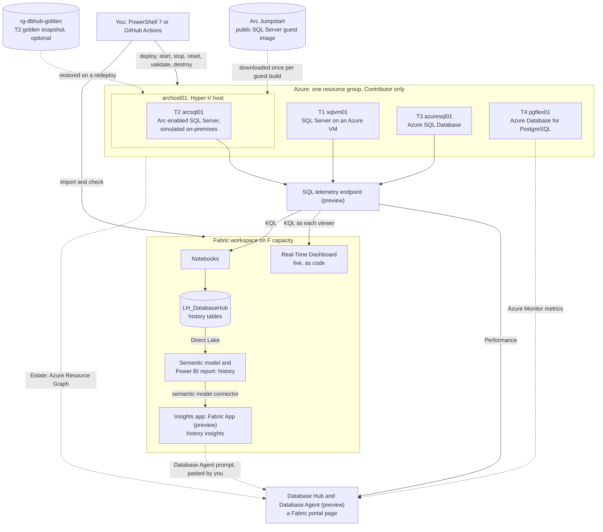
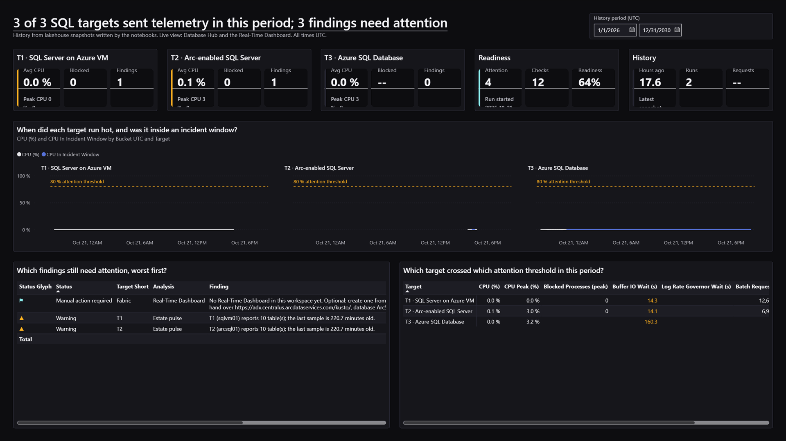
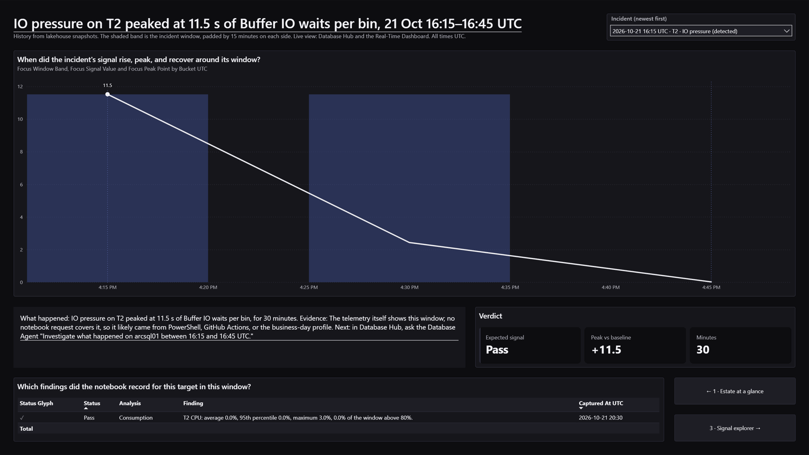
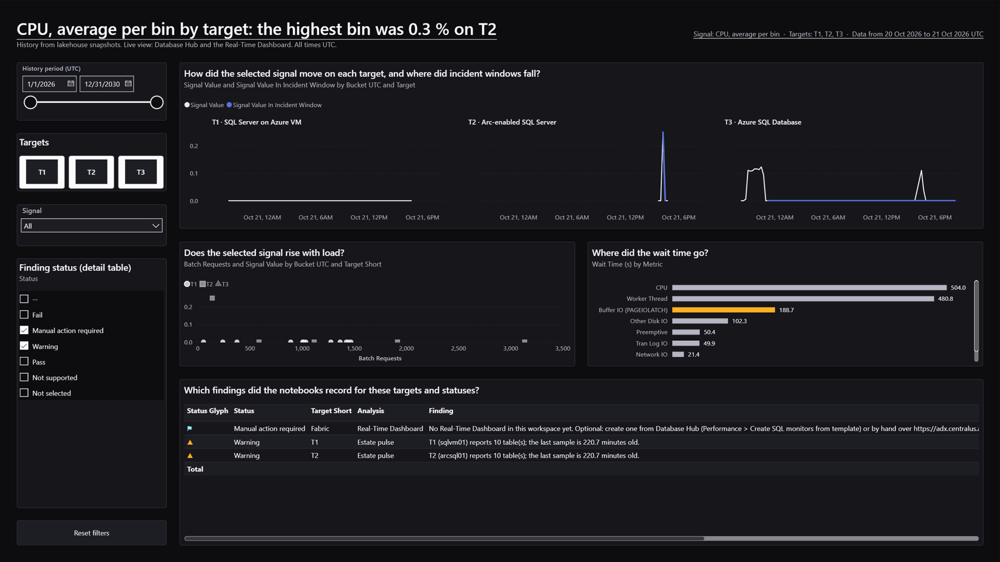
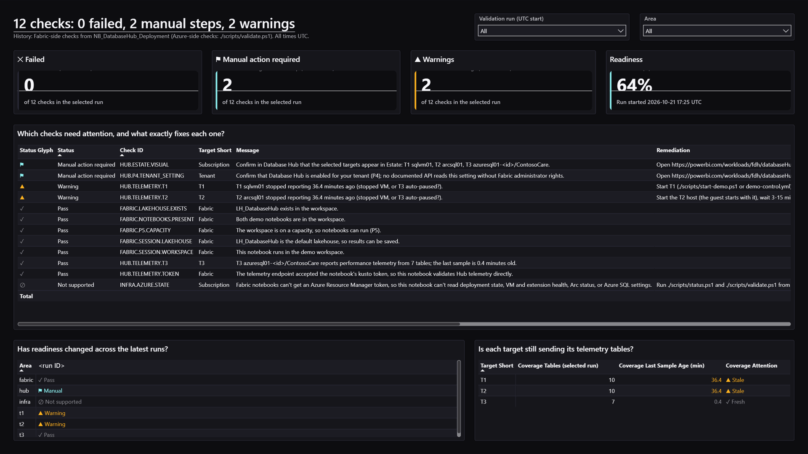

# Fabric Database Hub hybrid SQL demo

A low-cost, repeatable customer demo of **Microsoft Fabric Database Hub (preview)** and its in-Hub **Database Agent (preview)** across three SQL targets and one PostgreSQL target in one Azure resource group.

**The story:** fragmented visibility before; one hybrid estate in Database Hub after; then a live incident (locking, CPU, IO, a missing index, or an inefficient query) that the presenter investigates with the Database Agent. Every action the agent proposes needs human approval.

> **Preview disclosure:** Database Hub, the Database Agent, SQL VM performance monitoring, unified inventory, the Arc SQL monitoring setting, the telemetry endpoint, and Fabric Apps are previews and can change. This repo uses only documented interfaces and says plainly what's manual, unsupported, or not yet proven ([limitations](docs/limitations.md)).

## At a glance

`deploy.ps1` deploys everything below that has documented automation, with one command after `az login`, in parallel tracks: T1 with T3, T2, T4, and Fabric. In the default T2 mode, `JumpstartImage` (since 2026-11-05), T2 needs no person: the T2 host downloads [Arc Jumpstart](https://github.com/Azure/arc_jumpstart_docs/blob/71a945c619f78acb441c6470d76a9b58347169fe/docs/azure_jumpstart_arcbox/ITPro/_index.md)'s prebuilt SQL Server 2022 Standard guest disk and makes it `arcsql01`, and no Bastion is needed. After `az login`, a default deployment needs a person only for the Insights app's browser sign-in at the start of a run in a terminal you type in (about a minute, an estimate) and, when you aren't an Owner, for one command that an Owner runs once for the nightly safety stop's role (`./scripts/grant-safety-stop.ps1`); neither keeps the run from **DONE**. A clean first deployment took **91 minutes** to **DONE**, measured on 2026-11-06 from a fresh clone, in West US 3 with the default `lowest-cost` profile ([quick start](#quick-start)). The opt-in `PaygWizard` mode stops once instead, for about 10 minutes of a person's time, and finishes T2 in the same run (Phase 28). The redeploys measured below predate `JumpstartImage`; they restored T2 from a golden snapshot. With Phase 22's overlaps, a redeploy with the T2 golden snapshot took **63.7 minutes** end to end on 2026-10-23: T1 and T3 were ready at +26.8 minutes, 9.5 minutes sooner than in Phase 20, but T2 waited about 29.5 minutes for the SQL Server extension's download in its guest. Phase 20's redeploy, before those overlaps, took **38.8 minutes** on 2026-10-22. Neither run had a manual step, and the 30-minute target isn't met yet ([quick start](#quick-start)). [Deploy it, step by step](#deploy-it-step-by-step) comes next, then [automated vs manual](#automated-vs-manual), which lists every step, automated or not.

| What | Where | What it is | Deployed by |
|---|---|---|---|
| **T1** `sqlvm01` | Azure VM | SQL Server 2022 Standard, pay-as-you-go. Shows in Database Hub through the SQL IaaS Agent extension | `deploy.ps1` |
| **T2** `arcsql01` | Nested Hyper-V guest on the Azure VM `archost01` | SQL Server 2022 Standard, pay-as-you-go, presented as a **simulated** on-premises server. Shows in Hub through SQL Server enabled by Azure Arc | `deploy.ps1`, unattended: by default (`JumpstartImage`) the guest is Arc Jumpstart's prebuilt SQL Server Standard image, which the host downloads, checks, and makes `arcsql01` ([options](#options-t2s-install-modes)). The opt-in `PaygWizard` mode has one [guided stop](#the-guided-stop-about-10-minutes) of about 10 minutes per guest build instead. A redeploy can restore the finished guest from an optional golden snapshot ([ADR 0018](docs/adr/0018-fast-redeploy-parallel-tracks-golden-snapshot.md)), with no manual step |
| **T3** `azuresql01-<id>` | Azure SQL Database | The `ContosoCare` database, General Purpose serverless, Microsoft Entra-only. Native in Hub | `deploy.ps1` |
| **T4** `pgflex01-<id>` | Azure Database for PostgreSQL flexible server | PostgreSQL 18 with the `contosocare` database, Microsoft Entra only, no public access. Shows in Hub through Azure Monitor metrics. Its size is `t4SkuName`: General Purpose `Standard_D4ds_v5` (4 vCores) by default since 2026-11-04, with autonomous tuning, which needs 4 vCores; when Azure refuses it, another zone, then `Standard_D4ads_v5`, then `Standard_D2ds_v5` with tuning off once its price fits the cost ceilings. `Standard_B1ms` is the cheapest size, with tuning off, and `t4Enabled: false` turns T4 off ([ADR 0019](docs/adr/0019-t4-postgresql-flexible-server.md)) | `deploy.ps1` |
| Workload | T1 to T4 | A workload runner with activity profiles and bounded incident scenarios that act only inside `ContosoCare` (`contosocare` on T4) | `deploy.ps1`; driven by `demo-control.ps1` |
| Nightly safety stop | Azure Automation in the demo resource group | Every evening at the VMs' auto-shutdown time, it deallocates both VMs and stops T4 if they run, then reads, through Azure Resource Manager only, whether T3 paused, and stops T4 again if it runs. It never starts anything or connects to a database ([what stops or pauses on its own](#what-stops-or-pauses-on-its-own)) | `deploy.ps1`, on every run; it assigns the safety stop's role when you're an Owner, and otherwise an Owner runs one command once (P16) |
| Fabric notebooks | Fabric workspace | `NB_DatabaseHub_Deployment` (validator) and `NB_DatabaseHub_LiveActivity` (live analysis), which save the demo's history to the lakehouse `LH_DatabaseHub` | `deploy.ps1`'s Fabric track (`configure-fabric.ps1`) |
| Real-Time Dashboard | Fabric workspace | `RTD_DatabaseHub_LiveView`: the live view, defined as code, over the telemetry endpoint | `deploy.ps1`'s Fabric track (`configure-fabric.ps1`) |
| Power BI history report | Fabric workspace | `RPT_DatabaseHub_History`: four pages over its Direct Lake semantic model, `SM_DatabaseHub_History` | `deploy.ps1`'s Fabric track (`configure-powerbi.ps1`) |
| [Fabric App](fabric/app/README.md) (preview) | Fabric workspace | The Insights app, `APP_DatabaseHub_Insights`: a read-only app over the same model, built with the Rayfin SDK and CLI, with custom visuals, DAX and CSV export on every visual, and ready-made prompts for Database Hub's Database Agent. Part of every deployment; when it can't be created, the run goes on and still ends **DONE**, and the status page shows its step as **Failed**, with the actual error and the fix | `deploy.ps1`'s Fabric track (`configure-fabric-app.ps1`), after two tenant settings and a one-time browser sign-in, which `deploy.ps1` starts at the beginning of the run |
| Database Hub | Fabric portal | Nothing to deploy: a portal page that finds the targets through Azure Resource Graph and charts their telemetry | — |

Also included: start, stop, reset, status, cost estimate, and destroy, from PowerShell or GitHub Actions; a [Database Agent prompt pack](fabric/agent/README.md); and validation in six statuses: **Pass**, **Fail**, **Warning**, **Manual action required**, **Not supported**, and **Not selected**. A successful deployment alone is never **Pass**.



**Status (2026-10-27):** all three targets sent performance telemetry live on 2026-10-20 and 2026-10-21. The notebooks, the Real-Time Dashboard (14 of 14 tiles with data), and the history model and report (98 of 103 measures with data before any scenario ran, and all 103 after Phase 20's scenarios) were deployed and checked live on 2026-10-21 and 2026-10-22. Since Phase 16's follow-up fixes, a fresh build onboards T2 reliably (the T2 host's DNS forwarder now waits for its gateway address), and the subscription guard recovers by itself from a Continuous Access Evaluation token challenge. Destroy is verified live in a disposable test environment (Phase 16, 2026-10-22): a subscription snapshot compared with the one before deploy shows nothing of the demo left behind. Phase 20 then destroyed the demo environment and redeployed it in 38.8 minutes, with T2 restored from its golden snapshot as Standard pay-as-you-go with monitoring on (2026-10-22); it also ran every scenario and the reset live, a second `deploy.ps1` converged with no duplicate Arc resources, and a repeat session's start took about 8 minutes. The Fabric App is live too (Phase 19b, 2026-10-22): with its Database Agent prompts, it redeployed in place in 47 s, all 14 of its queries return rows, including 9 incident windows from Phase 20's run, and it loads and connects when opened from its workspace item. Phase 22 (2026-10-23) built the redeploy's overlaps: the tracks' guards run while the template deploys, T2's restore starts as soon as its host exists and sends T2's artifacts meanwhile, T1's bundle and runner go in one wave with T1's monitoring merged alongside its bootstrap, and T3 is set up first. Its measured redeploy took 63.7 minutes with no check **Fail** and T1 and T3 ready 9.5 minutes sooner, while T2 stayed the critical path ([quick start](#quick-start)); a second `deploy.ps1` converged in 19.2 minutes with nothing to change. Phase 22 also fixed the golden snapshot's Release and proved the fix live: the restored copy's Arc identity is reset while its guest is still air-gapped, before any reconnect. The Fabric capacity was an F4 for that run (an F16 in Phase 20), so the Fabric track's times aren't comparable. T4 (Phase 24) was proven live on 2026-10-26 on the General Purpose `Standard_D2ds_v5`, after West US 3 refused `Standard_B1ms` and `Standard_B2s` for this subscription (`SkuNotAvailable`). The deploy that created T4 took 40.3 minutes, a convergence 20.1 minutes with no changes, and a stop, a start, and a stop 6.7, 7.9, and 6.2 minutes ([ADR 0019](docs/adr/0019-t4-postgresql-flexible-server.md), [report](docs/implementation-report.md#phase-24-t4-an-azure-database-for-postgresql-flexible-server)). `deploy.ps1` also keeps a VM disk type that the subscription's automation switched while the VMs were deallocated, with a **Warning** ([deployment](docs/deployment.md#disks-the-subscriptions-automation-switched-phase-24)). Phase 25d proved the eight newer scenarios and the on-demand activity control live on 2026-10-27. Each scenario ran for 8 minutes on T1, T2, and T3 at once, and the telemetry showed the waits it's designed for, from lock chains and deadlocks to tempdb latches, memory-grant queues, parallelism, log flushes, network waits, and CPU at 97 to 100 %. The live-activity notebook found CPU windows on T1 and T2 for the first time. A request from the control notebook reached its runbook about 3 minutes after it was sent, and started the targets and their scenarios; a second request was refused while the first was active, and **Stop now** and the run's own auto-stop each stopped everything ([report](docs/implementation-report.md#phase-25d-phases-25b-and-25c-live)). Still open: a browser check of the app's Database Agent prompts (**Manual action required**), and `validate.ps1`'s output scan, which reads the Fabric App's third-party packages under `out/` and reports a **Fail** for patterns in them ([troubleshooting](docs/troubleshooting.md#the-insights-app-fabric-app)). Since 2026-11-05 the default T2 mode is `JumpstartImage` ([options](#options-t2s-install-modes)). Its first clean deployment, from a fresh clone on 2026-11-06, ended **DONE** in 91 minutes, with the other two changes of 2026-11-05, the Insights app in every deployment and the nightly safety stop, in the same run: T2's guest came from Arc Jumpstart's image, its first boot's cleanup deleted `C:\Jumpstart`, and the image check passed. Still to see live: the nightly safety stop's first evening, a resumed image download, and a browser sign-in at the start ([still to verify](docs/implementation-report.md#still-to-verify)). Evidence and the acceptance checklist are in the [final report](docs/implementation-report.md#final-report).

## Deploy it, step by step

**Where it goes:** into **your own Azure subscription** and **your own Fabric capacity**, in the same Microsoft Entra tenant. The demo is tested that way.

- **Azure:** the resource group `rg-dbhub-demo`, in West US 3 by default (`location` in your configuration; preflight checks that Database Hub supports the region). It holds T1 to T4, their network (no VM has a public IP), the workload runner, and the [nightly safety stop](#what-stops-or-pauses-on-its-own). Two more groups appear only if you use what they hold: `rg-dbhub-golden` keeps the optional T2 golden snapshot, and `rg-dbhub-control` holds the optional [on-demand activity control](#on-demand-activity-control-optional).
- **Fabric:** the workspace **Database Hub Demo**, with the lakehouse `LH_DatabaseHub`, on an F or Trial capacity. The scripts find both by name and create them when they're missing, so you never look up an ID.
- **Where you run the scripts:** your computer, the repository's [dev container](.devcontainer/devcontainer.json), or GitHub Codespaces. GitHub Actions is optional ([quick start](#quick-start)).

**Before you start** (once; people do these):

| You need | Who provides it |
|---|---|
| **Contributor** on the Azure subscription | The subscription's Owner |
| *Recommended, once per environment:* an **Owner** (or User Access Administrator) for the nightly safety stop's role. When you're one, `deploy.ps1` assigns it itself. Otherwise the run still ends **DONE** and prints one command for an Owner, `./scripts/grant-safety-stop.ps1`; until it's run, nothing stops T4 when Azure starts it again 7 days after a stop, while the VMs' nightly auto-shutdown and T3's auto-pause still apply | You, or the subscription's Owner |
| An **F or Trial Fabric capacity** you can assign, **running** while you deploy | You, or the capacity's administrator |
| The Fabric tenant setting **Users can access the Database hub (preview)**, and **Create workspaces** unless you already have a workspace | Your Fabric administrator |
| For the Insights app: the Fabric tenant settings **Fabric Apps (preview)** and **Dataset Execute Queries REST API**. Without them, the app isn't created, but the run still ends **DONE**, and the status page says why | Your Fabric administrator |
| Quota for about **8 vCPUs** of VM sizes with nested virtualization in the region | The subscription; preflight checks it |
| Outbound HTTPS from the VMs, as for their other downloads. In the default T2 mode, the T2 host also downloads its guest's disk from Arc Jumpstart's public storage (`jumpstartprodsg.blob.core.windows.net`) and Jumpstart's pinned script from GitHub (`raw.githubusercontent.com`) | The demo's network allows it; where your tenant's firewall or proxy restricts outbound traffic, its network administrator |
| PowerShell 7.4, the Azure CLI with Bicep, the .NET SDK, Node.js 24, and Git, or a codespace that has them | You |

**Steps** (91 minutes the first time, measured on 2026-11-06, most of it T2: its host build, about 27 minutes, then its Arc onboarding, about 33; after `az login`, you're needed only for the Insights app's browser sign-in at the start, about a minute, an estimate, and, when you aren't an Owner, an Owner runs one command once for the nightly safety stop's role):

1. **Get the code:** select **Use this template** on GitHub for your own copy, clone it with `git clone https://github.com/MarcBushong/fabric-database-hub-demo.git`, or open it in [GitHub Codespaces](https://codespaces.new/MarcBushong/fabric-database-hub-demo?quickstart=1).
2. **Sign in to Azure:** `az login` (in a codespace or a container, `az login --use-device-code`). The scripts never sign in for you, and never change your default subscription.
3. **Deploy, with one command:** `./scripts/deploy.ps1`. On the first run it writes your configuration from your sign-in, as `./scripts/init.ps1 -CreateAdminGroup` does: it picks your subscription and Fabric capacity, asking when there's more than one, creates the Microsoft Entra group `dbhub-demo-sql-admins`, which administers T3 and T4, with you as its owner, and asks for T2's mode (`JumpstartImage`, the default, needs no person; [options](#options-t2s-install-modes)). Then it checks everything (preflight), deploys T1, T3, T4, and the Fabric items in parallel while T2 builds, and waits for T2. In the default mode, the T2 host downloads Arc Jumpstart's SQL Server Standard guest disk (34 GiB), checks it, and makes it `arcsql01` while the guest has no network (T2's host build took about 27 minutes when measured on 2026-11-06); then it onboards the guest to Azure Arc with the SQL Server extension, pay-as-you-go, and monitoring, about 33 minutes more. In the opt-in `PaygWizard` mode, the run instead stops once for you, about 60 to 90 minutes in, for about 10 minutes through Bastion ([the guided stop](#the-guided-stop-about-10-minutes)). At the start, when the Rayfin CLI isn't signed in yet, a browser opens once for the Insights app's sign-in (on Windows, the CLI runs in a window of its own); the run doesn't wait for it, and only the app's step does, at most 15 minutes from the start. It starts only in a terminal you type in, not in CI or under an assistant ([Running it with an AI assistant](#running-it-with-an-ai-assistant)). Every run also sets up the [nightly safety stop](#what-stops-or-pauses-on-its-own), and ends by running the live-activity notebook once, analyze-only, so the [history report](docs/deployment.md#the-history-reports-snapshot-at-the-end-2026-11-06) has data. It keeps your PC awake, opens a [live status page](#while-it-runs), and prints what to expect.
4. **The ending:** the run ends with one banner. **DONE** means Database Hub shows every target, with where to look and which activity runs, and lists once, under **Please confirm**, what only you can confirm, such as a tenant setting the run couldn't read; none of it keeps the run from **DONE**. A clean first deployment also shows a few **Warnings** that need nothing, such as T4's `max_connections` waiting for a restart and the history report's blank measures, checked before the run's snapshot at the end fills the report ([the full list](docs/deployment.md#what-a-clean-first-deployment-shows-2026-11-06)). When the Insights app couldn't be created, **DONE** also says so, with its actual error and fix (step 7). When you can't assign roles, **DONE** also gives the one command an Owner runs for the nightly safety stop's role. **NOT DONE** says why (only what keeps it from **DONE**), the single next action, and the exact command, with the `-ConfigPath` you ran with: usually `./scripts/deploy.ps1` again, which continues where it stopped. When a fix you pulled meanwhile changed what runs on the VMs (their bootstrap or the workload runner), that run sends it to them again first, and the VM stops its earlier bootstrap run, if it's still going, and starts the new one. When the run started or created VMs and isn't **DONE**, one line says which now run and bill, and how they stop: `./scripts/stop-demo.ps1` now, or the nightly auto-shutdown. If the window closes or the PC restarts, run `./scripts/deploy.ps1` again; you never need a flag to continue. It starts VMs that were stopped, for example by the nightly auto-shutdown or `./scripts/stop-demo.ps1`, while preflight runs, and T4 too when it's stopped. It checks T1's monitoring plugin on every run, which can stop after a restart, and restarts it when it has.
5. **See it:** open **Database Hub** in the Fabric portal ([Database Hub](https://learn.microsoft.com/fabric/database/hub/overview)) and look at Estate and Performance ([Monitor a Microsoft SQL database](https://learn.microsoft.com/fabric/database/hub/monitor-sql)). Performance's problem panels, such as **High CPU resources over time**, **CPU spikes over time**, and **Databases limited by service tier** (as the preview names them, 2026-11-03), list only resources that have that problem, so they're expected to fill from the default `business-day` profile's bounded incidents at fixed minutes every hour, each a few minutes after it starts ([the hourly incidents](docs/demo-walkthrough.md#the-hourly-incidents-business-day)). For one right now, run `./scripts/demo-control.ps1 -Target T2 -Scenario incident:cpu-pressure -Duration 25`. Then investigate it with the Database Agent, approving or cancelling each action it proposes.
6. **Keep the finished build** (optional): `./scripts/capture-t2-golden.ps1`, then `./scripts/test-t2-golden.ps1 -Onboard`, so the next redeploy restores T2 in about 30 to 45 minutes (an estimate) instead of making it again. In the default `JumpstartImage` mode that's only a speed-up: it skips T2's host build (the image's download, its first boot, and the image check), which took about 27 minutes when measured on 2026-11-06, and the snapshot bills every month it exists ([cost](#cost)). In `PaygWizard` mode it also saves the next guided stop.
7. **The Insights app:** part of every deployment. `deploy.ps1`'s Fabric track creates it, after the browser sign-in it started at the beginning of the run. Open the app from its item in the workspace. When it can't be created, for example because a tenant setting is off or nobody finished the sign-in, the deployment goes on and still ends **DONE**: the status page shows the app's step as **Failed**, in red, with the actual error and the fix, and the **DONE** banner and the console say the same, as `Failed (doesn't block DONE): the Insights app. ...`. Once that's fixed, `./scripts/configure-fabric-app.ps1 -SignIn` adds the app, with one browser sign-in that only you can do; after a run that ended **DONE**, the next `./scripts/deploy.ps1` starts over and tries again too.
8. **Between sessions:** `./scripts/stop-demo.ps1`, which also stops T4 and says the date Azure starts it again on its own, seven days later, and `./scripts/start-demo.ps1` next time, which takes about 8 minutes. If you forget, every evening at `autoShutdownTime` (19:00 Pacific by default) the VMs shut down and the nightly safety stop deallocates any that still run and stops T4 ([what stops or pauses on its own](#what-stops-or-pauses-on-its-own)).
9. **Remove it:** `./scripts/destroy.ps1`.

### The guided stop (about 10 minutes)

**Only in the opt-in `PaygWizard` mode.** The default `JumpstartImage` mode has no guided stop and needs no Bastion to deploy ([options](#options-t2s-install-modes)). `PaygWizard` builds the guest from installation media, and installing pay-as-you-go SQL Server without a product key is documented only in setup's wizard, so a person makes that choice once per guest build ([ADR 0006](docs/adr/0006-sql-editions-and-licensing.md)). Everything around it is automated:

- **When:** about 60 to 90 minutes after the start (an estimate; it can be later, and the run waits). The start banner and the status page say so, and the run prints its progress with an estimate of when it comes. Keep the window open.
- **What you see:** a large **WAITING FOR YOU** banner, a beep, and the console window flashing; the browser opens `archost01`'s page in the Azure portal; the status page turns **Waiting for you**, with the steps, the link, and a countdown; a short reminder every 5 minutes; and one plain line for an assistant to relay, `HUMAN ACTION REQUIRED: DEPLOY.T2.GUIDEDSTOP ...`.
- **What you do:**
  1. In the portal, select **Connect**, then **Bastion**, and sign in to `archost01` as its administrator. The password: a one-time password is already on your clipboard (never shown or saved), or in the demo's key vault with the [Key Vault opt-in](docs/deployment.md#opt-in-the-password-in-key-vault-instead-of-the-clipboard). **Without a working clipboard** (GitHub Codespaces, Cloud Shell, an SSH session, or Linux without a desktop and `xclip`), nothing is set or shown: first open `archost01` in the portal, then **Help**, then **Reset password**, keep the user name, and type a password of your own choosing ([reset a password](https://learn.microsoft.com/troubleshoot/azure/virtual-machines/windows/reset-rdp)). Either way, it's rotated afterward.
  2. Virtual Machine Connection to the guest `arcsql01` opens by itself. The guest has signed itself in, once, for this step, and SQL Server setup is open and pre-filled.
  3. On the **Edition** page, choose **Use pay-as-you-go billing through Microsoft Azure**, then **Standard**; accept the license terms.
  4. On the **Azure Extension for SQL Server** page, select **Use Azure Login** and sign in with your own Azure account. The sign-in window is an Internet Explorer-based control, so before setup opens, the host turns IE Enhanced Security Configuration off for administrators in the guest and adds Microsoft's sign-in sites to Trusted sites, and it undoes both afterward. **If the Azure Login window stays blank, or Internet Explorer says content from `https://login.microsoftonline.com` is blocked,** follow the dialog's directions: select **Add...**, then **Add**, to put the Microsoft sign-in page in Trusted sites, and **Close**. Then select **Use Azure Login** again. Repeat for any other sign-in site it names. The dialog can open behind setup's window, so check with Alt+Tab. **If the window stays blank and no dialog comes at all,** IE Enhanced Security Configuration was still on when setup started, and turning it off while setup is open doesn't reach setup (confirmed live on 2026-10-30). Cancel setup. In the guest, open **Server Manager** > **Local Server** > **IE Enhanced Security Configuration** and set **Administrators** to **Off**. Then start setup again: `C:\DbHubDemo\setup\Start-GuidedSetup.ps1` opens it pre-filled, and the host also reopens it within about 5 minutes; on a guest that has neither, run `setup.exe` from the SQL Server media drive. Redo steps 3 and 4. The cleanup after setup turns the setting back on. Never type into the service principal fields: "Requires all input values for AZURESERVICEPRINCIPAL" only means you haven't signed in yet. ([Troubleshooting](docs/troubleshooting.md#t2-the-setup-wizard-step) has more.)
  5. Select **Next** on the pre-filled pages, then **Install**. When setup is complete, select **Close**, and close the Bastion tab.
- **Then, by itself:** the host checks what you installed (Standard, the default instance, the Azure extension). If something's wrong, such as Evaluation or a named instance, it shows the documented fix and keeps waiting. Otherwise it signs the guest out, turns its automatic sign-in off, turns IE Enhanced Security Configuration back on and takes the sign-in sites out of Trusted sites, and removes the sign-in data that setup leaves; Arc gets pay-as-you-go and monitoring; Bastion is removed; and the host password is rotated.
- **How long the run waits:** at least 45 minutes after it asks, until a time it prints. After that, it ends **NOT DONE**; run `./scripts/deploy.ps1` again when you have about 15 minutes, and it guides you again.

### While it runs

- **The status page,** `out/deploy-status.html`, opens at the start and updates itself every 10 to 15 seconds, offline. Its banner says **Deploying, no action needed** (you can step away), **Waiting for you**, **Done**, or **Stopped, not done**, with every step of every track below it: its status, its time, and a one-line message. An Azure-side wait, such as an extension that a policy in your tenant installs, says "no action needed". The steps that never block **DONE**, the Insights app's and, last, the history report's snapshot, say "(doesn't block DONE)". When one of them didn't work, it shows **Failed** in red, or **Action needed** (such as a paused capacity), with its actual error and fix, and the same text is in a red **Needs attention** box right under the banner, also once the run is **Done**. `./scripts/status.ps1 -Watch` shows the same in a second terminal, anywhere.
- **Keep the machine on:** `deploy.ps1` keeps a Windows PC and its display awake until it ends; plug a laptop in and leave it open. On macOS and Linux, keep it awake yourself.
- **If something goes wrong:** run `./scripts/deploy.ps1` again. When **NOT DONE** repeats, `./scripts/collect-diagnostics.ps1` writes a redacted zip for a **Deployment problem** issue ([getting help](#getting-help)).
- **To stop it:** Ctrl+C stops the run within seconds, its background processes too; the PC may sleep again, and the console and the status page say **NOT DONE**, **Stopped, not done**, with the command that continues where it stopped, and that also brings the VMs a fix you pull before you run it. Stopped at the guided stop, Bastion stays up and the host password stays valid until the next run cleans them up when it gets to T2, even when setup finished meanwhile (it isn't **DONE** before), or until `./scripts/stop-demo.ps1` does, which is what to run if you're done for the day ([details](docs/deployment.md#one-command-one-guided-stop-phase-28)).

### Options: T2's install modes

`t2SqlInstallMode` in your configuration (`init.ps1` and the first run ask):

| Mode | What you do | What T2 gives in Database Hub |
|---|---|---|
| `JumpstartImage` (default since 2026-11-05) | Nothing: T2 is fully unattended, with no product key, no Bastion, and no sign-in beyond your `az login`. The T2 host downloads [Arc Jumpstart](https://github.com/Azure/arc_jumpstart_docs/blob/71a945c619f78acb441c6470d76a9b58347169fe/docs/azure_jumpstart_arcbox/ITPro/_index.md) ArcBox's prebuilt SQL Server 2022 Standard guest disk from Jumpstart's public storage (34 GiB, checked against its own MD5 and size), then, while the guest has no network, replaces its published password with a random one and makes it `arcsql01`: SQL Server renamed, `sa` disabled, the sample database, Integration Services, and Jumpstart's files removed. It checks the result (Standard, SQL Server 2022, the default instance) and onboards it with license type PAYG. Needs `t2Mode` `Nested`, the default ([deployment](docs/deployment.md#t2-from-arc-jumpstarts-image-jumpstartimage)) | Estate, Performance, and the Database Agent's findings, billed pay-as-you-go through Azure |
| `PaygWizard` | The guided stop, about 10 minutes per guest build | The same as `JumpstartImage` |
| `ProductKey` | Nothing during the run: fully unattended, with your own SQL Server Standard product key (P10), license type PAYG or Paid per your entitlement. Put the key in the session before you deploy, never in a file: `$env:DBHUB_SQL_PRODUCT_KEY = Read-Host -MaskInput 'Product key'`; `deploy.ps1` hands it only to the T2 track and removes it from the environment | The same as `JumpstartImage` |
| `Developer` | Nothing: fully unattended | Estate only: **no T2 performance data and no Database Agent findings**, which Developer edition doesn't get |

- **No fallback:** when the Jumpstart image can't be used, for example its download fails or the booted guest fails its checks, T2 ends **NOT DONE** with the cause and the command to retry or to choose another mode; nothing switches by itself. Jumpstart can publish a newer image at the same address: the host uses it once it passes the same checks, with a **Warning** that names it. An existing T2 guest never changes its mode: to switch, run `./scripts/destroy.ps1`, then `./scripts/deploy.ps1` ([troubleshooting](docs/troubleshooting.md#t2-arc-jumpstarts-image-jumpstartimage)).
- **Jumpstart's terms:** Arc Jumpstart's environments are "intended for evaluation, training, and demo purposes only and are not supported for production use cases" ([Jumpstart FAQ](https://github.com/Azure/arc_jumpstart_docs/blob/71a945c619f78acb441c6470d76a9b58347169fe/docs/FAQ/_index.md)), which is this demo's use ([limitations](docs/limitations.md)).
- **The build modes** (`PaygWizard`, `ProductKey`, `Developer`) build the guest from the Windows Server evaluation, whose 180 days the host now extends by itself with `slmgr.vbs /rearm` when 30 or fewer are left ([ADR 0006](docs/adr/0006-sql-editions-and-licensing.md)). The Jumpstart guest isn't an evaluation.

A golden snapshot (step 6) makes every later redeploy unattended in any mode; in `JumpstartImage` mode it's only a speed-up.

### In GitHub Codespaces

The repository's dev container has every tool, in a codespace or on your machine. A codespace stops after 30 minutes without activity by default; terminal output counts as activity, and `deploy.ps1` prints progress at least every 5 minutes, but raise the timeout before a first run to be safe: **Settings** > **Codespaces** > **Default idle timeout**, up to 240 minutes, for codespaces you create afterward, or `gh codespace create --idle-timeout 240m` ([GitHub Docs](https://docs.github.com/codespaces/setting-your-user-preferences/setting-your-timeout-period-for-github-codespaces)). In the opt-in `PaygWizard` mode, a codespace has no clipboard for the script, so the guided stop uses the portal's **Reset password** (above). A codespace can't open a browser: preview the status page through a forwarded port, as `deploy.ps1` prints, or use `./scripts/status.ps1 -Watch`. The Insights app's sign-in runs in the codespace's terminal, where its browser sign-in may not complete; the run still ends **DONE**, and `./scripts/configure-fabric-app.ps1 -SignIn` adds the app later from a machine with a browser.

**Cost:** the default ceilings are $15 a session and $375 a month (`sessionCeilingUsd`, `monthlyCeilingUsd`; $250 before 2026-11-04). Preflight prices the deployment for your region at run time and warns when an estimate passes either ceiling ([cost](#cost)). **Stuck?** See [troubleshooting](docs/troubleshooting.md), or open an issue with the **Deployment problem** template ([getting help](#getting-help)).

## Running it with an AI assistant

An assistant such as GitHub Copilot can drive the whole deployment for you: in the default T2 mode, `JumpstartImage`, T2 needs no person. Your sign-ins stay yours, and no assistant should do them for you: `az login`, the Insights app's browser sign-in, and, only in the opt-in `PaygWizard` mode, the guided stop's, once, for about 10 minutes.

- **What the assistant can do:** run `./scripts/deploy.ps1`, `./scripts/status.ps1 -Watch`, and `./scripts/collect-diagnostics.ps1`; read the results and the status page; and run `./scripts/deploy.ps1` again after an interruption, since it continues where it stopped with no flag, and starts VMs that were stopped, for example by the nightly auto-shutdown. `deploy.ps1` notices a session that can't take keyboard input, says so at the start, and goes on; on a first run in such a session it never asks, and a choice it can't make is **NOT DONE** with the parameter to pass (`./scripts/init.ps1` takes them). A first run that can't ask writes `JumpstartImage`, the default.
- **What you must do, and when** (only in the opt-in `PaygWizard` mode, about 60 to 90 minutes after the start, for about 10 minutes): sign in to `archost01` through Bastion; choose **pay-as-you-go** and **Standard** in the pre-filled setup; and sign in to Azure on setup's **Azure Extension for SQL Server** page ([the guided stop](#the-guided-stop-about-10-minutes)). If the **Use Azure Login** window stays blank, or Internet Explorer says content from `https://login.microsoftonline.com` is blocked, follow the dialog's directions: **Add...**, then **Add**, to put the Microsoft sign-in page in Trusted sites, and **Close**; then select **Use Azure Login** again, and repeat for any other sign-in site it names. If it stays blank and no dialog comes, cancel setup, set **IE Enhanced Security Configuration** for **Administrators** to **Off** in the guest's **Server Manager** > **Local Server**, and start setup again ([the guided stop](#the-guided-stop-about-10-minutes), step 4). Without a clipboard, you first set the host's password yourself in the portal (**Help** > **Reset password**). Plan to be at a browser then; the start banner says when, as `PLAN FOR A PERSON: DEPLOY.T2.GUIDEDSTOP ...`.
- **The handoff:** in `PaygWizard` mode, at the guided stop, the run prints one plain line for the assistant to relay to you, `HUMAN ACTION REQUIRED: DEPLOY.T2.GUIDEDSTOP - ...`, with the time limit and the status page's path, and repeats it every 5 minutes.
- **It waits, then resumes:** the run waits at least 45 minutes once it asks, and continues by itself when setup is done. If nobody came in time, it ends **NOT DONE**; `./scripts/deploy.ps1` again guides you from that step.
- **Also yours:** `az login` itself, and the Insights app's browser sign-in. `deploy.ps1` starts that sign-in only in a session that can take keyboard input, so under an assistant, run `./scripts/configure-fabric-app.ps1 -SignIn` yourself in a terminal, before the deployment (its Fabric track then uses that sign-in) or after it. Without it, the run still ends **DONE**, and the status page shows the app as **Failed**, with that command. When you aren't an Owner, **DONE** also prints `./scripts/grant-safety-stop.ps1` for an Owner to run once, for the nightly safety stop's role; an assistant can't grant it for you.
- **Fully unattended:** the default `JumpstartImage` mode, or `ProductKey` mode with your own SQL Server Standard product key, set in the session as above ([options](#options-t2s-install-modes)); both give the same Database Hub views with no person needed for T2. `Developer` mode is unattended too, but T2 then shows in Estate only.

## Automated vs manual

The scripts automate every step that has a documented interface. Each step that's left is manual for a stated reason, and the scripts report it as **Manual action required** with its exact steps, so nothing is hidden. The [automation support matrix](docs/automation-support-matrix.md#what-stays-manual-and-why) gives each reason with its Microsoft Learn source.

- **Automated:** a script does it, unattended.
- **Manual (one time):** once per tenant, subscription, or environment; in the opt-in `PaygWizard` mode, also the setup wizard, once per T2 guest build.
- **Manual (each session):** around each demo session.
- **Presenter-driven:** done live in a product's UI, by design.

"You" is the person who deploys, with Contributor on the subscription. In the **Time** column, a date means measured that day, and ≈ means an estimate.

| Step | Type | Why it's manual | Time | Who |
|---|---|---|---|---|
| **Before the first deployment** | | | | |
| Sign in to Azure: `az login` (in a codespace or a container, `az login --use-device-code`) | Manual (one time) | By design: no script signs in, signs out, or changes your default subscription, so none holds your credentials. Sign in again when the session expires | ≈ 1 min | You |
| Write `config/demo.config.json` from your sign-in: `./scripts/deploy.ps1` does it on its first run (Phase 28), or `./scripts/init.ps1 -CreateAdminGroup` on its own. It reads your subscriptions (`az account list`, the one call before the subscription guard), runs the guard, and fills in your subscription, tenant, account, budget-alert address, Fabric capacity, workspace name, and P6 group, asking only when there's a real choice: the subscription, the capacity, and T2's mode | Automated, after the sign-in | — | ≈ 1 min: 44 s for a read-only run (2026-10-27) | You |
| Contributor on the subscription (P1) | Manual (one time) | Assigning a role needs Owner or User Access Administrator; the demo needs nothing more to deploy. `init.ps1` checks it and prints the Owner's exact command | ≈ 2 min | Subscription Owner |
| The nightly safety stop's role (P16, recommended): the custom role "DbHub Demo Safety Stop" for the safety stop's identity, at the demo resource group, once per environment and again after a destroy and redeploy | Automated in `deploy.ps1` when you're an Owner or User Access Administrator (or a Role Based Access Control Administrator once the role exists); otherwise Manual (one time): `./scripts/grant-safety-stop.ps1` | Creating a role and assigning it need more than Contributor. Without it, the run still ends **DONE**, with a **Warning** (`SAFETYSTOP.ROLE`) and the command, and DONE says that nothing stops T4 after its 7-day restart until an Owner runs it; the VMs' nightly auto-shutdown and T3's auto-pause still apply ([ADR 0024](docs/adr/0024-nightly-safety-stop.md)) | ≈ 1 min (an estimate) | You, or a subscription Owner |
| Fabric tenant settings: **Users can access the Database hub (preview)** (P4); and, for the Fabric App, **Fabric Apps (preview)** (P12) and **Dataset Execute Queries REST API** (P13; newer portals say "Semantic Model"), which the report's data check also uses | Manual (one time) | No supported automation: tenant-wide administrator settings, outside the demo's permissions. The Hub setting has no documented internal name, so a run by a Fabric administrator reads it through the admin API by its title; anyone else gets a reminder to confirm it, which never keeps the run from **DONE**. Preflight reads P12 and P13 the same way (`PREFLIGHT.FABRIC.APPSETTINGS`), a **Warning** when one is off or can't be read. Without them the app isn't created, but the run still ends **DONE**, with the app's step **Failed** on the status page, and the fix | ≈ 5 min | Fabric administrator |
| A Fabric F or Trial capacity you can assign (P5) | Manual (one time) | The capacity belongs to its administrator, and the scripts never create one. On it, `deploy.ps1` finds or creates the workspace and the lakehouse `LH_DatabaseHub` by name, and imports the notebooks (ADR 0021). Creating the workspace needs the Fabric tenant setting "Create workspaces" for you | ≈ 5 min | The capacity's administrator |
| T3's administrators: a Microsoft Entra security group you own (P6) | Automated with `init.ps1 -CreateAdminGroup`; Manual (one time) where the tenant restricts it | `init.ps1` finds the group by name or creates it with you as its owner. Where only administrators may create groups, it prints the exact steps for one. With the group, `deploy.ps1` adds T1's identity to it, and T1 creates T3's schema, seed data, and users | Seconds, or ≈ 5 min for an administrator | You, or an Entra administrator |
| T3's T-SQL setup, run interactively | Manual (one time), fallback only | Only when T1 can't join the group (you don't own it, or the GitHub identity runs the deployment): a group owner runs the printed command, or a group member runs T3's T-SQL once ([ADR 0008](docs/adr/0008-identity-rbac-abac.md#phase-8-addendum-t1-and-the-p6-group-as-built-2026-10-20)) | ≈ 10 min | A group owner or member |
| T2's pay-as-you-go SQL Server setup, only in the opt-in `PaygWizard` mode (the first run asks; the default `JumpstartImage` mode has no manual step for T2): the [guided stop](#the-guided-stop-about-10-minutes) in `deploy.ps1`'s run, where you sign in to the host through Bastion, choose pay-as-you-go and Standard in the pre-filled setup, and sign in to Azure on its Azure page | Manual (once per guest build), guided | No supported automation: installing pay-as-you-go SQL Server without a product key is documented only in the setup wizard, whose **Use Azure Login** page needs your interactive sign-in. Since Phase 28 everything around it is automated: Bastion, the password hand-over, the guest's one automatic sign-in, setup pre-filled from a configuration file, the check of what you installed, and everything after it. The default `JumpstartImage` mode avoids it (since 2026-11-05: Arc Jumpstart's image already has SQL Server Standard, and Arc sets pay-as-you-go), and so do a product key (P10), `Developer` mode (Estate only), and a redeploy from the T2 golden snapshot (`capture-t2-golden.ps1`), which keeps the finished guest (no manual step, 2026-10-22) | About 10 min of your time plus 10–15 min while setup installs, about 60 to 90 min after the start (Phase 28, an estimate). By hand: about 1 hour, after about 8 min for Bastion (2026-10-21) | You, with your Azure account |
| Rayfin CLI sign-in for the Fabric App (P14): not needed while Fabric accepts your Azure CLI token (2026-11-09); otherwise `./scripts/configure-fabric-app.ps1 -SignIn` | Automated with your `az login`; a guided one-time sign-in only as the fallback | Each Rayfin command gets a token from your Azure CLI for its own audience, in its own process only, so no Rayfin sign-in and no browser are needed. When Fabric refuses that token (`FABRIC.APP.TOKEN`, a **Warning**), the CLI's own cached sign-in deploys the app instead; without one, `-SignIn` runs the stage's `rayfin login --tenant <tenantId>` in your console, which opens a browser, then deploys, and the next `deploy.ps1` starts the same sign-in at its beginning, alongside everything else. An assistant can't do that sign-in for you, and a session that can't take keyboard input doesn't start it. The CLI's service principal sign-in is listed but not supported yet. Whether the Fabric Apps (preview) service accepts the Azure CLI's token is still to be checked live. Without either, the run still ends **DONE**, with the app's step **Failed** and the fix | None; ≈ 1 min for the fallback | The operator, as the demo's Fabric user |
| GitHub Actions (P7, optional): `gh auth login`, then `./scripts/setup-github-oidc.ps1 -ConfigureGitHub` creates the GitHub identity, then the environment `demo`, with you as its required reviewer and the default branch only, and its four environment secrets; `-ScheduleEnvironment` (optional) adds an environment without reviewers for the scheduled workflows. The identity still needs Contributor on the subscription | Automated with `-ConfigureGitHub`, after the GitHub CLI sign-in; the role assignment is Manual (one time) | Assigning a role needs more than Contributor, so the script prints the one command for an Owner, User Access Administrator, or Role Based Access Control Administrator (with `assignRoles` and those rights, it assigns it itself). Without `-ConfigureGitHub`, it writes nothing to GitHub and prints the `gh secret set` commands. The identifiers are secrets so that GitHub masks them in a public repository's logs; on a private repository, environment secrets and reviewers need a paid GitHub plan ([deployment](docs/deployment.md#private-repositories)) | ≈ 10 min | You, as an administrator of the repository; then an Owner or User Access Administrator for the role |
| Presenter access (P8, optional): Reader, plus the Arc telemetry role | Manual (one time) | Role assignments need more than Contributor. With `assignRoles`, the scripts make them when you can | ≈ 2 min per person | An Owner or User Access Administrator |
| Viewer licenses (P11, optional) | Manual (one time) | Licenses are assigned outside Azure | Varies | Each viewer's license administrator |
| The on-demand activity control (P15, optional): `setup-activity-control.ps1`, then `setup-activity-control.ps1 -GrantRole` | Manual (one time) | Setup needs only Contributor, but the control's one custom role and its three assignments need an Owner, signed in with multifactor authentication ([ADR 0020](docs/adr/0020-on-demand-activity-control.md)) | 521 s for setup on the private path, and 79 s for `-GrantRole` (2026-10-27) | You, then an Owner |
| Share the report with viewers outside the workspace (optional) | Manual (one time) | By choice: sharing grants permissions to people | ≈ 5 min | A workspace administrator |
| **Each session** | | | | |
| Resume the Fabric capacity before, and pause it after | Manual (each session); Automated with `fabric.manageCapacity` for a capacity that's yours alone | By default, no script resumes, pauses, or scales a capacity: it's outside the demo's resource group, often shared, and bills while it runs; Database Hub doesn't need it. With `fabric.manageCapacity` true (opt-in, an F capacity in the same subscription), `start-demo.ps1` resumes it when it's paused and records that in the resource group's tag `DbHubFabricCapacityResumed`, and `stop-demo.ps1` and `destroy.ps1` pause only what that tag records. Keep it false for a shared capacity | ≈ 1 min | Its administrator, or `start-demo.ps1` and `stop-demo.ps1` |
| Run `NB_DatabaseHub_LiveActivity` to save the session's history for the report and the app | Automated with `stop-demo.ps1 -SaveHistory` (or `fabric.saveHistoryOnStop`); otherwise Manual (each session) | `-SaveHistory` runs the notebook on demand after the VMs stop, at most 15 minutes, before anything pauses the capacity; it writes only the lakehouse tables. By hand, set `CONFIRM = False` first: since 2026-11-03 it's `True` by default (no dry-run defaults), so **Run all** also sends the notebook's activity request (`business-day` through `demo-control.yml`, which needs P9) | About 2 min (2026-10-21, by hand) | You, or `stop-demo.ps1` |
| Check the Fabric App in a browser after a deploy: open it from its workspace item and see **"Connector check passed"** on its **Live links** page | Automated by API when the app's queries run (since 2026-11-09); otherwise Manual, after each deploy | When every query the app runs works through its connector (`FABRIC.APP.QUERIES`), `FABRIC.APP.BROWSER` is only a note (**Not selected**, "Not needed"). Otherwise it stays **Manual action required**: only a person can check the app in the portal, and the repo never automates it. Not checked by any script: the app's own sign-in in the browser. The browser check of the Database Agent prompts is still open (2026-10-22) | None, or ≈ 2 min | You |
| Open the Fabric App from its workspace item | Manual (each session) | A documented preview limitation: the app's static assets are `protected`, so opening the hosted URL directly fails the sign-in hand-off ("Page not accessible directly"), and an anonymous request gets HTTP 401. From the workspace item, it loads and connects (2026-10-22) | Seconds | The presenter or a viewer |
| Database Hub (Estate and Performance), the Database Agent, and Copilot | Presenter-driven | No supported automation: no API, ARM, or Bicep resource, and Learn documents them only as portal experiences. Every action the agent proposes needs your approval | During the session | The presenter |
| Ask the Database Agent from the Fabric App: **Ask the agent** on an incident window or on the replay (four prompts per window, built from its resource, UTC times, peak, baseline, and ratio), or the prompt library on Estate and Readiness; then **Copy**, or **Copy and open Database Hub**, and paste the prompt into the agent | Presenter-driven | No supported automation: the agent is UI-only, with no API, so the app copies and links, and never sends or runs anything. Every panel says **Preview**, that you approve each action, and that it's investigation only; read a proposal aloud, then cancel it. A switch rewrites the prompts for GitHub Copilot CLI or VS Code | ≈ 1 min | The presenter |
| Hub's **Create SQL monitors from template** wizard (optional) | Presenter-driven | UI-only, with no API. The Real-Time Dashboard is its governed counterpart, as code | ≈ 3 min | The presenter |
| The missing-index fix | Presenter-driven | By design: a person reviews and runs `remediation.sql`, and `reset --undo-remediation` reverts it | ≈ 1 min | The presenter |
| **What the scripts do** | | | | |
| First run (`init.ps1`, or `deploy.ps1` when there's no configuration yet): your configuration from your sign-in, the P6 group with `-CreateAdminGroup`, and the exact next steps. Git ignores the file, it holds no secrets, and it's never replaced without `-Force` | Automated, after the sign-in | — | 44 s for a read-only run, 50 s with `-WhatIf` (2026-10-27) | You |
| Preflight (`preflight.ps1`): the guard, P1–P6, providers, region, sizes, quota, the policy inventory, and the cost against both ceilings | Automated | — | 215 s with the cached policy inventory (2026-10-22); 12.5 min without it, of which about 7 for the policy inventory (2026-10-21). Since Phase 28, with `networkMode` `private`, `deploy.ps1` runs the policy inventory beside the deployment instead of before it | You |
| Deploy (`deploy.ps1`): the first-run configuration when it's missing, preflight and infrastructure, the nightly safety stop, then parallel tracks for T1 with T3, T2 (restored from the golden snapshot when there's one; otherwise, in the default `JumpstartImage` mode, made from Arc Jumpstart's image with no person, or built, with the guided stop in `PaygWizard` mode), T4, and Fabric (the notebooks, the dashboard, the model and report, and the Insights app, which never keeps the run from **DONE**), with Arc onboarding, then validation and one ending, **DONE** or **NOT DONE**; it keeps the PC awake, shows a live status page, and continues where it stopped when run again | Automated (in `PaygWizard` mode, apart from the guided stop) | — | 63.7 min for a redeploy with the T2 golden snapshot (2026-10-23, with Phase 22's overlaps; about 29.5 of them waiting for the SQL Server extension in T2's guest), against 38.8 min before them (2026-10-22); 19.2 and 21.8 min for a second run that changes nothing (2026-10-23 and 2026-10-22); a clean first run 91 min in `JumpstartImage` mode (2026-11-06) and about 2–3 hours in `PaygWizard` mode (an estimate); more in the [quick start](#quick-start) | You, or the **deploy** workflow |
| T2 golden snapshot (optional: `capture-t2-golden.ps1`, then `test-t2-golden.ps1 -Onboard`), once per guest build, in `PaygWizard` mode after the setup wizard: keeps the finished host in `rg-<prefix>-golden`, and proves a copy in quarantine before it's used. In `JumpstartImage` mode it's only a speed-up | Automated | — | Proving it took 75 min, the extension download included (4,492 s, 2026-10-22) | You |
| Notebooks and the Real-Time Dashboard (`configure-fabric.ps1 -ImportDashboard`): imported, read back, and every tile checked for data | Automated | — | 35 s for the dashboard and 61 s for its tile check (2026-10-21) | You |
| Power BI model and report (`configure-powerbi.ps1`): deployed, refreshed, and every measure checked with DAX | Automated | — | 265 s (2026-10-22) | You |
| Fabric App (`configure-fabric-app.ps1`): `rayfin up` to the same item, then every query of the app's catalog checked for rows through its connector, and a check that the hosted app refuses anonymous requests | Automated, after the one-time sign-in | — | 47 s for `rayfin up`, which updated the item in place, and 265 s for the whole script; all 14 queries returned rows (2026-10-22) | You |
| Start (`start-demo.ps1`): the cost check, both VMs at once, T3, the activity profiles, and the warm-up in the background | Automated | — | 481 s, every check **Pass** (2026-10-22) | You, or the scheduled workflow |
| Scenarios (`demo-control.ps1`): an activity profile, or one bounded incident with a hard time limit | Automated | — | Up to the limit you set, for example `-Duration 15` | You, the notebook, or the **demo-control** workflow |
| On-demand activity control (`NB_DatabaseHub_Control`, optional): one request from Fabric starts the targets and their scenarios, with the run's own auto-stop, and Stop now ends it | Automated, after the one-time setup | — | The runbook starts 3 to 4 minutes after the request, 2 to 3 of them for the control workspace's Spark start, and dispatches the activity within 2 minutes, after starting the stopped VM and T4; **Stop now** reaches the runbook in about 3 minutes (2026-10-27) | The presenter |
| Status and validation (`status.ps1`, `validate.ps1`) | Automated | — | 58 s for `status.ps1` (2026-10-21) | You |
| Reset (`reset-demo.ps1`): back to a known state without a redeploy | Automated | — | Not timed; it passed on T1, T2, and T3 in Phase 20's live run (2026-10-22) | You |
| Stop (`stop-demo.ps1`), and the nightly auto-shutdown | Automated | — | About 6 min in the demo environment (349 and 367 s, 2026-10-22); 4.2 min in the test environment, with T1 already stopped | You, or the schedule |
| The nightly safety stop, which `deploy.ps1` sets up on every run: at `autoShutdownTime`, `DbHub-Stop -Scope Nightly` deallocates the VMs and stops T4 if they run; 30 minutes later, or T3's auto-pause delay plus 15 minutes when that's longer, `-Scope T3Check` reads through Azure Resource Manager whether T3 paused, and stops T4 again if it runs. `status.ps1` shows the last runs (`STATUS.SAFETYSTOP`) | Automated, once its role is assigned (P16) | — | Not measured yet; two short jobs a night (an estimate: a few minutes, up to about 12 when it waits for a starting T4) | The schedule |
| Destroy (`destroy.ps1`): the Arc resources, then the resource group, then the deployment record and the group's budget, which outlive the group, then a check for anything left. It keeps `rg-<prefix>-golden` unless `-IncludeGolden` | Automated | — | 18.4 min for the demo environment (1,102 s, 2026-10-22); in the test environment, the group in 4 min, and 24 min with the residual check's polling and the live teardown tests | You, or the **destroy** workflow |
| **After destroy** | | | | |
| Remove a role assignment that your tenant's governance automation gave one of the demo's identities, if it did | Manual (one time) | Not the demo's: the demo's own role assignments are all in the demo resource group, which destroy deletes: by default only the nightly safety stop's, and with `assignRoles` the others. Removing one needs Owner or User Access Administrator. Destroy's residual check reports it as a **Warning** that names its scope | ≈ 2 min | An Owner or User Access Administrator |
| Delete the nightly safety stop's custom role, "DbHub Demo Safety Stop" (optional) | Manual (one time) | It's a definition in the subscription, not a resource in the group: after destroy it has no assignment and costs nothing, and the next deployment uses it again. `DESTROY.SAFETYSTOP.ROLE` gives the exact `az role definition delete` command | ≈ 1 min | An Owner or User Access Administrator |
| Grant the on-demand activity control's A1 again after a redeploy (only with the control, and only when `assignRoles` is false) | Manual (after each redeploy) | A1 lives in the demo resource group, which destroy deletes; `deploy.ps1` grants it again by itself when `assignRoles` is true, and otherwise lists the exact `-GrantRole` command in `DEPLOY.SUMMARY` | ≈ 1 min | An Owner |

## Prerequisites

Contributor on an existing Azure subscription is the only Azure role the default path needs to deploy. One more is recommended, once per environment: an Owner for the nightly safety stop's role (P16). `preflight.ps1` checks everything it can and reports each item in the six statuses. The full list, with how to satisfy each item, is in [prerequisites](docs/prerequisites.md), and the role matrix is in [permissions](docs/permissions.md).

| # | You need | Who provides it | How it's checked |
|---|---|---|---|
| P1 | **Contributor** on the subscription. The default deployment creates no Key Vault, and only one role assignment, the nightly safety stop's, when you may assign it (P16) | Subscription Owner | `PREFLIGHT.P1.CONTRIBUTOR`, a **Fail** without it |
| P2 | The resource providers the demo uses, registered | Preflight registers them (Contributor can) | `PREFLIGHT.P2.PROVIDERS` |
| P3 | Quota for about 8 vCPUs of sizes that support nested virtualization in the region (West US 3 by default), and one public IP for on-demand Bastion, which only the opt-in `PaygWizard` mode needs to deploy (otherwise it's optional, for interactive access) | The subscription; request more quota if needed | `PREFLIGHT.P3.*`: region, sizes, security types, quota, and the public IP, with alternatives when one fails |
| P4 | The Database Hub tenant setting, and a Fabric Free license for each Hub user | Fabric administrator | Read through the Fabric admin API on every run (`PREFLIGHT.P4.HUBSETTING`, `FABRIC.P4.HUBSETTING`): **Pass** when on. Only a Fabric administrator can read it; for anyone else it says "Couldn't check ... please confirm it's enabled", a reminder that never keeps the run from **DONE** (listed once under **Please confirm**). Only a setting read as off does |
| P5 | Contributor or higher on a Fabric workspace on F or Trial capacity, with the lakehouse the notebooks write to; the capacity must be running for imports and runs | Workspace and capacity administrators | `configure-fabric.ps1`: `FABRIC.P5.WORKSPACE` and `FABRIC.P5.CAPACITY` through Fabric REST. A paused capacity is **Manual action required** |
| P6 | A Microsoft Entra security group you own, used as T3's administrator | You (`init.ps1 -CreateAdminGroup` creates it with you as its owner), or an Entra administrator where only administrators may create groups | `INIT.P6.GROUP` and `PREFLIGHT.P6.GROUP` |
| P7 | *Optional:* GitHub Actions with OpenID Connect: Contributor for the identity that `setup-github-oidc.ps1` creates | An Owner, User Access Administrator, or Role Based Access Control Administrator | `setup-github-oidc.ps1` prints the one command |
| P8 | *Optional:* Reader for presenters and viewers who aren't Contributors, plus the Arc telemetry role for T2's performance data | The same | `configure-fabric.ps1` with `assignRoles`: `HUB.PRESENTER.*`, or the exact commands |
| P9 | *Optional:* a GitHub token in Key Vault, so the live-activity notebook can trigger activity profiles | You | The notebook; without it, it prints the Actions link and command |
| P10 | *Optional:* a SQL Server Standard product key, only for the opt-in `ProductKey` mode (the default `JumpstartImage` mode needs no key) | Your licensing | `configure-arc.ps1 -ProductKey` when `t2SqlInstallMode` is `ProductKey` |
| P11 | *Optional:* Pro, PPU, or a trial for each viewer of Power BI content on a capacity smaller than F64 | Each viewer's license administrator | `PREFLIGHT.FABRIC.VIEWERLICENSE`: a **Warning** below F64, **Pass** on F64 or larger |
| P12 | For the Insights app: the Fabric tenant setting **Fabric Apps (preview)**, enabled for the deploying user and every viewer of the app. Without it, the app isn't created, and the run still ends **DONE** | Fabric administrator | Preflight: `PREFLIGHT.FABRIC.APPSETTINGS`, with P13, read through the Fabric admin API: **Pass** when both are on for the organization, otherwise a **Warning**, also when only a Fabric administrator can read them; never a **Fail**. `configure-fabric-app.ps1`: with `-FabricAdmin`, read the same way (`FABRIC.APP.TENANTSETTING`); without it, **Manual action required**, which turns into **Pass** when the app's deploy passes. In `deploy.ps1`, none of the app's results keeps the run from **DONE** |
| P13 | For the Insights app's connector and the report's data check: the Fabric tenant setting **Dataset Execute Queries REST API** (Integration settings; newer portals say "Semantic Model") | Fabric administrator | Preflight, with P12 (`PREFLIGHT.FABRIC.APPSETTINGS`); then the same as P12 (`FABRIC.APP.EXECUTEQUERIES`), which turns into **Pass** when the app's connector check passes; `configure-powerbi.ps1`'s data check reports **Manual action required** while it's off |
| P14 | For the Insights app: Node.js 20, 22, or 24 on the machine that deploys. The Rayfin CLI uses your Azure CLI sign-in (2026-11-09); its own one-time sign-in, as the demo's Fabric user, only when Fabric refuses that token | The operator: nothing while Fabric accepts the Azure CLI's token; otherwise `configure-fabric-app.ps1 -SignIn`, or the next `deploy.ps1` starts the sign-in at the beginning of the run | `deploy.ps1`: `DEPLOY.FABRIC.APPSIGNIN`, the status page's sign-in row: **Not selected**, "Not needed", by default. After a refusal: **Pass** when the CLI is signed in, a **Warning** when the sign-in was closed, failed, or timed out, and **Not supported** in CI or in a session that can't take keyboard input; never a **Fail**. `configure-fabric-app.ps1`: `FABRIC.APP.SIGNIN`, a **Pass** with the Azure CLI's token; `FABRIC.APP.TOKEN`, a **Warning** when Fabric refuses it; then `rayfin login status --json`, **Manual action required** with the exact command until it passes (`-SignIn` runs it in your console; it's **Not supported** in CI); and `node --version` (`FABRIC.APP.NODE`), a **Warning** for a newer Node.js |
| P15 | *Optional:* the on-demand activity control ([ADR 0020](docs/adr/0020-on-demand-activity-control.md)): an Owner runs `setup-activity-control.ps1 -GrantRole` once, and again for A1 after each redeploy unless `assignRoles` is true | Subscription Owner | `setup-activity-control.ps1` and `validate.ps1`: `CONTROL.ROLE.*`, **Manual action required** with the exact command until they pass |
| P16 | *Recommended:* the nightly safety stop's role, once per environment, and again after a destroy and redeploy ([ADR 0024](docs/adr/0024-nightly-safety-stop.md)). `deploy.ps1` creates the custom role "DbHub Demo Safety Stop", which can only read the demo resource group, its VMs, T3, and T4, and stop the VMs and T4, and assigns it at the demo resource group when you're an Owner or User Access Administrator (or a Role Based Access Control Administrator once the role exists); otherwise an Owner runs `./scripts/grant-safety-stop.ps1` once | Subscription Owner | `SAFETYSTOP.ROLE`: **Pass**, or a **Warning** with the exact command that never keeps the run from **DONE**; `status.ps1` (`STATUS.SAFETYSTOP`) and `validate.ps1` (`COST.SAFETYSTOP`) |

- **Viewer licensing (P11):** "On F SKUs smaller than F64, each user viewing Power BI content must have Pro, PPU, or an individual trial" ([Fabric licenses](https://learn.microsoft.com/fabric/enterprise/licenses)). The demo's capacity is an F16 (2026-10-21), so everyone who opens the Power BI report needs one. A presenter who shares their screen needs only their own. Database Hub and the Real-Time Dashboard aren't Power BI content, so a Fabric Free license is enough for them. Learn doesn't list a Fabric App as Power BI content, but the Insights app reads the model as each viewer, so plan for the report's rule until that's verified. Its viewers also need access to the app item, **Read** and **Build** on `SM_DatabaseHub_History`, and P12 and P13.
- **The Real-Time Dashboard needs Azure read access:** it queries the telemetry endpoint as each viewer, so every viewer needs Reader on the subscription (P8; Contributors have it), and viewers who are only Readers also need the Arc telemetry role to see T2. Sharing the dashboard doesn't grant that access: a viewer without it sees empty tiles.
- **Tools:** PowerShell 7.4, the Azure CLI with Bicep, and the .NET SDK pinned in `config/versions.json`, or Azure Cloud Shell (without the SDK, `deploy.ps1 -SkipRunner` skips the workload runner). The Fabric App also needs Node.js 20, 22, or 24 with npm (P14); 26 also worked, with npm's warning. The repository's [dev container](.devcontainer/devcontainer.json) has all of them at the pinned versions, locally or in GitHub Codespaces; sign in there with `az login --use-device-code`.
- **Region:** West US 3 by default. Any region you choose must be in Database Hub's performance-monitoring list and the SQL VM unified-inventory list; preflight checks both.

## Screenshots

Captured from live data by the agents that built each surface, without automating any portal. Nothing identifying is visible: no tenant, subscription, or resource IDs, no emails, account names, or IP addresses. T3's server suffix shows as `<id>`, and the notebook's run ID is masked.

### The Power BI history report

Power BI Desktop's render of the deployed report against the live model, captured on 2026-10-22 from the history that the notebooks saved on 2026-10-20 and 2026-10-21; times are UTC. No scenario had run yet, so the incident shown is a detected IO-pressure window, not a requested one.

| 1. Estate at a glance | 2. The incident, minute by minute |
|---|---|
|  |  |
| Telemetry coverage, CPU per target against the 80 % attention line, and the findings that still need attention | One incident's signal before, during, and after its window, with a verdict and the notebook's evidence |

| 3. Signal explorer | 4. Readiness checks |
|---|---|
|  |  |
| Any signal on any target over time, against load, with the wait time by category | The deployment notebook's checks by status, with the exact fix for each one |

### The Fabric App (preview)

No screenshots yet. The [app's guide](fabric/app/README.md#whats-in-it) describes its four pages: Estate, Incidents, Readiness, and Live links.

### Command output

Real output, shortened: `[...]` marks omitted text, and T3's server suffix is masked.

`./scripts/status.ps1` between sessions, on 2026-10-21 at 19:49 UTC, with both VMs deallocated and T3 paused (the guard's and the deployment's lines are left out):

```text
checkId                     status  message
-------                     ------  -------
STATUS.VM_SQLVM01           Pass    sqlvm01 is deallocated; start-demo.ps1 starts it.
STATUS.VM_ARCHOST01         Pass    archost01 is deallocated; start-demo.ps1 starts it.
T1.SQLVM.ASSOCIATEDSERVICES Pass    Unified inventory lists only the database engine for sqlvm01 (MSSQLSERVER, Standard 16.0.4255.1).
STATUS.T3                   Pass    azuresql01-<id>/ContosoCare is Paused.
T2.ARC.CONNECTED            Warning The Arc machine arcsql01 is Disconnected while archost01 is PowerState/deallocated; it reconnects within minutes of the host starting.
T2.ARC.DISCONNECTEDDAYS     Pass    The Arc machine arcsql01 has been Disconnected for 0.1 days, which is fine while the host is stopped.
STATUS.BASTION              Pass    No Bastion host or Bastion public IP exists.
STATUS.COST                 Pass    Month-to-date cost: 13.37 USD of the 250 ceiling (Cost Management, actual cost; it lags by up to a day).
STATUS.SHUTDOWN             Pass    Next auto-shutdown: 2026-10-21 23:00 UTC (1900 Eastern Standard Time).
```

`./scripts/validate.ps1` on 2026-10-21 from 14:20 to 14:33 UTC, for T1 and T3 while `sqlvm01` was deallocated: the checks that need a running VM are **Warnings**, never **Pass**. Here are 11 of its 73 checks, then its summary:

```text
checkId                       status                 message
-------                       ------                 -------
PREFLIGHT.GUARD.CONTEXT       Pass                   The Azure CLI context matches the configured subscription and tenant, and a token is available.
PREFLIGHT.P2.PROVIDERS        Pass                   Every required resource provider is registered.
PREFLIGHT.P3.QUOTA            Pass                   vCPU quota in westus3 covers the lowest-cost profile.
INFRA.VM.SQLVM01              Warning                sqlvm01 is deallocated [...], so its bootstrap and health checks can't run; start it to run them.
T3.ENTRAONLY                  Pass                   T3 is Microsoft Entra-only, its administrator is the P6 group, and it requires TLS 1.2 or later.
HUB.ESTATE.T1                 Pass                   T1 (sqlvm01) is in Azure Resource Graph as a SQL virtual machine, which is how the Hub Estate discovers it. [...]
TELEMETRY.T3                  Pass                   T3 (azuresql01-<id>/ContosoCare) sends performance telemetry: 3814 CPU samples [...], the newest 0.9 minutes ago.
FABRIC.P4.HUBSETTING          Manual action required Confirm that the Fabric tenant setting "Users can access the Database hub (preview)" is enabled; [...]
HUB.PRESENTER.READER          Not selected           No presenters are listed in presenterObjectIds, so Reader on the subscription [...] isn't needed; [...]
SECURITY.RBAC.ROLEASSIGNMENTS Pass                   No role assignments at or below rg-dbhub-demo: the deployment created none (ADR 0008). [...]
SECURITY.NETWORK.NOPUBLICIP   Pass                   None of the 3 network interfaces in rg-dbhub-demo has a public IP.
[...]

Status                 Checks
------                 ------
Pass                       44
Fail                        0
Warning                    18
Manual action required      2
Not supported               0
Not selected                9
```

## Quick start

The shortest correct path from a clone to a running demo, in your own subscription and tenant, with no IDs to look up. [Deployment](docs/deployment.md) has every option, and [troubleshooting](docs/troubleshooting.md) helps with anything that isn't **Pass**.

[](https://codespaces.new/MarcBushong/fabric-database-hub-demo?quickstart=1)

Every tool is in the repository's [dev container](.devcontainer/devcontainer.json), on your machine or in GitHub Codespaces (a 4-core machine). Without it, you need PowerShell 7.4, the Azure CLI with Bicep, the .NET SDK, Node.js 24, and Git ([tools](docs/prerequisites.md#tools)).

```powershell
# Once: clone (a codespace already has the clone) and sign in
git clone https://github.com/MarcBushong/fabric-database-hub-demo.git
cd fabric-database-hub-demo
az login                                     # you sign in; in a codespace or a container: az login --use-device-code

# Deploy: one command. The first run writes config/demo.config.json from your sign-in (as init.ps1 does), then
# preflight, the infrastructure, and T1 with T3, T2, T4, and Fabric as parallel tracks; it waits for T2 (nothing needs
# you in the default JumpstartImage mode; one guided stop in the opt-in PaygWizard mode), and ends DONE or NOT DONE.
# At the start, a browser opens once for the Insights app's sign-in, and the run goes on meanwhile. Run it again to
# continue where it stopped.
./scripts/deploy.ps1
./scripts/grant-safety-stop.ps1              # only when DONE asks for it: an Owner, once, for the nightly safety stop's role
./scripts/status.ps1 -Watch                  # optional, in a second terminal: the live status page's view
./scripts/configure-fabric-app.ps1 -SignIn   # only when the run says the Insights app wasn't created: it deploys with your az login, and opens a browser sign-in only if Fabric refuses that

# Optional, before the first deploy: write the configuration or check, on their own
./scripts/init.ps1 -CreateAdminGroup         # writes config/demo.config.json from your sign-in; asks only when there's a choice
./scripts/preflight.ps1                      # checks only (it registers missing providers), and the cost against both ceilings

# Optional, once per guest build: keep the finished T2 host for a faster redeploy (in PaygWizard mode, after the
# guided stop, so a redeploy needs no manual step)
./scripts/capture-t2-golden.ps1
./scripts/test-t2-golden.ps1 -Onboard

# Fabric: deploy.ps1's Fabric track runs these; run one yourself to repeat it
./scripts/configure-fabric.ps1 -ImportDashboard
./scripts/configure-powerbi.ps1
./scripts/configure-fabric-app.ps1
./scripts/configure-fabric.ps1 -SkipHubChecks -SkipNotebookImport -RunLiveActivity   # the history snapshot deploy.ps1 takes last

# Each session
./scripts/start-demo.ps1 -WarmUpMinutes 30    # business-day by default: bounded incidents at fixed minutes every hour
#   or, for the quieter demo with the steady mix only: ./scripts/start-demo.ps1 -ActivityProfile baseline -WarmUpMinutes 30
./scripts/status.ps1                          # read-only: health, profiles, Bastion, and the cost so far
./scripts/validate.ps1 -Area Hub, Telemetry   # Estate and fresh telemetry for each target
./scripts/demo-control.ps1 -Target T2 -Scenario incident:cpu-pressure -Duration 25   # one incident right now, in place of T2's profile
./scripts/reset-demo.ps1                      # back to a known state, without a redeploy
./scripts/stop-demo.ps1 -SaveHistory          # saves the session's history for the report and the app, then stops

# When a run doesn't finish: a redacted zip for a Deployment problem issue
./scripts/collect-diagnostics.ps1

# For good
./scripts/destroy.ps1
```

- **`init.ps1`** ([deployment](docs/deployment.md#first-run-initps1)), which `deploy.ps1` runs by itself when there's no configuration, reads the subscriptions your sign-in can see with `az account list`, the one Azure CLI call before the subscription guard, and asks which one when there's more than one; it never changes your default subscription. After the guard, it fills in your tenant, account, and budget-alert address, the Fabric capacity you can assign (it asks when there's more than one), and the workspace name, "Database Hub Demo" by default. With `-CreateAdminGroup`, it creates the P6 group `dbhub-demo-sql-admins` with you as its owner when no group has that name; where only administrators may create groups, it prints their steps instead. It asks for T2's mode: `JumpstartImage`, the default, needs no person and shows T2 in Database Hub's Performance; `PaygWizard` shows the same after one guided stop of about 10 minutes per guest build; and `Developer` needs no person but shows T2 in Estate only. It writes only the Git-ignored file, validated against the schema and never over an existing one without `-Force` (the old one goes to `out/config-backup` first), and prints the exact next steps. `-WhatIf` writes nothing and creates nothing.
- **The Fabric items, with no IDs:** `deploy.ps1`'s Fabric track finds the workspace and the lakehouse `LH_DatabaseHub` by name, and creates them on your capacity when they're missing ([ADR 0021](docs/adr/README.md)). It imports the notebooks that are missing, so a new workspace gets them without asking; `fabric.importNotebooks` true, which `init.ps1` writes for a new workspace, also updates them from the repository on every deploy. A new lakehouse gets its history tables from one run of `NB_DatabaseHub_LiveActivity`, and every `deploy.ps1` ends with another, analyze-only, once its telemetry checks pass, so the history report has the run's data ([deployment](docs/deployment.md#the-history-reports-snapshot-at-the-end-2026-11-06)). Creating a workspace needs the Fabric tenant setting "Create workspaces" for you, and an F or Trial capacity that you can assign and that's running.
- **Still manual, by design:** the sign-in; Contributor (P1, which an Owner assigns); the nightly safety stop's role when you can't assign it (P16, one command for an Owner); the Fabric tenant settings (P4, P12, and P13); the capacity itself; T2's guided stop, only in the opt-in `PaygWizard` mode; and the Rayfin CLI's browser sign-in for the Insights app (P14), which `deploy.ps1` starts for you at the beginning of the run. [Automated vs manual](#automated-vs-manual) gives each reason.
- **The activity profile (`activityProfile`):** `business-day` by default since 2026-11-03: the steady OLTP mix plus bounded incidents at fixed minutes past each UTC hour on every target, so Database Hub's Performance page, the report's incident views, and the Database Agent have something to show within the hour, with no extra command ([the schedule](docs/demo-walkthrough.md#the-hourly-incidents-business-day)). `deploy.ps1` and `start-demo.ps1` set `baseline` while their own Run Commands on a VM run and switch to `business-day` once those are done, so an incident never slows them, also when a run ends **NOT DONE**, fails, or is stopped with Ctrl+C. For the quieter demo, set `"activityProfile": "baseline"` in your configuration, or pass `-ActivityProfile baseline` to `start-demo.ps1`. A configuration that `init.ps1` wrote before this change names `baseline` and keeps it; one without the key gets `business-day`, which the run says once, and its cost check includes it ([ADR 0010](docs/adr/0010-workload-generator-technology.md#activity-profiles-business-day-by-default-2026-11-03)).

| Step | Measured time |
|---|---|
| **First deployment** in the default `JumpstartImage` mode, from a fresh clone to **DONE** (2026-11-06, West US 3, `lowest-cost`) | **91 min** (11:57 to 13:27 Eastern), with nobody needed during the run: preflight about 4.5 min, the template 12, T1's bootstraps about 6, T2's host build about 27 (the image's download and verification, its first boot and cleanup, and the image check), then T2's Arc onboarding with the SQL Server extension, pay-as-you-go, and monitoring about 33, and the validation about 4. The Rayfin CLI was already signed in, so no browser opened. In an earlier run, the 34.1 GiB image downloaded and verified in about 11 min, about 51 MiB/s, bound by the T2 host's disk (`Standard_E2s_v5` with an E10 Standard SSD) |
| **Redeploy** with the parallel tracks, Phase 22's overlaps, and the T2 golden snapshot, from the destroyed resource group to every target ready (2026-10-23) | **63.7 min**, measured with no manual step and no sleep (the operator's PC was kept awake for the whole run), and no check **Fail**. T1's and T3's telemetry **Pass** at **+26.8 min**, 9.5 min sooner than in Phase 20; the Fabric track done at +17.1 min, on an F4 capacity, so it isn't comparable with Phase 20's F16; T2 ready at **+61.7 min**, of which about 29.5 min went to failed downloads of the SQL Server extension in its guest ([R72](docs/deployment.md#faster-redeploy-phase-22)). **Without R72: about 35.5 min, an estimate, not a measurement.** Within it: the subscription guard 22 s, preflight 169 s with the cached policy inventory, and the infrastructure 449 s |
| The same redeploy before Phase 22's overlaps, for comparison (Phase 20, 2026-10-22) | **38.8 min**, with no manual step. T1's and T3's telemetry **Pass** at +36.3 min; T2, restored from the snapshot as Standard pay-as-you-go with monitoring on, telemetry **Pass** at +37.7 min; the Fabric track (the dashboard with its 14 tiles, the model, and the report) about 2.4 min. Within it: the subscription guard 68 s, preflight 215 s with the cached policy inventory, and the infrastructure 428 s |
| Fresh build on the old sequential pipeline, for comparison (Phase 16's test environment, `Developer` mode, 2026-10-21 and 2026-10-22) | T1's telemetry at +58.5 min, and T3's at +62.9 min. T2 ready after about 103 min across two runs: about 75 min until its host waited for Arc onboarding (the guest build took about 35 of them), then, with Phase 16's DNS fix, the Arc machine **Connected** 7.1 min and the Arc SQL instance 27.9 min after the T2 stage started. In `PaygWizard` mode, the one-time setup wizard comes on top |
| Fresh build in the other modes, without a snapshot | Not measured yet. Estimates from documented step times (Phase 28): about 2–3 hours in `PaygWizard` mode, with a person needed about 60 to 90 minutes after the start, for about 10 minutes; about 1.5–2.5 hours in `ProductKey` or `Developer` mode |
| A second `deploy.ps1` on the deployed environment (it converges, with no duplicate Arc resources) | 19.2 min with nothing changed after Phase 22's redeploy (2026-10-23); 21.8 min with nothing changed, and 25.9 min with changed code (2026-10-22) |
| A repeat session's start (`start-demo.ps1`) | **481 s (about 8 min)**, every check **Pass** (2026-10-22): both VMs at once, T1's monitoring restored, T3 resumed, and the profiles set; the warm-up runs in the background unless `-WaitForWarmUp` |
| Preflight alone | 215 s with the cached policy inventory (2026-10-22); 12.5 min without it, of which about 7 for the policy inventory (2026-10-21) |
| Stop (`stop-demo.ps1`) | About 6 min in the demo environment (349 and 367 s, 2026-10-22); 4.2 min in the test environment, with T1 already stopped |
| Destroy (`destroy.ps1`) | 18.4 min for the demo environment (1,102 s, 2026-10-22), and 18.8 and 19.9 min before Phase 22's two redeploys (1,127 and 1,191 s, 2026-10-23); in the test environment, the group in 4 min, and 24 min with the residual check's polling and the live teardown tests |
| Proving the golden snapshot (`test-t2-golden.ps1 -Onboard`) | 75 min, the extension download included (4,492 s, 2026-10-22) |
| The one-time setup step (`PaygWizard`) | By hand: about 1 hour, after about 8 min for Bastion (2026-10-21). With Phase 28's guided stop: about 10 min of your time, plus 10 to 15 min while setup installs (an estimate; not measured yet) |
| Fabric: the dashboard's import and its tile check, the model and report, then the app | 35 s and 61 s (2026-10-21); 265 s for the model and report (2026-10-22); 265 s for the app with its Database Agent prompts, of which 47 s for `rayfin up` (2026-10-22). In Phase 20's redeploy, the dashboard, model, and report took about 2.4 min together; in Phase 22's, the whole track, the app included, took 371 s on an F4 capacity (2026-10-23) |

- **The 30-minute target isn't met:** Phase 22 built the redeploy's overlaps (the guards during the template deployment, T2's restore as soon as its host exists with its artifacts sent meanwhile, T1's bundle and runner together, T1's monitoring alongside its bootstrap, and T3 set up first), and T1 and T3 are ready 9.5 min sooner. T2 is still the critical path: its Release now resets the copy's Arc identity unless the agent names another one (1,007 s, against 531 s in Phase 20), and the SQL Server extension's download in its guest (R72) took about 29.5 min in the measured run, against about 5 in Phase 20's. Next, not built: the Release can skip its wait for an answer it no longer needs (about 3.5 min); R72 has no documented fix. The machine that runs `deploy.ps1` must stay awake ([deployment](docs/deployment.md#one-command-deployps1)): Phase 22's first run went to sleep and doesn't count. Since Phase 28, `deploy.ps1` keeps a Windows PC awake itself.
- **Your default subscription stays as it is.** You sign in; the scripts never do. Every Azure call names the configured subscription, and the subscription guard checks the account, the tenant, and every authentication path before anything is written. When Microsoft Graph refuses a cached token with a Continuous Access Evaluation challenge, the guard gets one fresh token and tries again by itself. On a machine whose Azure CLI profile is shared with other work, you can give the demo its own profile with `AZURE_CONFIG_DIR` ([prerequisites](docs/prerequisites.md#optional-a-separate-azure-cli-profile)).
- **The guided stop:** only in the opt-in `PaygWizard` mode (the default `JumpstartImage` mode has none) the T2 host stops once per guest build for SQL Server setup's pay-as-you-go choice. Since Phase 28, `deploy.ps1` waits for it in the same run, opens Bastion and the right portal page, has the guest open a pre-filled setup, prompts you, and finishes T2 by itself afterward ([the guided stop](#the-guided-stop-about-10-minutes); [deployment](docs/deployment.md#the-guided-stop-paygwizard)). `-NoWaitForT2` returns earlier instead, and a later `./scripts/deploy.ps1` continues T2. Then capture the golden snapshot, so the next redeploy needs no guided stop. `JumpstartImage` and `ProductKey` mode (P10) are unattended, and so is `Developer` mode, which shows Estate only.
- **`JumpstartImage` is measured once so far:** the first row is its first clean deployment (2026-11-06). The other rows restored T2 from a golden snapshot or built it in another mode, before `JumpstartImage` existed; a golden redeploy in `JumpstartImage` mode isn't measured yet.
- **The Fabric App** ([its guide](fabric/app/README.md)) is part of every deployment: `deploy.ps1`'s Fabric track deploys it with `configure-fabric-app.ps1` on an **Active** capacity, after the two tenant settings (P12, P13). Since 2026-11-09 it deploys with your `az login`: each Rayfin CLI command gets a token from your Azure CLI for its own audience, in its own process only, so no browser opens. When Fabric refuses that token (`FABRIC.APP.TOKEN`, a **Warning** with the reason), the Rayfin CLI's own one-time sign-in (P14) deploys it instead: `configure-fabric-app.ps1 -SignIn` runs that sign-in in your console, and the next `deploy.ps1` starts it at the beginning of the run, alongside everything else, where only the app's step waits for it, at most 15 minutes from the start ([deployment](docs/deployment.md#the-insights-app-part-of-every-deployment-2026-11-05)). When the app can't be created, the deployment goes on and still ends **DONE**: the status page shows the app's step as **Failed**, in red, with the actual error (such as the CLI's exit code and message, or the tenant setting that's off) and the fix, repeated in a **Needs attention** box under its banner, and the **DONE** banner and the console say the same. Its results are never a check **Fail**, so they never fail a GitHub Actions run or ask for a rerun of the whole deployment. Open it from its workspace item in the Fabric portal, not from its hosted URL. Its browser check is a note when every query the app runs worked through its connector; otherwise it stays **Manual action required** until you've opened it and seen "Connector check passed" on **Live links**.
- **The history report right after a deployment:** `deploy.ps1`'s last step (2026-11-06) runs `NB_DatabaseHub_LiveActivity` once in Fabric, analyze-only, after **DONE**'s telemetry checks pass, and refreshes the history model, so `RPT_DatabaseHub_History` shows the deployment's own data: before, the Fabric track's first run came before any target sent telemetry, and the report stayed blank. It sends no activity request of its own (`CONFIRM` false: the deployment already started the activity), saves the last 24 hours to the lakehouse, and runs as you, with your Azure CLI sign-in. It takes about 2 to 5 minutes (an estimate: Spark's start and the analysis), at most about 15, and never keeps the run from **DONE**: a paused Fabric capacity, which the scripts never resume, pause, or scale, or a run that outlives its wait is a **Warning** with the reason, and the status page and **DONE** say so (`DEPLOY.FABRIC.HISTORY`). It's **Not selected** with `-WhatIf` or `-SkipFabric`, in GitHub Actions, and when **DONE**'s telemetry checks didn't pass. **The data is partial at first:** the VMs start `business-day`'s incidents only at the end of the run, after **DONE**'s checks, so incident measures such as **Blocking Incidents** stay blank until incidents have run and the notebook runs again: `./scripts/stop-demo.ps1 -SaveHistory` at the end of a session, `./scripts/configure-fabric.ps1 -SkipHubChecks -SkipNotebookImport -RunLiveActivity` now, or the next `./scripts/deploy.ps1`, which takes another snapshot at its end ([deployment](docs/deployment.md#the-history-reports-snapshot-at-the-end-2026-11-06)).
- **GitHub Actions:** after a one-time setup (`gh auth login`, then `./scripts/setup-github-oidc.ps1 -ConfigureGitHub`, and the one role assignment it prints), run **deploy**, **demo-control**, or **destroy** from the Actions tab, and approve each run as the environment's reviewer ([deployment](docs/deployment.md#set-up-your-fork-one-time-prerequisite-p7)). Sign-in uses OpenID Connect, so no credential is stored; the identifiers are environment secrets only so that GitHub masks them.
- **Deploy to Azure (infrastructure only):** [](https://portal.azure.com/#create/Microsoft.Template/uri/https%3A%2F%2Fraw.githubusercontent.com%2FMarcBushong%2Ffabric-database-hub-demo%2Fmain%2Fazuredeploy.json) Then finish with `./scripts/deploy.ps1 -Resume`. The button works only while the repository is public.

## Presentation surfaces

Four surfaces show the same SQL estate: two live, and two over the history that the notebooks save. [Presentation surfaces](docs/presentation.md) has the details, including what each viewer needs.

| Surface | Live or history | When to use it | Needs |
|---|---|---|---|
| [Database Hub](https://powerbi.com/workloads/fdh/databaseHub) | **Live:** a Fabric portal page, not a workspace item | The customer demo itself: it's the product, it's free, and it needs no capacity | A Fabric Free license, the tenant setting (P4), and Reader on the subscription |
| [Real-Time Dashboard](fabric/realtime/README.md) | **Live,** as code: `RTD_DatabaseHub_LiveView` | Showing that monitoring can be governed and versioned, or a cockpit on a second screen during an incident | The capacity running, and Reader on the subscription, because it queries as each viewer |
| [Power BI report](fabric/powerbi/README.md) | **History:** `RPT_DatabaseHub_History`, from the notebooks' lakehouse snapshots | Reviewing earlier sessions, past the telemetry's 7-day retention | The capacity running; Pro, PPU, or a trial below F64 (P11) |
| [Fabric App](fabric/app/README.md) (preview) | **History,** as a custom app: the Insights app, `APP_DatabaseHub_Insights`, over the report's model, deployed by every `deploy.ps1` | Exploring the same history with custom visuals and taking the data out (DAX, CSV); for each incident, ready-made prompts to copy into Database Hub's Database Agent | The capacity running; access to the app item, Read and Build on the model, and P12 and P13; plan for the report's viewer licensing. Open it from its workspace item |

A presenter who shares their screen needs only their own access. If you want a script, the [demo walkthrough](docs/demo-walkthrough.md) has 15- and 30-minute versions.

## On-demand activity control (optional)

Start the demo's activity from a Fabric notebook when you want it, watch it live in the same notebook, and know it stops by itself ([ADR 0020](docs/adr/0020-on-demand-activity-control.md); the [notebook's guide](fabric/control/README.md)).

- **How it works:** the notebook `NB_DatabaseHub_Control` sends one request (a scenario per target and a duration) to an Azure Automation webhook. Its runbook checks the request against the scenario catalog's allow-lists, refuses it while another run is active, creates the run's own **auto-stop** first, starts what's stopped, and sets each target's activity profile. **Stop now** in the notebook, the auto-stop, the VMs' nightly shutdown, the [nightly safety stop](#what-stops-or-pauses-on-its-own) that every deployment has, and the control's own daily T4 safety stop each stop it by themselves, through Azure Resource Manager only. There's no recurring schedule.
- **A local session takes over:** `stop-demo.ps1` removes a run's pending auto-stop, and so does `start-demo.ps1`, with a **Warning** that the VMs now run until `stop-demo.ps1` or the nightly auto-shutdown at its time (`START.CONTROL.AUTOSTOP`). If a run's stop job is already queued or running, `start-demo.ps1` first waits up to 10 minutes for it to finish (`START.CONTROL.STOPJOB`).
- **It's optional and needs an Owner once:** `./scripts/setup-activity-control.ps1` sets it up with Contributor, and an Owner runs `./scripts/setup-activity-control.ps1 -GrantRole` once, signed in with multifactor authentication, to create the one custom role and its three assignments. Without an Owner, use `./scripts/demo-control.ps1` from your machine, which needs only Contributor. Turn it on with `control.enabled` in your configuration. You don't need it to keep T4 stopped: since 2026-11-05 the nightly safety stop does that in every deployment ([ADR 0024](docs/adr/0024-nightly-safety-stop.md)).
- **The webhook URL is the credential.** It's kept only as a secret in a Key Vault in `rg-<prefix>-control`, which only the users you name can read; the notebook reads it for each request and never prints it.

### Why it may need a second workspace

The notebook reads the webhook URL from that vault, and a Fabric notebook reaches a vault without public access only through a **managed private endpoint**. Network isolation in Fabric is per workspace, not per folder: a managed private endpoint creates a **managed virtual network for the whole workspace**, which turns off starter pools, so **every** Spark notebook in that workspace then starts in 3 to 5 minutes instead of seconds ([managed virtual networks](https://learn.microsoft.com/fabric/security/security-managed-vnets-fabric-overview)); the control notebook's runs started in 107 to 166 seconds (2026-10-27). A folder can't have a network of its own. Putting the endpoint on the demo's workspace would slow its other notebooks too, so where one is needed, the control notebook gets its own workspace.

So `setup-activity-control.ps1` adapts to your tenant (`control.vaultNetworkMode`, default `auto`):

| Your tenant | The vault | The notebook |
|---|---|---|
| New Key Vaults can keep public access | Public, with access granted per user through Microsoft Entra roles | In a folder, "DBHub Control", of the demo's existing workspace: it starts fast |
| An Azure Policy makes new vaults private (for example a Modify that sets `publicNetworkAccess` to `Disabled`) | Private | In a separate workspace, "DBHub Control", on the same capacity, with a managed private endpoint to the vault that the script creates and approves. Its sessions take 3 to 5 minutes to start |

`public` and `private` force a path. `public` in a tenant whose policy would make the vault private is refused before anything is created: the script names the policy and never adds its exclusion tag, because opting out of a network control is your governance team's decision. `destroy.ps1` keeps the control; `setup-activity-control.ps1 -Remove` deletes it ([cleanup](docs/cleanup.md#the-on-demand-activity-control)).

## What fills each Database Hub visual, and when

**Run all** in the Fabric notebook `NB_DatabaseHub_Control` starts the **showcase** on all four targets for 90 minutes (120 at most):

- the steady Contoso Care baseline, plus a 30-minute rotation of bounded incidents, at most two at a time per target ([`activity-profiles.json`](scenarios/activity-profiles.json));
- it repeats every 30 minutes, and each target's clock starts when its activity starts;
- it ends by itself, and the run's auto-stop deallocates the VMs and stops T4 10 minutes later.

A second Run all while a run is active is refused: **Stop now** first, or wait for the run to end. T1's monitoring plugin is checked once `sqlvm01` runs, and `DbHub-Monitor` checks it again every 30 minutes, scheduled only while at least 5 minutes of the run remain: a run shorter than about 35 minutes gets none, and the 90-minute showcase gets two ([the notebook's guide](fabric/control/README.md)).

**When data arrives:** the first data reaches Database Hub about **10-15 minutes after Run all** when the VMs already run, and **15-35 minutes** from a cold start (the VMs, T2's guest, T4). That's the notebook, the runbook, the start, and Database Hub's own lag: "Most performance data is available within 3 to 5 minutes ... Some inventory-based data can take up to 15 minutes" ([enable performance monitoring](https://learn.microsoft.com/fabric/database/hub/add-sql)). After that, each visual follows its slot by 3-15 minutes, as the tables say. "No data" means neither healthy nor down ([FAQ](https://learn.microsoft.com/fabric/database/hub/faq)). So start Run all about 30 minutes before the audience.

**Labels:** the Learn pages were checked on 2026-11-03 (T4's autonomous tuning on 2026-11-04). *Observed* with a date means seen in the Database Hub UI, or in its telemetry, on that date and not documented on Learn. Database Hub is a preview, so labels, thresholds, and timings can change.

### Microsoft SQL: T1 (`sqlvm01`), T2 (`arcsql01`), and T3 (`ContosoCare` on `azuresql01-<deploymentId>`)

| Visual (where) | Threshold or condition | Filled by (minute of each 30-minute cycle) | Populates (after its slot starts) | Stays empty when |
|---|---|---|---|---|
| **Estate**: the three resources, issue chips, suggestion chips | Reader on the subscription, `Microsoft.Sql` registered, T1's SQL IaaS Agent extension, T2 through Azure Arc ([monitor SQL](https://learn.microsoft.com/fabric/database/hub/monitor-sql)) | The deployment, not activity | Already there | No Reader, the provider unregistered, T2's guest off or Arc disconnected |
| **Security** issues and suggestions (Overview, Estate) | Database Hub's assessment list: Microsoft Entra authentication, TLS 1.2, public network access, private endpoint (issues); auditing, customer-managed keys, Microsoft Entra enforced, ledger (suggestions) ([monitor SQL](https://learn.microsoft.com/fabric/database/hub/monitor-sql)) | Configuration, not activity | On the assessment's own schedule (not documented); a newly created T3 can show them late | A control is already met. Activity never fills these |
| **Performance > Microsoft SQL**: CPU, memory, storage, IO | Telemetry samples: CPU every 10 seconds (15 on Azure SQL Database), counters every minute ([telemetry](https://learn.microsoft.com/fabric/database/hub/microsoft-sql-query-performance-monitoring-telemetry)) | Every slot, the baseline too | 3-5 minutes, up to 15 | A VM deallocated, T3 paused, T1's monitoring plugin not running, T2's guest off |
| **High CPU** (the chart "High CPU resources over time") | **Over 80%** (*observed 2026-11-03*). Learn uses 80% as the default of the **High CPU utilization** alert template, "greater than 80 for 10 minutes" ([alerts](https://learn.microsoft.com/fabric/database/hub/sql-activator-alerts)). On T3, CPU is "a percentage of the service tier limit" ([telemetry](https://learn.microsoft.com/fabric/database/hub/microsoft-sql-query-performance-monitoring-telemetry)) | T3 `resource-governance` 1-13 (`AvgCPUPercent` 99.9, *observed 2026-11-04*); T2 `cpu-pressure` 2-14; T1 `cpu-pressure` 22-29 | 3-15 minutes, plus the panel's own window (not documented) | **T1 and T2 may not appear; observed intermittent.** The telemetry's `AvgCPUPercent` for the SQL VM and Arc targets is intermittently 0 while the SQL process is busy: 0 for both on 2026-10-23, while SQL Server's own CPU was at 97-99%; on 2026-11-04, during a T2 `cpu-pressure` incident at intensity 8, `arcsql01`'s `SqlServerCPUUtilization` had `SQLProcessCPUPercent` at most 86 (84 on average) and `AvgCPUPercent` at most 81 from 14:36 to 14:46 UTC, then `SQLProcessCPUPercent` at most 88 and `AvgCPUPercent` at most **0** from 14:46 to 14:56 (*observed*). The panel's source isn't documented, and the Hub itself hasn't been checked for these targets yet |
| **CPU spikes** | Against a **48-hour baseline** (*observed 2026-11-03*) | The same CPU slots, judged against the previous 48 hours | When the target sent telemetry in the previous 48 hours: see [the baseline run](#the-baseline-run-why-it-matters-and-when-it-doesnt) | Likely when the target sent no telemetry in the previous 48 hours (the computation isn't documented). Telemetry is kept "up to 7 days" ([telemetry](https://learn.microsoft.com/fabric/database/hub/microsoft-sql-query-performance-monitoring-telemetry)) |
| **Databases limited by service tier** | T3 at its service tier's limits (*observed 2026-11-03*); Azure SQL Database only | T3 `resource-governance` 1-13 (the CPU cap); `log-rate-pressure` 25-30 (the log rate governor) | 3-15 minutes | T1 and T2 (no service tier); T3 paused |
| **Recent signal changes** | Not documented ([monitor databases](https://learn.microsoft.com/fabric/database/hub/monitor)) | Every slot's start and end | 3-15 minutes | A run of the baseline alone |
| **Waits** (Database Hub's built-in Real-Time Dashboard, **Create SQL monitors from template**, the telemetry endpoint) | Wait categories ([telemetry](https://learn.microsoft.com/fabric/database/hub/microsoft-sql-query-performance-monitoring-telemetry)) | **CPU**: T1 22-29, T2 2-14, T3 1-13. **Lock**: T1 0-21, T3 13-25. **Tran Log IO**: T1 2-10. **Log Rate Governor**: T3 25-30. **Memory**: T2 10-18. **Parallelism**: T2 22-29 (cycles 1 and 3). **Buffer Latch**: T2 22-29 (cycle 2). **Network IO**: T3 15-25 (cycle 1) | 3-15 minutes | **Parallelism on T3:** 1 vCore runs serial plans. **Buffer IO:** only briefly after a cold start, because the scratch sets fit in memory (*observed 2026-10-27*) |
| **Blocking** (`Processes blocked`) | Above 0 means a session was blocked ([telemetry](https://learn.microsoft.com/fabric/database/hub/microsoft-sql-query-performance-monitoring-telemetry), sample query 8) | T1 `blocking-chain` 0-10 (at most 6 blocked, *observed 2026-11-04*); T3 `locking-blocking` 13-23 (cycles 1 and 3) | 3-15 minutes | The chain's depth and head blocker aren't in the telemetry: use the agent skills or `sys.dm_exec_requests` |
| **Deadlocks** (`Number of Deadlocks/sec`); the **Deadlock spike** alert template | Template: "greater than 1 for 10 minutes", Azure SQL Database only ([alerts](https://learn.microsoft.com/fabric/database/hub/sql-activator-alerts)) | T1 `deadlock-storm` 11-21; T3 `deadlock-storm` 13-25 (cycle 2) | 3-15 minutes; the alert template only after its 10-minute condition and the rule's query interval. T3's slot is in cycle 2, about 43 minutes into the run | Alerts need a rule you create, and a capacity ([walkthrough](docs/demo-walkthrough.md)) |
| **Log** (`WRITELOG`, `Log Flushes/sec`) | Counters every minute | T1 `log-flush-waits` 2-10; T3 `log-rate-pressure` 25-30 | 3-15 minutes | `Log Flushes/sec` is SQL Server only |
| **Memory grants** (`Granted Workspace Memory (KB)`, Memory waits) | Counters | T2 `memory-grant-pressure` 10-18 | 3-15 minutes | The memory chart stays high anyway: the buffer pool "is usually the largest, which is healthy" (sample query 7) |
| **Storage growth** | `SqlServerDatabaseStorageUtilization` every minute | T2 `io-pressure` 18-26 (2 GB, the first cycle only) | 1-15 minutes | Later cycles reuse the space |
| **CPU of one regressed query** | T3's plan regression and its correction show as CPU only | T3 `plan-regression` 15-25 (cycle 3, about 75 minutes into the run) | 3-15 minutes | The plans are in Query Store and the DMVs, not in Database Hub (below) |
| **Query-level** (top queries, plans) | Not in Database Hub: "Telemetry describes resources, not individual queries" ([telemetry](https://learn.microsoft.com/fabric/database/hub/microsoft-sql-query-performance-monitoring-telemetry)) | Query Store is on in `ContosoCare` (15-minute intervals): SSMS, VS Code, or T3's Query Performance Insight | One Query Store interval | Never in Database Hub |
| **Database Agent and Copilot** | Coverage, prerequisites, and timing aren't documented ([overview](https://learn.microsoft.com/fabric/database/hub/overview), [FAQ](https://learn.microsoft.com/fabric/database/hub/faq)) | The prompts in [`showcase.in-hub.md`](fabric/agent/prompts/showcase.in-hub.md) | On demand | A target the agent doesn't cover: use the fallback in the [agent guide](fabric/agent/README.md) |

### PostgreSQL: T4 (`pgflex01-<deploymentId>`)

Database Hub shows T4's Azure Monitor metrics only: "Query Store-backed top queries, query plans, wait-event analysis, and log search aren't part of the Database Hub" ([monitor PostgreSQL](https://learn.microsoft.com/fabric/database/hub/monitor-postgresql)). Run all starts a stopped T4; a server that's starting "can have incomplete data".

| Visual (Performance > PostgreSQL) | Metric and its meaning ([monitor PostgreSQL](https://learn.microsoft.com/fabric/database/hub/monitor-postgresql)) | Filled by (minute of each cycle) | Populates (after its slot starts, T4 running) | Stays empty when |
|---|---|---|---|---|
| **Estate** | The flexible server, not its databases | The deployment | Already there | No Reader |
| **CPU** | `cpu_percent` | `cpu-pressure` 8-20 on General Purpose, 8-14 in cycles 1 and 3 on Burstable. Its sessions follow T4's vCores (`profile set --vcores`), so every size gets the same load per vCore, near 100% `cpu_percent` (one session keeps about one vCore busy): **6 sessions** on `Standard_D4ds_v5` or `Standard_D4ads_v5` (4 vCores, the default), **3** on `Standard_D2ds_v5` (2 vCores), **2** on `Standard_B1ms` (1 vCore), and **4** on `Standard_B2s` (2 vCores) | A few minutes ("some Azure Monitor metrics arrive in batches") | **Burstable:** "When credits are exhausted, the VM is restricted to baseline CPU" ([compute](https://learn.microsoft.com/azure/postgresql/configure-maintain/concepts-compute)), so the showcase rations it. Not proven live on 4 vCores |
| **Connections** | `active_connections`, "connections across all states, including idle" | `connection-surge` 0-8, up to the limit; `idle-in-transaction` or `locking-blocking` 10-20 | A few minutes | T4 stopped or starting |
| **Failed connections** | `connections_failed`, "failed attempts" | `connection-surge` 0-8: at the limit it holds the free slots for 5 seconds at most while a few attempts are refused, at most 5 a minute and 30 a run ([connection-surge](scenarios/connection-surge/README.md)) | A few minutes, on every size: the template sets `max_connections` to 50 | The new limit still waits for T4's restart (`T4.MAXCONNECTIONS` is a **Warning**): on an environment deployed before it, run `./scripts/deploy.ps1 -FromStage Infrastructure` once ([update an existing environment](docs/deployment.md#update-an-existing-environment)). Not proven live yet ([limitations](docs/limitations.md#targets-and-licensing)) |
| **Disk activity** | `iops`, "not a saturation percentage" | `io-pressure` 20-29 | A few minutes | |
| **Storage** | `storage_percent` | `io-pressure` adds up to 1 GiB once, about 3% of 32 GiB | A few minutes, the first cycle | Later cycles reuse the space |
| **Memory** | `memory_percent` | No slot of its own | Whatever the load shows | |
| **Read replica lag** | `physical_replication_delay_in_seconds` | Nothing: T4 has no read replica | Never | Always |
| **Security** | Microsoft Entra authentication enabled (issue); customer-managed keys, Microsoft Entra enforced, public network access disabled (suggestions) | Configuration | On the assessment's schedule | A control already met |
| **Alerts** | Activator alerting over these PostgreSQL metrics "isn't currently supported" ([FAQ](https://learn.microsoft.com/fabric/database/hub/faq)) | Nothing | Never | Always |

### Recommendations and optimizations

| Recommendation | Where it shows | What triggers it | How long it takes | Within one session? |
|---|---|---|---|---|
| T3 **automatic plan correction** | `sys.dm_db_tuning_recommendations`, the database's **Automatic tuning** page in the Azure portal, and Query Store in SSMS (not Database Hub) | `plan-regression` in the showcase's third cycle (minutes 15-25, about 75 minutes into the run): a plan regression with an estimated CPU gain over 10 seconds ([automatic tuning](https://learn.microsoft.com/sql/relational-databases/automatic-tuning/automatic-tuning)). `FORCE_LAST_GOOD_PLAN` is on by Azure default ([overview](https://learn.microsoft.com/azure/azure-sql/database/automatic-tuning-overview)) | Detection and forcing aren't timed on Learn; the check of the forced plan takes "30 minutes to 72 hours" | **Likely, in a run of 90 minutes or more** (not proven live yet): the recommendation and the forced plan; its verification can come later |
| T3 **create index** | Azure portal, **Performance recommendation** | Repeated queries that would gain from an index (T3's `missing-index` slots, cycle 2) | "At least for a day" of monitoring; consistent patterns ([apply recommendations](https://learn.microsoft.com/azure/azure-sql/database/database-advisor-find-recommendations-portal)) | **No:** run the demo on more than one day |
| T3 **parameterize queries**, **drop index** | Azure portal | Recompiling ad hoc queries; indexes unused for more than 90 days ([advisor](https://learn.microsoft.com/azure/azure-sql/database/database-advisor-implement-performance-recommendations)) | Days; 90 days | **No** |
| T1 and T2 automatic tuning | n/a | n/a | n/a | **Never:** SQL Server 2022 Standard doesn't include automatic tuning ([editions](https://learn.microsoft.com/sql/sql-server/editions-and-components-of-sql-server-2022)); Enterprise is a dated example in [cost management](docs/cost-management.md#dated-example-business-hours-and-two-optional-upgrades-2026-11-03) |
| T1-T3 missing-index suggestions in the engine | SSMS, the agent skills (not Database Hub) | Every `missing-index` run | Immediate | Yes, outside Database Hub |
| Database Hub **performance** issues and suggestions | Overview, Estate, **Issue Details** | Not documented; findings "can come from agents, alerts, resource metadata, or telemetry" ([monitor databases](https://learn.microsoft.com/fabric/database/hub/monitor)) | Not documented | Probably, for CPU findings (not documented) |
| Database Hub **optimization** suggestions | Overview, Estate | "Supported storage, compute, and memory signals" ([monitor databases](https://learn.microsoft.com/fabric/database/hub/monitor)), such as low use | Not documented | **Not while the showcase runs:** they need quiet targets |
| T4 **Azure Advisor** | Azure portal | Daily; history-based recommendations "only appear after a server operates with the same configuration for seven days"; long-running transactions over 24 hours ([PostgreSQL Advisor](https://learn.microsoft.com/azure/postgresql/configure-maintain/concepts-azure-advisor-recommendations)) | 1-7 days | **No** |
| T4 **autonomous tuning**: index recommendations (create or drop an index), and table recommendations such as `ANALYZE` | The Azure portal, not Database Hub, whose PostgreSQL view is metrics-only: Database Hub **Estate** → T4 → **Open in…** → the server's **Intelligent Performance** > **Autonomous tuning**; or `az postgres flexible-server autonomous-tuning` ([walkthrough](docs/demo-walkthrough.md#t4-autonomous-tuning-in-the-azure-portal)) | Query Store (`pg_qs.query_capture_mode` `TOP`, `pg_qs.parameters_capture_mode` `capture_first_sample`) capturing the showcase's T4 `missing-index` lookups, minutes 20-29 on General Purpose: selective, parameterized queries on `contosocare` columns without an index | A tuning session every `index_tuning.analysis_interval`, set to 60 minutes (the minimum; 720 by default) while T4 runs, so at least about **60 minutes after the activity starts** | **Likely in a 90-minute run on the default size** (not proven live): `t4AutonomousTuning` on (the default) and 4 or more vCores; it runs "on any currently supported compute SKU with at least 4 vCores" ([autonomous tuning](https://learn.microsoft.com/azure/postgresql/monitor/concepts-autonomous-tuning), updated 2026-07-16, checked 2026-11-04). **Never** on `Standard_B1ms`, `Standard_B2s`, or `Standard_D2ds_v5`, which turn it off: "Don't enable query store on the Burstable pricing tier as it causes performance problems" ([Query Store](https://learn.microsoft.com/azure/postgresql/monitor/concepts-query-store)) |
| **Database Agent** recommendations | Database Hub | Your prompt, from what the showcase created | Not documented | On demand |

## The baseline run: why it matters, and when it doesn't

**What it runs.** The `baseline` activity profile runs the `healthy-baseline` scenario as back-to-back 30-minute runs ([`activity-profiles.json`](scenarios/activity-profiles.json)): the steady Contoso Care mix of front-desk, billing, and scheduling lookups and small updates that stay within the seeded values.

| Target | Sessions | Intensity | What it does there |
|---|---|---|---|
| T1 `sqlvm01`, T2 `arcsql01` | 2 | 3 | Low, flat CPU; steady `Batch Requests/sec` and `Transactions/sec`; `Processes blocked` at 0 |
| T3 `ContosoCare` | 1 | 2 | The same, lighter. It also keeps the serverless database awake, which bills vCore-seconds, inside the free monthly allowance first when T3 has the free offer |
| T4 `contosocare` | 1 | 2 | The same lookups, a work-item update, and an audit row; low CPU and connections |

- **The quiet profile:** set `"activityProfile": "baseline"` for a demo without incidents; the default since 2026-11-03 is `business-day`, which runs the baseline under bounded incidents every hour.
- **Under the incidents:** `business-day` and the showcase run it beneath their incidents.
- **On its own:** in the control notebook, `"scenario": "baseline"` for a target runs it alone, for up to 120 minutes; `./scripts/start-demo.ps1 -ActivityProfile baseline` runs it until `./scripts/stop-demo.ps1` or the nightly auto-shutdown.

**The baselines Database Hub and Azure compute themselves, and the history each one needs:**

| Visual or recommendation | History it needs | Source |
|---|---|---|
| **CPU spikes** | A **48-hour baseline** | Database Hub's panel (*observed 2026-11-03*; not on Learn) |
| Everything in the telemetry | Kept "up to 7 days" | [Telemetry](https://learn.microsoft.com/fabric/database/hub/microsoft-sql-query-performance-monitoring-telemetry) |
| Alert templates (CPU, log, deadlocks) | A condition that holds "for 10 minutes" | [Alerts](https://learn.microsoft.com/fabric/database/hub/sql-activator-alerts) |
| Azure SQL Database recommendations (T3) | "At least for a day" of monitoring, with consistent patterns | [Apply recommendations](https://learn.microsoft.com/azure/azure-sql/database/database-advisor-find-recommendations-portal) |
| Automatic tuning's check of a change (T3) | "From 30 minutes to 72 hours" | [Automatic tuning](https://learn.microsoft.com/azure/azure-sql/database/automatic-tuning-overview) |
| Drop-index recommendations (T3) | Indexes unused for more than 90 days | [Advisor](https://learn.microsoft.com/azure/azure-sql/database/database-advisor-implement-performance-recommendations) |
| PostgreSQL Azure Advisor (T4) | Daily; history-based ones after 7 days on the same configuration | [PostgreSQL Advisor](https://learn.microsoft.com/azure/postgresql/configure-maintain/concepts-azure-advisor-recommendations) |
| Query Store comparisons (T1-T3, in SSMS) | A "before" interval of 15 minutes or more (the demo's interval) | This repo's `030-configure.sql` for each target, such as [T3's](database/azuresql/030-configure.sql) |
| Optimization suggestions (low use) | Quiet periods, from "supported storage, compute, and memory signals" | [Monitor databases](https://learn.microsoft.com/fabric/database/hub/monitor) |

**Why it matters:**

- **CPU spikes stays empty without history.** A target that sent no telemetry in the previous 48 hours has nothing to spike against. Demo VMs are deallocated most of the time, so that's the usual state.
- **Recommendations need days, not minutes.** Azure SQL Database's advisor needs at least a day of the same pattern, and PostgreSQL's Advisor up to a week. A single session never produces them; T3's automatic plan correction is the one exception ([above](#recommendations-and-optimizations)).
- **Incidents stand out against normal load.** **Recent signal changes**, a before-and-after chart, and an agent's "is this sustained or a spike?" all compare the incident with what came before. Without a baseline, the first minutes of an incident are also the first minutes of data.
- **T3 stays awake.** Without activity, the serverless database pauses after its auto-pause delay (`t3AutoPauseMinutes`, 15 by default), and its charts show gaps. "No data" means neither healthy nor down ([FAQ](https://learn.microsoft.com/fabric/database/hub/faq)).

**Why it doesn't:**

- **Most visuals fill on absolute thresholds within one session:** High CPU (over 80%, *observed 2026-11-03*; on T1 and T2 intermittent, *observed 2026-11-04*), waits by category, blocking, deadlocks, log, databases limited by service tier, and T4's CPU, connections, failed connections, IOPS, and storage.
- **The showcase brings its own baseline:** it runs the baseline under its incidents, so Run all 30 minutes before the audience is enough for a full demo of those visuals.

**How long to run it** (costs are dated examples: West US 3 list prices from the Azure Retail Prices API, 2026-11-03):

| You want | Do this | Cost |
|---|---|---|
| A demo of the absolute-threshold visuals | **Run all** (the showcase) 30 minutes before the audience | One 90-minute session bills about 2 hours: about **$2.45-$4.40** (the upper end with the default 4-vCore T4) |
| **CPU spikes** too | The day before, within 48 hours, run `baseline` on all four targets for 60 minutes (the control notebook with each target's `"scenario": "baseline"` and `DURATION_MINUTES = 60`, or `start-demo.ps1 -ActivityProfile baseline` and `stop-demo.ps1` an hour later), then Run all on the day. 60 minutes gives each target about an hour of normal samples; the panel's minimum isn't documented. Prefer `baseline` to `business-day` here: hourly incidents raise the baseline that the next day's spikes are compared with (an inference, since the computation isn't documented) | About 1.4 billed hours more: about **$1.71-$3.08** |
| T3's own index recommendation | Run the showcase, or `business-day`, on two or more days; then open the database's **Performance recommendation** page in the Azure portal (viewing it resumes a paused T3) | One session a day |
| PostgreSQL Advisor's history-based recommendations | Seven days on one configuration. Not practical for this demo | n/a |

**Against the ceilings** ([ADR 0016](docs/adr/0016-cost-profiles.md)):

- **A session** should stay under `sessionCeilingUsd`, **$15** (above it is a **Warning**). A day-before baseline plus a showcase is about $4.16-$7.48.
- **The month** must stay under `monthlyCeilingUsd`, **$375** by default since 2026-11-04 ($250 before), a hard ceiling (above it, preflight's monthly check is a **Fail**). In the dated example, the demo bills about $81 a month whether it runs or not and about $2.20 an hour while it runs (the worst case: T4 on the default `Standard_D4ds_v5`, T3 without the free offer, Defender for Cloud), and the check also counts T4's 7-day automatic restart: about $34 a month with the nightly safety stop in place, which every deployment sets up since 2026-11-05 (its role needs an Owner once), or T4 running for the rest of the month without it ([cost management](docs/cost-management.md#dated-example-the-4-vcore-t4-default-and-the-375-ceiling-2026-11-04)). So with the safety stop, $375 covers about 118 running hours a month: about 59 showcases, or about 34 with a day-before baseline each; without it, about 18 hours. The budget's alerts fire at 50%, 80%, and 100% of the ceiling.
- Run `./scripts/estimate-cost.ps1` for today's prices.

**What you lose by skipping it:** CPU spikes; Azure's own recommendations; a clean "before" picture in the Performance charts and in Query Store; an agent that can tell the incident from normal load; and, for the first minutes of a cold start, T3's charts, while it resumes.

## Cost

- **Ceilings:** a hard **$375 a month** for idle plus light use (preflight fails above it) and **$15 per demo-day session** (a Warning). The deployment adds a budget at `monthlyCeilingUsd`, with alerts at 50%, 80%, and 100%. Every default is the cheapest working option except T4's size: since 2026-11-04 it's General Purpose `Standard_D4ds_v5` (4 vCores), with autonomous tuning, at the owner's direction ([ADR 0016](docs/adr/0016-cost-profiles.md), [ADR 0019](docs/adr/0019-t4-postgresql-flexible-server.md)).
- **Why $375 (since 2026-11-04; $250 before):** the worst case after T4 restarts itself. Azure starts a stopped flexible server again after 7 days, and the 4-vCore T4 then bills about $0.356 an hour (a dated example: West US 3, list prices, 2026-11-05, the same as on 2026-11-03). When a safety stop is fully in place, each restart counts as about a day, about $34 a month; otherwise the rest of the month, up to about $256 ([cost management](docs/cost-management.md#dated-example-the-4-vcore-t4-default-and-the-375-ceiling-2026-11-04)). Since 2026-11-05 every deployment sets up that safety stop, the [nightly safety stop](#what-stops-or-pauses-on-its-own); it's fully in place when its schedule is enabled, its role is assigned on `rg-<prefix>-<env>` (P16), and its last run didn't fail. The on-demand control's daily T4 safety stop, when it's fully in place, counts too. An existing environment gets the new budget at its next `./scripts/deploy.ps1 -FromStage Infrastructure`; a configuration that sets `monthlyCeilingUsd` keeps its value.
- **To stay cheap:** set `t4SkuName` to `Standard_B1ms` (which turns autonomous tuning off), set `t4Enabled` to `false`, or lower `monthlyCeilingUsd`. Preflight's monthly check, and `start-demo.ps1`'s, give the same three options.
- **Dated example, the default deployment** (2026-11-05; list prices in USD for West US 3 from the Azure Retail Prices API, which `./scripts/estimate-cost.ps1` reads without sign-in; the example configuration: `lowest-cost`, T2 in `JumpstartImage` mode, T4 on `Standard_D4ds_v5`, private mode assumed, Defender for Cloud not read, T3 as regular serverless, no golden snapshot; the Fabric capacity left out): $2.08 an hour while it runs; $10.61 for a 5-hour session, or $10.42 without the one hour of optional Bastion that the estimate counts per session (a default deployment needs no Bastion); $55.89 for a light-use month of 10 running hours. With T4's 7-day restart worst case, the month is $90.07 with the nightly safety stop in place (96 hours, $34.18) and $312.21 without it (the rest of the month, 720 hours, $256.32). `demo-day` comes to $117.55 and $339.69, and `enhanced-performance` to $172.39 and $394.53: over $375 without the safety stop, so it fails a first deployment's preflight, which runs before the safety stop exists ([cost management](docs/cost-management.md#dated-example-the-default-deployment-2026-11-05)).
- **The default `business-day` profile adds nothing to the estimate (2026-11-03):** its two T3 incidents an hour (`resource-governance` at :15 and `log-rate-pressure` at :45, 5 minutes each) drive the serverless database to its maximum vCores, and the estimate already prices T3 at its maximum for every hour a profile keeps it awake (`t3ActiveShareOfMaxVcores` 1.0 in `config/profiles.json`), so the session and month estimates and both ceilings stay as they were. The incidents use the free offer's monthly vCore-second allowance faster, which the estimate counts at the same maximum. The VMs and a provisioned T4 cost the same whatever the load. What no estimate counts, T3 between its minimum and maximum vCores and the extra disk operations, came to at most $0.51 a session and $1.01 a light-use month in a dated estimate (2026-11-03, West US 3, list prices from the Azure Retail Prices API), well within both ceilings ([cost management](docs/cost-management.md#activity-profiles-business-day-phase-28-follow-up)).
- **Measured (2026-10-21 and 2026-10-22):** Phase 16's two-day test cycle, from a fresh build through stop and destroy in a disposable environment, came to about $4.50: its measured hours at the Retail Prices API's list prices, not a billed amount.
- **The T2 golden snapshot** is optional: in the default `JumpstartImage` mode it only speeds up a redeploy, and in `PaygWizard` mode it also saves the next guided stop. It bills every month it exists, also after destroy, until `destroy.ps1 -IncludeGolden` deletes it. Dated example (2026-10-22, $0.05 per GB-month for Standard HDD snapshots, the same list price on 2026-11-05): at most about $6.40 a month in the estimate, which prices the 128 GiB provisioned size, and about $1.85 billed for the 37 GiB a `PaygWizard` host used. A `JumpstartImage` host's disk also holds the 34 GiB image, so its snapshot would bill more: an estimated 50 to 60 GiB used, about $2.50 to $3 a month (not measured). The estimate and the cost guardrails include it ([cost management](docs/cost-management.md#the-t2-golden-snapshot-phase-20)).
- **T2 in `JumpstartImage` mode (the default since 2026-11-05) adds no Azure resource and no new cost:** the guest's disk is a file on the T2 host's existing OS disk, there's no storage account, and SQL Server is billed as before, Arc pay-as-you-go Standard per core-hour. The image's 34 GiB download into Azure is free ("Standard Data Transfer In" is $0.00 per GB), and writing it costs about $0.03 of disk operations on the host's Standard SSD. A first deployment no longer needs Bastion: Bastion Basic with its public IP is about $0.20 an hour, which a `PaygWizard` guest build used for about an hour at the guided stop. `estimate-cost.ps1` still counts one Bastion hour per session (`bastionHoursPerSession`) for optional interactive access, such as T2's missing-index fix ([cost management](docs/cost-management.md#t2s-jumpstartimage-mode-2026-11-05)).
- **Outside the ceiling:** the Fabric capacity bills while it runs (an F16 is about $2.88 an hour at list price, 2026-10-21). The notebooks, the Real-Time Dashboard, the report, and the Fabric App need it running; the app has no database, storage, or functions, so it uses capacity units only when a deployment deploys and checks it (every `deploy.ps1` does, since 2026-11-05) and while someone loads it and its queries run. No estimate includes the capacity, which you manage. Database Hub doesn't need it. Its administrator pauses it when no workspace needs it. Viewer licenses (P11) are outside the ceiling as well.
- **No price is hard-coded:** `./scripts/estimate-cost.ps1` uses the Azure Retail Prices API at run time ([cost management](docs/cost-management.md)).
- **T4** bills compute only while it runs. While it exists, stopped or not, its storage, private DNS zone, and the two Defender plans that a tenant policy enforces (open-source relational databases and CSPM) come to about $24.30 a month (dated example, 2026-10-23 and 2026-10-26, list prices). A stopped T4 starts on its own after seven days, so the estimate counts its compute after a restart against the ceiling, and `stop-demo.ps1` and `status.ps1` say the date it starts again and whether the nightly safety stop stops it at the next auto-shutdown time. The estimate reads whether a safety stop is in place (since 2026-11-04): when the nightly safety stop's schedule is enabled, its role is assigned, and its last run didn't fail, or the on-demand control's daily T4 safety stop is fully in place, each restart counts as about a day (at most 4 a month, 96 hours); otherwise the rest of the month, with a **Warning** that names the missing piece and its fix (`./scripts/deploy.ps1`, or an Owner's `./scripts/grant-safety-stop.ps1`). A read that fails counts as missing, and so does a first deployment's preflight, which runs before the safety stop exists ([cost management](docs/cost-management.md#azure-database-for-postgresql-t4-phase-24)).
- **T4's fallback (2026-11-04; Phase 28 follow-up before):** when `t4SkuName` isn't set and Azure refuses `Standard_D4ds_v5` with `SkuNotAvailable`, `deploy.ps1` tries another zone, then `Standard_D4ads_v5` (4 vCores, tuning stays on), and creates T4 as `Standard_D2ds_v5`, with autonomous tuning off, only after pricing it from the Azure Retail Prices API right then: the demo's month with T4's restart worst case (about a day per restart with the safety stop in place, the rest of the month otherwise), its storage, and its Defender plans must stay within `monthlyCeilingUsd`, and a session within `sessionCeilingUsd`. Otherwise T4 is left out, and **DONE** names the ceiling to raise. When it's created, the console, the status page, and **DONE** say so, with its hourly list price (about $0.178 an hour in West US 3, a dated example from 2026-10-26); until the server exists, **DONE** and **NOT DONE** say it was chosen but isn't created yet ([the cost check](docs/cost-management.md#the-general-purpose-fallbacks-cost-check-phase-28-follow-up)).
- **The on-demand activity control** (optional) adds its vault's operations and its Automation job minutes, of which the first 500 a month are included; the estimate prices them when `control.enabled` is true ([cost management](docs/cost-management.md#the-on-demand-activity-control)).
- **The nightly safety stop** runs two short Automation jobs a night in `aa-<prefix>-<env>-safetystop`. The estimate counts up to 120 job minutes a month at the meter's price from the Retail Prices API: $0 within the 500 job minutes a month that Azure Automation includes (2026-11-05; rate plans with a flat discount or a fixed monthly credit don't include them). Its identity, Automation account, and role cost nothing ([ADR 0024](docs/adr/0024-nightly-safety-stop.md)).

### What stops or pauses on its own

Everything below runs with no person and no command. Times are the defaults: `autoShutdownTime` 19:00 in `autoShutdownTimeZone`, Pacific Standard Time.

| What | When | What it does | Set up by |
|---|---|---|---|
| The VMs' auto-shutdown (DevTest Labs schedules `shutdown-computevm-<vm>`) | Daily at `autoShutdownTime`: 19:00 | Shuts down and deallocates `sqlvm01` (T1) and `archost01` (T2's host); the T2 guest stops with its host | The template (`deploy.ps1`); `validate.ps1` checks it (`COST.AUTOSHUTDOWN`) |
| The nightly safety stop (schedule `dbhub-safety-stop`, `DbHub-Stop -Scope Nightly`) | Daily at the same time: 19:00 | Backs up the auto-shutdown: deallocates each VM that isn't deallocated or deallocating, a VM someone kept running or stopped only from inside included, and stops T4 when it's running, after Azure's 7-day restart too; it waits up to 10 minutes for a T4 that's starting. It never starts anything, never connects to a database, and never uses Run Command | `deploy.ps1`, on every run ([ADR 0024](docs/adr/0024-nightly-safety-stop.md)); it acts once its role is assigned (P16) |
| Its T3 check (schedule `dbhub-safety-t3check`, `-Scope T3Check`) | Daily 30 minutes later, 19:30; or T3's auto-pause delay plus 15 minutes when that's longer, for example 20:15 with a 60-minute delay | Reads T3's status through Azure Resource Manager only, which doesn't wake it, and reports in `status.ps1` when it isn't paused. Azure has no "pause now" for serverless, so it can't pause T3. Then it stops T4 when it runs, as the stop does, so a T4 that Azure's 7-day restart started just after the stop doesn't run until the next evening | The same |
| T3's auto-pause | `t3AutoPauseMinutes` after its last session: 15 minutes by default | Azure pauses the serverless database, which then bills only its storage; the first connection resumes it | The template |
| The activity profiles and incidents | Each profile ends 2 minutes before the next auto-shutdown; each incident at its hard maximum | The workload stops, so T3 can pause | `deploy.ps1`, `start-demo.ps1`, `demo-control.ps1` |
| A notebook run's auto-stop (schedule `dbhub-autostop`; the optional on-demand control) | The run's end plus 10 minutes | Deallocates the VMs and stops T4, as **Stop now** does | The control's runbook, for each run |
| The control's daily T4 safety stop (schedule `dbhub-t4-safety-stop`; optional) | Daily 15 minutes after `autoShutdownTime`, 19:15, or at `control.t4SafetyStopTime` | Stops T4 when it's running | `setup-activity-control.ps1` |
| On-demand Bastion | Removed after the guided stop, also when nobody came in time, and by every `stop-demo.ps1`; otherwise `bastionMaxHours` (4) after it was created, but only with the `bastion-cleanup` workflow below | Deletes Bastion and its public IP, and rotates the T2 host's password | `deploy.ps1`, `stop-demo.ps1` |
| Optional GitHub schedules, off unless the repository variable `DBHUB_SCHEDULES_ENABLED` is `true` (cron in UTC; edit it for your time zone) | `schedule-stop` daily at 01:00 UTC; `bastion-cleanup` hourly at :10; `expiry` daily at 06:30 UTC | `schedule-stop` runs `stop-demo.ps1` (Bastion, the profiles, the guest, both VMs, and T4); `bastion-cleanup` removes an expired Bastion; `expiry` runs `destroy.ps1` once the resource group's `expiresOn` has passed | The workflows in `.github/workflows` |

- **Nothing in this list starts anything.** Only Azure starts a stopped T4 again after 7 days, and the nightly safety stop stops it again within a day: its T3 check that evening when it starts between the stop and the check, otherwise the next evening's stop; the optional `schedule-start` workflow starts a session (weekdays at 15:15 UTC, when enabled).
- **To skip one night:** turn off the `dbhub-safety-stop` and `dbhub-safety-t3check` schedules in `aa-<prefix>-<env>-safetystop` (Shared Resources > Schedules), since the T3 check stops T4 too, and the VM's auto-shutdown in the Azure portal. The next `./scripts/deploy.ps1` turns the safety stop on again.
- **Where to see it:** `./scripts/status.ps1` (`STATUS.SAFETYSTOP`: its times, its role, what its last run stopped, and what its last T3 check found), and the job history in `aa-<prefix>-<env>-safetystop` > Process Automation > Jobs.
- The Fabric capacity isn't in this list: its administrator pauses it.

## Clean up

- **After every session:** `./scripts/stop-demo.ps1` turns every activity profile off, waiting at most about 3 minutes for both VMs at once, shuts the guest down, and deallocates both VMs, also when a VM is busy with an incident, which stops with it. `-ParkT2` stops only T2, and `-RemoveT3` also deletes T3 until the next start. Ask the capacity's administrator to pause it if nothing else needs it. If you forget, the VMs' auto-shutdown and the nightly safety stop stop the VMs and T4 that evening ([what stops or pauses on its own](#what-stops-or-pauses-on-its-own)).
- **For good:** `./scripts/destroy.ps1` deletes the Arc SQL Server instances, then the Arc machine, then the resource group, then the deployment record and the group's budget, which both outlive the group, and checks that nothing is left behind ([cleanup](docs/cleanup.md)). Verified live in a disposable environment (2026-10-22): the group, the Arc machine and its SQL instance, the deployment record, and the managed identities were gone, and a subscription snapshot compared with the one before deploy showed nothing left.
- **The golden snapshot stays, when you captured one:** destroy keeps `rg-<prefix>-golden`, so the next `deploy.ps1` restores T2 from it (in `PaygWizard` mode, without the setup wizard); `-IncludeGolden` deletes it too. Without one, the next deploy makes T2 again: in the default `JumpstartImage` mode with no person, so destroy doesn't ask for a snapshot there. It refuses only to destroy a `PaygWizard` environment that no boot-verified snapshot protects, unless `-WithoutGolden` accepts losing the wizard's work.
- **The nightly safety stop's role stays:** its identity, Automation account, schedules, and role assignment go with the resource group, but its custom role, "DbHub Demo Safety Stop", is a definition in the subscription. After destroy it has no assignment and costs nothing, and the next deployment uses it again; `DESTROY.SAFETYSTOP.ROLE` gives the `az role definition delete` command for an Owner who wants it gone.
- **Tenant governance:** your tenant's own automation may give the demo's identities role assignments outside the demo, as it did in the test environment. They stay behind, orphaned, after destroy; they don't bill, the residual check reports them as a **Warning** that names the scope, and removing one needs Owner or User Access Administrator.
- **Fabric items stay:** destroy doesn't touch the workspace, so delete the notebooks, the dashboard, the model, the report, and the app there when you no longer need them.
- **The on-demand activity control stays** (when you set it up): destroy keeps `rg-<prefix>-control`. `./scripts/setup-activity-control.ps1 -Remove -WhatIf` shows what it deletes; without `-WhatIf`, it deletes the control's Fabric items, its role assignments (an Owner), and its Azure resources, and the group only when nothing else is in it.

## Your sign-in and tokens

**Where you sign in:**

- `az login` on your PC.
- Only in the opt-in `PaygWizard` mode, at the guided stop, once per guest build: to the T2 host through Bastion, and to Azure on SQL Server setup's Azure page inside the T2 guest. The default `JumpstartImage` mode needs no sign-in for T2 beyond `az login`.
- The Rayfin CLI, once, for the Insights app: `deploy.ps1` starts its browser sign-in at the beginning of the run.

**What the scripts do with it:**

- Nothing from your sign-in is stored in the repository, the configuration, Key Vault, logs, or snapshots.
- Short-lived tokens travel only in memory or as protected Run Command parameters, and the Run Commands that carried them are deleted right after. A Run Command that receives the one-time host password or the SQL Server product key clears the VM's Windows PowerShell log afterward when that log recorded the value (a Warning, because endpoint protection may report it), and never the Security log.
- The host password for the guided stop goes to your clipboard, never shown, or to the Key Vault opt-in; without either, nothing is set, and you choose one yourself with the portal's **Reset password**. Either way it's rotated afterward ([ADR 0009](docs/adr/0009-secrets-handling.md)).
- The guest signs itself in once for the guided stop (Phase 28): its Administrator gets a temporary random password that Windows keeps only as an LSA secret, never in plain text, and right after setup (or a failure or time-out) automatic sign-in is turned off, the secret is deleted, the password is rotated, and the console is signed out. While that window is open, an administrator of the T2 host, or someone with the guest's disk, could read the temporary password; they could take over the guest anyway, so the exposure is short and low ([security model](docs/security-model.md#the-guests-one-automatic-sign-in-phase-28)).
- With `assignRoles: true`, Arc onboarding uses the host's own Onboarding-only identity, so your token isn't used at all. Without it, your token (valid for about an hour) is used, and endpoint protection on the host can record the command line that carried it.
- Right after setup, and after every Arc onboarding, the scripts remove the sign-in data left on the VMs and verify that none remains. The build fails if any remains, and so does an automatic sign-in that's still armed. `./scripts/check-sign-in-data.ps1` checks any time, and reports counts and locations only. It never clears the Security log on its own; it gives you the command.
- The golden snapshot is captured only after a clean scan. Nothing from your sign-in is kept or reused across redeploys, so in `PaygWizard` mode each new guest build asks you to sign in again.
- **The Jumpstart image's published password** (`JumpstartImage` mode): the T2 host reads it during the deploy from Arc Jumpstart's own script at a pinned commit, checked by its SHA-256, and keeps it only in memory; it's never in the repository, the configuration, or a log. The host uses it once, while the guest has no network, to replace it with a random password that it keeps protected like the other guest passwords, and it disables `sa` and every other SQL login ([ADR 0009](docs/adr/0009-secrets-handling.md)).

**What stays on your own PC:** your Azure CLI sign-in, and the Rayfin CLI's own sign-in if you made one. End them with `az logout` and, from the repository root, `./out/fabric-app/node_modules/.bin/rayfin logout` when you're done; the scripts never do that.

**Mode tip:** the default `JumpstartImage` mode, a product key (`ProductKey`), or `Developer` mode avoids the guided stop's sign-ins entirely.

## Documentation

| Start here | Then |
|---|---|
| [Prerequisites](docs/prerequisites.md) and [permissions](docs/permissions.md) | [Architecture](docs/architecture.md) and [decisions (ADRs)](docs/adr/README.md) |
| [Deployment](docs/deployment.md) | [Automation support matrix](docs/automation-support-matrix.md): what's automated, what's manual, and why |
| [Demo walkthrough](docs/demo-walkthrough.md) and [presentation surfaces](docs/presentation.md) | [Security model](docs/security-model.md) and [security policy](SECURITY.md) |
| [Troubleshooting](docs/troubleshooting.md) | [Cost management](docs/cost-management.md) and [cleanup](docs/cleanup.md) |
| [FAQ](docs/faq.md) and [limitations](docs/limitations.md) | [Official sources](docs/references.md) and the [implementation report](docs/implementation-report.md) |

Component guides: [Fabric notebooks](fabric/README.md), [the on-demand activity control notebook](fabric/control/README.md) and its [runbooks](automation/README.md), [Real-Time Dashboard](fabric/realtime/README.md), [Power BI history report](fabric/powerbi/README.md), [Fabric App](fabric/app/README.md), [Database Agent prompt pack](fabric/agent/README.md), [scenarios](scenarios/README.md), [workload generator](workload-generator/README.md), and [VM bootstrap](vm/bootstrap/README.md). To contribute, see [CONTRIBUTING.md](CONTRIBUTING.md).

## Getting help

- **A result that isn't Pass:** every **Fail**, **Warning**, and **Manual action required** comes with its remediation, and [troubleshooting](docs/troubleshooting.md) explains the common ones; the [FAQ](docs/faq.md) and [limitations](docs/limitations.md) cover what's out of scope. `./scripts/status.ps1` (read-only) shows where an environment stands.
- **A deployment that doesn't finish:** `deploy.ps1` ends **NOT DONE** with the next command; run it, and if the same thing happens again, run `./scripts/collect-diagnostics.ps1`. It writes a zip of the run's results, progress, and logs, redacted, with your IDs and account replaced, and refuses to write one that its secret scan doesn't pass. Open an issue with the **Deployment problem** template, which asks for the command, how the run ended, the results that aren't **Pass**, and the zip (read it before you attach it).
- **A bug in the code or the docs:** open an issue with the **Bug report** template. For an idea, use **Feature request**.
- **Replace your IDs first:** this repository is public. Before you paste output into an issue, replace subscription, tenant, object, client, and workspace IDs, the T3 and T4 server names' random suffix, and your account with placeholders such as `<subscriptionId>`, and never paste a token, a password, or a webhook URL.
- **A security problem:** report it privately, as [SECURITY.md](SECURITY.md) describes, never in an issue.
- **Questions about the products** (Database Hub, the Database Agent, Fabric, Azure Arc): see [Microsoft Learn](https://learn.microsoft.com/fabric/database/hub/overview) and the [official sources](docs/references.md); this repository is a demo, not a product support channel.

## License

[MIT](LICENSE)
