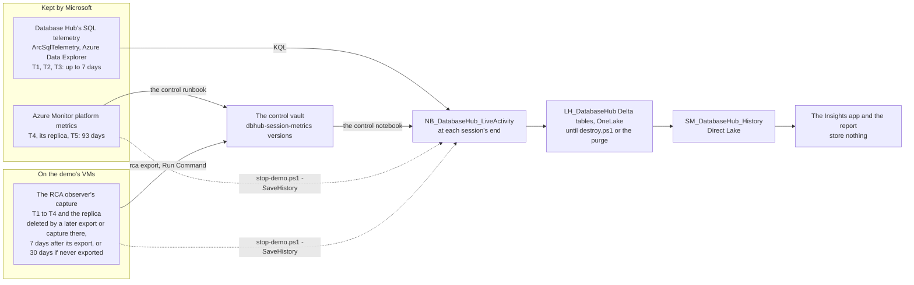

# ADR 0031: Incident RCA from saved history, blind, with the chat as the first-line investigator

- **Status:** Proposed (2026-11-20). The owner approved the design on 2026-11-20 and asked for it to be built. Phase 1 is being built against the evidence contract in [`rca/`](../../rca/README.md), which this ADR's pull request adds first. Nothing in it is live yet.
- **Date:** 2026-11-20
- **Decision source:** User-directed. The owner asked for the root cause of blocking, waits, and errors, down to the statement, the procedure, and who ran it, "displaying the query blocking chain and what was the first one and some recommendation analysis and next steps". Then: "I want the chat to be the first base investigation and extended DBA assistant. Full with specific detailed information and RCA and suggestions", across waits, errors, and "why lag times increased for the replicas at certain times". On the look: "I also like the theme options for it". On grading: "Real demo and DBA would not know what the scenarios are and we should be able to see these items." The owner also asked how long Database Hub keeps its data, who must keep it longer, and where its telemetry lives ([below](#where-the-data-lives-how-long-its-kept-and-who-keeps-it)). The coordinator's decisions, recorded for the owner to change by number: [the five design decisions](#decisions-and-open-items), errors (INV-12, INV-13) in Phase 1, and blind detection with the answer key in exactly two places. The first item of the Insights app's Wave 2.
- **Related:** [ADR 0008](0008-identity-rbac-abac.md) (identity), [ADR 0009](0009-secrets-handling.md) (secrets), [ADR 0010](0010-workload-generator-technology.md) (the runner and its bounds; [amended](0010-workload-generator-technology.md#amendment-the-incident-rca-observers-extended-events-session-2026-11-20) for the observer's event session), [ADR 0012](0012-validation-model.md) (statuses), [ADR 0016](0016-cost-profiles.md) (cost), [ADR 0025](0025-t4-read-replica.md) (T4's replica), [ADR 0026](0026-one-run-all-session.md) (Run all), [ADR 0027](0027-t5-cosmos-db.md) (T5), [ADR 0028](0028-ask-copilot-in-the-insights-app.md) (the chat), [ADR 0030](0030-insights-app-mission-control.md) (Mission Control, the scoreboard, the postmortem), [the evidence contract](../../rca/README.md)

## Context

Verified on `ignite-updates` at a8d51ac:

- **The history is metrics only.** `NB_DatabaseHub_LiveActivity` writes `telemetry_snapshots`, `incident_windows`, `scenario_runs`, `analysis_findings`, and `validation_results`, which `SM_DatabaseHub_History` reads (Direct Lake). For T1 to T3 it reads Database Hub's telemetry with KQL; for T4, its replica, and T5, the Azure Monitor metrics the control runbook or the operator's scripts saved. It never connects to a target.
- **Not in it:** who blocked whom, the head blocker, statement or procedure text, login, host, or program, lock resources, errors, deadlock graphs, Query Store plans, or the replica's replay state.
- **Database Hub's telemetry can't fill it:** it's resource-level. Its documented tables have no waits or blockers per session, and its sessions have no program name ([telemetry](https://learn.microsoft.com/fabric/database/hub/microsoft-sql-query-performance-monitoring-telemetry#tables)); "Query-level detail, such as query text, plans, and per-query statistics, isn't in the telemetry" ([limitations](https://learn.microsoft.com/fabric/database/hub/microsoft-sql-query-performance-monitoring-telemetry#limitations)).
- **Only the runner can read the evidence.** T1, T2, T4, its replica, and T5 are private, and T3 accepts only T1's subnet. A Fabric notebook has no documented token audience for SQL ([NotebookUtils credentials](https://learn.microsoft.com/fabric/data-engineering/notebookutils/notebookutils-credentials#get-token): storage, pbi, keyvault, kusto) and no route. The runner already signs in to every SQL target ([permissions](#10-permissions-cost-and-volume)).
- **The channels into the history are narrow.** A managed Run Command keeps the last 4 KB of output ([managed Run Command](https://learn.microsoft.com/azure/virtual-machines/windows/run-command-managed)), and the control's metrics secret holds 24,000 bytes per version (`Save-DbHubSessionMetric`).
- **Wave 1 measures against the plan.** The scoreboard, the postmortem, and the incident list read what the demo injected (`scenario_runs`) and look for each fault's expected signal in its own window. That's verification against an answer key, not detection ([the audit](#wave-1-audit-where-it-reads-the-answer-key)).

## Decision

### Blind detection, and the answer key in exactly two places

**The product is blind.** It finds and explains incidents with only what a real DBA's tools would show: the observer's capture (DMVs, Extended Events, `pg_stat` views), Azure Monitor's metrics, and Database Hub's telemetry. Grading against what the demo injected exists for the tests and for the presenter's trust moment, nowhere else.

- **Blind:** the rules, the shared detector, the investigation tools (`triage_window`, `find_incidents`, `explain_*`), the RCA view, and the chat. They never read `scenario_runs`, injected or planned incident windows, the runner's plan, `demo.scenario_run_events` or any other event the workload reports about itself, the scenario catalog, or a scenario's name.
- **The answer key lives in two places:**
  1. **The tests and the evaluation set,** which grade every blind RCA offline against what was injected. A viewer never sees them.
  2. **The "Did we catch it?" scoreboard,** the presenter's trust moment, which the presenter can show or skip: for example "the demo sent 19 faults, and the blind detector caught 17 without being told, at these times; here are the 2 it missed, and 1 false alarm". In Wave 2 the shared blind detector powers it. It may link a caught fault to its RCA; the RCA never links back to the key or shows it.
- **No "Injected" header, no "the evidence agrees" badge, no answer-key strip** in the RCA view, and **no answer-key tool in the chat,** not even a labeled one.
- **Enforced by tests:** [`rca/blind-detection.json`](../../rca/blind-detection.json) lists what detection may read, the answer key's tables and objects, and the identifiers detection code must never contain, every scenario ID among them. `tests/unit/Rca.Contract.Tests.ps1` fails when the app's detection code (`fabric/app/src/rca/`) or the runner's observer names one; the dock's `run_dax` refuses DAX that names an answer-key table, or calls a function that reads the whole model.
- **The capture is blind too:** the observer never reads the plan, and its detail capture starts from what its sentinel sees, not from a schedule ([triggers](../../rca/README.md#capture-triggers)).

### The shared blind detector

One detector in the app (`fabric/app/src/rca/detector.ts`) finds incidents for the RCA view, the chat's `find_incidents` and `triage_window`, the postmortem's Cause, and in Wave 2 the scoreboard.

- **It reads** only what [`blind-detection.json`](../../rca/blind-detection.json) allows: Telemetry Snapshots' bins (Database Hub's telemetry for T1 to T3; Azure Monitor's for T4, its replica, and T5) and the seven RCA tables.
- **Its families and levels** are the notebook's `EPISODE_RULES` (blocking and deadlocks above 0; CPU at 80 %, or at 1.5 times and 10 points above its baseline; the wait families), so its numbers stay comparable with Wave 1's. The RCA adds errors (10 a minute and 3 times the median of the 10 minutes before), the replica's stalled replay, T4's connections near the limit, and T5's 429s and 100 % normalized RU.
- **Its baselines are blind:** the median of the signal's valued bins over the 30 minutes before, at least 5 of them, leaving out the bins of episodes it already found. Never a planned or injected window, which Wave 1's baselines leave out ([audit](#wave-1-audit-where-it-reads-the-answer-key)). With fewer than 5, it uses the family's absolute level and says so.
- **A bin without a value is unknown, never "under the level".** Wave 1 counts it as under and breaks the run: on dbhubfn's session 81446b84, T3's plan regression peaked at 65.95 % in bins with empty bins between them, and never counted, because CPU's rule wants 2 bins in a row at the level (10 %, with a baseline near 0 %). The release's fix F23 (f9f953d) says what was measured; the rule is unchanged. Here, a run continues across up to 2 unknown bins between bins at the level; a valued bin under the level ends it.
- **Persistence by magnitude:** an episode needs 2 valued bins at the level in one run, as Wave 1's rule does, **or** one valued bin at twice the level and at least 30 points above the baseline (for a percentage; a count opens on one bin above 0, as today). A one-bin episode is a **single sample** with low confidence, unless another source shows it too. It says "in one sample, far over its level" only when that's what opened it; a rule that opens on one sample (the replica's lag, connections, 429s, normalized RU) says "in one sample" (the review of c4c63abe: 34 s against a 30 s level read "far over its level").
- **The densest source first:** T3's CPU from RCA-AZ-01's 15-second rows (`sys.dm_db_resource_stats`, read for the whole session in Phase 1 and kept without a deadband, so a missing row is a missing sample), which sees a regression where Database Hub's bins are sparse; blocking from the sentinel's 30-second `processes_blocked` before Database Hub's 1-minute bins. Each episode names its source.
- **What it says:** each episode carries its start, its end (the first 2 valued bins in a row under the level; "not known" when the telemetry ends or breaks off first), its peak and when, its valued and unknown bins, its source, and its support (**sustained**, **sparse**, or **single sample**). The view and the chat use those words, for example "CPU at 10 % or more in 4 bins from 14:00 to 14:09 UTC, peak 65.95 % at 14:00; 6 of its 10 bins had no value".
- **An episode the capture never ended** (Stop now cut it off, or the capture broke off) ends at its own capture's last sample before a gap of more than 90 seconds, never in a later session's samples (Final tests' live check of 4e2c65ed: a surge cut off at 18:53 UTC read as "36 of 35 at 19:30:16", in the next session's samples 37 minutes later). It says the capture ended while it was still on only when its last sample was at its level. When its last samples were back under it, it says it fell under by the first of them, and that the capture ended before it could confirm the end (the review of 803f2b1a: 32, 8, and 8 of 35 read as "still on"). An episode with samples under its level between its first and last at it says "in 3 of its 4 samples", whatever its source, never "in a row".
  - **Cut off, or only past the minutes read:** the capture's events are read up to the minutes' end, so an episode that relaxed after them has no end in them. It's one its capture cut off only when its samples broke off at a gap of more than 90 seconds, or its capture's coverage (`rca_coverage`) ended before the minutes read do; without coverage, when its samples stopped more than 90 seconds before their end. Otherwise the minutes read end first, its end after them, with no end of the capture (the review of 97fdf5ba: a window ending mid-surge read "under its level by 15:30:21 (the capture ended at 15:30:51 …)", though T4's coverage ran to 15:55 and the capture relaxed it at 15:35:11). It says where it fell, as a cut-off one does, when its samples in the minutes read are back under its level: "under its level by 15:30:21 UTC (the minutes read end at 15:31:00 UTC, before its capture confirmed the end)". It says "still on at 15:31:00 UTC, where the minutes read end" only when its last sample read was at its level (the review of 858c50c2: the replica's stall read "still on at 16:20:00" after its samples had fallen to 0.4 s at 16:19:27). Its explanation reads the same minutes, so one answer gives one end; the replica's lag is the exception, since the rise is read whole, on to its recovery, up to 3 more reads, and its explanation says so: "(read past the minutes asked about, which end at 16:18:00 UTC, to its recovery at 16:19:27 UTC)" (the review of 2e19adfc: one answer gave two peaks, 96.6 s and 176.7 s, unsaid). A read of the capture's tables that stopped short (see a read at its limit, below) ends the minutes read there, for an episode on before it: "still on at 15:01:00 UTC, where the read stopped" (the review of eb89acbb: with RCA Events read only to 15:00:30, a surge read "the minutes read end at 15:20:00"). Its samples, too, are only those up to there, whichever table holds them (the review of 4667459c: with RCA Resource read whole, one answer said both "under its level by 15:10:00" and "still on at 15:00:30"). An episode its capture ended keeps every sample (the review of 11b7c4b9).
  - **Errors and deadlocks** have no samples of their own in the capture's episodes, so neither a fall nor "still on" can be told: such an episode says whether it was still on isn't known.
- **One point per interval, at the finest grain the history has.** Each save of Azure Monitor's metrics has its own grain, the smallest from 1 to 1,440 minutes that fits, so one minute can be in several saves: on B, a day-long save at 15 minutes beside the session's own at 1 and 5. The model's measures keep each bin's newest capture, which kept a 15-minute total beside the minutes it holds. So T5's requests and 429s for 15:30 to 15:42 counted both, a replica stall's 5-minute "178 s" was the 15 minutes' highest, and the day's list split one storm in two (the review of 803f2b1a).
  - **The reader:** the RCA reads Azure Monitor's rows through the release's shared `finestPerInterval` (F35, `fabric/app/src/data/finest-per-interval.ts`), once, on the rows as read, and decodes what it keeps. It keeps the finest grain first, and of equal grains the newest save. A coarser point stays for the minutes the finer ones don't cover: a total as its total less theirs, and a peak only when it's higher than they are. Live, dropping the whole point lost the replica's 34 s from 16:57 to 17:00, after the session's window (the review of ebd1c6c3); it's an incident of its own now, `T4-replica-replica_lag-20261121T165700Z`.
  - **Span and grain:** each point has its span, what it covers (for coverage, ends, and sums), and its save's step, its grain. Runs step by the grain. The replica's words name a whole interval's grain, "its highest value in each 15-minute interval … in the 15 minutes from 15:30:00", and give a remainder's own span, "its highest value in each interval … in the 3 minutes from 16:57:00", since its value is the highest in those minutes (Final tests' check of ddebd4c3, F4: the save's 15 minutes beside the remainder's 3 read as a mismatch). So does T5's normalized RU: "keeps the highest in each interval … the interval from 17:00 to 17:03" for a remainder, and "each 15-minute interval" for a whole one (the review of 96abcf65). Stepped by a remainder's span, T4's CPU from 16:35 lost its end.
  - **One reading, one candidate:** a coarser point the shared function keeps in two or more pieces, around a finer save, is one reading, whether its pieces are a total's shares by length or a peak's upper bounds. Only its first piece can open an episode, at the point's own value. Its counts and peaks are said as Azure Monitor gave them, over the point's whole interval (cut to its save's window, as the shared function cuts it), with what the finer save holds of it: "800 throttled requests (429) in the 15 minutes from 15:30 UTC (Azure Monitor; a finer save holds none of them, in 15:33 to 15:38)". A share is never said as Azure Monitor's count, or as its own interval (the review of c4c63abe: one 15-minute count of 800 429s read as two incidents, peaks 240 and 560, and "2550 requests in that interval, 240 of them throttled (9.4 %)"). Minutes inside the finer save read that save.
  - **An interval the minutes read can't tell:** a point whose save's step can't be told from the minutes read, since they hold only one of its points, while its save's window is longer than them, has an interval that isn't known in these minutes, never an instant or a minute. It's said from its start, "the interval from 15:00 UTC, whose length isn't known in these minutes", with no end, and so are its counts, "3000 throttled requests (429) on T5 in the interval from 15:00:00 UTC, whose length isn't known in these minutes", never at one second (the review of 4667459c: "at 15:00:00 UTC"), and never added to the counts whose interval is known, which it may hold: "3000 in the interval from 15:00:00 UTC, whose length isn't known in these minutes, which may hold the 1600 counted from 15:14:00 to 15:30:00 UTC" (the review of 11b7c4b9: "4600"). Known counts that end by its start can't be in it, so its class adds them for its rank and its severity, even when later ones may be in it, while its words still give them apart, "… after the 100 counted from 14:40:00 to 15:00:00 UTC", or "… which may hold some of the 3 counted from 14:50:00 to 15:10:00 UTC" when only the later ones may be, and the view's errors table shows them so too, with the interval "from 15:00, length unknown" (the re-review of 087e096a: the table read "3,000" and "15:00 to 15:00", and 3,000 with the 100 before it ranked under 3,050; the re-review of 8b43102e: the table left out "some of", and that class counted 30, not 32); it stands for minutes from its start, so it isn't in minutes that end there (the review of c4c63abe: a 60-minute save read "each 1-minute interval … from 15:00 to 15:00 UTC"). Such an interval holds only its own class's counts, so triage counts a target's errors by class, as `explain_errors` does: an hour's 30 failed connections beside 5 statement-timeout cancels are 35 (the re-review of 8b43102e: "30 errors and cancels in the interval from 15:00:00 UTC, … which may hold the 5 counted from 15:20:00 to 15:20:00 UTC"), and one instant of known counts reads as one, "at 15:20:00 UTC". Neither reads wider.
  - An Azure Monitor point stands for what it spans, so a stall the capture saw is listed once, as the capture's. The app's T4 and T5 views read through the same function with the release's follow-ups.
- **Every key it lists resolves.** A key names its episode's target, signal, and start, and `explain_incident` reads the key's own minutes, which can read differently from a list of other minutes. It reads them from 30 minutes earlier than the key's time, besides the 30 its baselines read, so the episodes before the key have baselines of their own, as in the list that gave it, and the detector leaves them out of its baseline (Final tests' check of ddebd4c3, F1: read from 16:19, a CPU incident on T2 that the day's list gave from 16:19 started at 16:20, so its key answered "No episode"). When they have no episode with that key, `explain_incident` reads the one of the same target and signal that holds the key's time, or one that starts later but within the interval of the key's own point, as the capture's stall from 16:17:12 does within Azure Monitor's 5 minutes from 16:15, or within a sample of its time, a minute. The key's own point is the coarsest the history holds at its time, read before one point per interval is kept, so a key that a list made from the day-long save's 15 minutes at 15:30 still reads as the storm from 15:31 in them (the review of 97fdf5ba: such keys answered "No episode" once the point kept at 15:30 was a minute). It never reads a later incident of its own, so such a key answers "No episode" (the review of 803f2b1a). It says which episode it read in its details (`readAs`), and in what wasn't captured, which the RCA view shows and Copilot reads. Live, T5's 12:30 key answered "No episode" at 94a17ff7 and 4e2c65ed (Final tests).
- **Tested** with the live shape from session 81446b84 (bins at 65.95 % every third minute, empty bins between, a baseline near 0 %), which must open a sparse episode; a lone 66 % bin, which opens a single-sample one; a lone 12 % bin, which opens none; and dense series, which give Wave 1's times.
- **The scoreboard in Wave 2:** the only place the key meets detection. An injected fault is **caught** when a blind episode of one of its expected families starts on its target between its injection and `TELEMETRY_LAG_MINUTES` after its window (time to detect: the episode's start minus the injection); **missed** otherwise, with what the detector measured; a blind episode that no fault explains is a **false alarm**, said as one.

### 1. Capture: the runner's observer lane

A new lane in the runner's `profile run`: on T1's VM for T1, T3, T4, and T4's replica; in T2's guest for T2. T5 has no observer: its 429s and normalized RU are Azure Monitor metrics the history saves already. The lane only reads, and it's bounded like the scenarios ([ADR 0010](0010-workload-generator-technology.md#bounds-enforced-in-three-layers)).

- **Sign-in:** the runner's existing connections, with no new login, role, secret, or role assignment ([permissions](#10-permissions-cost-and-volume)).
- **Its sessions:** Application Name `ContosoCare.Demo/control/rca`, so `demo.fn_demo_sessions` and the kill tools never list or end them; `READ UNCOMMITTED` and `LOCK_TIMEOUT 1000` (SQL), `lock_timeout` and `statement_timeout` (PostgreSQL); one statement at a time per target. A sample that takes over 2 seconds halves the lane's cadence, and three in a row stop its detail capture with an `RCA.CAPTURE.<target>` **Warning**.
- **The sentinel,** every 30 seconds for the whole session: counters only (RCA-SQL-09, RCA-PG-10, the replica's RCA-PG-06), a few milliseconds per target.
- **Episodes from what it sees:** a blocked process, a lock waiter on T4, the replica's replay stalled, T4's connections near the limit, or an error rate's jump starts 5- or 10-second detail capture, which ends when the signal stays clear ([the triggers](../../rca/README.md#capture-triggers)). Phase 2 adds a wait category's rate and CPU.
- **For the whole session:** the event session below, and T3's resource rows (RCA-AZ-01).
- **What it captures, by target** (the exact SQL, each block's permission and Learn page: [the capture catalog](../../rca/capture/README.md)):

  | Target | Blocking and locks | Errors, deadlocks, escalations | Waits and plans (Phase 2) | Other |
  |---|---|---|---|---|
  | T1, T2 (SQL Server 2022) | RCA-SQL-01 (requests, sessions, connections, SQL text, the input buffer of an idle head, transactions), RCA-SQL-02 (`sys.dm_tran_locks` with objects and indexes) | RCA-XE-01, 02 (`error_reported`, `attention`, `lock_escalation`, `xml_deadlock_report`), RCA-SQL-12 (system_health's deadlocks, the fallback) | RCA-SQL-03, 04 (waiting tasks, wait-stats deltas), 10, 11 (Query Store), 13 (missing indexes) | RCA-SQL-05 to 09 (grants, schedulers, file IO, the sentinel's counters) |
  | T3 (Azure SQL Database) | RCA-SQL-01, 02, with optimized locking's XACT resources and `LCK_M_S_XACT_*` | RCA-XE-03, 04 (database-scoped; `database_xml_deadlock_report`) | RCA-AZ-02 (`sys.dm_db_wait_stats`), RCA-SQL-10, 11, 13, RCA-AZ-03, 04 (automatic tuning) | RCA-AZ-01 (`sys.dm_db_resource_stats`, Phase 1), RCA-AZ-05 |
  | T4 and its replica (PostgreSQL) | RCA-PG-01 (`pg_stat_activity`, `pg_blocking_pids()`), RCA-PG-02 (both sides of each `pg_locks` wait), RCA-PG-11 (the head's tables) | RCA-PG-03 (deadlocks, conflicts) | RCA-PG-12 (scans per table) | RCA-PG-04 to 09 (WAL and replication on the primary; the replica's replay, conflicts, receiver, settings), RCA-PG-10 (connections) |

- **Found by testing, and designed in:** on a hot standby, `pg_blocking_pids()` returns nothing for the waiting startup process while `pg_locks` shows the wait and its holder, so replay conflicts are read from `pg_locks`. Azure SQL Database has no system_health, and Learn says not to read its built-in `dl` session, so T3's deadlocks come from a database-scoped session. Learn has no field reference for `error_reported`, so the observer reads the fields from `sys.dm_xe_object_columns` first (RCA-XE-00) and records a missing one as not captured. A `transactionid` wait names no table, so RCA-PG-11 reads the head's relation locks.
- **The event session is the one object the observer creates:** `ContosoCare_RCA`, in memory only, filtered to ContosoCare, created at the observer's start and dropped at the session's end. On T1 and T2 it's server-scoped, outside ADR 0010's "nothing outside ContosoCare": [the amendment](0010-workload-generator-technology.md#amendment-the-incident-rca-observers-extended-events-session-2026-11-20) allows it, with its limits.
- **Kept on the VM until the export:** `C:\ProgramData\DbHubDemo\rca\<session>\` (SYSTEM and Administrators only), at most 20 MB per target. The runner deletes it at its first export or capture on that VM at least 7 days after the export that took all of it, and, when no export took any of it, 30 days after it started (`EvidenceStore.Cleanup`, which only an export and a new capture span run); with neither, it stays until `destroy.ps1`. The T2 golden snapshot's capture deletes it from T2's guest, after stopping the runner, so a snapshot carries none (the docs review of 0189a4b).
- **Its end at a session's stop** (2026-11-23, Final tests' observation O1): the session control's stop deallocates the VMs without a Run Command to stop their activity (Phase 25a's finding 5), so the observer captured on, past the stop's export, and the session's last minutes stayed on the VM. Now the stop's export records the capture's end (`rca export --end-capture`); the lane reads it within a second and ends each target's capture as a profile's end does, while the workload runs on, and captures a target again only once its profile is set after the end ([the capture's end](../../rca/README.md#the-captures-end-at-a-sessions-stop)).

### 2. Names

**What the observer records** ([Names](../../rca/README.md#names)):

- A workload session's application name today is `ContosoCare.Demo/<scenario>/<run>`, which names the fault. The observer keeps only `ContosoCare.Demo`, plus `run_token`: an opaque hash of the run segment that groups a run's sessions and names nothing. A scenario ID never reaches the evidence.
- Modules and statements are recorded as the DMVs return them, because a DBA sees them too and the owner asked for them. Rules never branch on a name, and a test checks that detection code contains no procedure-name pattern.
- The procedures' own names (`demo.usp_scenario_chain_acquire`) still show the demo's script to a viewer who reads them.

**More realistic names, assessed:**

| Option | What changes | Effort | Risk |
|---|---|---|---|
| (a) Per-service application names (`ContosoCare.Scheduling`), with the runner tracking its sessions another way | The runner's endpoint (`Sql/TargetEndpoint.cs`, lines 108 to 114); `demo.fn_demo_sessions`, the kill tools, and reset on both engines (`database/common/110-demo-control.sql`, lines 282 to 305 and 826 to 844; `database/postgresql/110-demo-control.sql`, lines 166 to 201 and 386 to 405); validate's bounds; the agent prompts that read the tags | 8 to 15 days | High: ADR 0010's three-layer bounds and the watchdog key on the prefix |
| (a′) `ContosoCare.Demo/<service>/<token>` | The scenario segment becomes a service and the run a token that `demo.scenario_runs` maps back; the prefix, and so every bound, stays | 4 to 7 days | Medium: the prompts and docs that read the scenario from the name |
| (b) The observer strips names (above) | Only the observer | Part of step 1.1 | Low |
| (c) Realistic procedure names (`scheduling.usp_book_slot`) | 22 T-SQL procedures and 14 PostgreSQL functions, their callers, the scenario schema's procedure pattern, and `SqlScriptTests`' allow-lists | 5 to 10 days | Medium |

**Decided for Phase 1: (b),** with rules that never use names. **Recommended as a Wave 2 follow-up, for the owner to approve: (a′) and (c),** which change what a viewer reads without touching the bounds. They're not in Phase 1 because they change ADR 0010's tagging and the agent prompts, and the fixtures and evaluation set would change twice.

### 3. Redaction and privacy

- **Only the demo's own sessions keep text, login, and host** (`is_demo`). Any other session in a chain keeps its ID, status, waits, and locks only.
- **Text is normalized before it's stored:** string, number, date, binary, and GUID literals become `?`, IPv4 and IPv6 addresses `<ip>`; at most 2,000 characters for a statement and 1,000 for a detail. The runner's calls are parameterized, so their text is already literal-free.
- **Then the existing redaction:** the runner's own, and the notebook's `redact()`. A value that still looks like a secret is dropped, not stored. Tests build their fake secrets at run time.
- **Never captured:** passwords, connection strings, tokens, Key Vault values, or anything outside ContosoCare's own sessions and objects.

### 4. Transport into the history

Through the control channel that exists, with no new resource or grant ([transport](../../rca/README.md#transport)):

- **Export:** `ContosoCare.Workload rca export` reduces the capture into evidence documents: columnar JSON with string dictionaries ([schema](../../rca/evidence.schema.json)), gzipped and printed as part lines under a managed Run Command's 4 KB.
- **Into the control vault:** the control runbook writes the parts as earlier versions of its existing `dbhub-session-metrics` secret and lists them in that secret's final version, the metrics document the control notebook already reads. The deployer's existing grant on the secret covers its versions.
- **The bundles stay in the vault** until `./scripts/destroy.ps1`, which deletes and purges the control vault. Disabling them once the notebook confirms the save would take Key Vault's data-plane Update Secret, which "requires the secrets/set permission" ([Update Secret](https://learn.microsoft.com/rest/api/keyvault/secrets/update-secret/update-secret)). The runbook's identity has only ARM read and write on the secret, and the deployer only Key Vault Secrets User, so that would be a new grant, which the rules forbid. The bundles hold what the history holds (normalized statements, programs, logins, and hosts; never a secret), and only those who can already read the history can read them.
- **Into the history:** the control notebook stages the parts in the demo's lakehouse as one `RCA_EVIDENCE` document, `Files/rca/inbox/<name>.json`, and passes its path to `NB_DatabaseHub_LiveActivity` as `RCA_EVIDENCE_FILE`. The notebook writes the tables and deletes the file. `stop-demo.ps1 -SaveHistory` and `deploy.ps1`'s snapshot run the same export with the operator's role and stage the same file through OneLake's DFS API with the operator's existing workspace role ([transport](../../rca/README.md#rca_evidence_file)). During a Run all session, `stop-demo.ps1` hands the stop to the session control instead, whose stop exports the session's evidence into the control vault, so `-SaveHistory` then saves the history without it, and the session's own save takes it: that of the next Run all that starts a session within 7 days, or Run all's at the session's planned end; after 7 days, nothing saves it ([ADR 0026's 2026-11-22 amendment](0026-one-run-all-session.md#2026-11-22-amendment-stop-demops1-hands-a-sessions-stop-to-the-control)). The inline `RCA_EVIDENCE` stays supported.
  - **Why a file:** neither a notebook run's parameters nor a job's document a size limit, and a full session is about 218 KB of parts. A private control vault is reachable only from the control workspace, so the job's fallback can't read the bundles itself.
- **A session the nightly stop ended** keeps its evidence on the VM's disk, and the next start exports it.
- **A session the control stops** has its capture ended first, inside the stop's own export Run Command, so that export takes the session's last minutes, and the stop sends no other Run Command (2026-11-23, [above](#1-capture-the-runners-observer-lane)). A VM where the capture didn't end before the export's 60-second wait ran out goes into the session's `leftVms`: `RCA.PENDING` names it, and the next start that sends activity there exports the rest first, with the session's ID.
- **Not chosen for the default:**

  | Option | Why not |
  |---|---|
  | The runner writes to OneLake with T1's managed identity | A Fabric workspace role for T1's identity (a new role assignment) and a tenant setting. The best opt-in later: no size budget |
  | A storage account | A new resource, and a SAS (a secret) or a new role assignment |
  | Diagnostic settings to Log Analytics | New resources with ingestion cost, no T1 or T2, and the notebook still can't read it without a grant |
  | A new control-vault secret | Its grant needs an Owner again (per-secret RBAC): not one click for existing environments |

### 5. The history: eight tables and the model

`NB_DatabaseHub_LiveActivity` writes them as it writes the others (delete the run's rows, append with `mergeSchema`), and backfills nothing. Columns, types, keys, model names, relationships, and measures: [`rca/history-tables.json`](../../rca/history-tables.json), which the notebook's, the model's, and the app's tests read.

| Lakehouse table | Model table | Grain | Phase |
|---|---|---|---|
| `rca_sessions` | RCA Sessions | A session in a blocking or activity sample | 1 |
| `rca_events` | RCA Events | An error, attention, deadlock, escalation, tuning change, or capture episode's start or end | 1 |
| `rca_resource` | RCA Resource | A counter or resource sample (long format) | 1 |
| `rca_replica` | RCA Replica | A replay sample on either side of T4's replication | 1 |
| `rca_coverage` | RCA Coverage | What was captured for a target and window, and why not | 1 |
| `rca_waits` | RCA Waits | A wait type in an episode or its baseline | 2 |
| `rca_queries` | RCA Queries | A Query Store plan in an episode or its baseline | 2 |
| `rca_answer_key` | RCA Answer Key | The runner's own runs and their events, on every target, T4 and T5 included | 1 |

- **Detection tables carry no scenario, run ID, or incident key.** The answer key is its own table, in the model's Answer key folder, read only by the scoreboard and the tests.
- **The model:** the eight tables in Direct Lake, related to Target and Date only, with measures such as Blocked Sessions (captured), Head Blocker Idle (s), Deadlocks (captured), Errors (captured), Lock Escalations (captured), Replica Replay Stall (s), and Injected Faults (Answer key). `npm run guide:build` regenerates the chat's model guide from the TMDL, without the answer key ([§8](#8-the-chat-as-the-first-line-investigator)).
- **T4's and T5's beats join the answer key,** which closes ADR 0030's gap: Wave 2's scoreboard can grade them.
- **The deployment notebook's purge** (`PURGE_DEMO_TABLES` and `CONFIRM`) drops the eight tables too, and removes `Files/rca/inbox`.

### 6. Investigations, rules, and recommendations

One TypeScript implementation in the app (`fabric/app/src/rca/`), used by the RCA view, the postmortem, and the chat's tools: the same rows always give the same answer. Each finding cites its evidence rows, and each root cause carries its confidence: **high** when two independent kinds of evidence agree, **medium** when one carries it, **low** when only a metric's shape is left, which the answer says.

| ID | Investigation | Rules | Phase |
|---|---|---|---|
| INV-00 | Triage: what was abnormal, where, and when | The detector's episodes, ranked; "nothing abnormal" with the quiet targets | 1 |
| INV-01 | Blocking and lock waits: the chain, head blocker first, its statement or procedure, who ran it | `BLK-IDLE-HEAD`, `BLK-PG-IDLE-IN-TRANSACTION`, `BLK-LONG-RUNNING`, `BLK-CLIENT-NOT-FETCHING`, `BLK-ESCALATION` | 1 |
| INV-02 | Deadlocks: the victim, the resources, both statements | `DLK-ORDER`, `DLK-CONVERSION`, `DLK-MIXED`, `DLK-PG` | 1 |
| INV-12 | Errors by class: deadlock victims, lock timeouts, attentions, resource governance, PostgreSQL's classes, T5's 429s. An Azure Monitor count stands for its whole interval, so the span runs to the end of the last count's (the review of ebd1c6c3) | `ERR-<class>` | 1 |
| INV-13 | Connection capacity on T4: what held the slots (the capture's counts by state against the limit), who if the capture sampled them, and whether a client connecting then would have been refused | `CONN-LOCK-WAIT`, `CONN-IDLE-IN-TX`, `CONN-IDLE`, `CONN-ACTIVE`, `CONN-MIXED`, `CONN-STATES-UNKNOWN`, `ERR-CONNECTION-REFUSED` | 1 |
| INV-15 | Read replica lag: why it rose at a certain time | `REPL-REPLAY-CONFLICT`, `REPL-REPLAY-SLOW`, `REPL-SHIPPING`, `REPL-IDLE-PRIMARY`, `REPL-CATCHUP`, `REPL-REPLAY-STALLED`, `REPL-UNEXPLAINED`, `REPL-NO-LAG` | 1 |
| INV-14 (in part) | Cosmos DB's normalized RU at 100 %, from Azure Monitor: the busiest partition key range's share, the requests, and the 429s | `RU-AT-LIMIT`, `RU-THROTTLED` | 1 |
| INV-03 to 11, INV-14 | CPU and plans; governance and capacity; IO; log and the log rate governor; memory grants; latch and tempdb; parallelism; workers; the client not reading; Cosmos DB RU pressure by partition and operation | `WAIT-*`, `RU-*` | 2 |

- **The head blocker's kind** follows Learn's blocking scenarios ([understand and resolve blocking](https://learn.microsoft.com/troubleshoot/sql/database-engine/performance/understand-resolve-blocking)): idle with an open transaction, long-running, a client not fetching, or a rollback; then depth, width, blocked count and time, and its formations.
- **The replica's lag** separates a restart's catch-up (`replicaCatchUp`, ADR 0025) from a replay conflict (the startup process waiting on a lock a replica query holds), slow replay, slow shipping (write and flush lag), and an idle primary, with the WAL rate beside it.
  - **The rise:** read from the capture's own samples on the replica (`since_last_replayed_s`, every 30 s, every 5 s while replay stands still) wherever it took them. Azure Monitor's Read Replica Lag is the highest value in each interval, stamped with the interval's start, so it counts as that whole interval: it's read only for the minutes the capture didn't sample, and for an interval whose rise fell between the capture's samples, which means the samples inside it and the nearest on either side of it all stayed under 5 s (the review of 4e2c65ed: a stall that began after an interval's last sample shows in the sample after it). Where the capture's samples tell the rise, Azure Monitor's intervals are cited beside them, as Database Hub charts them. When replay last advanced is said only from the capture's samples; Azure Monitor's intervals bound it only from below. When the rise's first point is one of Azure Monitor's intervals (the capture started, or resumed after a gap, partway through a stall), the rise starts at the capture's first sample, or, with none, is said as that interval: "rose in the 5 minutes from 16:10:00 UTC", never from the interval's start (the re-review of bb70161f).
  - **The cause:** read from the rise's own minutes: from a minute before replay last advanced (a sample's time less its lag) to a minute after it recovered. A replay conflict's lock is the rise's only from when its own replay stood still, since that minute can hold the stall before it (the review of ebd1c6c3), and only up to its recovery, since the minute after it can hold the next stall's (the review of fb144473: a lock the replica took 16 s after a stall's recovery was named as that stall's cause, beside its own figures). Slow replay, slow shipping, and an idle primary are named only when the capture's own samples are from the stall, and only from those samples: the figures each rule reads (WAL received but not replayed, write and flush lag, the send gap, and the WAL rate) come from the stall's samples, from replay's last advance up to its recovery, not the recovery's own sample, by which replay had resumed, or to its last point when it hadn't recovered; so do the WAL and shipping figures a replay conflict states, which says the primary's side wasn't sampled, never how it shipped, when none of its samples is among them. Slow replay needs WAL received but not replayed in them, and an idle primary a WAL rate from the primary's own samples in them (the review of 921d3097: a sample a minute before a stall, with 512 bytes in flight from a busy primary, read as slow replay "512 bytes behind, WAL about 0 bytes/s" for a stall whose own samples held 0 behind, from an idle primary; and B's first stall said "write and flush lag at most 7.132 s", the primary's 20 s after its recovery, while the replica replayed its backlog, where the stall's own were at most 0.043 s).
  - **The queries recovery cancelled,** which a conflict states too, are `pg_stat_database_conflicts`' deltas since the reading before that read the counter, added up. A stall's cancel ends its wait, after `max_standby_streaming_delay`, so the capture records it after the stall's first reading at its level: during its catch-up, when replay takes more than a reading to catch up, as B's first stall did (still 154.1 s and 88,809,688 bytes behind at 16:19:22.703, after its lock had gone), or at or after its recovery. The next stall's comes only after the capture has read that one at its level. So a stall's are those recorded after its own first reading at its level, which is after its last replay too, through its recovery, up to the next rise's first point at its level, and within the minutes read: never an earlier stall's, nor the next one's, as long as the capture read the counter at the readings that bound them, the stall's first reading at its level and the next rise's first point (the review of fb144473: a cancel recorded 20 s before a stall's last replay read as that stall's). Counted from its last replay alone, a stall could share a reading with the one before it: B's blip from 16:19:37 stood still from 16:19:32.69, 0.13 s before the first stall's reading at 16:19:32.827, the first after its recovery. **A known limit** (the review of b29d733d): a count covers the time since the last reading whose read of the counter (RCA-PG-07) answered, which needn't be the reading before it. A read that fails records no count and leaves the total the next count is measured from as it was (`CounterDeltas`, in the runner's `Triggers.cs`), so the next count that's read covers the whole gap. So when the reads failed from a cancel through a reading that bounds a stall's cancels, the cancel is counted on the other side of it: an earlier stall's as this stall's, when the read at this stall's first reading at its level failed, or this stall's as the next one's. The stall it was for counts it out, and with no other cancel recorded, says whether its query was cancelled isn't known, since none of its readings from its recovery on has a count. It's rare: it takes failed reads from the cancel through exactly that reading, and B's and A's rows record no cancel. The history can't tell it apart, since it keeps no record of which reading a count is measured from: its coverage's gaps note a failed read (`rca_coverage.gaps`), but only the first of each kind in any 10 minutes, at the runner's time rather than the reading's, and not which reading it was; and a reading's capture IDs reach only its window's coverage (`rca_coverage.sources`). Recording each count's span is a [Phase 2 candidate](#phase-2-candidates). A cancel the capture recorded is stated wherever it was recorded: during the stall, during its catch-up, or after its recovery, and "during it" when the stall hadn't recovered by the end of the minutes read (the review of 6eaed9aa: one recorded during the catch-up, with no reading after the recovery, read as not known). With none recorded, a stall says nothing was cancelled only from a reading at or after its recovery, since a reading before it can precede the cancel that ended the stall; one that hadn't recovered by the end of the minutes read says whether its query ended or was cancelled isn't known, and so does one the capture didn't read from its recovery on. `max_standby_streaming_delay` is the setting as the capture read it.
  - **The capture's episode events** a conflict cites beside it are the stall's own: from its first reading at its level, since the capture escalates no earlier, to the episode's relax at or after its recovery. B's second stall, from 16:20:51, cited the first one's relax at 16:20:03, and left out its own at 16:24:03 (found while fixing the review of fb144473).
  - **A rise the samples are only beside,** before it began or after it ended, reads from its shape, at low confidence, and says where they are (Final tests' check of ddebd4c3, F4: Azure Monitor's 68 s from 18:54, after the capture's last sample at 18:53:23, read as slow replay "0 bytes behind", from the primary's WAL before Stop now).
  - **Which rise:** the one at the asked time, from the last point at or before it. When that point is under 5 s, the time can still be in a stall that began after it: the next point at the floor is its rise when its last replay was at or before the asked time (the review of ebd1c6c3: asked at 16:21:00, in the second stall's first minute, the chat explained the 12.5-s blip before it, by the first stall's lock).
  - **One answer:** the RCA view and the chat read the same rise whole. When it runs past the minutes read (it began before them, or hadn't recovered by their end), they're read again with those minutes, each time up to 15 minutes further, at most 3 more times. So any time in one stall gets the same finding from the same rows, for a stall the history shows recovered within 45 minutes past the first window; a longer one is reported as it stands, unrecovered.
  - **The live finding, 2026-11-21:** with Azure Monitor's 5-minute intervals first, the view read a stall from 16:16:21 as a rise "at 16:15:00". It looked for the cause from 16:14 to 16:16, before the stall began, and called it slow replay, while the chat, asked at 16:17:12, found the replay conflict.
- **T4's connections against the limit** are explained by what held the slots, from the capture's counts by state (RCA-PG-10):
  - many waiting on a lock, which a blocker explains;
  - idle in a transaction;
  - idle;
  - running queries.

  The answer says what the capture measured, and nothing it can't (Final tests' live check of 4e2c65ed):
  - **Refusals:** when a sample saw every usable slot in use, a client connecting then would have been refused (SQLSTATE 53300). When none did, the slots may have filled between the 10-second samples, so whether one was refused isn't known: live, the connection-surge scenario's answer key recorded refusals in fills of about 0.1 s between samples.
  - **Never "no refusal" from Azure Monitor:** Learn documents `connections_failed` only as the number of failed connections. Live on B, it stayed at 0 through the 48 refused attempts ("too many connections") the answer key recorded. So the answer says only what was seen: that in this demo's live check it counted none of the refusals at the connection limit, that failures it did count may have had another cause, and that how many clients were refused isn't known. That rests on this one live observation; Learn doesn't say (the review of 803f2b1a: the answer had stated it as fact).
  - **The surge's shape:** its waves at 80 % of the limit or more, their peaks, the troughs between them (half the limit or under), and how many samples were at that level. Live, "stayed at 80 % … 32 samples" hid 4 waves, with 8 connections between them.
  - **More connections** (`PG-MAXCONN`) only when running queries filled every slot. The failed connections were its trigger before.
  - **The observer's own connection** counts in the total, since it takes a slot like any other ([connection slots](https://www.postgresql.org/docs/18/runtime-config-connection.html#GUC-SUPERUSER-RESERVED-CONNECTIONS)), and not in the counts by state, which it read as a client running a query in every sample. That's since 2026-11-21, and takes effect at the next deploy; earlier rows count it in both. Checked on PostgreSQL 18: with 7 slots for roles without reserved ones, the observer and 6 clients filled them, the next client was refused (53300), and the total read 7. Left out of the total, it would read 6, a full server as one with a slot free. On B, the first surge's 4 samples at 35 of 35 had 34 idle clients and the observer, and the workload's answer key had 3 attempts refused by 15:26:44, 7 s before the first of them.
  - **Saying so** (the capture review of 3732317d): the answer says the total has "the capture's own connection among them". An earlier row, whose active, idle, and idle in a transaction add up to its total, which a later row's can't, is read with one active less, the capture's own query. A total past the limit is said as such: "reached 36, over the 35 slots clients can use (max_connections 50 less 15 reserved, which only privileged roles can take; …)", never "36 of the 35". Its evidence says "36 client connections, over the 35 usable", and only the total when the states weren't captured (the review of ebd1c6c3).

  Who held the idle connections isn't captured: RCA-PG-01 samples only sessions that aren't idle, and only while a client waits on a lock; the answer says so. Before 2026-11-21, only the errors were read for this family, so a surge with no failed connection had no cause at all (live).
- **T5's normalized RU at 100 %** means only that in at least one second, at least one partition key range used all of its share of the RU/s ([normalized RU](https://learn.microsoft.com/azure/cosmos-db/monitor-normalized-request-units)). The answer counts the requests and 429s of the intervals it names. When intervals under 100 % lie between the first and the last at 100 %, it says how many of them were at 100 %, "9 of the 11 intervals from 15:31 to 15:42 UTC", never "each of", and counts the others' 429s apart, so the minutes' own add up (Final tests' check of ddebd4c3, F6: "each of the 9 intervals from 15:31 to 15:42" read as all 11, and the 1,354 429s of 15:34 and 15:38 were only in the view's errors table, which said 14,593 where the answer said 13,222). It recommends no change without a 429, more throughput only above the 5 % of requests throttled at which Learn recommends it, and a new partition key only for a container with more than one physical partition. At T5's 400 RU/s, when the history has the hour's provisioned throughput, it says why a new key wouldn't help: one physical partition serves up to 10,000 RU/s and 50 GB, so all of the container's requests share its RU/s ([physical partitions](https://learn.microsoft.com/azure/cosmos-db/partitioning-overview#physical-partitions)). Azure Monitor keeps the provisioned throughput hourly, stamped with the hour's start, so T5's history is read from the start of the episode's hour (the re-review of bb70161f: an episode 30 minutes or more into its hour, about half of them, missed it).
- **Every demo scenario is covered** by an evaluation case that names its real cause from blind evidence. No scenario exhausts workers yet, so INV-10's rule is tested with fixtures only.
- **The recommendation catalog:** 40 entries, each with why, its risk, who approves it (the application owner for code, the DBA for settings, both where a setting changes what the application sees, the service owner for cost), and its Microsoft Learn page (the PostgreSQL documentation for core PostgreSQL behavior). Rules pick entries by ID. Neither the app nor Copilot writes or applies a fix.

### 7. The RCA view

- **Where:** the **Root cause** page in the navigation, when the history has the RCA tables. The selected incident on the Incidents page, a fault picked on the scoreboard, and Mission Control link into it with a target and its minutes only, never a fault's name; the view links back to none of them.
- **What it shows:** the episode and its window, in the viewer's time and UTC, with its source and support; the root cause with its confidence; **the blocking chain as a tree, head blocker first** (its module or statement, program, login, host, status, idle time, open transaction, and lock); the timeline (blocked sessions, CPU or lag, the capture's episodes, errors); the errors by class, from the incident's minutes and 2 on either side, which the table says, with "a count in the root cause covers only the intervals it names, so it can be lower" (F6); recommendations with their Learn links and who approves each; next steps; what wasn't captured; **Explain this incident** (Copilot) and **Show the DAX**.
- **When causes share a target's minutes,** the view ranks them by confidence, then impact: the first is the root cause, and the others show under "Also in these minutes". It never picks one because it was planned.
- **Never a blank cause** (Final tests, live at 94a17ff7):
  - Each family the view explains has its own investigation: blocking and deadlocks, errors, the replica's lag, T4's connections, T5's throttling, and its normalized RU.
  - Without a cause, the report says what's missing: for example, blocked processes that left no chain in the capture's samples. It says the capture's sentinel saw them only for the capture's own episode, or one whose minutes the capture covered; blocking that only Database Hub's telemetry saw, before the capture ran, is said to be in that telemetry only (the re-review of bb70161f).
  - It points to "what wasn't captured below" only when something is below. An incident says each target's "no RCA capture recorded" once, for its own minutes, though its parts read a little wider (the coordinator's note on 803f2b1a: two such lines for one T5 storm). So does the view, beside the errors' minutes, and both count the other form too, "no RCA evidence for", from a coverage row marked not captured, as T5's are in B's model (Final tests' check of ddebd4c3, F2: the storm from 15:46 also said "no RCA evidence for 15:55:03-16:24:58 UTC", after it had ended). An incident's own lines all stay, one per coverage row not captured, so a storm across two rows says both, and a part's or the errors' line goes only for a target the incident notes already (the re-review of ab1d2d41: the view kept one per target, so T5's storm from 12:15 read as not captured only up to 12:25:52). Each note says one instant "at" it, "no RCA capture recorded at 16:57:00 UTC" or "the blocked processes at 19:30:00 UTC", never as a range of it, and both dedupes count that form too (Final tests' check of ddebd4c3, F5: ten notes said "16:57:00-16:57:00" or "from 19:30:00 to 19:30:00"). One instant is the same second, never the same time of day, and a span whose ends fall on two UTC days gives their dates, "no RCA capture recorded from 2026-11-19 17:00:00 to 2026-11-20 17:00:00 UTC", the chat's entry points' dated form, to the second; both dedupes count that form too (the review of 921d3097: a day's minutes read "at 17:00:00 UTC"). So do every span of `explain_errors`, `triage_window`, and `explain_locking`, and `explain_incident`'s "Nothing abnormal", which a viewer's window reaches; the rules' wordings of an incident's own minutes, and a single time, such as where a read stopped, keep their times alone, and the result's window gives its dates.
- **The look:** ADR 0030's stage, with Microsoft's palette and Fluent 2, in every theme the app offers: **Light**, **Dark**, **High contrast**, and **Use the system setting** (`fabric/app/src/theme/`), and Windows forced colors, where the current incident takes the system's selection colors as the current page does (F22). Colors come from the stage tokens, never hard-coded, so each theme's contrast holds; `rca-view.test.tsx` checks both.
- **A read that fails is never an empty one** (Final tests, live at cb224b28): Execute Queries allows each user 120 query requests a minute and answers more with HTTP 429 ([Learn](https://learn.microsoft.com/rest/api/power-bi/datasets/execute-queries)), and one throttled presence check made the view say that no capture was recorded. The app tells a table the model doesn't have (`Cannot find table '<oii>RCA Coverage</oii>'`, read live on a model from before the feature) apart from a read that failed. A 429, a 5xx, or a connection that failed is tried again, after the wait Power BI asks for (at most 60 seconds) or a short backoff, 4 tries and 90 seconds of waiting at most (`fabric/app/src/data/retry.ts`). A read that still fails says that the history couldn't be read, with its reason and **Try again**: in the view, never "No RCA capture is recorded yet" or a quiet window, and in the tools' answers to Copilot, which the grounding rules forbid taking for nothing abnormal.
- **A read at its limit is never used as a whole one** (the coordinator's note on the shared `finestPerInterval`). Each query returns its rows oldest first, up to a limit: an RCA table's 2,000 rows per 30 minutes of window, 20,000 at most, and Azure Monitor's 5,000, as do Database Hub's bins and their waits by category for T1 to T3 (the replay's own queries). So a read at its limit has lost its newest rows, often the incident's own minutes. Azure Monitor's read, and the bins' and waits', go on a page at a time, each from the last bucket the page before it had, up to 4 pages (the review of eb89acbb: T1's waits, 10 categories a minute, held only their first 500 minutes, and a Tran Log IO storm in minute 700 was gone, with no note). A read still at its limit is said in what wasn't captured, with "ask about a narrower window". What it didn't find, and what it counted, are said only up to where it stopped: "nothing abnormal up to …, where the read stopped" in the chat and in the view's list, counts as "at least … through …", and an incident's part, which reads only its episode's own minutes, through where its incident's read stopped. No blocking chain is claimed for the minutes after the RCA Sessions read stopped.

### 8. The chat as the first-line investigator

- **Tools, not raw DAX:** six deterministic tools in Phase 1, beside the dock's four (`run_dax`, `show_chart`, `suggest_followups`, `estate_overview`), within the relay's 16: `triage_window`, `find_incidents`, `explain_incident` (by a blind episode's key), `explain_locking`, `explain_errors`, and `explain_replica_lag`. Phase 2 adds `explain_waits`. Like `run_dax`, they run in the app with the viewer's own Fabric token, with at most one DAX query per RCA table, bounded results, and every query under "Show the sources"; the relay still runs nothing ([ADR 0028](0028-ask-copilot-in-the-insights-app.md#tools-that-run-in-the-page-as-the-viewer)).
- **The playbook,** in the system message: scope the time window, triage, explain the top hypotheses with the tools, then answer with the root cause and its evidence and times, the recommendations with their Learn links and who approves each, the next steps, and what wasn't captured. A clock time the viewer gives ("11:56", or "11:56 UTC") is the latest such time up to the history's newest data, or up to an hour past it, since the capture can run past the newest bin; a date and time is taken as written (the re-review of 817b81c).
- **The grounding rules:** every claim cites captured rows and their times; it says "not captured" rather than guess, and that the history couldn't be read when a tool says so, never that nothing was abnormal; it never names a scenario or says what was injected, which it can't know.
- **The dock is blind too:** `run_dax` refuses DAX that names an answer-key table or a measure that reads one, directly or through another measure, since DAX names a measure without its table. It also refuses every function that reads the whole model without naming a table: `COLUMNSTATISTICS`, which returns every column's range ([Learn](https://learn.microsoft.com/dax/columnstatistics-function-dax)); the `INFO` functions, which return the model's metadata, descriptions and expressions included ([Learn](https://learn.microsoft.com/dax/info-functions-dax)); `CALENDARAUTO`, which scans every date column ([Learn](https://learn.microsoft.com/dax/calendarauto-function-dax)); and `EXTERNALMEASURE`, which names a measure by a string ([Learn](https://learn.microsoft.com/dax/externalmeasure-function-dax)). It looks for the key's names and the functions' names in the query as written, comments and strings included, so no misreading of where a comment or a string ends can hide one, and for the functions in its code too, where a comment can split a name (the review of bfbbe2a: until then, a function's name in a string or a comment ran). The model guide leaves them all out, with the grading analyses' rows, and no description in the model names a scenario. Every page's Ask hands the chat measured data only, and the entries that had nothing else to hand over are gone ([decision 7](#decisions-and-open-items)).
- **Names in lookalike characters** (the coordinator's hardening of 9f3d35f): Analysis Services, not the model's collation, decides how object identifiers compare, and Learn documents only their case rule ([languages and collations](https://learn.microsoft.com/analysis-services/languages-and-collations-analysis-services#collation-support-in-analysis-services)). A key name in fullwidth letters, with a long s, or with a soft hyphen or zero-width character inside it might therefore resolve to the real table. So `run_dax` compares names after folding those differences away: compatibility forms, accents, invisible characters, controls, and case. It also refuses any character outside plain ASCII in a query's code, outside its strings and comments, because no fold can list every character an older collation leaves unweighted. That costs the chat nothing, since every name in the model is plain ASCII (a test pins it), and each page's Ask still hands it DAX that `run_dax` runs (a test runs every one). Step 1.8 records whether the deployed model resolves a fullwidth key name; `run_dax` refuses one either way.
- **Where a comment ends, never guessed** (the review of bfbbe2a): DAX's syntax reference doesn't say where the engine ends a `//` or `--` comment ([DAX syntax](https://learn.microsoft.com/dax/dax-syntax-reference)), and each guess about a lone carriage return let a query hide code from the check: ending the comment there before fb964e7, and not ending it there after. So `run_dax` reads each carriage return and form feed as a line feed, and sends the query that way: the text it checks is the text the engine runs, and the one the answer's sources show. A line comment ends at a line feed, as it does in the engine, and at a vertical tab, U+0085, U+2028, or U+2029, which Unicode also makes line breaks. The plain-ASCII rule then refuses that character as code, so a query in which one could end a comment is refused, whatever the engine does.
- **A denylist, not an allowlist** (the re-review of 817b81c): the answer key's four table names all contain a space, so DAX can name them only in quotes, and the name check finds each. `TABLEOF` reaches a table only through a column, measure, or calendar the query names: every measure an answer-key table hosts is refused, and none of them has a calendar ([Learn](https://learn.microsoft.com/dax/tableof-function-dax)). An allowlist of tables would add nothing for the key, and one of functions would refuse queries the chat writes for good reasons. Tests pin each refusal, and that the model holds no scenario name for a metadata query to read.
- **The model's shape, checked every time the guide is built** (the final review of 9b1896c): the denylist also rests on how the model is built, so `npm run guide:build` writes no guide, and the app's tests fail, when a model change would weaken it:
  - a key table's name without a space;
  - a relationship that puts a key table on its one side, filters both ways or automatically, or isn't many-to-one. Each key table's relationships have it on the many side and filter one way, from the dimension to the key ([cross-filter direction](https://learn.microsoft.com/dotnet/api/microsoft.analysisservices.tabular.crossfilteringbehavior)), so a filter on the key reaches no other table;
  - DAX outside the key's own tables and the refused measures that names a key table or a refused measure: a calculated column or table, a calculation item, detail rows, a model function, or a role's filter would read the key under a name `run_dax` doesn't refuse. The check reads a ``` block whole, at any indentation, as TMDL does ([expressions](https://learn.microsoft.com/analysis-services/tmdl/tmdl-overview#expressions)); before the review of 9f3d35f, a block at column 0, or one that closed left of the members, escaped it;
  - a partition of another table that reads a lakehouse table holding the key (`rca/blind-detection.json`'s `answerKey.lakehouseTables`), by its `entityName`, its M source, or a shared expression that names one: that table would hold the key's rows under a name `run_dax` doesn't refuse (the review of 9f3d35f).
- **Sample questions,** with the owner's live session of 2026-11-20 (ET):
  - "Why was ContosoCare slow at 11:56?" T3's CPU at 100 % from 11:56 to 12:17, and T5 at 100 % normalized RU with about 1,300 to 2,100 429s a minute. In Phase 2 also the cause: Query Store's regressed plan, `FORCE_LAST_GOOD_PLAN` off from 11:52, and the last good plan forced at 12:18:00, after which CPU averaged 42.5 % at 12:18 and 7 % at 12:19 to 12:20.
  - "Who blocked whom at 12:05, and what should we do?" The chain, head blocker first, with its procedure, program, login, idle time, open transaction, and lock; its depth and width; the escalation; the recommendations.
  - "Why did the replica's lag spike at 12:14?" Lag at 45, 106, then 166 s from 12:12, back to 1 s at 12:15. The replay waited on a lock a long query held on the replica, while the primary's WAL was small and shipped at once (write and flush lag near 0): a replay conflict, not WAL volume or the network.
  - "What errors did the app hit during the incident?" The errors by class and minute, with their modules; T5's 429s from Azure Monitor.
- **The evaluation set** ([`testdata/eval-set.ts`](../../fabric/app/src/rca/testdata/eval-set.ts), graded by `eval.test.ts` beside it): Phase 1's 12 questions on the contract's two fixtures and B's and A's live rows. Each has the tool calls the playbook leads to, the facts a blind answer must contain, and what it must not say: a scenario's name, "injected", or a wrong cause. Each dataset's blind incidents are graded offline against its answer key by the scoreboard's own rule, through its functions (`inSearch`, `searchEndOf`): a run is caught by an incident of its families on its target in the bin that holds its start or later, before 15 minutes after its end or the next fault on its target that raises the same signal, whichever comes first, or by one still open at its start, in the bin that holds that start, as the scoreboard reads a signal already up then (the review of 96abcf65: a deadlock storm right after a blocking chain, in one incident with it, was missed). The earliest of the incidents that catch a run gives its time to detect, and each of them is one the run explains (the review of 3c0f5aeb: the chain's incident, still open at the storm's start, gave the storm its time, and the storm's own incident was left as a false alarm). An incident whose end isn't known is open only as far as its last sample at its level. Its families are the scoreboard's (`expectedFamilies`); T4's beats, which the scoreboard doesn't grade, have the set's own. Tests pin the set's grading and the scoreboard's to agree (the review of b4370565), and on the preview's sample session the two catch or miss all 35 faults alike. Six of them are caught a bin apart, each for a reason the set can't read: an incident has no values per bin, so a one-bin dip at a fault's start, as between T1's chain and its deadlock storm, is in it; its levels are the notebook's, not the scoreboard's bounds over their baselines, as for T3's log rate, which rests at 0.05 s a minute; and it reads no Database Agent beat, from whose regression the scoreboard looks. **A limit of the shared rule:** a catch by an incident already open before the fault doesn't show that the fault raised anything. T3's two log-rate faults on the sample session are caught by an incident that opened at 13:15 and never ends, since the log rate rests over the detector's level, so the set's catch there doesn't depend on the fault, and agrees with the scoreboard's, a minute later over its bound, by coincidence (the review of 3c0f5aeb). The scoreboard's own rule has the same limit wherever a signal is over its bound at a fault's start. B's and A's live rows are graded over the whole day, and the grading names any run of a key outside its minutes, so none is left out unsaid. Every run Phase 1's data can grade is caught within a minute, with no false alarm: T1's chain and T4's locking after 30 s, the replica's stall after 60 s, and B's four and A's two connection surges after 2 to 30 s. B's surge from 18:51 ran in a session that Stop now cut off, so its key has no row for it: it's reported as detected with no key row, not as a false alarm. T1's log-flush run isn't graded: its family, `tran_log`, comes from Database Hub's wait categories, and that fixture's tools get no telemetry. The spike's 30 cases came first; the rest wait for data. T3's chain, T1's locking and deadlocks, idle in transaction, and every wait's scenario come with step 1.8's recorded fixtures, whose telemetry the detector reads, and Phase 2's `explain_waits` explains the waits. Phase 3 asks the same questions of the real model.
- **Capture now:** not in v1. The sentinel and the episodes make the history specific enough for every scenario the demo injects, and the app stays the analysis product, working from saved history.

### 9. The postmortem's Cause

With the RCA tables, the Cause of a session's postmortem is the blind investigation of the session's minutes, as the session control recorded them, and the 15 after them (`TELEMETRY_LAG_MINUTES`), where the postmortem's other sections still read a signal, but never into the next session's ([`rca/postmortem.ts`](../../fabric/app/src/rca/postmortem.ts)). A lone incident request's minutes are its fault's own, from Scenario Runs, so its postmortem never investigates them, neither in its Cause nor with a Copilot draft, which it doesn't offer: an investigation aimed there would be told where the fault was. Its Cause points to the Root cause view instead, which finds the incidents from the signals alone and explains each one (the review of 63fb530c, and the re-review of feb64ad3). For a session:

- **What it reads:** `find_incidents`, then `explain_incident` for up to six incidents, in the RCA view's order: the capture's own first, then the others the investigations explain, then the telemetry-only ones.
- **What it says of each:** its root cause, confidence, and up to three of the rows it cites; or, with no root cause, why, from what wasn't captured (RCA Coverage). A root cause behind two incidents, such as a chain's deadlock and its blocking, is said once. The incidents past six are counted by target, for the RCA view.
- **A read that failed** is said as such, for one incident or for the list, never as no cause or nothing abnormal. So is a failed check of the RCA tables, which is never taken for their absence.
- **The answer key:** what the demo injected follows in a section of its own, "What the demo injected (answer key)", which the app writes itself. Like the investigation, it reads every target, whatever the page's filter shows: the session's faults on the targets the filter hides, from Scenario Runs before the filter, and T4's and T5's episodes there, which the dialog loads for it, follow under "On targets this page's filter hides", and a capture it couldn't read is said as such, never taken for a quiet target. The sections above it stay the filter's (the review of b4370565: with the filter on T1 to T3, a session's Cause could list T4's surges while its key had none of T4's episodes, and a session whose faults the filter all hid said its plan injected nothing). It also lists other plans' faults, on any target, that reach into the investigated minutes, or end up to 15 minutes before them, where a signal can still show, labeled as outside this session: a lone incident request just before or after the session, or another session's last fault. An incident the investigation finds in them then has its fault in the key, not a false alarm (the re-review of feb64ad3: a lone request from 15:02, after a session that ended at 15:00, beside the next session's start at 15:05). The investigation never reads them. The postmortem's other sections are the scoreboard's measurements, as before, of the targets the filter shows: when it shows none of the session's faults, its Summary, Timeline, Impact, Response, and Follow-ups say so, and the Summary points to the key, never that nothing was injected, or that the window had no event or response step (the review of 96abcf65: "No fault was injected in this window" beside the key's list of them; the review of 3c0f5aeb: "No event in this window." and "No response step in this window.", though a hidden fault was answered).
- **Its queries** end the postmortem, after the page's.
- **The dialog** says it's investigating, and its Download and Copy wait for the investigation.

Without the RCA tables, the Cause lists what was injected, as the release did, on the targets the filter shows; when it shows none of the session's faults, the Cause and the other sections say so, as above ([`lib/postmortem.ts`](../../fabric/app/src/lib/postmortem.ts)). The Copilot draft is the same blind draft either way ([decision 7](#decisions-and-open-items)): a session's postmortem hands it the session's minutes, T4's and T5's measured episodes, and the measured queries, and it investigates the rest with the tools. A lone incident request's postmortem has no draft, because its minutes are its fault's own: its dialog says so, and points to the Root cause view whenever the navigation lists it (the re-review of feb64ad3).

### 10. Permissions, cost, and volume

| Target | Identity (existing) | What it has | What the capture needs (documented) | New grant |
|---|---|---|---|---|
| T1 | the runner as SYSTEM | sysadmin (BUILTIN\Administrators) | VIEW SERVER PERFORMANCE STATE; CREATE ANY or ALTER ANY EVENT SESSION | None |
| T2, from Arc Jumpstart's image | SYSTEM in the guest | sysadmin | the same | None |
| T2, a kept PaygWizard guest | SYSTEM | `contosocare_runner` only | the same | None: not captured, an `RCA.CAPTURE.T2` **Warning** with the fix (`./scripts/deploy.ps1` rebuilds T2 from the image) |
| T3 | T1's managed identity, dbo through the P6 group | CONTROL on the database | VIEW DATABASE STATE; CREATE ANY DATABASE EVENT SESSION | None. The hardened option needs both granted to `contosocare_runner` in `030-configure.sql`: database permissions, not role assignments |
| T4 and its replica | T1's managed identity as `contosocare_runner` | `pg_read_all_stats` (T4's setup grants it) | The role sees every demo session; `pg_read_all_stats` adds the startup process's wait and `pg_stat_replication`'s details; `pg_locks` and the replay functions need nothing | None |
| Azure Monitor, Run Command, the control vault | the control runbook's identity; the operator's Contributor | what they use today | more Run Commands, versions of the metrics secret | None |

- **No new role assignment,** no new resource, and nothing for the person running the demo.
- **Cost:** no new Azure or Fabric resource or meter. The PostgreSQL capture's queries took 1 to 5 ms on average on a local server (33 ms at most); the T-SQL blocks were only parsed, and step 1.8 times them live. The notebook writes small tables in seconds; tool results are 5 to 30 KB per call on the viewer's own Copilot. The export runs in the session control's Automation jobs, bounded at 6 minutes at a stop, 8 at each 30-minute re-check, and 6 at a start that fetches an earlier session's capture, so a 90-minute session's jobs run at most about 36 minutes longer. The estimate counts the control's job minutes at 300 a month for a light-use month's sessions, within the 500 Azure Automation includes for one environment in a subscription (it adds up every Automation account's minutes there), so none of its figures changes; past them, a job minute is $0.002 (list price, West US 3, 2026-11-21). The history grows by about 1 to 2 MB a session in OneLake ([cost management](../cost-management.md#the-incident-rca-2026-11-20), [ADR 0016](0016-cost-profiles.md)). The release's follow-ups count the control's minutes otherwise; [the implementation report's merge note](../implementation-report.md#the-incident-rca-phase-1-2026-11-20) says how the two meet.
- **Volume, with sentinel-triggered capture:** the always-on parts are the sentinel's counters (about 7,000 rows and 8 to 12 KB of gzip per 90 minutes; the fixtures measure 150 rows in 248 bytes) and RCA-AZ-01 (about 1,800 rows, 4.6 KB). Detail costs about 3 KB per 15 minutes of 10-second blocking on one target, and 0.8 KB per replica stall. A 90-minute showcase comes to about 30 to 45 KB in transit, under the reducer's 64 KiB aim and the 96 KiB limit ([limits](../../rca/README.md#limits)), and 1 to 2 MB of Delta. Cuts, if any, are recorded as coverage gaps, which the chat says.

### 11. Existing environments, and one click

- **`./scripts/deploy.ps1` updates everything,** as today: the runner, the runbooks, the notebooks, the semantic model, and the app. No new grant, so no Owner step.
- **Anything older degrades and says so,** with ADR 0012's statuses: an older runner can't export (`RCA.EXPORT` **Warning**, fixed by `./scripts/deploy.ps1`); a target the observer can't read is an `RCA.CAPTURE.<target>` **Warning** with its reason; an older notebook ignores `RCA_EVIDENCE`; the app hides the RCA view and the tools when the model has no RCA tables, and says why; a session saved before the feature says "no RCA capture recorded", and the chat falls back to the telemetry it has.
- **Nothing changes for the person running the demo:** Run all, stop, and the history save work as today.

### Decisions and open items

**Decided, recorded by the coordinator on 2026-11-20 as the owner's approval of the spike's recommendations, which the owner can change by number:**

1. **The event session,** with the [ADR 0010 amendment](0010-workload-generator-technology.md#amendment-the-incident-rca-observers-extended-events-session-2026-11-20).
2. **Transport through the control vault's secret versions,** with no new grant.
3. **No capture now** for the chat in v1.
4. **The 30-second sentinel** for the whole session, with detail capture in the episodes it sees.
5. **The runner's existing sign-in** for the observer.

Also decided: errors (INV-12, INV-13) in Phase 1; blind detection, with the answer key in exactly two places (the coordinator, 2026-11-20, settled by the owner's question about grading).

**7. Every Ask that hands the chat the answer key, reworked:** the coordinator's call on 2026-11-20, following the owner's rule that the chat is blind, which the owner can change. Each Ask passes measured data only, or goes where nothing measured is left to ask about. The visuals stay as they are, and a page may show the answer key, labeled, as the scoreboard does.

- **Gone, with nothing measured to hand over:** the scoreboard's three grading entries (every injected fault, times per engine, times per fault type); Replay's "Every moment of the session"; the Incidents page's timeline and list; Overview's incidents, its newest incident's Ask why, and its recent sessions; Manage's "What the control ran"; a SQL target's incidents on the Estate page; and Ask why on the insights computed from incident windows.
- **Back, blind, with the RCA tables:** the chat's entry points never drop below the release's (the coordinator's call, 2026-11-20). Overview's incidents, the Incidents timeline and list, and a SQL target's incidents hand the chat the history's newest 90 minutes, to investigate with `find_incidents`. Overview's and Manage's sessions, Replay's moments, and the scoreboard's faults hand it a whole session's minutes, for `triage_window`; never a lone incident request's, whose window is its fault's. Each passes no rows and no DAX, only the window, with its date, in the form the tools take as written (`fabric/app/src/rca/entry.ts`). Without the RCA tables, those cards have no Ask.
- **Still gone:** the scoreboard's times per engine and per fault type, which grade across sessions and have no blind counterpart; Ask why on the insights built from incident windows and on Overview's newest incident, which their cards' blind Asks cover.
- **The measured part only:** Overview's own question and its findings; the Estate inventory, T4's and T5's charts and findings, and a target's findings; Trends' CPU, CPU peaks, waits, and week over week; Performance's charts; the Incidents page's selected incident, its replay, and its waits, each as measured bins under a neutral title, with no window key, label, source, or scenario; Mission Control's services, each with its key number and the telemetry behind it; the scoreboard's T4 and T5 metrics; and the postmortem's Copilot draft, a session's only: a lone incident request's postmortem has none, because its minutes are its fault's ([§9](#9-the-postmortems-cause)). Their wait queries read the session in focus only, on every SQL target in the filter, whatever it injected where: never a lone incident request's minutes, nor the other plans the scoreboard shows for its aggregates (the re-review of ff5753e2: a lone request's waits, from 30 minutes before its fault to 45 after, reached Mission Control's Ask, the scoreboard's T4 and T5 Ask, and a session's draft).
- **The measured queries:** variants of the page queries that pick their run from Telemetry Snapshots rather than Analysis Findings and leave out the incident and findings measures. Findings go without DAX, and without the grading analyses' rows. An anomaly never carries an incident window's key.
- **The test:** `fabric/app/src/copilot/ask-blind.test.tsx` renders every page, once in each state that changes its Asks (a target, a selected incident, a category of findings, Database Hub live, and the postmortem's draft), clicks every Ask, and fails when a context names an answer-key table, a measure that reads one (the list the model guide's generator writes, `ANSWER_KEY_MEASURES`), a scenario, or what was injected, or when a query in its DAX reads a lone incident request's target over minutes that reach into its fault's (`DATE ( … ) + TIME ( … )`, the one form the app writes times in DAX), or its prompt or title names a time in those minutes in one of three forms: ISO ("2026-10-20T15:00:00Z", "2026-10-20 15:00"); a day and month followed by a clock time, with or without the year between them ("20 Oct 2026 15:00", as the postmortem's draft writes it, and "20 Oct 15:30 UTC", as `formatDateTimeUtc` does), in the fault's year when it names none; and the clock times before "UTC on" an ISO day, as agent-prompts' `windowPhrase` writes them ("between 15:00 and 15:30 UTC on 2026-10-20") (the re-review of ab1d2d41: the ISO form alone missed a lone request's draft). Two cases add a lone request, in focus on Mission Control and among the scoreboard's newest plans, and a unit check holds the guard to a lone request's draft. A second test fails when a new place hands Copilot a context without a case, and seven more check the blind entry points: with the RCA tables, each hands a window and nothing else; without them, none is there. `fabric/app/src/pages/mission.test.tsx` checks that a lone incident request's postmortem offers no draft. Since no remaining Ask names the key, none ends in `run_dax`'s refusal.
  - **What the guard doesn't read** (the review of dbee7d53). It reads no other form of time, so it doesn't read these:
    - The Incidents page's forms for the incident a viewer selects: "UTC on" a day and month, in its insight's title, which that insight's Ask why quotes, and in its peak's Ask why ("15:00 to 15:30 UTC on 20 Oct", "at 15:12 UTC on 20 Oct"); and a clock time with no day, in that insight's detail, which its Ask why also quotes ("peak … at 15:12 UTC"), the incident's own peak, inside its window (the confirmation review of bf0e885b). That incident's measured bins are the measured part this decision allows, and no page that shows plans writes the "UTC on" form.
    - A range's second time after a day and month: of a draft's "from 20 Oct 2026 13:00 to 15:10 UTC", it reads only 13:00. A draft is a session's, so its end is the session's own.
    - An episode key's time ("…-20261020T151000Z"), which only the Root cause view's own Ask hands the chat. The key is the blind detector's, so that Ask is outside this test by design, and `rca-view.test.tsx` checks it.

**Open for the owner, numbered after the decisions:**

- **6. Names** ([§2](#2-names)): **recommended,** (a′) and (c) as a Wave 2 follow-up; Phase 1 does (b).

**Done in the release:** 8, the wording that read as blind detection ([the audit](#wave-1-audit-where-it-reads-the-answer-key)), fixed by the release's own commits (R927). Wave 2's detector then makes "caught" true as written.

## Where the data lives, how long it's kept, and who keeps it

| Data | Where it lives | How long | Configurable | Who keeps it longer |
|---|---|---|---|---|
| **Database Hub's SQL telemetry** (T1, T2, T3) | A Microsoft-managed Azure Data Explorer cluster: the `ArcSqlTelemetry` database at `https://adx.centralus.arcdataservices.com/kusto/` ([connect](https://learn.microsoft.com/fabric/database/hub/microsoft-sql-query-performance-monitoring-telemetry#connect-to-the-telemetry)). Not in the customer's Fabric workspace, capacity, or Azure subscription | Up to 7 days; Learn's Query 2 shows the window a tenant actually has ([query 2](https://learn.microsoft.com/fabric/database/hub/microsoft-sql-query-performance-monitoring-telemetry#query-2-estate-summary-and-available-time-range)) | No: no retention, size, or location setting, and it's a preview. What the customer controls is which resources send it | The customer: "You can't change retention or add tables. To keep data longer, export query results to your own store" ([limitations](https://learn.microsoft.com/fabric/database/hub/microsoft-sql-query-performance-monitoring-telemetry#limitations)) |
| **T4's, its replica's, and T5's metrics** | Azure Monitor platform metrics, Microsoft-managed | 93 days ([retention of metrics](https://learn.microsoft.com/azure/azure-monitor/metrics/data-platform-metrics#retention-of-metrics)); a deleted replica's metrics go with it ([ADR 0025](0025-t4-read-replica.md)) | No | The customer |
| **The RCA's own capture** | On T1's VM and in T2's guest (`C:\ProgramData\DbHubDemo\rca\`) until its export | Deleted at the runner's first export or capture there at least 7 days after the export that took all of it; 30 days after it started when no export took any of it; never in a T2 golden snapshot | No | It goes into the demo's history |
| **The RCA's bundles in transit** | Earlier versions of `dbhub-session-metrics` in the control vault (Azure Key Vault, in the demo's subscription) | Until `./scripts/destroy.ps1` deletes and purges the vault ([transport](#4-transport-into-the-history)) | No | It goes into the demo's history |
| **The demo's history** | `LH_DatabaseHub`'s Delta tables, in the demo's Fabric workspace, in OneLake: the customer's own store | Until `./scripts/destroy.ps1` without `-KeepFabric`, or the deployment notebook's purge (`PURGE_DEMO_TABLES` and `CONFIRM`) | Yes: it's the customer's lakehouse | The demo does it for them |

- **Database Hub's telemetry costs nothing and needs nothing deployed:** "Enabling performance monitoring doesn't incur an extra cost", and "the data isn't stored at rest outside the geography of the monitored SQL resource" ([telemetry](https://learn.microsoft.com/fabric/database/hub/microsoft-sql-query-performance-monitoring-telemetry)). The Database Hub "is free". Reading it takes the Reader role, or higher, on each subscription, and "The endpoint returns rows only for resources your account can access" ([prerequisites](https://learn.microsoft.com/fabric/database/hub/microsoft-sql-query-performance-monitoring-telemetry#prerequisites)).
- **The store always exists, but each resource is off until its monitoring is on** ([enable performance monitoring](https://learn.microsoft.com/fabric/database/hub/add-sql)). `deploy.ps1` turns it on for every SQL target and checks it:
  - **T1 (SQL Server on an Azure VM):** the SQL IaaS Agent extension's `DatabaseWatcheronAzureVM` flag ([Learn](https://learn.microsoft.com/fabric/database/hub/add-sql#enable-performance-monitoring-for-sql-server-on-azure-vms)), by `Enable-DemoSqlVmMonitoring`, checked as `T1.SQLVM.MONITORING`.
  - **T2 (SQL Server enabled by Azure Arc):** Arc's monitoring setting, `properties.monitoring.enabled` ([Learn](https://learn.microsoft.com/fabric/database/hub/add-sql#enable-performance-monitoring-for-sql-server-enabled-by-azure-arc)), by `Set-DemoArcSqlConfiguration`, checked as `T2.ARC.MONITORING`. In `t2SqlInstallMode` `Developer` it's **Not supported**: the Developer edition gets no Arc monitoring, so T2 shows in the Estate view only ([ADR 0006](0006-sql-editions-and-licensing.md)); the default, `JumpstartImage`, has it.
  - **T3 (Azure SQL Database):** the `MS_EnablePerformanceMonitoringPreview` extended property ([Learn](https://learn.microsoft.com/fabric/database/hub/add-sql#enable-performance-monitoring-for-azure-sql-database)), by `database/azuresql/040-performance-monitoring.sql`, checked as `T3.PROPERTY`.
  - **The `Microsoft.Sql` resource provider,** registered on the subscription ([Learn](https://learn.microsoft.com/fabric/database/hub/add-sql#register-the-sql-resource-provider)) by preflight, checked as `PREFLIGHT.P2.PROVIDERS`.
- **The demo's history is loaded by `NB_DatabaseHub_LiveActivity`,** which Run all runs at each session's end, as do `stop-demo.ps1 -SaveHistory` and `deploy.ps1`'s snapshot. The semantic model reads it, and the app and the report query the model. **The app stores nothing.**
- **The RCA's part:** its own capture from the targets, because Database Hub's telemetry is resource-level and doesn't record who blocked whom. It flows through the same notebook into the same lakehouse, kept the same way: 1 to 2 MB per session.



## Wave 1 audit: where it reads the answer key

Wave 1 is built as verification against the plan, by design ([ADR 0030](0030-insights-app-mission-control.md#2-did-we-catch-it-the-scoreboard)). Where it reads the key, and how (line numbers at a8d51ac):

| Where | What it reads | How |
|---|---|---|
| [`lib/scoreboard.ts`](../../fabric/app/src/lib/scoreboard.ts), lines 1 to 8, 147 to 200 (`isFault`, `toPlans`) | Scenario Runs: each injected fault and its window | Looks for each fault's expected signal from its injection to `TELEMETRY_LAG_MINUTES` after its window |
| `lib/scoreboard.ts`, lines 343 to 350 (`baselineOf`) | Every injected window that raises the signal | Leaves those windows out of the baseline: it knows where not to look |
| `lib/scoreboard.ts`, lines 361 to 384 (`firstRun`); the notebook's `signal_episodes` (`NB_DatabaseHub_LiveActivity.ipynb`, JSON lines 686 to 709) | Telemetry bins | Blind in itself, but a bin without a value breaks a run: the 65.95 % miss on session 81446b84 |
| The notebook's `incident_window_rows` (JSON lines 1670 to 1700) and `expected_signals` (677 to 684) | Scenario Runs | Turns an episode that overlaps a planned window and matches its expected signal into that window's evidence; an incident outside every window is a **Warning** |
| [`lib/postmortem.ts`](../../fabric/app/src/lib/postmortem.ts), lines 156 to 163 | Scenario Runs | The Cause is what was injected. Since Phase 1, only without the RCA tables: with them, the Cause is blind, and what was injected follows it, labeled as the answer key ([§9](#9-the-postmortems-cause)) |
| [`pages/IncidentsPage.tsx`](../../fabric/app/src/pages/IncidentsPage.tsx), lines 50 and 290; the agent loop, lines 112 to 168 | Incident Windows' scenario; the beat's run events | Shows the scenario; Respond and Verify read the workload's own events |

**Release wording that read as blind detection,** with the one-line fixes the release then made (R927; lines at a8d51ac):

| Where | Before | Now |
|---|---|---|
| `pages/ScoreboardPage.tsx`, line 57 | Column "Caught?" | "Signal seen?" |
| `pages/ScoreboardPage.tsx`, lines 137 and 166; `pages/KioskPage.tsx`, line 132 | "Did we catch it? 17 of 19"; "Caught: signal visible" | The title kept, "Signal seen", and a subtitle that says it's verified against the injected faults |
| `pages/ScoreboardPage.tsx`, lines 64 and 167; `pages/MissionControlPage.tsx`, line 153; `pages/KioskPage.tsx`, line 125; `lib/postmortem.ts`, lines 121 and 180 | "Time to detect", "Median time to detect" | "Time to signal", "Median time to signal" (the sub-line "injected → signal visible" already says what it is) |
| `lib/view-state.ts`, line 47 | "Every injected fault, detected and recovered" | "Every injected fault: its signal in its window, and its recovery" |
| `pages/IncidentsPage.tsx`, line 290 | "detected in the telemetry" beside "scenario …" | Unchanged; label recorded rows "Injected (answer key)" when Wave 2 adds blind episodes beside them |

Wave 2's shared detector ([above](#the-shared-blind-detector)) replaces the scoreboard's per-fault search, so "caught" then means what it says.

## Phase 1

Built in parallel against [the contract](../../rca/README.md), each part with its own tests against the shared fixtures:

| Step | Who | What |
|---|---|---|
| The contract | This ADR's first commit | The schemas, the tables' spec, the capture catalog, the blind-detection lists, the fixtures, and their tests |
| 1.1, 1.2 Capture | A session of its own | The observer lane, its triggers, names, and normalization, the local store, `rca export` and `rca part` |
| 1.3 to 1.5 Transport and history | A session of its own | The runbook's export and bundles; the staged `RCA_EVIDENCE_FILE` (and the inline `RCA_EVIDENCE`); the notebook's decoder and eight tables; the purge, with `Files/rca/inbox`; the model |
| 1.6, 1.7 The app and its docs | This ADR's session | The blind detector and rules, the DAX loader, the six tools, the playbook, the RCA view in every theme, the postmortem's Cause, the chat's blindness, the gating; the docs |
| 1.8 Proven live, like a release | After the three merge | The phase's final SHA, live on **both** a net-new deployment and an update of an existing environment from the then-current `main`: a plain `./scripts/deploy.ps1` ends **DONE** with 0 **Fail** on its first run, `./scripts/validate.ps1` has 0 **Fail**, and no **Warning** is new against the release before it. Then a full Run all on each, the evaluation set's Phase 1 cases, and real fixtures recorded from it |

Phase 2 (waits by class, `explain_waits`, the view's waits and plans) and Phase 3 (the chat proven with the real model) follow, one pull request each, and each ends the way Phase 1 does: Phase 2's step 2.4 proves its final SHA live on a new deployment and an update, by the same three measures. The estimate: 30 to 43 engineer-days for all three, Phase 1 the longest.

### Phase 2 candidates

For the owner's decision: neither is in Phase 2's scope above until it's decided. Each is a capture change, with a runner update, a deploy, and its own live proof.

- **Each cancel count's span** (the review of b29d733d): the capture stamps each `conflicts_cancelled` count with the time of the reading it's measured from, so the app can tell when a count reaches back before a stall, across a read of the counter that failed, and say so rather than count it as the stall's ([the replica's cause](#6-investigations-rules-and-recommendations)). The span is a new column in the contract's `rca_replica`, which the runner writes, the notebook and the model carry, and the app reads.
- **Who held T4's idle connections:** RCA-PG-10 counts them by state, and RCA-PG-01 samples only sessions that aren't idle, and only while a client waits on a lock, so a surge that idle connections held names no program that held them ([the implementation report](../implementation-report.md#the-incident-rca-phase-1-2026-11-20)).

### The upgrade matrix

No release may break an existing deployment or add a bug for a new or an existing user. Each piece works beside an older or a newer neighbor, says so with a status line and its fix, and `./scripts/deploy.ps1` brings them all to one version:

| The older piece | Beside | What happens | It says so | The fix |
|---|---|---|---|---|
| The runner, without `rca` commands | A newer runbook or scripts | No capture and no export; the session is saved as before | `RCA.EXPORT` **Warning**: that VM's runner has no RCA export | `./scripts/deploy.ps1` updates the runner |
| The control's runbook, without the export | A newer runner | Run all saves the session without its capture, which stays on the VM's disk until an export: `stop-demo.ps1 -SaveHistory` or `deploy.ps1`'s snapshot, whose scripts are always current | `CONTROL.RUNBOOKS`: `deploy.ps1` republishes the runbooks, or says why it couldn't, with the fix | `./scripts/deploy.ps1` |
| The runner, or a VM's bootstrap bundle, without the capture's end (before 2026-11-23) | A newer runbook | The VM-side control script exports without `--end-capture` (it tries with it first, and a runner from before refuses it before it exports anything; a script from before passes nothing on), so the observer captures until the VMs deallocate, as before, and the stop's export takes what was complete by its 60-second wait | `RCA.EXPORT` **Warning**: the VM's "observer was still capturing when its export ended", because its "workload runner predates" or its "bootstrap bundle predates ending the capture at a stop"; `RCA.PENDING` names the VM, whose next start that sends activity there exports the rest with the session's ID | `./scripts/deploy.ps1` updates the runner and the bundle |
| The control's runbook, without the capture's end | A newer runner | Its stop asks for no end, so the stop's export ends as it did before 2026-11-23: the last minutes stay on the VM, bound to the session, and a later session's exports list them for a later start to fetch, within 7 days | `CONTROL.RUNBOOKS`, as above | `./scripts/deploy.ps1` |
| `NB_DatabaseHub_LiveActivity`, without `RCA_EVIDENCE_FILE` | A newer control notebook or scripts | It ignores the parameter and saves the session as before; the capture isn't written. The scripts read the notebook's definition first and stage no file for it. Run all stages the file, finds it left after the run, and deletes it, as it does any file a run left | Run all: `RCA.EVIDENCE` **Warning** that the notebook "didn't read the session's RCA evidence" (for a history job, that it "ended without writing" it); the scripts: `STOP.FABRIC.SAVEHISTORY`, `FABRIC.RCA.EVIDENCE`, or `DEPLOY.FABRIC.HISTORY` **Warning** | `./scripts/deploy.ps1` updates the notebooks (with `fabric.importNotebooks` false, `./scripts/configure-fabric.ps1 -SkipHubChecks -Notebook NB_DatabaseHub_LiveActivity`); then the next save writes the evidence, while the control vault or the VMs still have it |
| The lakehouse, without the RCA tables | A newer semantic model | The deployment lists the lakehouse's tables and leaves out of the model any RCA table it doesn't have yet, since Direct Lake can't read a missing table; the rest of the model deploys as before, and the app says no RCA capture is recorded. The activity notebook creates the tables on its next run: an update that brings the new notebook runs it once, before the model's step, so the same run's model reads them | `FABRIC.SEMANTICMODEL.RCA` **Warning** when they're still missing, with what adds them | Usually none: the update itself. Otherwise the next `./scripts/deploy.ps1` (or `./scripts/configure-powerbi.ps1`) once a run of the notebook has created them |
| The semantic model, without the RCA tables | A newer app | The app behaves as the release does: no Root cause view or links, no investigation tools or starters, the postmortem's Cause as it was. Step 1.6's tests check each. Only the changes below reach it too | Where the view would be: "No RCA capture is recorded yet", with what adds the tables | The same |
| The app | A newer model | The app ignores the new tables | None needed | `./scripts/deploy.ps1` updates the app |
| A session saved before the feature | The new app | Its windows say "no RCA capture recorded", and the chat answers from the telemetry; nothing else changes | The view's and the tools' Not captured | None: it's history |
| T2's kept `PaygWizard` guest | The new runner | T2 isn't captured: the runner's login there isn't sysadmin | `RCA.CAPTURE.T2` **Warning** | `./scripts/deploy.ps1` rebuilds T2 from the image |

**The changes everywhere, with or without the RCA tables:**

- **The dock is blind,** as the owner decided. `run_dax` refuses the answer key's tables and the measures that read them, the model guide leaves them out, the starter that asked about the latest incident window now finds it from the telemetry, and every page's Ask hands the chat measured data only ([decision 7](#decisions-and-open-items)).
- **The postmortem, when the page's filter hides all of a session's faults,** says so in its Summary, Timeline, Impact, Response, Follow-ups, and Cause, of the targets the filter shows, never that nothing was injected or that the window was empty ([section 9](#9-the-postmortems-cause); the reviews of 96abcf65 and 3c0f5aeb).
- **The scoreboard's T4 and T5 rows marked Not supported** show the scenario's title as their signal, not the family the notebook's keyword fallback gives them, such as "Buffer IO (PAGEIOLATCH) waits" for a connection surge (the review of 96abcf65).

## Risks

- **The bundles stay in the control vault until `./scripts/destroy.ps1`.** The step that would have disabled them once the notebook confirmed the save is dropped: it takes Key Vault's data-plane Update Secret (`secrets/set`), a new grant. They hold what the history holds, never a secret; only those who can already read the history can read them; and `destroy.ps1` purges the vault ([transport](#4-transport-into-the-history)).
- **A full session's parts are larger than any documented notebook parameter:** solved by `RCA_EVIDENCE_FILE`, which the notebook reads with `notebookutils.fs.head` and an explicit 262,144 bytes, since its default is 100 KB.
- **Sparse telemetry hides real episodes,** as T3's 65.95 % peak on session 81446b84 showed: the detector opens an episode on one severe sample, bridges gaps, and prefers RCA-AZ-01's dense CPU ([the detector](#the-shared-blind-detector)). A lone mild spike stays a single-sample episode at low confidence, and says so.
- **The chat's prose** is checked only by the real model: Phase 3.
- **The capture's end at a session's stop must never reach a running session** (2026-11-23): only the stop's own export asks for it, after the stop's mark (`stopBegunUtc`); a re-check's export and a start's never do, and the runbook's tests hold each. A profile set after the end is captured again, so the next session, a start from the scripts, and a VM that sets its profile at boot capture as before. A profile that the profile host resumes at boot from before the end isn't captured, which is the earlier session's activity. Each VM's end and its profiles' times come from the same clock, and an end more than a minute ahead of the observer's is ignored, so a clock that went back can't stop the capture.
- **A tenant's policy can encrypt the session control's status copy** (2026-11-23). Some tenants re-create Automation variables encrypted, for example every night, following Defender for Cloud's recommendation to encrypt them all. The runbooks still read and write `DbHubSessionStatus` (`Get-AutomationVariable` and `Set-AutomationVariable`), so sessions, their stops, and the lists of evidence still on the VMs work as before. But nothing else reads its value then, not the portal or Azure Resource Manager ([variables](https://learn.microsoft.com/azure/automation/shared-resources/variables)), so `capture-t2-golden.ps1`, which reads those lists before it deletes T2's capture, captures nothing then (`GOLDEN.CAPTURE.RCA`, with how to save what they list first).
  - **An update keeps it, encrypted or not** (2026-11-23): `./scripts/deploy.ps1` reads the variable first ([Variable - Get](https://learn.microsoft.com/rest/api/automation/variable/get), which answers for an encrypted one too, without its value), and `infra/control/control.bicep` creates it only when there's none, so a start after an update still has what the stop's status listed. An existing variable is left as it is, since the deployment is incremental ([deployment modes](https://learn.microsoft.com/azure/azure-resource-manager/templates/deployment-modes)). One that can't be read before the deployment is read again after it, and created then, as the template creates it, when it's missing ([Variable - Create Or Update](https://learn.microsoft.com/rest/api/automation/variable/create-or-update)); one still unread is left as it is, never emptied, and `CONTROL.RESOURCES` is a **Warning** that says so (the review of 40124992). Before then, every update wrote it again, unencrypted and empty, which lost those lists ([the options, for the owner](../implementation-report.md#a-tenants-encrypted-status-variable-2026-11-23); [as built](../implementation-report.md#the-session-controls-status-kept-through-updates-2026-11-23)).
  - **So an update no longer makes it readable:** in a governed tenant, the golden capture's fix deletes the variable once the sessions have nothing left to list, and `./scripts/deploy.ps1` then creates it again, unencrypted and empty, before the capture. A variable that's missing from the control's account, after a deletion or a deployment that couldn't create it, makes the capture capture nothing, with `./scripts/deploy.ps1` as its fix, since sessions can run without it, and their stops' lists are then only in the control vault.
  - **Whether the tenant's re-creation keeps the value** isn't known yet: Final tests' live round checks it. If it does, the runbooks go on reading the same status, and an update keeps it. If it doesn't, each night empties it, as an update did before: a start after that has no earlier session's lists, whatever the update does, and the vault's copy, which the runbooks can't read, is the only one left.

## Consequences

- The chat answers "who blocked whom", "why slow", "what errors", and "why did the replica lag" from saved evidence, blind, with the procedure, the program and login, the lock, the times, the cause's confidence, Learn-backed recommendations, and what wasn't captured.
- One rules implementation serves the RCA view, the postmortem, the chat, and in Wave 2 the scoreboard.
- The scoreboard can say "caught without being told" truthfully once Wave 2's detector powers it, including the faults it missed and its false alarms.
- The runner grows an observer lane, an export command, and a reducer; the runbook an export step; the notebook eight tables; the model eight tables; the app a detector, a view, and six tools.
- The evidence is a sample, not a trace: an event between samples shows only through counters and the event session. The chat says "not captured" for the rest.
- The export budget caps the detail per session; cuts are recorded and said.
- ADR 0028's dock changes: `run_dax` refuses the answer-key tables and the measures that read them, and the model guide leaves them out. The chat no longer reads Analysis Findings; a blind view of findings could come back in Phase 2.

## Validation

- **The spike (2026-11-20):** every T4 capture query ran on a local PostgreSQL 18.6 primary and hot standby while the repository's own runner ran its locking, idle-in-transaction, and replica-lag scenarios; all 24 T-SQL blocks parse with the SQL Server 2022 grammar (`TSql160Parser`, as `SqlScriptTests`), and their column references are on their objects' Learn pages; 101 Vitest tests in the app's harness checked the rules, the tools, and the evaluation set.
- **The contract:** after the blind changes, all 24 T-SQL blocks parse again and all 12 PostgreSQL blocks run again on the local primary and standby. `tests/unit/Rca.Contract.Tests.ps1` (30 tests) checks the schemas against the tables' spec, the fixtures against the schemas, their parts' decoding and SHA-256, the transport's sizes, the blind-detection lists, and the capture catalog; a probe file that named a scenario in `fabric/app/src/rca/` made it fail.
- **The app's blind Ask (decision 7):** the app's 388 Vitest tests pass, with `ask-blind.test.tsx`'s 16; an answer-key table put in Overview's question, or "injected" in the postmortem's draft, made it fail.
- **What needs a live target:** the SQL Server and Azure SQL Database blocks (T3's `sys.dm_exec_requests` scope and its XACT resources, the event sessions), Azure PostgreSQL's `pg_read_all_stats`, whether the deployed model resolves a key name in lookalike characters (which `run_dax` refuses either way), and the chat's prose with the real model. Step 1.8 checks all but the last; Phase 3 the last.
- **Phase 1:** [the implementation report](../implementation-report.md#the-incident-rca-phase-1-2026-11-20) records its integrated tests, every review with its findings and fixes, what's left, and step 1.8's results, which the final tests fill in.

## Sources

The documentation behind each capture block and rule is listed with it: [the capture catalog](../../rca/capture/README.md) and the recommendation catalog in the app. Database Hub's telemetry: [query performance monitoring telemetry](https://learn.microsoft.com/fabric/database/hub/microsoft-sql-query-performance-monitoring-telemetry) and [enable performance monitoring](https://learn.microsoft.com/fabric/database/hub/add-sql). Metric retention: [Azure Monitor Metrics](https://learn.microsoft.com/azure/azure-monitor/metrics/data-platform-metrics#retention-of-metrics). Run Command's output: [managed Run Command](https://learn.microsoft.com/azure/virtual-machines/windows/run-command-managed). Notebook token audiences: [NotebookUtils credentials](https://learn.microsoft.com/fabric/data-engineering/notebookutils/notebookutils-credentials#get-token). Blocking: [understand and resolve blocking](https://learn.microsoft.com/troubleshoot/sql/database-engine/performance/understand-resolve-blocking).
