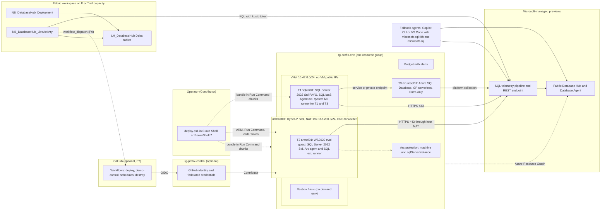
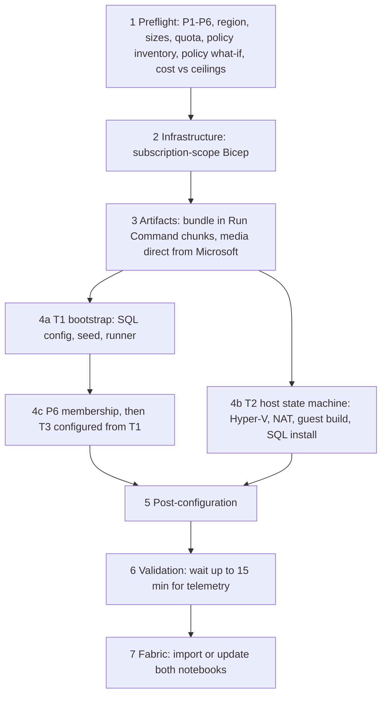
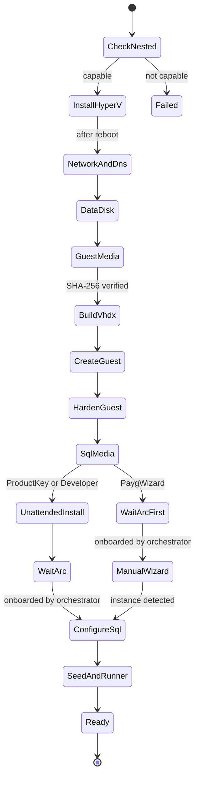
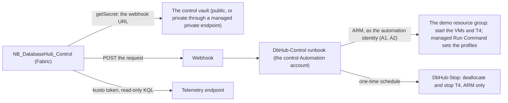

# Architecture

This document describes how the Fabric Database Hub hybrid SQL demo is built and why. Decisions and their evidence are in the [architecture decision records](adr/README.md). What's automated and what isn't is in the [automation support matrix](automation-support-matrix.md). How to present it is in the [demo walkthrough](demo-walkthrough.md) and [presentation surfaces](presentation.md).

> **Preview disclosure:** Microsoft Fabric Database Hub, its Database Agent and Copilot experience, SQL Server on Azure VM performance monitoring, unified inventory, the Arc SQL monitoring setting, and the SQL telemetry endpoint are previews. Behavior, prerequisites, and APIs can change. This repo uses only documented interfaces and validates what it can.

## Goal and scope

- **Goal:** a low-cost, repeatable customer demo of Database Hub (preview) and its in-Hub Database Agent (preview) across three SQL targets in one Azure resource group.
- **Minimum permissions:** Contributor on an existing subscription (plan §9.1).
- **One-click:** one command (`scripts/deploy.ps1`) or one GitHub Actions run (`deploy.yml`) deploys and configures everything that has documented automation, and reports anything else as **Manual action required**.

| ID | Target | Hosting | Management path | Scenario focus |
|---|---|---|---|---|
| T1 `sqlvm01` | SQL Server 2022 Standard (PAYG image) | Azure VM | SQL IaaS Agent extension. **Never Arc-enabled.** | Locking and blocking, long transactions |
| T2 `arcsql01` | SQL Server 2022 Standard (`t2SqlInstallMode`) | Nested Hyper-V guest on the Azure VM `archost01`, disclosed as a simulated on-premises server | SQL Server enabled by Azure Arc, **in the guest only** | CPU, memory, IO, expensive queries, missing index |
| T3 `azuresql01` | Azure SQL Database, General Purpose serverless | PaaS | Native | Service-objective CPU cap, log-rate governance, serverless resume |

Every incident scenario can also run on any target, because the Database Agent's target coverage isn't documented ([ADR 0013](adr/0013-agent-experience.md)).

## Overview



## Components and defaults

Every value is a parameter. Profiles (`lowest-cost`, `demo-day`, `enhanced-performance`) only set defaults ([ADR 0016](adr/0016-cost-profiles.md)).

| Component | Default | Notes |
|---|---|---|
| Region | West US 3 | In Hub's performance-monitoring region list and the SQL VM unified-inventory list. Preflight checks sizes and quota and suggests alternatives. |
| Resource groups | `rg-dbhub-demo`, plus `rg-dbhub-control` only for the GitHub path | [ADR 0002](adr/0002-resource-group-topology.md) |
| Network | VNet `10.42.0.0/24`: `snet-sqlvm`, `snet-archost`, `snet-pe` (private mode), `AzureBastionSubnet` | No VM public IPs. [ADR 0007](adr/0007-networking-modes-and-egress.md) |
| T1 `sqlvm01` | `Standard_D2s_v5` (`lowest-cost`), `MicrosoftSQLServer:sql2022-ws2022:standard-gen2`, OS disk (plus a data disk outside `lowest-cost`), system-assigned identity, SQL connectivity `LOCAL` | `Microsoft.SqlVirtualMachine/sqlVirtualMachines` with license type PAYG. Runs the workload runner for T1 and T3. |
| T2 host `archost01` | `Standard_E2s_v5` (`lowest-cost`), Windows Server 2022 Datacenter Gen2, `securityType = Standard`; in `lowest-cost` the guest's VHDX and media use the 128 GiB OS disk, and the other profiles add a 128 GiB data disk | No Arc agent and no SQL IaaS extension. [ADR 0003](adr/0003-t2-host-size-security-type-bootstrap.md) |
| T2 guest `arcsql01` | Generation 2, 2 vCPU, 8 GiB static memory, 64 GB dynamic VHDX, Windows Server 2022 Datacenter Evaluation (Desktop Experience) | IMDS and wire server blocked; automatic start and shutdown. [ADR 0004](adr/0004-guest-imds-isolation.md), [ADR 0006](adr/0006-sql-editions-and-licensing.md) |
| T3 `azuresql01` | Logical server `azuresql01-<deploymentId>`, database `ContosoCare`, GP serverless Gen5, 0.5–1 vCore, auto-pause 15 minutes, 32 GB maximum size | Entra-only with the P6 group as admin; TLS 1.2 |
| Budget | `monthlyCeilingUsd` (250, the hard monthly ceiling), alerts at 50%, 80%, and 100% to `ownerEmail` | Resource-group scope |
| Auto-shutdown | DevTest Labs schedules for T1 and the host | The host's guest shuts down cleanly through its stop action |
| Bastion | Basic SKU with a Standard public IP, created and removed on demand | Removed automatically after `bastionMaxHours` |
| Key Vault, Log Analytics, storage accounts | Not deployed | Hub telemetry is Microsoft-managed. The artifact cache storage account was dropped on 2026-10-20 ([ADR 0016](adr/0016-cost-profiles.md), C9). Key Vault is an opt-in since Phase 13 (`keyVault.enabled`, which requires `assignRoles`): an RBAC-mode vault `kv-<prefix><environment>-<deploymentId>`, created on demand like Bastion, for the one-time host password ([ADR 0009](adr/0009-secrets-handling.md)). |

## Naming and tags

| Item | Name |
|---|---|
| Demo resource group | `rg-<prefix>-<env>` |
| T1 VM / SQL VM resource | `sqlvm01` |
| T2 host VM | `archost01` |
| T2 guest and Arc machine | `arcsql01` |
| T3 logical server / database | `azuresql01-<deploymentId>` / `ContosoCare` |
| Bastion and its IP | `bas-<prefix>-<env>`, `pip-<prefix>-<env>-bastion` |
| GitHub identity | `id-<prefix>-github` in `rg-<prefix>-control` |

- `deploymentId` is six lowercase alphanumeric characters, deterministic per subscription, prefix, and environment.
- **Tags on every resource:** `solution`, `environment`, `owner`, `purpose`, `costCenter`, `autoShutdown`, and `deploymentId`.
- **Resource group only:** `ArcSQLServerExtensionDeployment=PAYG`, `dbhubDeployStage`, and the optional `expiresOn`.

## Deployment

One orchestrator, two triggers: `scripts/deploy.ps1` (Cloud Shell or local PowerShell 7, Contributor only) and `.github/workflows/deploy.yml` (after the one-time P7 setup). Both run the same idempotent stages. `-Resume` continues after the last good stage, which is recorded in the resource-group tag `dbhubDeployStage` ([ADR 0011](adr/0011-control-surface-priority.md)).



- **Subscription guard:** every script passes `--subscription` explicitly and never uses or changes the Azure CLI's default subscription. Before anything is written, the guard checks the configured subscription's sign-in (tenant and `azureAccount`) and runs read-only canaries through every authentication path: Azure Resource Manager through `az` and `az rest`, and Resource Manager, Fabric, Kusto, and Microsoft Graph tokens checked for the configured tenant and caller. Scripts never start an interactive sign-in ([ADR 0011](adr/0011-control-surface-priority.md#guard-update-2026-10-21), [prerequisites](prerequisites.md#target-subscription-configuration-the-subscription-guard)).
- **Stage 5 (post-configuration):**
  - Merges the T1 monitoring feature flag with the documented Azure CLI method.
  - Onboards T2 to Arc with the caller's token ([ADR 0005](adr/0005-arc-onboarding-authentication.md)).
  - Verifies the Arc SQL instance (Standard edition, license type, monitoring enabled).
  - Starts the `baseline` activity profile.
- **`PaygWizard` mode (default):** the orchestrator reports **Manual action required** with the wizard steps and an on-demand Bastion link, and keeps polling for up to `-WaitForManualMinutes`. The guest state machine resumes on its own once it detects the instance; `deploy.ps1 -Resume` finishes the Azure-side steps if the wait ran out.
- **Deploy to Azure button:** secondary. It runs stage 2 (infrastructure only), then links to `deploy.ps1 -Resume`, which sends the bootstrap bundle in Run Command chunks, starts the VM bootstraps (stages 3 and 4), and finishes the steps ARM can't do. It works only once the repo is public ([ADR 0001](adr/0001-iac-bicep-avm-compiled-arm.md), [ADR 0003](adr/0003-t2-host-size-security-type-bootstrap.md#phase-6-implementation-notes-2026-10-19)).
- **Bootstrap delivery (stages 3 and 4):** `deploy.ps1` deploys the VMs, sends each one the bundle with `Send-DemoBootstrapBundle` (SHA-256-checked chunks, one Run Command at a time, each deleted after it succeeds), deploys again with the bundle's SHA-256 and chunk count to add the loader Run Command, and reports the loader's exit code with `Wait-DemoBootstrapLoader` ([ADR 0003](adr/0003-t2-host-size-security-type-bootstrap.md#phase-6-implementation-notes-2026-10-19)).
- **Expected first-deploy time (estimate, measured in Phase 6 once live runs are approved):** about 15 minutes of infrastructure, a few minutes to send the bundle, 60–90 minutes for the T2 build (including about 6.2 GB of media downloads), and 3–15 minutes of telemetry latency. About 1.5–2 hours end to end, plus the manual wizard step in `PaygWizard` mode.
- **Parallel tracks and the T2 golden snapshot (Phase 20, [ADR 0018](adr/0018-fast-redeploy-parallel-tracks-golden-snapshot.md)):** `deploy.ps1` now runs stages 1–2 in one process, then three tracks at once in their own processes: T1 with T3 (the artifacts, T1's bootstrap with `deploy.ps1` running the loader itself, T3 from T1, the profiles, monitoring, telemetry), T2, and Fabric (the notebooks, the dashboard, and the history report); `-Sequential` keeps the stages above. A new `archost01` is restored from a golden snapshot of a finished host in `rg-<prefix>-golden` when one is boot-verified (`t2Source auto`), which keeps the pay-as-you-go wizard step: its OS disk is copied from the snapshot, the guest boots air-gapped, its Arc identity is reset locally, both passwords are rotated, and Arc is onboarded fresh. Measured on 2026-10-22: **38.8 minutes** end to end for a redeploy (T1 and T3 ready at +36.3 minutes, T2 at +37.7, Fabric about 2.4 minutes); the 30-minute target wasn't met. Phase 22 built the remaining overlaps: the tracks start before the template, a golden T2 starts as soon as `archost01` is deployed, with its artifacts sent during the Release, T1's artifacts go in one wave with its monitoring merged during the bootstrap, and T3 is set up first ([deployment](deployment.md#faster-redeploy-phase-22)).
- **One command, one guided stop (Phase 28, [ADR 0018](adr/0018-fast-redeploy-parallel-tracks-golden-snapshot.md#amendments-2026-10-29-phase-28-one-command-one-guided-stop)):** `deploy.ps1` after `az login` is the whole deployment. With no configuration it runs the first run itself; it keeps the PC awake, writes a progress model and a self-refreshing local status page (`status.ps1 -Watch` shows the same), waits for T2 by default, and in `PaygWizard` mode stops once for a person: Bastion, the host password (clipboard, Key Vault, or the portal's **Reset password**), the guest's one automatic sign-in, and SQL Server setup pre-filled from a configuration file, so the person chooses pay-as-you-go and Standard and signs in to Azure; the host checks the result, and the T2 track finishes by itself. With `networkMode` `public` or `private` the policy inventory runs beside the deployment; T4 falls back from B1ms to B2s, or to no T4, when its size isn't set; chunk Run Command deletes aren't waited for, extensions settle first, and a watchdog restarts a stuck VM once. Every run ends **DONE** (Database Hub shows every target) or **NOT DONE** (the exact next command), and a plain rerun continues where it stopped. Without a golden snapshot, a first run takes about 2 to 3 hours (an estimate), with a person needed for about 10 minutes, about 60 to 90 minutes in. In the state machine below, the `ManualWizard` state is preceded by a `GuidedSetup` step that prepares the pre-filled setup and the logon tasks ([deployment](deployment.md#one-command-one-guided-stop-phase-28)).

### T2 host state machine

The host runs a resumable state machine as a SYSTEM scheduled task. State is kept in `C:\ProgramData\DbHubDemo\state.json` ([ADR 0003](adr/0003-t2-host-size-security-type-bootstrap.md)).



## Network

| Subnet | CIDR | Purpose |
|---|---|---|
| `snet-sqlvm` | `10.42.0.0/27` | T1 |
| `snet-archost` | `10.42.0.32/27` | T2 host; the guest is behind its NAT |
| `snet-pe` | `10.42.0.64/27` | Private endpoints, private mode only |
| `AzureBastionSubnet` | `10.42.0.128/26` | On-demand Bastion |

- **Inbound:** RDP only from `AzureBastionSubnet`; everything else from the virtual network or the internet is denied.
- **Outbound:**
  - Allowed: TCP 443, and TCP 1688 to the two documented Azure KMS addresses. T1 also gets TCP 1433 and 11000–11999 to `Sql.<region>` for T3 in public mode. DNS, IMDS, and Windows licensing are platform traffic that NSGs allow by default; their service tags can only deny ([ADR 0007](adr/0007-networking-modes-and-egress.md)).
  - Everything else to the internet is denied.
  - NSGs can't restrict HTTPS by FQDN; this gap is documented.
- **Modes:** `public` (T3 reachable only through a VNet rule from `snet-sqlvm`) or `private` (T3 private endpoint plus the `privatelink.database.windows.net` zone). The default, `auto`, is resolved by preflight from Azure Policy: `private` when a policy turns off public network access on SQL servers, otherwise `public` ([ADR 0007](adr/0007-networking-modes-and-egress.md)).
- **Outbound path:** `outboundMode`. `DefaultOutboundAccess` is the default: the VM subnets set `defaultOutboundAccess: true` explicitly, because subnets are now private by default. `NatGateway` adds a NAT gateway and public IP at extra cost ([ADR 0017](adr/0017-outbound-access.md)).
- **Lateral movement:** the VM and private-endpoint subnets also deny outbound RDP and SSH into the VNet.
- **Guest isolation:** the guest firewall blocks IMDS and the wire server, host-enforced Hyper-V port ACLs block them too, and the guest's DNS goes through a forwarder on the host ([ADR 0004](adr/0004-guest-imds-isolation.md)).

Full rules: [ADR 0007](adr/0007-networking-modes-and-egress.md).

## Identity, permissions, and secrets

- **Minimum:** Contributor on the subscription (P1). No role assignments by default (`assignRoles = false`). Optional prerequisites P7–P11 add GitHub one-click, presenter Reader, notebook triggering, a product key, and Power BI viewer licenses ([ADR 0008](adr/0008-identity-rbac-abac.md), [permissions](permissions.md), [prerequisites](prerequisites.md)).
- **T3 administration:** the P6 group, which the deploying user owns, is the T3 Entra admin. T1's system-assigned identity is added to it, so T1 configures T3 in both network modes. This over-privilege is documented (risk R26), along with a hardened option.
- **No stored secrets:**
  - VM passwords are used only at creation; break-glass is a VMAccess reset.
  - The guest password stays on the host under DPAPI.
  - The Arc token lives in memory only.
  - Details: [ADR 0009](adr/0009-secrets-handling.md).
- **Threat model:** [security model](security-model.md). The T2 host is a trust boundary for the guest.

## Data and workload

- **Database `ContosoCare`** on every target. Business tables in schema `care`: `facilities`, `providers`, `patients` (synthetic), `appointments`, `encounters`, `claims`, `orders`, `inventory`, `payments`, `audit_events`, and `work_queues`. Control objects in schema `demo`: `scenario_runs`, `scenario_control`, `activity_profile`, and the bounded scenario procedures.
- **Seed:** deterministic and set-based, with a fixed seed. Size scales with the profile. All data is obviously synthetic.
- **Runner:** .NET 10 LTS, `ContosoCare.Workload`, as a CLI and a Windows service ([ADR 0010](adr/0010-workload-generator-technology.md)). Every connection is tagged `ContosoCare.Demo/<scenarioId>/<runId>`. Bounds are enforced in T-SQL, in the runner, and by a watchdog.
- **Activity profiles:**
  - `baseline`: a steady OLTP mix.
  - `business-day`: the baseline plus scheduled, bounded incidents.
  - `incident:<scenario>`: one bounded incident on a chosen target.
  - `off`.

| Target | Default incidents | Hub telemetry evidence | Query-level evidence |
|---|---|---|---|
| T1 | Locking and blocking, long transactions | `Processes blocked`, Lock-category waits, `Active Transactions`, `SqlServerActiveSessions` | Blocking chain through SSMS or the `diagnose-blocking-and-deadlocks` skill |
| T2 | CPU, memory, IO, expensive query, missing index | CPU utilization, memory clerks, `SqlServerStorageIO`, `PAGEIOLATCH` waits | Query Store before and after; remediation is never applied automatically |
| T3 | Service-objective CPU cap, log-rate governance, serverless resume and warm-up | `SqlServerCPUUtilization` against the tier limit, `Log Rate Governor` waits | Query Store |

## Database Hub integration

Discovery, monitoring, agents, and mirroring are separate concerns.

| Target | Estate (discovery) | Performance prerequisites | How the repo enables it | How it's validated |
|---|---|---|---|---|
| T1 | SQL IaaS Agent extension registration; unified inventory (preview) | Standard or Enterprise; extension 2.0.229.0 or later; system-assigned identity; `DatabaseWatcheronAzureVM` merged into the `SqlIaasExtension` settings; `Microsoft.Sql` and `Microsoft.AzureArcData` registered; egress to `telemetry.<region>.arcdataservices.com:443` | Bicep, plus the documented CLI settings merge in stage 5 | Extension status shows `DatabaseMonitorArcPlugin` with `MetricsUploadStatus` `OK`; telemetry rows |
| T2 | Arc machine and the SQL Server extension produce a `sqlServerInstance` | Standard or Enterprise; PAYG or Software Assurance; extension 1.1.2504.99 or later; `properties.monitoring.enabled = true` (API version `2023-09-01-preview`); egress to `*.<region>.arcdataservices.com` | Arc onboarding, the resource-group license tag, and a monitoring update in stage 5 | Machine **Connected**; extension version; instance edition, license type, and monitoring; telemetry rows |
| T3 | Native through Azure Resource Graph | Extended property `MS_EnablePerformanceMonitoringPreview = 'true'` on each user database | T-SQL from T1 in stage 4 | Property present; telemetry rows |

- **Hub users** need Reader at subscription scope (Contributors already have it), `Microsoft.Sql` registered, the Hub tenant setting (P4), and a Fabric Free license.
- **Telemetry validation** uses the documented REST endpoint (`POST https://adx.centralus.arcdataservices.com/kusto/v1/rest/query`, database `ArcSqlTelemetry`, token audience `https://kusto.kusto.windows.net`). Retention is 7 days or less. Tokens are never logged.
- **Hub validators (Phase 9):** `configure-fabric.ps1` runs the subscription guard, then P4, P5 and the workspace capacity, Estate visibility through Resource Graph (`HUB.ESTATE.*`), telemetry rows, newest sample, and lag per target (`TELEMETRY.T1`–`T3`), and presenter access (`HUB.PRESENTER.*`, only with `assignRoles`). Then it runs the Phase 12 notebook import (`Import-DemoFabricNotebook`), which worked live on 2026-10-21. P4 and P5 call Fabric REST only through Phase 12's `Get-DemoFabricToken` and `Invoke-DemoFabricRequest`. Warm-up uses the T3 readiness gate (`T3.READINESS.*`): T3 is ready only when it's in Resource Graph, its extended property is set, and fresh telemetry arrives; otherwise it's a Warning with the measured lag. The KQL lives in `scripts/modules/DbHubDemo/Kql/` ([ADR 0012](adr/0012-validation-model.md#phase-9-database-hub-checks-2026-10-20)).
- **Live (2026-10-20 and 2026-10-21):** all three targets passed their Estate and telemetry checks: T1 (`T1.SQLVM.MONITORING` **Pass**; 10 telemetry tables), T2 (`HUB.ESTATE.T2` and `TELEMETRY.T2` **Pass**, about 7 minutes after monitoring was turned on), and T3 (first sample 2.8 minutes after creation). The Hub UI itself is the owner's rehearsal.
- **No Hub API:** Hub has no public API or ARM resource. Saved views, the **Enable Performance Monitoring** button, monitor templates, and the Database Agent are UI-only. The repo never calls `/v1/databasehub/__private` routes.
- **Real-Time Dashboard as code (Phase 18):** [`fabric/realtime/`](../fabric/realtime/README.md) defines `RTD_DatabaseHub_LiveView`, a Fabric Real-Time Dashboard over the same telemetry endpoint as an Azure Data Explorer data source with each viewer's identity. Its definition is generated from the live-activity notebook's own KQL, so the two can't drift, and `configure-fabric.ps1 -ImportDashboard` imports it through the generic `Import-DemoFabricItem`, reads it back with Get Item Definition, and checks that every tile gets data by running its KQL read-only against the telemetry endpoint (`Test-DemoRealTimeDashboardData`, also a deploy step). Hub's monitor template wizard builds a similar dashboard by hand. Viewers need Reader like Hub users; Power BI content needs Pro or PPU below F64 (P11, `PREFLIGHT.FABRIC.VIEWERLICENSE`). See [presentation surfaces](presentation.md).
- **Agents:** the in-Hub Database Agent is the presenter-driven showcase, and every proposed action needs human approval. The `microsoft-sql-fdh` and `microsoft-sql` plugins are the scriptable fallback ([ADR 0013](adr/0013-agent-experience.md)). The install guide, the plugin pins, and the prompt pack are in [`fabric/agent/`](../fabric/agent/README.md) (Phase 10).
- **Mirroring:** deferred from v1 ([ADR 0015](adr/0015-mirroring-deferral.md)).

## Control surface and lifecycle

**Priority:** GitHub Actions (when P7 is in place), then the Fabric notebooks, then the PowerShell CLI. There's no local web UI ([ADR 0011](adr/0011-control-surface-priority.md)). Every surface calls the same module functions.

| Operation | What it does |
|---|---|
| `start-demo.ps1` | Starts T1 and the T2 host (the guest auto-starts), warms up T3, and sets an activity profile. `-Interactive` creates Bastion; `-ResetAdminPassword` adds a break-glass reset. |
| `stop-demo.ps1` | Stops the profile, shuts the guest down, deallocates the host and T1, lets T3 auto-pause, and removes Bastion. `-ParkT2` stops only T2. |
| `reset-demo.ps1` | Stops scenarios, verifies no demo transaction is open, and restores the seed state without redeploying. `-RebuildGuest` reports **Not supported**: rebuild T2 before its evaluation OS expires with `destroy.ps1`, then `deploy.ps1` (R196). |
| `status.ps1` | Health per target, active profile, evaluation-OS days left, Arc days disconnected, Bastion presence, month-to-date cost, next auto-shutdown |
| `validate.ps1` | The validation catalog ([ADR 0012](adr/0012-validation-model.md)) |
| `estimate-cost.ps1` | Live-price estimates per profile against the ceilings |
| `destroy.ps1` | Deletes Arc resources explicitly, then the resource group and the subscription deployment record, then checks for residual resources, Arc and identities included ([ADR 0002](adr/0002-resource-group-topology.md), [cleanup](cleanup.md)) |

**Scheduled workflows** (GitHub path only):

- `schedule-start.yml`: start with a warm-up before a demo.
- `schedule-stop.yml`: stop after a demo.
- `bastion-cleanup.yml`: remove a forgotten Bastion.
- `expiry.yml`: destroy the environment after its `expiresOn` tag (`destroy.ps1 -IfExpired`); `stop-demo.ps1 -ParkT2` parks T2 by hand.

**The on-demand activity control** (optional, Phase 25c, [ADR 0020](adr/0020-on-demand-activity-control.md)): a Fabric notebook starts a bounded run without any local tool, and watches it live.



- Everything lives in `rg-<prefix>-control`, which destroy keeps; only A1 reaches into the demo group.
- The runbook checks every request against the scenario catalog's allow-lists, refuses a run while another is active, creates the run's auto-stop before it starts anything, and sets each target's profile with the same VM-side request as `demo-control.ps1`. Stop now, the auto-stop, and the daily T4 safety stop go through Azure Resource Manager only.
- Where the tenant's policy makes new vaults private, the notebook lives in its own "DBHub Control" workspace, because a managed private endpoint turns off starter pools for its whole workspace; otherwise it's in a folder of the existing workspace.

## Validation

- **Statuses:** **Pass**, **Fail**, **Warning**, **Manual action required**, **Not supported**, and **Not selected**.
- A successful deployment is never reported as **Pass** on its own; every check is functional.
- **Static checks run in CI:** Bicep build and lint, PSRule, PSScriptAnalyzer, Pester, xUnit, JSON schema, notebook outputs, and gitleaks.
- **Live checks** cover providers, VM and extension health, nested virtualization, guest health, T1 monitoring status, Arc state, T3 configuration, Hub visibility through Resource Graph, telemetry rows per target, workload bounds, and zero residuals after destroy.
- See [ADR 0012](adr/0012-validation-model.md).

## Cost

- **Ceilings:** a hard $250 a month for idle plus light use (preflight fails above it), and $15 per demo-day session (a Warning above it). Every default stays the cheapest working option.
- **Live estimates:** `estimate-cost.ps1` computes hourly, daily-demo, and idle-monthly figures from the Azure Retail Prices API. It includes `Global` meters for SQL Server licenses and Arc SQL, and the subscription's Microsoft Defender for Cloud plans on their documented billing basis.
- **Guardrails C1–C11:** budget alerts, schedules, expiry, Spot, Hybrid Benefit, short T3 auto-pause, Bastion auto-removal, and month-to-date reporting. C9, the artifact cache, was dropped on 2026-10-20.
- **Biggest cost driver:** the T2 host size.
- **Bills while stopped:** disks, T3 storage, Defender for Azure SQL and Defender CSPM on T3 where those plans are on, the private endpoint and DNS zone in private mode, and anything left on demand (Bastion).
- See [ADR 0016](adr/0016-cost-profiles.md) and [cost management](cost-management.md).

## Repository layout

The tree follows the brief. Additions are marked **(deviation)** with the reason.

```text
README.md  LICENSE  SECURITY.md  CONTRIBUTING.md  CHANGELOG.md  CODE_OF_CONDUCT.md
azuredeploy.json  azuredeploy.parameters.json
docs/        architecture, prerequisites, deployment, permissions, cost-management,
             demo-walkthrough, troubleshooting, limitations, cleanup, faq,
             security-model, automation-support-matrix, implementation-report,
             references (deviation: the consolidated official sources, Phase 17),
             presentation (deviation: the presentation surfaces and viewer licensing, Phase 18)
docs/adr/    ADRs 0001-0018 and 0020 (the on-demand activity control, Phase 25c)
infra/       main.bicep, main.bicepparam, modules/,
             control/ (deviation: the optional on-demand activity control's templates, Phase 25c)
automation/  runbooks/ (deviation: the on-demand activity control's runbooks, Phase 25c)
config/      demo.config.example.json, environment.schema.json,
             versions.json (deviation: single source of pinned versions, plan §9.5)
scripts/     deploy, preflight, configure-fabric, configure-arc, configure-monitoring,
             validate, start-demo, stop-demo, reset-demo, status, estimate-cost, destroy (.ps1)
             setup-github-oidc.ps1 (deviation: one-time GitHub identity bootstrap, plan §4.12)
             setup-activity-control.ps1 (deviation: the optional on-demand activity control, Phase 25c)
             modules/DbHubDemo/ (deviation: shared module used by every script, plan §4.12)
vm/          bootstrap/, dsc/, health/, hyperv-guest/,
             t3/ (deviation: the T1-to-T3 T-SQL runner sent by action Run Command, Phase 8)
database/    common/, sqlvm01/, arcsql01/, azuresql/
scenarios/   healthy-baseline/, locking-blocking/, cpu-pressure/, io-pressure/,
             inefficient-query/, missing-index/,
             resource-governance/, log-rate-pressure/ (deviation: the T3 incidents, Phase 11)
             blocking-chain/, deadlock-storm/, tempdb-contention/, memory-grant-pressure/,
             parallel-scans/, log-flush-waits/, slow-consumer/, capacity-max/
             (deviation: one scenario per wait family, Phase 25b)
workload-generator/  src/, tests/, Dockerfile, README.md
fabric/      notebooks/ (NB_DatabaseHub_Deployment, NB_DatabaseHub_LiveActivity), agent/,
             connections/, README.md,
             realtime/ (deviation: the Real-Time Dashboard as code, Phase 18),
             control/ (deviation: NB_DatabaseHub_Control, the on-demand activity control's notebook, Phase 25c)
tests/       unit/, integration/, smoke/, teardown/,
             Invoke-StaticValidation.ps1 and Install-TestTools.ps1 (the local and CI test runner),
             PSScriptAnalyzerSettings*.psd1 (scripts, tests, and Windows PowerShell 5.1 rules for vm/)
.github/     workflows/ (validate, deploy, demo-control, destroy; plus reusable workflows,
             schedule-start, schedule-stop, bastion-cleanup, expiry, release: deviation, plan §9.4-§9.5),
             actions/ (deviation: composite actions, plan §9.5), ISSUE_TEMPLATE/,
             copilot-instructions.md, dependabot.yml, pull_request_template.md, CODEOWNERS
.devcontainer/  (deviation: identical contributor tooling, plan §9.5)
.pre-commit-config.yaml  (deviation: gitleaks, notebook output stripping, Bicep format, plan §9.5)
bicepconfig.json, ps-rule.yaml, .markdownlint-cli2.yaml, .editorconfig, .gitattributes, .gitignore
             (tool configuration read from the repo root)
```

## T3 as built (Phase 8)

- **Template:** `infra/modules/azuresql01.bicep`, deployed by `demo.bicep` as `azuresql01`. Parameters: the effective `networkMode`, the P6 group (`t3AdminGroupObjectId`, with its display name as the login), `t3AutoPauseMinutes` (0 means the profile's value), and `t3UseFreeLimit`. Outputs: `t3ServerName`, `t3ServerFqdn`, `t3DatabaseName`, `t3ServerId`, `t3DatabaseId`, and `t3PrivateEndpointId`; nothing secret.
- **Native resources, not the AVM `sql/server` module.** AVM 0.22.1 supports the free-offer properties, but it turns on server auditing and deploys a connection-policy resource by default, requires an availability-zone setting on each database, and brings about a dozen resource types the demo never creates into the compiled template (customer-managed keys, elastic pools, failover groups, outbound firewall rules, and more), each of which the policy inventory would have to account for. The native module uses exactly the seven resource types that the policy inventory already checks, and sends only the properties the demo sets.
- **Logical server** `azuresql01-<deploymentId>`: Microsoft Entra-only from creation (`administrators.azureADOnlyAuthentication`, the P6 group as a `Group` administrator), minimum TLS 1.2, no SQL authentication. Public network access is `Disabled` in private mode and `Enabled` in public mode ([ADR 0007](adr/0007-networking-modes-and-egress.md#phase-8-addendum-t3-as-built-2026-10-20)).
- **Database** `ContosoCare`: General Purpose serverless (`GP_S_Gen5`), the profile's maximum vCores, a 0.5 vCore minimum, 32 GB, regional, with locally redundant backups. With the free offer, `useFreeLimit` and `freeLimitExhaustionBehavior: BillOverUsage` are sent; without it, neither is, because an existing database can't be converted.
- **Auto-pause:** `t3AutoPauseMinutes` from the configuration (default 15) for every profile when a script deploys; the profile's `autoPauseMinutes` (60 for `demo-day` and `enhanced-performance`) applies only where no configuration is passed, which is the Deploy to Azure button. Set `t3AutoPauseMinutes` to 60 for a long demo-day session without resume pauses.
- **Configured from T1** (stage 4c), through module functions that Phase 13's scripts call:
  1. `Add-DemoT1ToT3AdminGroup` adds T1's identity to the P6 group before T1 first asks for an Azure SQL token (`T3.ADMINGROUP`; [ADR 0008](adr/0008-identity-rbac-abac.md#phase-8-addendum-t1-and-the-p6-group-as-built-2026-10-20)).
  2. `Invoke-DemoT3SqlFromT1 -Name Setup` runs the common schema and seed, `database/azuresql`, and the seed procedure on T3. The VM-side script (`vm/t3/Invoke-DemoT3Sql.ps1`) travels through action Run Command, gets an Azure SQL token from IMDS, retries the login while the membership applies, and prints one short JSON line ([database/azuresql](../database/azuresql/README.md), [vm/t3](../vm/t3/README.md)).
  3. `Test-DemoT3` verifies T3 (below), and `Invoke-DemoT3WarmUp` resumes it before a demo and confirms the extended property. The rest of the readiness gate (Resource Graph and telemetry) comes in Phase 9.
  4. `Remove-DemoT3` deletes the server and its private endpoint between demos and keeps the private DNS zone; the next deployment recreates T3 under the same names.
  5. `Resolve-DemoT3FreeOfferError` tells `deploy.ps1` when Azure rejected the free offer, so it deploys T3 again without it and records a Warning. Microsoft Learn lists no error codes for this, so the match requires an error that names the offer.

| Check | Verifies | Status |
|---|---|---|
| `T3.ADMINGROUP` | T1's identity is a member of the P6 group | Pass; Warning when Microsoft Graph doesn't report a new membership in time; Manual action required when the caller can't add members; Fail when T1 or its identity is missing |
| `T3.EXISTS` | The logical server and `ContosoCare` exist | Pass or Fail |
| `T3.ENTRAONLY` | Entra-only, the P6 group as administrator, TLS 1.2 or later | Pass or Fail |
| `T3.NETWORK` | Public network access matches the effective mode; private endpoint, zone group, and VNet link, or the `snet-sqlvm` VNet rule and no IP firewall rule | Pass, Warning (extra rules), or Fail |
| `T3.DATABASE` | General Purpose serverless with the profile's sizing and the configured auto-pause | Pass, Warning (drift), or Fail |
| `T3.FREEOFFER` | The free offer with `BillOverUsage`, as preflight decided | Pass, Warning, or Not selected |
| `T3.PROPERTY` | `MS_EnablePerformanceMonitoringPreview = 'true'`, read on T3 through T1 | Pass, Fail, Warning when T1 can't run the query, or Not selected |
| `T3.WARMUP` | T3 answered, and how long a resume took | Pass, Warning, or Fail |
| `T3.REMOVE` | The server and private endpoint are gone | Pass or Fail |
| `T3.SQL` | Any other T-SQL run from T1 | Pass, Warning, or Fail |

## T4 as built (Phase 24)

T4 is an Azure Database for PostgreSQL flexible server, `pgflex01-<deploymentId>`, added at the owner's request with live views first ([ADR 0019](adr/0019-t4-postgresql-flexible-server.md)).

| Aspect | T4 |
|---|---|
| Resource | `Microsoft.DBforPostgreSQL/flexibleServers`, Burstable `Standard_B1ms` (1 vCore, 2 GiB) by default, or `Standard_B2s` (2 vCores, 4 GiB), the documented fallback when Azure refuses B1ms, or General Purpose `Standard_D2ds_v5` (2 vCores, 8 GiB), the documented option the owner chose on 2026-10-26 (`t4SkuName`; the tier follows the size), in an optional zone at creation (`t4AvailabilityZone`), 32 GiB (P4) without auto-grow, PostgreSQL 18 (`config/versions.json` `postgresql.majorVersion`), 7-day backups, no HA, the database `contosocare` (`infra/modules/pgflex01.bicep`); `t4Enabled` (default true) |
| Network | Virtual network integration in both network modes: delegated `snet-pg` (10.42.0.96/28), a private DNS zone `<prefix>-<environment>.private.postgres.database.azure.com` linked to the network, no public access; `nsg-<prefix>-<environment>-pg` allows port 5432 from `snet-sqlvm` only |
| Access | Microsoft Entra only (password authentication off). The P6 group is the administrator; T1's managed identity signs in through it to create the runner's role `contosocare_runner` for its own object ID (`pgaadauth_create_principal_with_oid`), the schema, the seed, and the grants (`Enable-DemoT4Workload`). The runner then signs in as `contosocare_runner` with a token from T1's identity, per connection |
| Workload | The same runner and interface as T1 to T3 (`--target T4`), Npgsql with TLS `VerifyFull`; scenarios `healthy-baseline`, `cpu-pressure`, `locking-blocking`, `io-pressure`, `connection-surge`, `idle-in-transaction` ([`database/postgresql`](../database/postgresql/README.md)); the activity profile in `C:\ProgramData\DbHubDemo\activity-t4.json` on T1 |
| Database Hub | Estate lists the flexible server; Performance's **PostgreSQL** dashboard charts its Azure Monitor metrics. No query-level diagnostics (`HUB.ESTATE.T4`, `METRICS.T4`) |
| Live view | Enhanced metrics on (`metrics.collector_database_activity`): sessions by state and by wait event type, the oldest transaction and query, deadlocks. `status.ps1` (`STATUS.T4`, `STATUS.T4.LIVE` with `-Detail`) and `ContosoCare.Workload status --target T4` show them with the sessions, waits, blockers, and connections against `max_connections` |
| Lifecycle | `deploy.ps1` starts a stopped T4 before the template, its T4 track checks it, and T1's track sets it up; `start-demo.ps1` starts it, `stop-demo.ps1` stops it (a stopped server starts on its own after seven days), `destroy.ps1` removes it with the resource group |
| Not included | Lakehouse history, the report, the Insights app, and a Real-Time Dashboard page for T4 (follow-ups in ADR 0019); Query Store (not for the Burstable tier) |

## Changes from the approved plan

These engineering refinements were made while writing the ADRs. None of them changes a user-directed decision.

| # | Change | Why | ADR |
|---|---|---|---|
| 1 | The T2 host's `securityType` defaults to `Standard`; T1 uses `TrustedLaunch` only when its image advertises support | Microsoft Q&A answers say nested virtualization isn't supported with Trusted Launch. The Trusted Launch page, re-read in Phase 6, doesn't list it either way, so one live test decides. | 0003 |
| 2 | In `PaygWizard` mode, Arc onboarding runs before the wizard | The wizard's Azure Extension page then fills in the subscription, resource group, and region from the existing Arc connection. Validated live 2026-10-21: pay-as-you-go still needs the operator's own Azure Login on that page, which needs the WebView2 runtime in the guest ([deployment](deployment.md#the-paygwizard-manual-step-validated-live-2026-10-21)). | 0003, 0005 |
| 3 | The NSGs allow TCP 1688 to the two Azure KMS addresses, and TCP 1433 and 11000–11999 to `Sql.<region>` from T1 | Azure SQL's redirect connection policy needs the SQL ports; the KMS rule keeps activation working even if the platform's licensing rule is disabled. Keeps the 443-and-DNS intent otherwise (DNS is platform traffic; Phase 5 live finding) | 0007 |
| 4 | Guest DNS goes through a forwarder on the host, and Hyper-V port ACLs back up the guest firewall | Blocking the wire server also blocks Azure DNS; port ACLs can't be removed from inside the guest | 0004 |
| 5 | T1 SQL connectivity is `LOCAL` instead of `PRIVATE` | Nothing needs network access to T1's SQL Server | 0007 |
| 6 | Re-runs omit `osProfile` for VMs that already exist | Passwords aren't stored, and `adminPassword` can't change on an existing VM | 0001, 0009 |
| 7 | The artifact cache uses shared-key SAS. **Dropped 2026-10-20** with the artifact cache: tenant policies turn off shared-key access | Contributor can't assign the data-plane roles that a user delegation SAS needs | 0009, 0016 |
| 8 | The guest is Windows Server with Desktop Experience | The setup wizard needs a desktop | 0003, 0006 |
| 9 | The runner targets .NET 10 LTS | .NET 8 support ends on 2026-11-10 | 0010 |
| 10 | VM subnets set `defaultOutboundAccess: true` explicitly, with an opt-in NAT gateway mode | Subnets are private by default on newer networking API versions; a NAT gateway would have exceeded the original $75 ceiling, and defaults stay cheapest (Phase 5) | 0017 |
| 11 | Resource-group tags are merged by passing the existing tags into the template | A subscription-scope resource-group resource replaces tags on every deployment (Phase 5) | 0002 |
| 12 | Premium SSD v2 for `demo-day` and `enhanced-performance` data disks, where zones allow | Near-Standard-SSD cost with premium performance kept `demo-day` under the original $75 ceiling (Phase 5, C10) | 0016 |
| 13 | `networkMode` `auto` (default) resolves from Azure Policy; preflight reads the tenant's policies and the Defender plans | Tenant policies can turn off SQL public network access and enforce Defender plans (Phase 5, 2026-10-20) | 0007, 0012, 0016 |
| 14 | The artifact cache is dropped; the bundle travels in Run Command chunks and media comes straight from Microsoft | Tenant policies turn off shared-key and public access on storage accounts, and Defender for Storage bills each account (2026-10-20) | 0001, 0016 |
| 15 | The monthly ceiling is a hard $250 | User-directed, 2026-10-20 | 0016 |
| 16 | Premium SSD v2 only when a `zone` is configured; otherwise the profile's regional data-disk tier (E10 for `demo-day`), with P10 only as a `dataDiskSku` opt-in | Premium SSD v2 needs a zonal VM, and a zone is an explicit choice that preflight checks (Phase 6; disk decision of 2026-10-19) | 0016 |
| 17 | The Deploy to Azure button provisions infrastructure only; the bootstraps start on `deploy.ps1 -Resume` | The portal can't send the bootstrap bundle, so a loader would wait on an artifact that may never arrive (Phase 6) | 0001, 0003 |
| 18 | The host downloads guest media from the pinned Microsoft URLs and verifies their SHA-256 | The hash pin keeps the build deterministic without a staging step (Phase 6) | 0003, 0006 |
| 19 | T1 doesn't use SQL VM automated storage configuration | It's documented for Premium SSD with separate data and log disks; T1 has one data disk of varying type, or none in `lowest-cost` (Phase 6) | 0003 |
| 20 | `lowest-cost` has no separate data disks: SQL Server data on T1 and the guest's VHDX and media on the T2 host use the OS disks, after a free-space check on the host | Keeps the lightest profile as cheap as possible, saving about 19 USD a month (owner-approved, 2026-10-20; Phase 6) | 0003, 0016 |
| 21 | The workload runner is a framework-dependent publish that reaches the VMs in Run Command chunks, and runs on a .NET runtime zip downloaded from Microsoft against a pinned SHA-512 | Without the artifact cache, a self-contained build would need hundreds of chunks (Phase 6) | 0010 |
| 22 | T3 uses native Bicep resources instead of the AVM `sql/server` module | AVM adds auditing, a connection policy, and unused resource types by default; the native module sends only what the demo sets (Phase 8) | 0001, 0007 |
| 23 | T3 auto-pause follows `t3AutoPauseMinutes` (default 15) on every profile when a script deploys | The cheapest default wins (2026-10-20); the profiles' 60 minutes applies only to the Deploy to Azure button (Phase 8) | 0016 |
| 24 | T1 runs T3's T-SQL through action Run Command with an IMDS token, and joins the P6 group before its first Azure SQL token | One documented path for both network modes; managed identity tokens are cached for up to about 24 hours (Phase 8) | 0007, 0008 |
| 25 | The runner is published framework-dependent, and `profile run` is a long-running console host rather than a Windows service; this supersedes "a Windows service" under [Data and workload](#data-and-workload) | The delivery phases download the pinned .NET runtime from Microsoft, so a small runner fits Run Command chunks; hosting it (for example as a startup task) stays with them (Phase 11) | 0010 |
| 26 | Two more scenarios, `resource-governance` and `log-rate-pressure`, for the T3 incidents; every scenario runs on every target | Plan §9.3 lists them for T3, and Database Agent target coverage is undocumented (Phase 11) | 0010, 0013 |
| 27 | `deploy.ps1` runs three tracks in parallel and restores a new T2 host from a golden snapshot; a third resource group, `rg-<prefix>-golden`, holds the snapshots and outlives `destroy.ps1` unless `-IncludeGolden` | User-directed, 2026-10-21: a repeatable deploy of 30 minutes or less that keeps the pay-as-you-go wizard state; measured at 38.8 minutes (Phase 20) | 0002, 0003, 0018 |
| 28 | Eight more scenarios, one per wait family: a deep blocking chain with lock escalation, a deadlock storm, tempdb contention, memory grants, parallelism, log flushes, a slow client, and a target at full capacity; `tempdb-contention`'s own temporary tables are the one write outside `ContosoCare` | User-directed, 2026-10-23: diverse, bounded activity for the Performance page and the Database Agent; every scenario keeps a hard maximum duration, runs on every target, and touches only `ContosoCare.Demo/` sessions (Phase 25b) | 0010, 0013 |

## Sources (checked 2026-10-19)

- Database Hub: [overview](https://learn.microsoft.com/fabric/database/hub/overview), [monitor SQL](https://learn.microsoft.com/fabric/database/hub/monitor-sql), [add SQL](https://learn.microsoft.com/fabric/database/hub/add-sql), [FAQ](https://learn.microsoft.com/fabric/database/hub/faq), [telemetry endpoint](https://learn.microsoft.com/fabric/database/hub/microsoft-sql-query-performance-monitoring-telemetry)
- SQL Server on Azure VMs: [performance monitoring](https://learn.microsoft.com/azure/azure-sql/virtual-machines/windows/enable-performance-monitoring-sql-vm), [unified inventory](https://learn.microsoft.com/azure/azure-sql/virtual-machines/windows/unified-inventory-sql-vm)
- SQL Server enabled by Azure Arc: [monitoring](https://learn.microsoft.com/sql/sql-server/azure-arc/sql-monitoring), [license and billing](https://learn.microsoft.com/sql/sql-server/azure-arc/manage-license-billing), [auto-deploy](https://learn.microsoft.com/sql/sql-server/azure-arc/manage-autodeploy), [prerequisites](https://learn.microsoft.com/sql/sql-server/azure-arc/prerequisites)
- Azure Arc-enabled servers: [`azcmagent connect`](https://learn.microsoft.com/azure/azure-arc/servers/azcmagent-connect), [network requirements](https://learn.microsoft.com/azure/azure-arc/servers/network-requirements), [evaluate on an Azure VM](https://learn.microsoft.com/azure/azure-arc/servers/plan-evaluate-on-azure-virtual-machine)
- Compute: [nested virtualization](https://learn.microsoft.com/virtualization/hyper-v-on-windows/user-guide/nested-virtualization), [managed Run Command](https://learn.microsoft.com/azure/virtual-machines/windows/run-command-managed), [Trusted Launch](https://learn.microsoft.com/azure/virtual-machines/trusted-launch)
- Azure SQL Database: [serverless auto-pause](https://learn.microsoft.com/azure/azure-sql/database/serverless-tier-auto-pause-resume), [connectivity architecture](https://learn.microsoft.com/azure/azure-sql/database/connectivity-architecture)
- Fabric: [licenses](https://learn.microsoft.com/fabric/enterprise/licenses), [`notebookutils` credentials](https://learn.microsoft.com/fabric/data-engineering/notebookutils/notebookutils-credentials)
- ARM and Bicep: [subscription deployments](https://learn.microsoft.com/azure/azure-resource-manager/bicep/deploy-to-subscription), [file functions](https://learn.microsoft.com/azure/azure-resource-manager/bicep/bicep-functions-files), [Deploy to Azure button](https://learn.microsoft.com/azure/azure-resource-manager/templates/deploy-to-azure-button)
