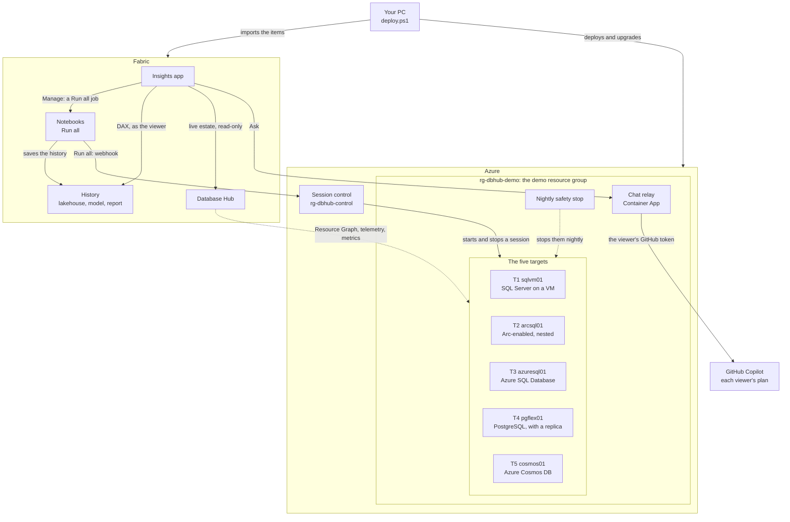
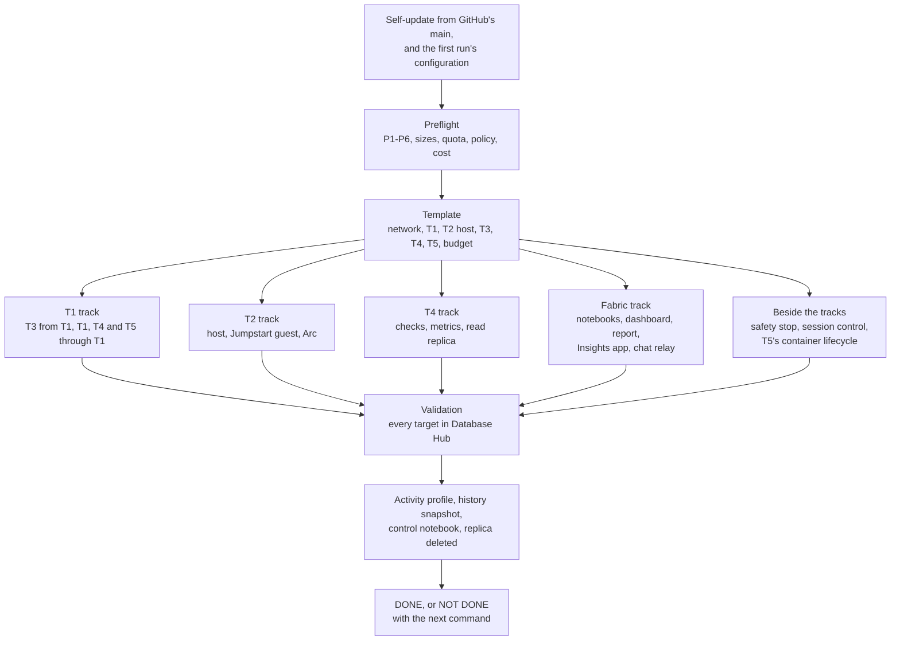
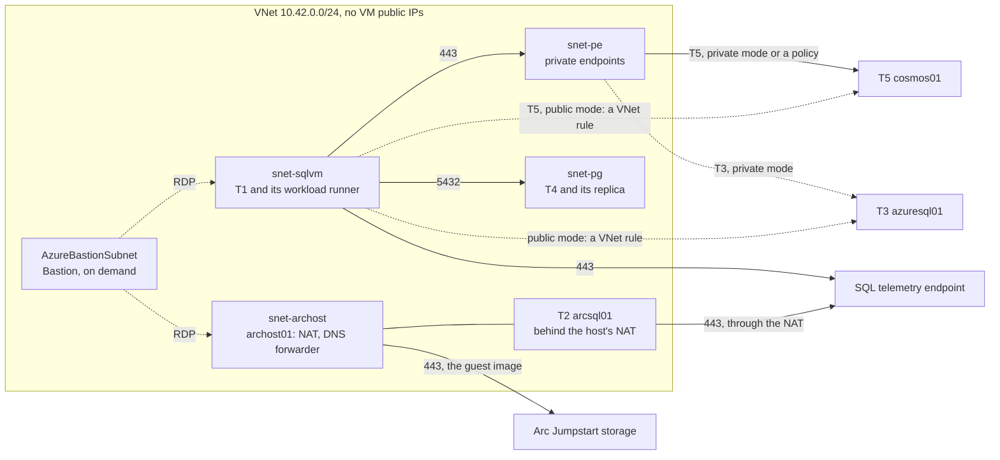
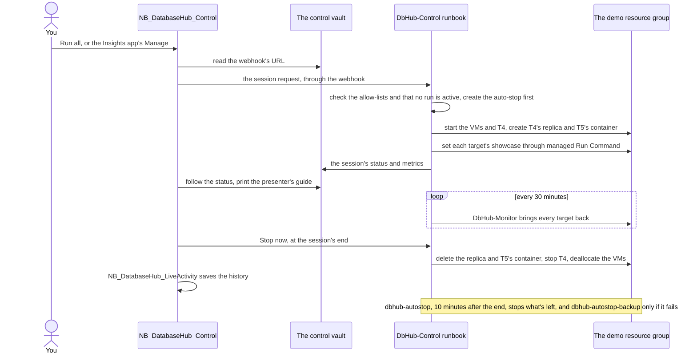

# Architecture

How the demo's parts fit together, and why. The decisions and their evidence are in the [architecture decision records](adr/README.md), what's automated and what isn't in the [automation support matrix](automation-support-matrix.md), and how to present it in the [demo walkthrough](demo-walkthrough.md) and [presentation surfaces](presentation.md).

> **Preview disclosure:** Microsoft Fabric Database Hub is generally available since 2026-11-17. Its Copilot, Database Agents, alerts, SQL Server on Azure VM performance monitoring, and unified inventory are previews, Learn still labels the SQL telemetry endpoint and the Arc SQL monitoring setting previews, and Fabric Apps, which the Insights app is built on, is a preview too ([limitations](limitations.md#preview-disclosures)). Behavior, prerequisites, and APIs can change. This repo uses only documented interfaces, with one narrow, read-only exception: the Insights app's estate function reads 8 allowlisted Database Hub routes, scoped to the demo's resource group ([ADR 0013's amendment](adr/0013-agent-experience.md#amendment-2026-11-18-the-ga-skill-and-one-narrow-exception)).

## Goal and scope

- **Goal:** a low-cost, repeatable customer demo of Database Hub, with its Copilot and Database Agents, across five targets (three SQL targets, PostgreSQL, and Azure Cosmos DB) in the demo resource group, with the session control in a resource group of its own.
- **Minimum permissions:** Contributor on an existing subscription.
- **One command:** `./scripts/deploy.ps1` after `az login` deploys and configures everything that has documented automation, and reports anything else as **Manual action required**. GitHub Actions (`deploy.yml`) is an optional path for maintainers (P7); users never need it.

| ID | Target | Hosting | Management path | Scenario focus |
|---|---|---|---|---|
| T1 `sqlvm01` | SQL Server 2022 Standard (PAYG image) | Azure VM | SQL IaaS Agent extension. **Never Arc-enabled.** | Locking and blocking, long transactions |
| T2 `arcsql01` | SQL Server 2022 Standard (`t2SqlInstallMode`) | Nested Hyper-V guest on the Azure VM `archost01`, disclosed as a simulated on-premises server | SQL Server enabled by Azure Arc, **in the guest only** | CPU, memory, IO, expensive queries, missing index |
| T3 `azuresql01` | Azure SQL Database, General Purpose serverless | PaaS | Native | Service-objective CPU cap, log-rate governance, serverless resume, plan regression and the Database Agent loop |
| T4 `pgflex01` | Azure Database for PostgreSQL flexible server, PostgreSQL 18, with a read replica `pgreplica01` for each session | PaaS | Native, through Azure Monitor metrics | Connections at `max_connections`, idle in transaction, read replica lag |
| T5 `cosmos01` | Azure Cosmos DB for NoSQL, 400 RU/s | PaaS | Native, through Azure Monitor metrics | Normalized RU at 100% and throttled requests (429) |

Every SQL scenario runs on T1, T2, and T3, because Copilot's target coverage in Database Hub isn't documented, except `plan-regression`, which needs T3's automatic tuning. T4 and T5 have scenarios of their own ([scenarios](../scenarios/README.md)). Database Agents covers Azure SQL Database only, so T3, where the showcase's Database Agent loop runs ([ADR 0013](adr/0013-agent-experience.md#amendment-general-availability-and-the-database-agent-loop-on-t3-2026-11-18)).

## At a glance

`deploy.ps1` deploys everything in the diagram with one command, in parallel tracks, and keeps it up to date. [What's deployed, and by what](../README.md#whats-deployed-and-by-what) lists each part with what creates and deletes it, and [components and defaults](#components-and-defaults) has each part's details. T2 needs no person: its host downloads [Arc Jumpstart](https://github.com/Azure/arc_jumpstart_docs/blob/71a945c619f78acb441c6470d76a9b58347169fe/docs/azure_jumpstart_arcbox/ITPro/_index.md)'s prebuilt SQL Server 2022 Standard guest disk and makes it `arcsql01`, with no Bastion. What needs a person, none of which keeps the run from **DONE**:

- **An Owner's one grant,** only when you aren't an Owner: `./scripts/grant-safety-stop.ps1`, once, for the roles of the nightly safety stop and the session control. **DONE** prints it first.
- **Once per deployment, required for the Database Agent beat:** selecting T3 for Database Agents in Database Hub's **Manage agents**, a minute or two (`HUB.AGENT.T3`, under **DONE**'s **Please confirm**; [step by step](database-agents.md)); everything else works without it.
- **Each viewer of Ask,** the Copilot chat in the Insights app: a GitHub sign-in once per browser, on their own GitHub Copilot plan.
- **The Fabric capacity:** you or its administrator resume it before Run all and pause it after. It's outside every estimate, with Fabric and Power BI licenses and each viewer's GitHub Copilot plan.
- **Only if Fabric refuses your `az login` token:** the Insights app's browser sign-in, `./scripts/configure-fabric-app.ps1 -SignIn`.

Also included: start, stop, reset, status, cost estimate, and destroy from PowerShell, a [Database Agent prompt pack](../fabric/agent/README.md), and validation in six statuses ([validation](#validation)). [Automated vs manual](automation-support-matrix.md#automated-vs-manual) lists every step, and [how long each step takes](deployment.md#how-long-each-step-takes) the measured times.

## Components and defaults

Every value is a parameter; the profiles (`lowest-cost`, `demo-day`, `enhanced-performance`) only set defaults ([ADR 0016](adr/0016-cost-profiles.md), [configuration](configuration.md)). The names are in [naming and tags](#naming-and-tags).

| Component | Default | Notes |
|---|---|---|
| Region | West US 3 | In Database Hub's performance-monitoring region list and SQL VM unified inventory's; preflight checks sizes and quota, and suggests alternatives |
| Resource groups | `rg-dbhub-demo`; `rg-dbhub-control` for the session control (and the optional GitHub identity); `rg-dbhub-golden` only for an optional T2 golden snapshot | [ADR 0002](adr/0002-resource-group-topology.md) |
| T1 | `Standard_D2s_v5` (`lowest-cost`), `MicrosoftSQLServer:sql2022-ws2022:standard-gen2`, an OS disk (and a data disk outside `lowest-cost`), a system-assigned identity, SQL connectivity `LOCAL` | `Microsoft.SqlVirtualMachine/sqlVirtualMachines`, license type PAYG. Runs the workload runner for T1, T3, T4, and T5 |
| T2 host | `Standard_E2s_v5` (`lowest-cost`), Windows Server 2022 Datacenter Gen2, `securityType` `Standard`; in `lowest-cost` the guest's disk (and, in the build modes, its media) use the 128 GiB OS disk, and the other profiles add a 128 GiB data disk | No Arc agent and no SQL IaaS extension ([ADR 0003](adr/0003-t2-host-size-security-type-bootstrap.md)) |
| T2 guest | Generation 2, 2 vCPU, 8 GiB static memory. `JumpstartImage` (the default): Arc Jumpstart ArcBox's prebuilt disk, a dynamic VHDX of at most 100 GiB (34 GiB to download), with Windows Server 2022 Standard (not an evaluation) and SQL Server 2022 Standard. The build modes (`ProductKey`, `Developer`, and a kept `PaygWizard` guest): a 64 GB dynamic VHDX with Windows Server 2022 Datacenter Evaluation (Desktop Experience) | IMDS and the wire server blocked; automatic start and shutdown ([ADR 0004](adr/0004-guest-imds-isolation.md), [ADR 0006](adr/0006-sql-editions-and-licensing.md)) |
| T3 | `ContosoCare`, General Purpose serverless Gen5, 0.5–2 vCores in `lowest-cost`, auto-pause after 15 minutes, 32 GB | An older T3 at 1 vCore is scaled online by the next `deploy.ps1` (`DEPLOY.T3.SCALE`). [T3 as built](#t3-as-built-phase-8) |
| T4 and its read replica | `Standard_D4ds_v5` (General Purpose, 4 vCores) with autonomous tuning, PostgreSQL 18, 32 GiB, `contosocare`; the replica at T4's size, only during a session | In every deployment ([T4 as built](#t4-as-built)) |
| T5 | Azure Cosmos DB for NoSQL: `patient-events` at 400 RU/s, only during a session; a private endpoint in private mode or when something needs it, otherwise T1's subnet rule (since 2026-11-21); the free tier when it's free | [T5 as built](#t5-as-built) |
| Budget and auto-shutdown | The budget at `monthlyCeilingUsd`, with alerts at 50%, 80%, and 100% to `ownerEmail`; DevTest Labs schedules for T1 and the T2 host at `autoShutdownTime` | The host shuts its guest down cleanly first ([cost](#cost)) |
| Nightly safety stop | An Automation account (Basic, local authentication off) and its identity, with `DbHub-Stop` on `dbhub-safety-stop` (at `autoShutdownTime`, 19:00 by default), `dbhub-safety-t3check` (30 minutes later, or T3's auto-pause delay plus 15 when that's longer), and `dbhub-safety-deferred` (only after a `deploy.ps1` run it waited for) | [Sessions and stops](#sessions-and-stops) ([ADR 0024](adr/0024-nightly-safety-stop.md)) |
| Session control | In `rg-<prefix>-control`: an Automation account with the runbooks `DbHub-Control`, `DbHub-Stop`, and `DbHub-Monitor` and the webhook, a Key Vault, and an identity; and the notebook `NB_DatabaseHub_Control` | Part of every deployment; `control.enabled: false` no longer turns it off ([ADR 0026](adr/0026-one-run-all-session.md)) |
| Key Vault | The session control's, in every deployment: the webhook's URL and the session's status and metrics, never a password; public or private, as the tenant's policy makes new vaults | The host-password vault only with `keyVault.enabled`, which requires `assignRoles`: an RBAC-mode vault, created on demand like Bastion ([ADR 0009](adr/0009-secrets-handling.md)) |
| Fabric items | In `fabric.workspaceName`, on your F or Trial capacity: the lakehouse; `NB_DatabaseHub_Deployment` (the validator) and `NB_DatabaseHub_LiveActivity` (the live analysis, which saves the history); the Real-Time Dashboard over the telemetry endpoint; the Direct Lake model and its four-page report | `deploy.ps1`'s Fabric track: `configure-fabric.ps1`, `configure-powerbi.ps1`, and `configure-fabric-app.ps1` |
| The Insights app | `APP_DatabaseHub_Insights` (Fabric Apps, preview), the demo's operations product: Mission Control, the "Did we catch it?" scoreboard, and a replay of each session ([ADR 0030](adr/0030-insights-app-mission-control.md)), and a DBA console: the history (read-only DAX through its connector, as the viewer), the live estate (its functions item, as the app's owner; Database Hub refuses it today, R924), Ask, and Manage (for its operators, the deployer and the admin group; for anyone else, it copies the request for Run all) | Deploys with your `az login`, after two tenant settings (P12, P13); when it can't be, the run still ends **DONE**, with the app's row red (Failed) on the status page, reported as **Manual action required**, never a **Fail** ([its guide](../fabric/app/README.md), [ADR 0029](adr/0029-insights-app-dba-console.md)) |
| Ask's chat relay | Container Apps, Consumption, 1 vCPU and 2 GiB, 0 to 1 replica, external HTTPS ingress | Holds no credential, and scales to zero about 10 minutes after the last question. No Log Analytics workspace, registry, secret, managed identity, or role; a public ghcr.io image, pinned by digest (`askRelay.image`). `"ask": { "enabled": false }` leaves it out ([ADR 0028](adr/0028-ask-copilot-in-the-insights-app.md)) |
| Bastion | Basic, with a Standard public IP, on demand | Optional: no deployment needs it. Removed after `bastionMaxHours` |
| Log Analytics, storage accounts | Not deployed | Database Hub's telemetry is Microsoft-managed, and there's no artifact cache ([ADR 0016](adr/0016-cost-profiles.md)) |

## Naming and tags

| Item | Name |
|---|---|
| Demo resource group | `rg-<prefix>-<environment>` |
| T1 VM / SQL VM resource | `sqlvm01` |
| T2 host VM | `archost01` |
| T2 guest and Arc machine | `arcsql01` |
| T3 logical server / database | `azuresql01-<deploymentId>` / `ContosoCare` |
| T4 flexible server / database | `pgflex01-<deploymentId>` / `contosocare` |
| T4's read replica, for each session | `pgreplica01-<deploymentId>` |
| T5 account / database / container | `cosmos01-<deploymentId>` / `contosocare` / `patient-events` |
| Network | `vnet-<prefix>-<environment>`; `nsg-<prefix>-<environment>-sqlvm`, `-archost`, `-pe`, `-pg`, and `-bastion`; with `outboundMode` `NatGateway`, `ng-<prefix>-<environment>` and `pip-<prefix>-<environment>-nat` |
| Private endpoints | `pe-<prefix>-<environment>-cosmos01` (T5: private mode, a policy that needs it, or a T5 deployed before 2026-11-21) and `pe-<prefix>-<environment>-azuresql01` (T3, private mode) |
| Bastion and its IP | `bas-<prefix>-<environment>`, `pip-<prefix>-<environment>-bastion` |
| Budget and deployment record | `budget-<prefix>-<environment>`, `<prefix>-<environment>-main` |
| Nightly safety stop | `aa-<prefix>-<environment>-safetystop`, `id-<prefix>-<environment>-safetystop` |
| Ask's chat relay | `cae-<prefix>-<environment>-ask`, `ca-<prefix>-<environment>-ask` |
| Session control | `rg-<prefix>-control`: `aa-<prefix>-control`, `kv-<prefix>-ctl-<suffix>`, `id-<prefix>-automation` |
| Host-password vault (opt-in) | `kv-<prefix><environment>-<deploymentId>` |
| GitHub identity (optional) | `id-<prefix>-github` in `rg-<prefix>-control` |
| T2 golden snapshots (optional) | `rg-<prefix>-golden` |
| Administrators' group (P6) | `<prefix>-<environment>-sql-admins`, unless you supply your own: T3's and T4's administrator |
| Custom roles | "DbHub Demo Safety Stop", "DbHub Demo Activity Operator", and "DbHub Demo Session Writer" (the last two with `control.roleNameSuffix` when it's set) |
| Fabric items | In the demo's workspace (`fabric.workspaceName`): `LH_DatabaseHub`, `NB_DatabaseHub_Deployment`, `NB_DatabaseHub_LiveActivity`, `RTD_DatabaseHub_LiveView`, `SM_DatabaseHub_History`, `RPT_DatabaseHub_History`, and `APP_DatabaseHub_Insights` with its user data functions `APP_DatabaseHub_Insights_connector` and `APP_DatabaseHub_Insights`. `NB_DatabaseHub_Control` is in the folder "DBHub Control" of that workspace or, where the control's vault is private, in a workspace of its own: "&lt;workspace&gt; Control" (`control.fabricWorkspaceName`) |

- `deploymentId` is six lowercase alphanumeric characters, deterministic per subscription, prefix, and environment.
- **Tags on every resource:** `solution`, `environment`, `owner`, `purpose`, `costCenter`, `autoShutdown`, and `deploymentId`.
- **Resource group only:** `ArcSQLServerExtensionDeployment=PAYG`, the optional `expiresOn`, and the `DbHub*` state tags that `deploy.ps1` and the sessions keep there, such as `DbHubDeployStage`, each track's `DbHubTrackT1`, `DbHubTrackT2`, `DbHubTrackT4`, and `DbHubTrackFabric`, `DbHubT4Size`, `DbHubT4Replica`, and `DbHubT5Container`.

## Deployment

One command, `./scripts/deploy.ps1`, in Cloud Shell, a codespace, or PowerShell 7 on your PC, with Contributor. Every step is idempotent: a plain rerun continues where the last one stopped, from the state tags, as `-Resume` does, and the same command upgrades an existing environment. [Deployment](deployment.md) has every step, option, and duration, and [update an existing environment](deployment.md#update-an-existing-environment) what an upgrade changes.

- **First,** a clean checkout of `main` updates itself from GitHub (`DEPLOY.SELFUPDATE`), and with no configuration the run writes one (`INIT.EXISTING` when your environment exists). The subscription guard checks the configured subscription's tenant and account on every authentication path; scripts pass `--subscription`, never change the Azure CLI's default subscription, and never sign in ([prerequisites](prerequisites.md#target-subscription-configuration-the-subscription-guard), [ADR 0011](adr/0011-control-surface-priority.md#guard-update-2026-10-21)).
- **The tracks** run at once, each in its own process with its own guard; `-Sequential` runs them in turn ([ADR 0018](adr/0018-fast-redeploy-parallel-tracks-golden-snapshot.md)). The T2 host's steps are a resumable state machine, a SYSTEM scheduled task with its state in `C:\ProgramData\DbHubDemo\state.json` ([the host's steps](../vm/bootstrap/README.md)). In `JumpstartImage` mode it downloads the image, checked against its Content-MD5, makes it `arcsql01` at a first boot with no network, and checks it; an image that can't be used ends T2 **NOT DONE** with the fix ([ADR 0006](adr/0006-sql-editions-and-licensing.md)). Arc onboarding uses your token ([ADR 0005](adr/0005-arc-onboarding-authentication.md)). A configuration's retired `PaygWizard` runs as `JumpstartImage`.
- **Each VM's bootstrap** arrives in SHA-256-checked Run Command chunks, then a loader; a rerun sends a changed bundle or runner again ([ADR 0003](adr/0003-t2-host-size-security-type-bootstrap.md#amendment-a-changed-bundle-takes-over-from-a-run-thats-still-going-2026-11-06)). An optional golden snapshot in `rg-<prefix>-golden` restores a new T2 host from a finished one ([faster redeploy](deployment.md#faster-redeploy-phase-22)).
- **The ending:** the configured activity profile (`business-day` by default), the history report's snapshot (`NB_DatabaseHub_LiveActivity` once, analyze-only, as you; it never blocks **DONE** or resumes a paused capacity; [ADR 0014](adr/0014-notebook-role-and-capacity.md#amendment-2026-11-06-one-analyze-only-run-at-the-end-of-each-deployment)), the control notebook, and T4's read replica deleted unless a session uses it (`DEPLOY.T4.REPLICA.END`). The Deploy to Azure button deploys the infrastructure only, from a public repository, and `deploy.ps1 -Resume` does the rest ([ADR 0001](adr/0001-iac-bicep-avm-compiled-arm.md)).

## Network

| Subnet | CIDR | Purpose |
|---|---|---|
| `snet-sqlvm` | `10.42.0.0/27` | T1 |
| `snet-archost` | `10.42.0.32/27` | The T2 host; the guest is behind its NAT (`192.168.200.0/24`) |
| `snet-pe` | `10.42.0.64/27` | Private endpoints: T5's when it has one, and T3's in private mode |
| `snet-pg` | `10.42.0.96/28` | T4, delegated to `Microsoft.DBforPostgreSQL/flexibleServers`, with `nsg-<prefix>-<environment>-pg`; its read replica joins it for each session |
| `AzureBastionSubnet` | `10.42.0.128/26` | On-demand Bastion |

- **Inbound:** RDP only from `AzureBastionSubnet`. From `snet-sqlvm` (T1) only: T4 on TCP 5432 (`Allow-Postgres-From-T1`), T5's private endpoint on TCP 443 (`Allow-Cosmos-From-T1`), and T3's on TCP 1433. Everything else from the virtual network or the internet is denied.
- **Outbound:** TCP 443, and TCP 1688 to the two documented Azure KMS addresses. T1 also gets TCP 1433 and 11000–11999 to `Sql.<region>` for T3 in public mode, and `snet-pg` sends TCP 443 to Azure Storage, for T4's write-ahead log, and to Microsoft Entra ID. DNS, IMDS, and Windows licensing are platform traffic that NSGs allow by default; their service tags can only deny. Everything else to the internet is denied. NSGs can't restrict HTTPS by FQDN: a documented gap. In `JumpstartImage` mode the T2 host also downloads from Arc Jumpstart's public storage (`jumpstartprodsg.blob.core.windows.net`) and GitHub (`raw.githubusercontent.com`) over that TCP 443 ([outbound access](prerequisites.md#outbound-access)).
- **Modes:** `public` (T3 reachable only through a VNet rule from `snet-sqlvm`) or `private` (T3's private endpoint and the `privatelink.database.windows.net` zone). The default, `auto`, is resolved by preflight from Azure Policy: `private` when a policy turns off public network access on SQL servers, otherwise `public`. T4 (virtual network integration, with its own private DNS zone) is private in both modes. T5 has its private endpoint and the `privatelink.documents.azure.com` zone in private mode, under a policy that turns Azure Cosmos DB's public network access off, when the policies couldn't all be read, and when it was deployed before 2026-11-21; otherwise, in public mode, as T3, a VNet rule for `snet-sqlvm` through that subnet's `Microsoft.AzureCosmosDB` service endpoint (`DEPLOY.T5.NETWORK`, [ADR 0027](adr/0027-t5-cosmos-db.md#2026-11-21-a-private-endpoint-only-when-something-needs-it)).
- **Outbound path (`outboundMode`):** `DefaultOutboundAccess`, the default, sets `defaultOutboundAccess: true` on the VM subnets, because subnets are now private by default; `NatGateway` adds a NAT gateway and a public IP at extra cost ([ADR 0017](adr/0017-outbound-access.md)).
- **Lateral movement and the guest:** the VM and private-endpoint subnets deny outbound RDP and SSH into the VNet. The guest's firewall and host-enforced Hyper-V port ACLs block IMDS and the wire server, and the guest's DNS goes through a forwarder on the host ([ADR 0004](adr/0004-guest-imds-isolation.md)). Full rules: [ADR 0007](adr/0007-networking-modes-and-egress.md).

## Identity, permissions, and secrets

- **Minimum:** Contributor on the subscription (P1). No role assignments by default (`assignRoles` false), with two owner-approved exceptions, which `deploy.ps1` grants when you may (an Owner or User Access Administrator), and otherwise an Owner once with `./scripts/grant-safety-stop.ps1`. Without them, nothing stops T4 after Azure's 7-day restart, Run all can't start a session, and T5's container stays between sessions ([permissions](permissions.md)):
  - **The nightly safety stop's** "DbHub Demo Safety Stop", for its own identity at the demo resource group (P16, [ADR 0024](adr/0024-nightly-safety-stop.md)): 9 actions that read the group, the VMs, T3, T4, and T5's container, deallocate the VMs, stop T4, and delete T5's container. No start, no Run Command, no data access.
  - **The session control's** "DbHub Demo Activity Operator" for its identity at the demo resource group (A1) and the control's Automation account (A2), with T5's container read, write, and delete; "DbHub Demo Session Writer" at the vault's two session secrets (A4); and Key Vault Secrets User for you on the vault's three secrets (A3) (P15, [ADR 0026](adr/0026-one-run-all-session.md)).
- **Other access:** T1's role on T5 is a data-plane `sqlRoleAssignment`, which Contributor creates. The P6 group, which you own, is T3's and T4's Microsoft Entra administrator, and T1's system-assigned identity is added to it, so T1 configures T3 in both network modes, and T4: a documented over-privilege, with a hardened option ([permissions](permissions.md)). P7, P8, P10, and P11 are optional, and P12 to P14 are the Insights app's ([prerequisites](prerequisites.md), [ADR 0008](adr/0008-identity-rbac-abac.md)).
- **No stored secrets:** VM passwords are used only at creation (break-glass is a VMAccess reset), and the guest's stays on the host under DPAPI. In `JumpstartImage` mode, the image's published default credential is read at run time from Jumpstart's pinned script, used once while the guest has no network, and replaced ([security model](security-model.md#the-jumpstart-image-jumpstartimage-mode-2026-11-05)). The Arc token lives in memory only, and Ask's chat relay holds no credential: each viewer's GitHub sign-in stays in their own browser ([ADR 0009](adr/0009-secrets-handling.md)). The [security model](security-model.md) has the threat model; the T2 host is a trust boundary for the guest.

## Data and workload

- **Database:** `ContosoCare` on T1 to T3, and `contosocare` on T4 and T5. On the SQL targets, the business tables are in the schema `care` (`facilities`, `providers`, `patients` (synthetic), `appointments`, `encounters`, `claims`, `orders`, `inventory`, `payments`, `audit_events`, and `work_queues`), and the control objects in `demo` (`scenario_runs`, `scenario_control`, `activity_profile`, and the bounded scenario procedures). T4 has the same two schemas in PostgreSQL ([database/postgresql](../database/postgresql/README.md)). T5 has one container, `patient-events`, and no control tables: its runs are recorded on T1 ([database/cosmosdb](../database/cosmosdb/README.md)). The seed is deterministic, set-based, sized by the profile, and obviously synthetic.
- **Runner:** .NET 10 LTS, `ContosoCare.Workload`, a CLI that the SYSTEM task `DbHubDemo-Workload` runs as a long-running host: on T1 for T1, T3, T4, and T5, and in T2's guest for T2 ([ADR 0010](adr/0010-workload-generator-technology.md)). Every connection is tagged `ContosoCare.Demo/<scenarioId>/<runId>`, and bounds are enforced in T-SQL (and T4's PostgreSQL functions), in the runner, and by a watchdog.
- **Activity profiles:** `baseline`, a steady OLTP mix; `business-day`, the baseline plus scheduled, bounded incidents (the default); `showcase`, what Run all starts: the baseline plus a 30-minute cycle of incidents on every target, 90 minutes by default; `incident:<scenario>`, one bounded incident on a chosen target; and `off`.

| Target | Default incidents | Evidence |
|---|---|---|
| T1 | Locking and blocking, long transactions | `Processes blocked`, Lock waits, `Active Transactions`, `SqlServerActiveSessions`; the blocking chain in SSMS or the `diagnose-blocking-and-deadlocks` skill |
| T2 | CPU, memory, IO, expensive query, missing index | CPU, memory clerks, `SqlServerStorageIO`, `PAGEIOLATCH` waits; Query Store before and after (a fix is never applied automatically) |
| T3 | Service-objective CPU cap, log-rate governance, serverless resume and warm-up, plan regression | `SqlServerCPUUtilization` against the tier limit, `Log Rate Governor` waits; Query Store, automatic tuning's `FORCE_LAST_GOOD_PLAN`, and Database Agents' issue |
| T4 | Connection surge, idle in transaction, read replica lag (and CPU, locking, IO, missing index) | Azure Monitor: sessions by state and wait event type, the oldest transaction, deadlocks, connections, Read replica lag; `ContosoCare.Workload status --target T4`, and Query Store and autonomous tuning in the Azure portal |
| T5 | `ru-storm`: a hot partition at the container's 400 RU/s | Azure Monitor: normalized RU at 100%, requests with 429s; `ContosoCare.Workload status --target T5` |

## Database Hub integration

Discovery, monitoring, agents, and mirroring are separate concerns.

| Target | Estate (discovery) | Performance prerequisites | How the repo enables it | How it's validated |
|---|---|---|---|---|
| T1 | SQL IaaS Agent extension registration; unified inventory (preview) | Standard or Enterprise; extension 2.0.229.0 or later; a system-assigned identity; `DatabaseWatcheronAzureVM` merged into the `SqlIaasExtension` settings; `Microsoft.Sql` and `Microsoft.AzureArcData` registered; egress to `telemetry.<region>.arcdataservices.com:443` | Bicep, and the documented CLI settings merge in T1's track | The extension's `DatabaseMonitorArcPlugin` with `MetricsUploadStatus` `OK`; telemetry rows |
| T2 | The Arc machine and the SQL Server extension produce a `sqlServerInstance` | Standard or Enterprise; PAYG or Software Assurance; extension 1.1.2504.99 or later; `properties.monitoring.enabled = true` (API version `2023-09-01-preview`); egress to `*.<region>.arcdataservices.com` | Arc onboarding, the resource group's license tag, and a monitoring update in T2's track | Machine **Connected**; the extension's version; the instance's edition, license type, and monitoring; telemetry rows |
| T3 | Native, through Azure Resource Graph | `MS_EnablePerformanceMonitoringPreview = 'true'` on each user database | T-SQL from T1, first in T1's track | The property; telemetry rows |
| T4 | Native, through Azure Resource Graph | Azure Monitor metrics, with enhanced metrics on | The template and T4's track | `HUB.ESTATE.T4`, `METRICS.T4` |
| T4's read replica | Native, while a session has it | Azure Monitor metrics: Read replica lag | `start-demo.ps1` or Run all, and `deploy.ps1` for its checks | `HUB.ESTATE.T4.REPLICA`, `METRICS.T4.REPLICA` |
| T5 | Native, through Azure Resource Graph | Azure Monitor metrics: normalized RU, requests, throttled requests (429), provisioned throughput, availability | The template | `HUB.ESTATE.T5`, `METRICS.T5` |

- **Hub users** need Reader at subscription scope (Contributors have it), `Microsoft.Sql` registered, the Hub tenant setting (P4), and a Fabric Free license. T2's migration assessment is on (SQL Server Instances - Update, `migration.assessment.enabled`), so Optimization shows its migration readiness; it's free and weekly (`T2.ARC.MIGRATIONASSESSMENT`).
- **Telemetry checks** query the documented telemetry endpoint as you ([connections](../fabric/connections/README.md)); tokens are never logged. `configure-fabric.ps1` checks Estate visibility (`HUB.ESTATE.*`), each SQL target's rows, newest sample, and lag (`TELEMETRY.T1`–`T3`), and presenter access (`HUB.PRESENTER.*`, with `assignRoles`). T3's readiness gate (`T3.READINESS.*`) needs T3 in Resource Graph, its extended property set, and fresh telemetry, or it's a **Warning** with the measured lag ([ADR 0012](adr/0012-validation-model.md#phase-9-database-hub-checks-2026-10-20)).
- **No Hub API:** saved views, **Enable Performance Monitoring**, monitor templates, Copilot, and Database Agents' settings are UI-only, which is why `HUB.AGENT.T3` is a person's step. The repo calls no `/v1/databasehub/__private` route except the estate function's 8 read-only ones, which `tests/unit/DbHubDemo.HubKql.Tests.ps1` pins ([ADR 0013's amendment](adr/0013-agent-experience.md#amendment-2026-11-18-the-ga-skill-and-one-narrow-exception)).
- **Agents and dashboards:** every action Copilot in Database Hub proposes needs a person's approval, and Run all makes the response to Database Agents' issue on T3 ([the Database Agent loop](demo-walkthrough.md#the-database-agent-loop-on-t3)). Ask's tools are read-only and run in the page ([ADR 0028](adr/0028-ask-copilot-in-the-insights-app.md)). The GA `databasehub-cli` skill and the `microsoft-sql` plugin are the presenter's scriptable fallback ([`fabric/agent/`](../fabric/agent/README.md), [ADR 0013](adr/0013-agent-experience.md)). The [Real-Time Dashboard](../fabric/realtime/README.md) runs the live-activity notebook's own KQL as each viewer, who needs Reader; Power BI content needs Pro or PPU below F64 (P11). Mirroring is deferred ([ADR 0015](adr/0015-mirroring-deferral.md)).

## Sessions and stops

Run a session with **Run all** in `NB_DatabaseHub_Control`, with `start-demo.ps1` and `stop-demo.ps1`, or from the Insights app's **Manage**, for its operators; GitHub Actions is optional, for maintainers (P7), with its schedules off unless the repository variable `DBHUB_SCHEDULES_ENABLED` is `true`. Every surface calls the same module functions, with no local web UI ([ADR 0011](adr/0011-control-surface-priority.md), [quick reference](deployment.md#quick-reference-every-command)).

The session control (formerly the on-demand activity control, [ADR 0020](adr/0020-on-demand-activity-control.md)) runs a whole session from one **Run all**. A Fabric notebook gets no Azure Resource Manager token, so it goes through a webhook:

- The runbook sets each target's profile with the same VM-side request as `demo-control.ps1`, which during a session replaces that target's showcase (on T3 it ends the Database Agent loop). Only A1 reaches from `rg-<prefix>-control` into the demo resource group, and `destroy.ps1` deletes the control with the environment when it serves it.
- Where the tenant's policy makes new vaults private, the notebook lives in a workspace of its own, "&lt;workspace&gt; Control", because a managed private endpoint turns off starter pools for its whole workspace; otherwise it's in the folder "DBHub Control" of the demo's workspace. A control set up before 2026-11-14 keeps its "DBHub Control" workspace ([the control notebook's guide](../fabric/control/README.md#how-it-works)).
- **What stops the demo:** Stop now and the session's auto-stop, as above, and a `start-demo.ps1` session's own, 4 hours after its start (`-Hours`). An update that found the demo stopped stops again what it started at its end (`DEPLOY.ENDSTOP`; `-KeepRunning` opts out); a new deployment keeps running, and **DONE** says what it bills an hour. Every evening at `autoShutdownTime`, the VMs' auto-shutdown deallocates them, and the nightly safety stop deallocates them and stops T4 if they run, then a read replica a session left, and deletes T5's container when a session left it; its T3 check reads, without waking T3, whether T3 paused, and stops T4 again. It waits for a `deploy.ps1` that's still running, then stops the demo 60 minutes after the run (`DEPLOY.NIGHTLYSTOP`). The control's daily T4 safety stop (`dbhub-t4-safety-stop`, 15 minutes after `autoShutdownTime` or at `control.t4SafetyStopTime`) stops T4 and, while T1 is stopped, deletes T5's container, as a fallback. The control's stops and the nightly safety stop use Azure Resource Manager only, never Run Command, and never start anything ([what stops or pauses on its own](cost-management.md#what-stops-or-pauses-on-its-own)).

## Validation

- **Statuses:** **Pass**, **Fail**, **Warning**, **Manual action required**, **Not supported**, and **Not selected**. A successful deployment is never **Pass** on its own; every check is functional ([ADR 0012](adr/0012-validation-model.md)).
- **Static checks, in CI:** Bicep build and lint, PSRule, PSScriptAnalyzer (`STATIC.PSSCRIPTANALYZER`, with Windows PowerShell 5.1 rules for `vm/`), Pester, xUnit, JSON schema, notebook outputs, the Insights app's `npm run verify` (`STATIC.FABRICAPP`), markdownlint (`STATIC.MARKDOWN`), and gitleaks.
- **Live checks:** providers, VM and extension health, nested virtualization, the guest, T1's monitoring, Arc, T3's, T4's, and T5's configuration, Hub visibility through Resource Graph, telemetry rows for each SQL target and Azure Monitor metrics for T4, its replica, and T5, the Insights app's queries, Ask's chat relay, workload bounds, and zero residuals after destroy.

## Cost

- **Ceilings:** $20 a session (`sessionCeilingUsd`, a **Warning** above it) and $415 or more a month for a new configuration, from its region's worst case (`monthlyCeilingUsd`, a hard ceiling: preflight fails above it; a configuration keeps its own value); [cost management](cost-management.md#at-a-glance). Every default stays the cheapest working option, except T4's 4-vCore size.
- **Estimates:** `estimate-cost.ps1` prices everything at run time from the Azure Retail Prices API. The Fabric capacity, Fabric and Power BI licenses, and each viewer's GitHub Copilot plan are outside every estimate.
- **Between sessions** the disks, storage, private endpoints, and DNS zones bill, with T5's container while the session control's role can't create it again; an environment deployed before 2026-11-19 keeps that container until its next `./scripts/deploy.ps1` ([what it costs](../README.md#what-it-costs), [T5's cost](cost-management.md#t5-azure-cosmos-db-2026-11-18)).

## Repository layout

| Folder | What's in it |
|---|---|
| `docs/` | These docs; `adr/` holds the decision records 0001 to 0029, with their [index](adr/README.md) |
| `infra/` | The subscription-scope `main.bicep` and its `modules/`; `control/` (the session control), `safetystop/`, `replica/` (T4's read replica), and `ask/` (the chat relay) |
| `scripts/` | The entry scripts and the shared module `modules/DbHubDemo/` |
| `automation/` | The runbooks of the session control and the nightly safety stop |
| `vm/` | `bootstrap/` (the loader and the state machines), `dsc/`, `health/`, `hyperv-guest/`, and `t3/` (T3's T-SQL, run from T1) |
| `database/` | Schemas and seeds: `common/`, `sqlvm01/`, `arcsql01/`, `azuresql/`, `postgresql/`, and `cosmosdb/` |
| `scenarios/` | The bounded scenarios and the activity profiles |
| `workload-generator/` | The runner `ContosoCare.Workload`, with its tests |
| `fabric/` | `notebooks/`, `control/`, `realtime/`, `powerbi/`, `app/` (the Insights app), `agent/` (the prompt pack and plugin pins), and `connections/` |
| `ask-relay/` | The chat relay's source and image |
| `config/` | The example configuration, the schema, the profiles, and `versions.json`, which pins every version |
| `tests/` | `unit/`, `integration/`, `smoke/`, and `teardown/`, run by `Invoke-StaticValidation.ps1` |
| `.github/`, `.devcontainer/` | The workflows (optional, for maintainers), composite actions, issue templates, and the Copilot instructions; the dev container, locally or in GitHub Codespaces |

## T3 as built (Phase 8)

- **Template:** `infra/modules/azuresql01.bicep`, with native resources rather than the Azure Verified Modules `sql/server` module, which turns on server auditing and a connection policy by default, needs a zone setting on each database, and brings about a dozen resource types the demo never creates; the native module uses exactly the seven resource types the policy inventory checks. Outputs: `t3ServerName`, `t3ServerFqdn`, `t3DatabaseName`, `t3ServerId`, `t3DatabaseId`, and `t3PrivateEndpointId`, nothing secret.
- **Server and database:** Microsoft Entra only from creation (`administrators.azureADOnlyAuthentication`, the P6 group as a `Group` administrator), TLS 1.2, no SQL authentication; public network access `Disabled` in private mode, `Enabled` in public mode ([ADR 0007](adr/0007-networking-modes-and-egress.md)). `GP_S_Gen5`, the profile's maximum vCores, a 0.5 minimum, 32 GB, locally redundant backups. With the free offer, `useFreeLimit` and `freeLimitExhaustionBehavior: BillOverUsage`; without it, neither, because an existing database can't be converted. A rejected offer is deployed again without it, with a **Warning**.
- **Auto-pause:** `t3AutoPauseMinutes` (15) for every profile when a script deploys; the profile's `autoPauseMinutes` (60 for `demo-day` and `enhanced-performance`) only from the Deploy to Azure button. Set 60 for a long session without resume pauses.
- **From T1:** T1's identity joins the P6 group before its first Azure SQL token; the schema and seed then run on T3 through action Run Command with an IMDS token, retrying while the membership applies ([database/azuresql](../database/azuresql/README.md), [vm/t3](../vm/t3/README.md)). `stop-demo.ps1 -RemoveT3` deletes the server and its private endpoint between demos, keeping the DNS zone; the next deployment creates T3 again under the same names.

| Check | Verifies | Status |
|---|---|---|
| `T3.ADMINGROUP` | T1's identity is a member of the P6 group | Pass; Warning when Microsoft Graph doesn't report a new membership in time; Manual action required when the caller can't add members; Fail when T1 or its identity is missing |
| `T3.EXISTS` | The logical server and `ContosoCare` exist | Pass or Fail |
| `T3.ENTRAONLY` | Entra only, the P6 group as administrator, TLS 1.2 or later | Pass or Fail |
| `T3.NETWORK` | Public network access matches the effective mode; the private endpoint, zone group, and VNet link, or the `snet-sqlvm` VNet rule and no IP firewall rule | Pass, Warning (extra rules), or Fail |
| `T3.DATABASE` | General Purpose serverless with the profile's sizing and the configured auto-pause | Pass, Warning (drift), or Fail |
| `T3.FREEOFFER` | The free offer with `BillOverUsage`, as preflight decided | Pass, Warning, or Not selected |
| `T3.PROPERTY` | `MS_EnablePerformanceMonitoringPreview = 'true'`, read on T3 through T1 | Pass, Fail, Warning when T1 can't run the query, or Not selected |
| `T3.WARMUP` | T3 answered, and how long a resume took | Pass, Warning, or Fail |
| `T3.REMOVE` | The server and private endpoint are gone | Pass or Fail |
| `T3.SQL` | Any other T-SQL run from T1 | Pass, Warning, or Fail |
| `T3.AGENT` | What Database Agents needs from T3 that a script can read: not a one-vCore serverless database, not in an elastic pool, Azure RBAC write on the database for the signed-in account, and performance monitoring on | Pass, or a Warning that names each gap with its fix; never a Fail, because only the Database Agent loop needs it |
| `T3.AUTOTUNING` | Automatic tuning's `FORCE_LAST_GOOD_PLAN` (for `plan-regression`), and the Database Agent beat's hold on it | Pass or Warning |
| `HUB.AGENT.T3` | T3 selected in Database Hub's **Manage agents** > **Database agent settings**, which no API offers: once per deployment, required for the Database Agent beat, and everything else works without it ([step by step](database-agents.md)) | Manual action required, under **DONE**'s **Please confirm** |

## T4 as built

T4 is an Azure Database for PostgreSQL flexible server ([ADR 0019](adr/0019-t4-postgresql-flexible-server.md)); its scripts and scenarios are in [database/postgresql](../database/postgresql/README.md).

| Aspect | T4 |
|---|---|
| Resource | `Microsoft.DBforPostgreSQL/flexibleServers` (`infra/modules/pgflex01.bicep`): `Standard_D4ds_v5` (General Purpose, 4 vCores, 16 GiB) by default, with autonomous tuning, which needs 4 vCores; 32 GiB (storage tier P4) without auto-grow, PostgreSQL 18 (`postgresql.majorVersion` in `config/versions.json`), 7-day backups, no high availability, and an optional zone (`t4AvailabilityZone`). In every deployment: `t4Enabled: false` is ignored, with a note |
| Size fallback | When Azure refuses the size (`SkuNotAvailable`): another zone, then `Standard_D4ads_v5`, then `Standard_D2ds_v5` (2 vCores, tuning off; its cost check is a **Warning**). A size `t4SkuName` sets falls back too, cheapest first (`DEPLOY.T4.FALLBACK`); `Standard_B1ms` and `Standard_B2s` (Burstable, tuning off) only when it sets them. **NOT DONE** with the fix when Azure refuses every size. The `DbHubT4Size` and `DbHubT4Refused` tags record it ([ADR 0019](adr/0019-t4-postgresql-flexible-server.md#2026-11-02-the-general-purpose-fallback-phase-28-follow-up)) |
| Network and access | Virtual network integration in `snet-pg`, in both network modes, with the private DNS zone `<prefix>-<environment>.private.postgres.database.azure.com`; no public access. Microsoft Entra only: T1's managed identity, through the P6 group, creates the runner's role `contosocare_runner` (`pgaadauth_create_principal_with_oid`), the schema, and the seed (`WORKLOAD.T4.ENABLE`); the runner signs in as that role with T1's token, over TLS `VerifyFull`, with its profile in `C:\ProgramData\DbHubDemo\activity-t4.json` on T1 |
| Database Hub and live view | Estate, and Performance's **PostgreSQL** dashboard over Azure Monitor metrics, with no query-level diagnostics (`HUB.ESTATE.T4`, `METRICS.T4`). Enhanced metrics (`metrics.collector_database_activity`, `T4.ENHANCEDMETRICS`) add sessions by state and wait event type, the oldest transaction, and deadlocks, which `status.ps1` (`STATUS.T4`; `-Detail` adds `STATUS.T4.LIVE`) and `ContosoCare.Workload status --target T4` show |
| Lifecycle | `deploy.ps1` starts a stopped T4 before the template; the starts start it, and every stop stops it. A stopped server starts on its own after seven days, and `stop-demo.ps1` and `status.ps1` give that date |
| Read replica | `pgreplica01-<deploymentId>` at T4's size, for each session: `start-demo.ps1` (`-SkipT4Replica` leaves it out) and Run all create it once T4 runs, in about 9 minutes (when Azure refuses T4's size: another zone, then a size with at least T4's vCores); the stops read its metrics for the history, then delete it; `deploy.ps1` creates it for its checks and deletes it at its end unless a session uses it. It starts before T4 and stops after it. A Burstable T4 has none: **Not supported**, with the fix ([ADR 0025](adr/0025-t4-read-replica.md)) |
| History and gaps | T4's and the replica's metrics reach the lakehouse (`telemetry_snapshots`, `analysis_findings`, analysis `postgresql`), the model, and the Insights app through the notebook's `POSTGRES_METRICS`. Not included: T4 pages in the history report and the Real-Time Dashboard (ADR 0019's follow-ups), high availability, geo-replicas, and promotion |

## T5 as built

T5 is an Azure Cosmos DB for NoSQL account, because Database Hub's general availability covers Cosmos DB ([ADR 0027](adr/0027-t5-cosmos-db.md)); its data model is in [database/cosmosdb](../database/cosmosdb/README.md).

| Aspect | T5 |
|---|---|
| Resource | `Microsoft.DocumentDB/databaseAccounts` (`GlobalDocumentDB`; `infra/modules/cosmos01.bicep`, `cosmosdb` in `config/versions.json`): one region without zone redundancy, Session consistency, and the container `patient-events` at 400 RU/s of manual throughput. The free tier when no other account in the subscription has it and the subscription isn't internal (`DEPLOY.T5.FREETIER`); `t5Enabled: false` leaves T5 out |
| Network and access | Public network access off, with the private endpoint (group `Sql`) in `snet-pe` and the `privatelink.documents.azure.com` zone, in private mode, under a policy that needs it, when the policies couldn't all be read, and for every T5 deployed before 2026-11-21. Otherwise, in public mode (since 2026-11-21), public network access on, limited to `snet-sqlvm` by a virtual network rule through its service endpoint, with no IP rule, as T3; Database Hub's Security page then lists it (`DEPLOY.T5.NETWORK`, `T5.NETWORK`). Microsoft Entra only, with key authentication and key-based metadata writes off; T1's managed identity has Cosmos DB Built-in Data Contributor on the account (`infra/modules/cosmos01-access.bicep`), and no key exists anywhere |
| Workload and Database Hub | The runner's `--target T5 --server <account>.documents.azure.com`, over the documented REST API with T1's token: `healthy-baseline` and `ru-storm`. Estate and Performance chart its Azure Monitor metrics (`HUB.ESTATE.T5`, `METRICS.T5`) |
| Lifecycle | `deploy.ps1` creates it (`DEPLOY.T5.MISSING` in an older demo), and T1's track checks it (`T5.*`, `WORKLOAD.T5.WARMUP`). Its container exists only during a session once the session control's role can create it again (the `DbHubT5Container` tag is `Session`; `DEPLOY.T5.LIFECYCLE`): the starts, `demo-control.ps1`, and `deploy.ps1` create it (`START.T5.CONTAINER`, `CONTROL.T5.CONTAINER`, `DEPLOY.T5.CONTAINER`), and every stop deletes it (`STOP.T5`). `destroy.ps1` removes the account with the resource group ([T5's cost](cost-management.md#t5-azure-cosmos-db-2026-11-18)) |
| History | T5's metrics reach the lakehouse (`telemetry_snapshots`, `analysis_findings`, analysis `cosmosdb`) and the model through the notebook's `COSMOS_METRICS` |

## Notes

The changes from the approved plan are recorded, with their reasons, in the [decision records](adr/README.md). Sources: [official sources](references.md).
