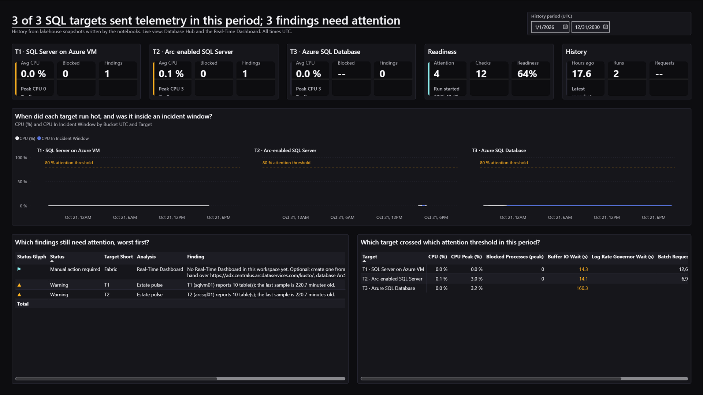
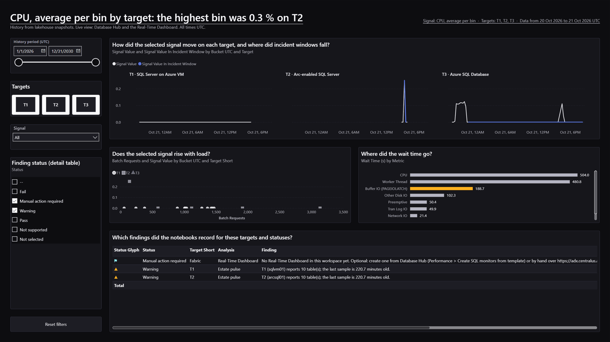
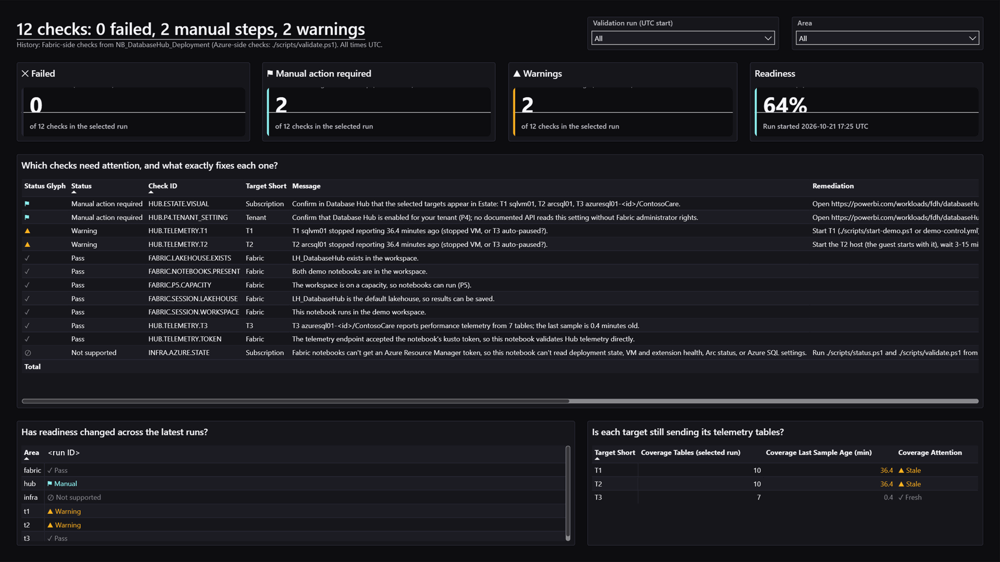

# Presentation surfaces

How to present the demo, and to whom. Four surfaces show the same SQL estate: two live views, a history report, and a Fabric app. This page says what each one is, when to use it, and what a viewer needs. The scripts are in the [demo walkthrough](demo-walkthrough.md).

> **Preview disclosure:** Database Hub is generally available since 2026-11-17, with its real-time dashboards for Microsoft SQL, PostgreSQL, and Azure Cosmos DB ([Database Hub overview](https://learn.microsoft.com/fabric/database/hub/overview)). Its Copilot, Database Agents, and alerts are previews, as are SQL Server on Azure VM monitoring, unified inventory, the Arc SQL monitoring setting, the telemetry endpoint, and Fabric Apps, which the Insights app is built on ([what's generally available, and what's a preview](limitations.md#preview-disclosures)). The live views can change with them; the history report reads only what the demo saved.

**Before you present:** the activity every surface shows, and the history the report and the app read, come from **Run all** in `NB_DatabaseHub_Control` ([the presenter's path](demo-walkthrough.md#the-presenters-path)).

## The four surfaces

| Surface | What it is | Needs |
|---|---|---|
| [Database Hub](https://app.fabric.microsoft.com/workloads/fdh/databaseHub) | The live view: a Fabric portal page, not a workspace item, with its own real-time dashboards for Microsoft SQL, PostgreSQL (T4), and Azure Cosmos DB on **Performance**, and Copilot and Database Agents (previews) | A Fabric Free license, no capacity, Azure read access; Copilot needs the workspace's capacity |
| [Real-Time Dashboard](../fabric/realtime/README.md) | The live view, as code, in the workspace | Capacity; viewers need Azure read access to the targets through the telemetry endpoint |
| [Power BI report](../fabric/powerbi/README.md) | History over lakehouse snapshots: `RPT_DatabaseHub_History`, four pages | Below F64, viewers need Pro, PPU, or an individual trial |
| [Fabric app](../fabric/app/README.md) | The DBA console: the Insights app `APP_DatabaseHub_Insights`, a Fabric Apps (preview) item. What needs attention now, every engine and target, incidents with the Database Agent loop, findings, and trends, from the history (through `SM_DatabaseHub_History`) and Database Hub live, with Ask, the Copilot chat, on every visual, and bounded actions through the session control | Access to the app item; Read and Build on the history model; for Ask, each viewer's own GitHub Copilot plan and a GitHub sign-in once per browser |

- **Live means the telemetry endpoint:** samples arrive a few minutes after the activity, and retention is 7 days or less ([query performance monitoring telemetry](https://learn.microsoft.com/fabric/database/hub/microsoft-sql-query-performance-monitoring-telemetry)). Database Hub and the Real-Time Dashboard query it with each viewer's own identity, so two viewers can see different resources.
- **History means the lakehouse:** the notebooks write the demo's history to five Delta tables in `LH_DatabaseHub`: validation results, scenario requests, telemetry snapshots, findings, and incident windows ([Fabric assets](../fabric/README.md#delta-tables-in-lh_databasehub)). These tables keep the history past the telemetry's retention. The Power BI report reads them through a Direct Lake semantic model, so it shows what the notebooks saved, not live data, and every page is labeled as history.

## When to use which

| Situation | Use | Why |
|---|---|---|
| A customer demo of the product | **Database Hub**, with the walkthrough's beats | It's what the customer will use, it's free, and it needs no capacity |
| Showing that monitoring can be governed and versioned | **The Real-Time Dashboard**, right after Database Hub's template wizard (the 30-minute walkthrough) | "The same telemetry, governed and versioned": the dashboard's definition and KQL live in Git, are tested, and are imported through a documented API |
| A cockpit on a second screen during an incident | **The Real-Time Dashboard**, Incident page, with **Target** set to the incident target | Status numbers, side-by-side charts, and a one-minute refresh |
| A review of earlier sessions, past the 7-day retention | **The Power BI report** | It reads the lakehouse snapshots |
| An audience that explores on its own after the session | **The Fabric app**, or **the Power BI report**, shared with them | The app starts at what needs attention and answers questions with Ask, its Copilot chat, on each viewer's own GitHub Copilot plan; mind the viewer licensing below |
| A DBA audience: one console for the estate, with a Copilot that answers about what's on screen | **The Fabric app**, opened from its workspace item | Overview's Live now, the drill-down from the estate to an incident, T3's Database Agent loop, T5's throttling and recovery, **Ask Copilot** and **Ask why** on every visual, and every visual's query and data one click away |
| The Fabric capacity isn't running | **Database Hub**, plus the walkthrough's PowerShell telemetry tables | Neither needs the capacity |

A presenter who shares their screen needs only their own access, whatever the audience's licenses.

## Licensing and permissions

The rule for Power BI content, from Microsoft Learn: "On F SKUs smaller than F64, each user viewing Power BI content must have Pro, PPU, or an individual trial. On F64 or larger, users with only a Free license and a viewer role can view Power BI content" ([Fabric licenses](https://learn.microsoft.com/fabric/enterprise/licenses)). Learn lists the Power BI items: reports, semantic models, (Power BI) dashboards, paginated reports, scorecards, metric sets, dataflows, datamarts, org apps, and explorations; everything else, including notebooks, lakehouses, and Real-Time Dashboards, is a non-Power BI Fabric item, which a Free license can view and share on an F capacity. If your capacity is smaller than F64, viewers of the report need Pro, PPU, or an individual trial (optional prerequisite [P11](prerequisites.md#optional)). The Insights app and its Copilot chat have their own rows below.

| Surface | License to view | Azure access | Fabric access | Capacity |
|---|---|---|---|---|
| Database Hub | Fabric Free | Reader on the subscription; for T2's performance data, Reader-only users also need the Arc telemetry role on the demo resource group (P8) | The tenant setting (P4), and My workspace on a capacity outside North Europe and West Europe | None |
| Real-Time Dashboard | Fabric Free: it isn't Power BI content | The same as Database Hub: the dashboard queries the telemetry endpoint as the viewer (pass-through) | A workspace role, or the dashboard shared with them: `deploy.ps1` gives the presenters in `presenterObjectIds` the Viewer role on the demo workspace (`FABRIC.PRESENTER.VIEWER`, since 2026-11-18) | The workspace's Fabric capacity |
| Power BI report | Pro, PPU, or an individual trial below F64; Fabric Free and a viewer role on F64 or larger | None: it reads the lakehouse | A workspace role, or the report shared with them | The workspace's Fabric capacity |
| Fabric app (the Insights app) | Learn doesn't list a Fabric App item as Power BI content, but its data comes from the semantic model as the viewer; plan for the report's rule, because this isn't verified | None: it reads the lakehouse through the model | Access to the app item; Read and Build on `SM_DatabaseHub_History`; the tenant settings Fabric Apps (preview) and Dataset Execute Queries REST API | The workspace's Fabric capacity |
| Ask, the Copilot chat in the Insights app | Each viewer's own GitHub Copilot plan, with a GitHub sign-in once per browser to the OAuth App **Database Hub Insights Ask**, which an organization that restricts OAuth apps approves once ([the Copilot chat](../README.md#the-copilot-chat-in-the-insights-app)) | None: the app reads the estate and the history for it | The app's, and the tenant setting "Enforce a strict content security policy for static-hosted Fabric Apps (preview)" off, as it is by default | The workspace's Fabric capacity, for the app; the chat relay runs in Azure, in the demo's resource group |
| A presenter sharing their screen | Their own | Their own | Their own | As for the surface shown |

- **Azure access:** the telemetry endpoint returns rows only for resources the caller can read: Reader or higher on each subscription, and `Microsoft.Sql` registered ([query performance monitoring telemetry](https://learn.microsoft.com/fabric/database/hub/microsoft-sql-query-performance-monitoring-telemetry)). Contributors already have it. For others, `Set-DemoPresenterAccess` assigns Reader and the Arc telemetry role (**Azure Hybrid Database Administrator - Read Only Service Role**), or prints the commands ([permissions](permissions.md#presenter-access)).
- **Dashboard access isn't data access:** sharing the Real-Time Dashboard doesn't grant access to the telemetry; a viewer without Reader sees empty tiles ([Real-Time Dashboard permissions](https://learn.microsoft.com/fabric/real-time-intelligence/dashboard-permissions)).
- **The check:** none since 2026-11-14. The demo assumes that its viewers have the licenses this rule asks for (the user, 2026-11-14: "Make the assumption that the PBI licenses are sorted out"), so `preflight.ps1` and `configure-fabric.ps1` report `PREFLIGHT.FABRIC.VIEWERLICENSE` as **Not selected** with the rule and read nothing; before, it read the capacity's SKU and warned below F64. Nothing changes the capacity ([ADR 0012](adr/0012-validation-model.md#phase-18-presentation-checks-2026-10-21)).

## Cost

- **Database Hub** is free and needs no capacity ([Database Hub overview](https://learn.microsoft.com/fabric/database/hub/overview)). Copilot, custom alerts, and shared dashboards need a Fabric capacity: the workspace's, which the demo's notebooks and app use too.
- **The Real-Time Dashboard, the report, the app, and the notebooks** are Fabric items, so they need the workspace's capacity running, and so does Run all. Your Fabric capacity bills while it runs and is outside the demo's resource group: it isn't in `estimate-cost.ps1` or `monthlyCeilingUsd` ([Fabric capacity](cost-management.md#microsoft-fabric-capacity)). You, or its administrator, resume it before Run all and pause it after; don't resize it for a demo.
- **The demo's own ceilings:** $20 a session (`sessionCeilingUsd`, a **Warning** above it) and $415 a month for a new configuration (`monthlyCeilingUsd`, a hard ceiling: preflight fails above it; a configuration keeps its own value); [cost management](cost-management.md#at-a-glance).
- **Licenses** for viewers below F64 (Pro, PPU, or a trial) are per-user costs outside Azure. This page quotes no license prices.
- **The Fabric app** (the Insights app) runs as Fabric Apps services that consume the workspace capacity's units ([Fabric Apps overview](https://learn.microsoft.com/fabric/apps/overview)); it has no database or storage, and its functions (the live estate for Ask and the pages, read-only, and Manage's, since 2026-11-18) run only when it calls them, so it uses capacity only when a deployment deploys and checks it (every `deploy.ps1` does, since 2026-11-05) and while someone loads it and its queries and functions run. Like the rest of the capacity, that's in no estimate.
- **Ask, the app's Copilot chat,** has a chat relay in the demo's resource group, the container app `ca-<prefix>-<environment>-ask`, which bills per second only while someone chats and scales to zero about 10 minutes after the last question; `estimate-cost.ps1` includes it. Each viewer's GitHub Copilot plan is theirs.
- **Outside every estimate:** your Fabric capacity, Fabric and Power BI licenses, and each viewer's GitHub Copilot plan.

## The template wizard and the dashboard as code

Database Hub's **Performance** page has **Create SQL monitors from template**: it builds a Real-Time Dashboard, or a page in an existing one, in a workspace you pick, and you customize it there ([Monitor a Microsoft SQL database](https://learn.microsoft.com/fabric/database/hub/monitor-sql)). It's UI-only, with no API ([automation support matrix](automation-support-matrix.md), row 34). The repo's dashboard is the governed counterpart: the same telemetry, with its definition and KQL in Git, tested, and imported and read back through documented Fabric REST APIs. The 30-minute walkthrough shows both, one after the other ([beat 5](demo-walkthrough.md#beat-5-13001600-a-monitor-from-a-template-and-the-dashboard-as-code)).

## The Fabric app: the Insights app

The demo's Fabric app is the Insights app, `APP_DatabaseHub_Insights`: a [Fabric Apps](https://learn.microsoft.com/fabric/apps/overview) (preview) item built with the Rayfin SDK and CLI, redesigned on 2026-11-18 as a DBA's console ([ADR 0029](adr/0029-insights-app-dba-console.md), [its guide](../fabric/app/README.md)). Fabric hosts it and signs users in to it; its read-only connector to `SM_DatabaseHub_History` runs DAX as the signed-in user; its estate function reads Database Hub's own API, scoped to the demo's resource groups, the repo's one exception to the documented-interfaces rule ([ADR 0013](adr/0013-agent-experience.md#amendment-2026-11-18-the-ga-skill-and-one-narrow-exception)); and its Manage functions run the control notebook's actions for an operator. Phase 19 keeps the model's names stable for it.

- **What a DBA sees, in order:** **Overview** (what needs attention now: **Live now** from Database Hub, then each target's health, incidents, findings, readiness, and the last session), **Estate** (every engine and target, with each target's page), **Performance**, **Incidents** (the timeline, the replay, what changed, and T3's Database Agent loop: detect, evidence, respond, verify), **Findings** (security and optimization live from Database Hub), **Readiness**, **Trends**, **Manage**, and **Live views**.
- **History and live, labeled:** every visual says **History** (with the newest snapshot's age) or **Live, as of** a UTC time with its Database Hub API calls. Without the live function, a page says why in one line and shows the history.
- **Ask, the Copilot chat:** the dock on the right (it resizes and goes full screen). **Ask Copilot** on every visual and table, and **Ask why** on every anomaly, hand it the visual's title, rows, and DAX; its charts draw in the app's own chart language. It runs on each viewer's own GitHub Copilot plan, after a GitHub sign-in once per browser ([the Copilot chat](../README.md#the-copilot-chat-in-the-insights-app)).
- **Manage:** start a session (which bills), run an incident on a target, stop now, and reset, each bounded and confirmed through the session control; Run all in `NB_DatabaseHub_Control` stays the one action. Operators (the deployer and the demo's admin group) send from the app when its Manage function is deployed; otherwise each action copies its request for Run all. No secret reaches the browser.
- **From history to the Database Agent:** Incidents has each window's prompts, written from the window's own numbers; **Copy and open Database Hub** copies one and opens Database Hub in a new tab, or **Ask Copilot** sends it to the Copilot chat. The panels say what matters on stage: the agent is a preview; it proposes, and each action runs only after an explicit approval in Database Hub ([FAQ](https://learn.microsoft.com/fabric/database/hub/faq)); and the app's prompts only investigate. Follow the [presenter rules](../fabric/agent/README.md#use-it-safely-approval-rules-for-presenters). A switch rewrites the same prompts for the fallback, GitHub Copilot CLI or VS Code with the GA `databasehub-cli` skill and the `microsoft-sql` plugin ([agent guide](../fabric/agent/README.md)).
- **Open it from its workspace item.** It runs embedded in the item page and signs in by itself. Opening its hosted URL directly is a known preview limitation (the sign-in pop-up stops at "Page not accessible directly"), so share the workspace item, not the URL.
- **How it's deployed:** by every `./scripts/deploy.ps1` since 2026-11-05: its Fabric track runs `./scripts/configure-fabric-app.ps1` after `configure-powerbi.ps1`, unattended and idempotent, with `rayfin up` from a Git-ignored stage and the deployer's `az login`; it updates the item in place on every run. Only when Fabric refuses that token does it need the Rayfin CLI's own one-time sign-in (`./scripts/configure-fabric-app.ps1 -SignIn`). When the app can't be created, the deployment still ends **DONE**, and the status page shows the app's step as **Failed** with the reason ([deployment](deployment.md#the-insights-app-part-of-every-deployment-2026-11-05)).
- **In the walkthrough:** open it after a session to show the estate in one console: Overview's **Live now**, an incident's replay and T3's Database Agent loop, T5's throttling and recovery, and **Ask Copilot** on a visual; then Manage, to show a bounded, confirmed action ([demo it yourself](demo-walkthrough.md#demo-it-yourself-the-insights-app)).

## Screenshots

Captured from live data by the agents that built each surface, without automating any portal. Nothing identifying is visible: no tenant, subscription, or resource IDs, no emails, account names, or IP addresses. T3's server suffix shows as `<id>`, and the notebook's run ID is masked.

### The Power BI history report

Power BI Desktop's render of the deployed report against the live model, captured on 2026-10-22 from the history that the notebooks saved on 2026-10-20 and 2026-10-21; times are UTC. No scenario had run yet, so the incident shown is a detected IO-pressure window, not a requested one.

| 1. Estate at a glance | 2. The incident, minute by minute |
|---|---|
|  |  |
| Telemetry coverage, CPU per target against the 80 % attention line, and the findings that still need attention | One incident's signal before, during, and after its window, with a verdict and the notebook's evidence |

| 3. Signal explorer | 4. Readiness checks |
|---|---|
|  |  |
| Any signal on any target over time, against load, with the wait time by category | The deployment notebook's checks by status, with the exact fix for each one |

### The Fabric App (preview)

The redesign's screenshots from live data come with its live check. The [app's guide](../fabric/app/README.md#whats-in-it) describes its nine pages.

## Sources (checked 2026-10-21)

- [Fabric licenses](https://learn.microsoft.com/fabric/enterprise/licenses): the F64 viewer rule, Power BI and non-Power BI items, and Trial and P capacities
- [Monitor a Microsoft SQL database](https://learn.microsoft.com/fabric/database/hub/monitor-sql) and [Monitor databases in Database Hub](https://learn.microsoft.com/fabric/database/hub/monitor): the template wizard and the proxy connection
- [Query performance monitoring telemetry](https://learn.microsoft.com/fabric/database/hub/microsoft-sql-query-performance-monitoring-telemetry): access, latency, and retention
- [Real-Time Dashboard permissions](https://learn.microsoft.com/fabric/real-time-intelligence/dashboard-permissions) and [Create a Real-Time Dashboard](https://learn.microsoft.com/fabric/real-time-intelligence/dashboard-real-time-create)
- [Database Hub overview](https://learn.microsoft.com/fabric/database/hub/overview) and [FAQ](https://learn.microsoft.com/fabric/database/hub/faq)
- [Fabric Apps overview](https://learn.microsoft.com/fabric/apps/overview), [connectors](https://learn.microsoft.com/fabric/apps/connectors), [hosting](https://learn.microsoft.com/fabric/apps/hosting), and [Fabric authentication](https://learn.microsoft.com/fabric/apps/fabric-authentication) (checked 2026-10-22)
