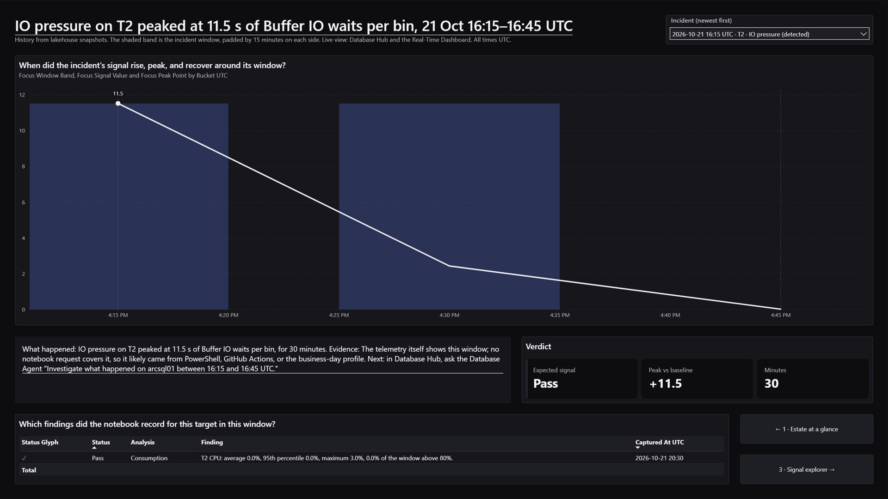

# Presentation surfaces

How to present the demo, and to whom. Four surfaces show the same estate: two live views, a history report, and a Fabric app. This page says what each one is, when to use it, and what a viewer needs; the scripts are in the [demo walkthrough](demo-walkthrough.md).

> **Preview disclosure:** Database Hub is generally available, with its real-time dashboards for Microsoft SQL, PostgreSQL, and Azure Cosmos DB ([Database Hub overview](https://learn.microsoft.com/fabric/database/hub/overview)). Its Copilot, Database Agents, and alerts are previews, as are SQL Server on Azure VM monitoring, unified inventory, the Arc SQL monitoring setting, the telemetry endpoint, and Fabric Apps, which the Insights app is built on ([what's a preview](limitations.md#preview-disclosures)). The live views can change with them; the history report reads only what the demo saved.

**Before you present:** the activity every surface shows, and the history the report and the app read, come from **Run all** in `NB_DatabaseHub_Control` ([the presenter's path](demo-walkthrough.md#the-presenters-path)).

## The four surfaces

| Surface | What it is | Needs |
|---|---|---|
| [Database Hub](https://app.fabric.microsoft.com/workloads/fdh/databaseHub) | The live view: a Fabric portal page, not a workspace item, with real-time dashboards for Microsoft SQL, PostgreSQL (T4), and Azure Cosmos DB on **Performance**, and Copilot and Database Agents (previews) | A Fabric Free license, no capacity, and Azure read access; Copilot needs the workspace's capacity |
| [Real-Time Dashboard](../fabric/realtime/README.md) | The live view, as code, in the workspace | The capacity; viewers need Azure read access to the targets through the telemetry endpoint |
| [Power BI report](../fabric/powerbi/README.md) | History over lakehouse snapshots: `RPT_DatabaseHub_History`, four pages | Below F64, viewers need Pro, PPU, or an individual trial |
| [Fabric app](../fabric/app/README.md) | The Insights app, `APP_DatabaseHub_Insights`, a Fabric Apps (preview) item: a DBA console over the history (through `SM_DatabaseHub_History`) and Database Hub live, with incidents and the Database Agent loop, findings, trends, Ask, the Copilot chat, on every visual, and bounded actions through the session control | Access to the app item, and Read and Build on the history model; for Ask, each viewer's own GitHub Copilot plan and a GitHub sign-in once per browser |

- **Live means the telemetry endpoint:** samples arrive a few minutes after the activity, and retention is 7 days or less ([query performance monitoring telemetry](https://learn.microsoft.com/fabric/database/hub/microsoft-sql-query-performance-monitoring-telemetry)). Database Hub and the Real-Time Dashboard query it with each viewer's own identity, so two viewers can see different resources.
- **History means the lakehouse:** the notebooks write the demo's history to five Delta tables in `LH_DatabaseHub` (validation results, scenario requests, telemetry snapshots, findings, and incident windows; [Fabric assets](../fabric/README.md#delta-tables-in-lh_databasehub)), past the telemetry's retention. The report reads them through a Direct Lake semantic model, so every page is labeled as history.

## When to use which

| Situation | Use | Why |
|---|---|---|
| A customer demo of the product | **Database Hub**, with the walkthrough's beats | It's what the customer will use, it's free, and it needs no capacity |
| Showing that monitoring can be governed and versioned | **The Real-Time Dashboard**, right after Database Hub's template wizard (the 30-minute walkthrough) | Its definition and KQL live in Git, are tested, and are imported through a documented API |
| A cockpit on a second screen during an incident | **The Real-Time Dashboard**, **Incident** page, **Target** on the incident target | Status numbers, side-by-side charts, and a one-minute refresh |
| A review of earlier sessions, past the 7-day retention | **The Power BI report** | It reads the lakehouse snapshots |
| An audience that explores on its own after the session | **The Fabric app**, or **the Power BI report**, shared with them | The app starts at what needs attention and answers questions with Ask, on each viewer's own GitHub Copilot plan; mind the viewer licensing below |
| A DBA audience: one console for the estate, with a Copilot that answers about what's on screen | **The Fabric app**, opened from its workspace item | Overview's **Live now**, the drill-down to an incident, T3's Database Agent loop, T5's throttling and recovery, and **Ask Copilot** and **Ask why** on every visual, with each visual's query and data one click away |
| The Fabric capacity isn't running | **Database Hub**, plus the walkthrough's PowerShell telemetry tables | Neither needs the capacity |

A presenter who shares their screen needs only their own access, whatever the audience's licenses.

## Licensing and permissions

The rule for Power BI content: "On F SKUs smaller than F64, each user viewing Power BI content must have Pro, PPU, or an individual trial. On F64 or larger, users with only a Free license and a viewer role can view Power BI content" ([Fabric licenses](https://learn.microsoft.com/fabric/enterprise/licenses)). Learn's Power BI items are reports, semantic models, (Power BI) dashboards, paginated reports, scorecards, metric sets, dataflows, datamarts, org apps, and explorations; notebooks, lakehouses, and Real-Time Dashboards aren't, so a Free license can view and share them on an F capacity. Below F64, viewers of the report need Pro, PPU, or an individual trial (optional prerequisite [P11](prerequisites.md#optional)).

| Surface | License to view | Azure access | Fabric access | Capacity |
|---|---|---|---|---|
| Database Hub | Fabric Free | Reader on the subscription; Reader-only users also need the Arc telemetry role on the demo resource group for T2's performance data (P8) | The tenant setting (P4), and Database Hub available in your tenant's region ([region availability](https://learn.microsoft.com/fabric/admin/region-availability)) | None |
| Real-Time Dashboard | Fabric Free: it isn't Power BI content | As for Database Hub: it queries the telemetry endpoint as the viewer | A workspace role, or the dashboard shared with them; `deploy.ps1` makes the presenters in `presenterObjectIds` Viewers of the demo workspace (`FABRIC.PRESENTER.VIEWER`) | The workspace's |
| Power BI report | Pro, PPU, or an individual trial below F64; Fabric Free and a viewer role on F64 or larger | None: it reads the lakehouse | A workspace role, or the report shared with them | The workspace's |
| Fabric app (the Insights app) | Learn doesn't list a Fabric App item as Power BI content, but its data comes from the semantic model as the viewer ([connectors](https://learn.microsoft.com/fabric/apps/connectors)), so plan for the report's rule; this isn't verified | None: it reads the lakehouse through the model | Access to the app item; Read and Build on `SM_DatabaseHub_History`; the tenant settings Fabric Apps (preview) and Dataset Execute Queries REST API | The workspace's |
| Ask, the Copilot chat in the Insights app | Each viewer's own GitHub Copilot plan, with a GitHub sign-in once per browser to the OAuth App **Database Hub Insights Ask**, which an organization that restricts OAuth apps approves once ([the Copilot chat](../README.md#the-copilot-chat-in-the-insights-app)) | None | The app's, with the tenant setting "Enforce a strict content security policy for static-hosted Fabric Apps (preview)" off, as it is by default | The app's; the chat relay runs in the demo's resource group |
| A presenter sharing their screen | Their own | Their own | Their own | As for the surface shown |

- **Azure access:** the telemetry endpoint returns rows only for resources the caller can read, with Reader or higher on each subscription and `Microsoft.Sql` registered ([query performance monitoring telemetry](https://learn.microsoft.com/fabric/database/hub/microsoft-sql-query-performance-monitoring-telemetry)). Contributors already have it; for others, `Set-DemoPresenterAccess` assigns Reader and the Arc telemetry role (**Azure Hybrid Database Administrator - Read Only Service Role**), or prints the commands ([permissions](permissions.md#presenter-access)).
- **Dashboard access isn't data access:** sharing the Real-Time Dashboard doesn't grant access to the telemetry, so a viewer without Reader sees empty tiles ([Real-Time Dashboard permissions](https://learn.microsoft.com/fabric/real-time-intelligence/dashboard-permissions)).
- **The check:** `PREFLIGHT.FABRIC.VIEWERLICENSE` is **Not selected**, with this rule: the demo assumes its viewers have the licenses it asks for, so `preflight.ps1` and `configure-fabric.ps1` read nothing, and nothing changes the capacity ([ADR 0012](adr/0012-validation-model.md#phase-18-presentation-checks-2026-10-21)).

## Cost

- **Database Hub** is free and needs no capacity ([Database Hub overview](https://learn.microsoft.com/fabric/database/hub/overview)). Copilot, custom alerts, and shared dashboards need a Fabric capacity: the workspace's, which the notebooks, the report, the Real-Time Dashboard, the app, and Run all use too.
- **Your Fabric capacity** bills while it runs and is outside the demo's resource group: it isn't in `estimate-cost.ps1` or `monthlyCeilingUsd` ([Fabric capacity](cost-management.md#microsoft-fabric-capacity)). You, or its administrator, resume it before Run all and pause it after; don't resize it for a demo.
- **The demo's ceilings:** $20 a session (`sessionCeilingUsd`, a **Warning** above it) and $415 a month for a new configuration (`monthlyCeilingUsd`, a hard ceiling: preflight fails above it; a configuration keeps its own value); [cost management](cost-management.md#at-a-glance).
- **The Insights app** runs as Fabric Apps services on the capacity's units ([Fabric Apps overview](https://learn.microsoft.com/fabric/apps/overview)), with no database or storage; its functions run only when it calls them, so it uses capacity while a deployment deploys and checks it and while someone uses it.
- **Ask's chat relay,** the container app `ca-<prefix>-<environment>-ask` in the demo's resource group, bills per second only while someone chats and scales to zero about 10 minutes after the last question; `estimate-cost.ps1` includes it.
- **Outside every estimate:** your Fabric capacity, Fabric and Power BI licenses (this page quotes no license prices), and each viewer's GitHub Copilot plan.

## The template wizard and the dashboard as code

Database Hub's **Performance** page has **Create SQL monitors from template**: it builds a Real-Time Dashboard, or a page in an existing one, in a workspace you pick, and you customize it there ([Monitor a Microsoft SQL database](https://learn.microsoft.com/fabric/database/hub/monitor-sql)). It's UI-only, with no API ([automation support matrix](automation-support-matrix.md)). The repo's dashboard is the governed counterpart: the same telemetry, with its definition and KQL in Git, tested, and imported and read back through documented Fabric REST APIs. The 30-minute walkthrough shows both, one after the other ([beat 5](demo-walkthrough.md#beat-5-13001600-a-monitor-from-a-template-and-the-dashboard-as-code)).

## The Fabric app: the Insights app

`APP_DatabaseHub_Insights` is a [Fabric Apps](https://learn.microsoft.com/fabric/apps/overview) (preview) item: a DBA's console over the history model and Database Hub's live estate ([ADR 0029](adr/0029-insights-app-dba-console.md)), whose pages, Ask, and Manage are in [its guide](../fabric/app/README.md). Its estate function reads Database Hub's routes, scoped to the demo's resource group, the repo's one exception to the documented-interfaces rule ([ADR 0013](adr/0013-agent-experience.md#amendment-2026-11-18-the-ga-skill-and-one-narrow-exception)); every `./scripts/deploy.ps1` deploys and updates it ([deployment](deployment.md#the-insights-app-part-of-every-deployment-2026-11-05)). Open it from its workspace item and share the item, not its hosted URL, which stops at "Page not accessible directly", a known preview limitation. The walkthrough shows it after a session ([demo it yourself](demo-walkthrough.md#demo-it-yourself-the-insights-app)).

## Screenshots

Captured from live data by the agents that built each surface, without automating any portal. Nothing identifying is visible: no tenant, subscription, or resource IDs, no emails, account names, or IP addresses; T3's server suffix shows as `<id>`, and the notebook's run ID is masked.

### The Power BI history report

Power BI Desktop's render of the deployed report against the live model, captured on 2026-10-22 from the history the notebooks saved on 2026-10-20 and 2026-10-21, before T4 and T5 existed; times are UTC. No scenario had run yet, so the incident shown is a detected IO-pressure window, not a requested one.

| 1. Estate at a glance | 2. The incident, minute by minute |
|---|---|
|  |  |
| Telemetry coverage, CPU per target against the 80% attention line, and the findings that still need attention | One incident's signal before, during, and after its window, with a verdict and the notebook's evidence |

| 3. Signal explorer | 4. Readiness checks |
|---|---|
|  |  |
| Any signal on any target over time, against load, with the wait time by category | The deployment notebook's checks by status, with the exact fix for each one |

### The Fabric App (preview)

No screenshots here yet; the [app's guide](../fabric/app/README.md#whats-in-it) describes its nine pages.
