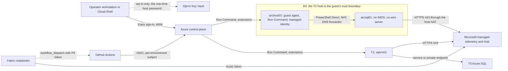
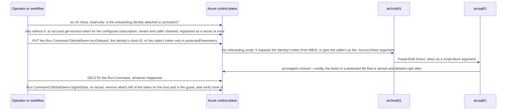

# Security model

> **Status: final (Phase 14, 2026-10-21).** Re-checked against the implementation as built in Phases 3 to 14 and the live runs of 2026-10-20 and 2026-10-21, including Phase 7's follow-ups of 2026-10-21 (merged through Phase 13 at `52890c8`). Decisions referenced here are in the [ADRs](adr/README.md); the checks that still need a running environment are listed under [Pending live checks](#pending-live-checks).

## Scope and assumptions

- A **demo**, deployed into a subscription where the deploying identity holds **Contributor** (plan §9.1). A dedicated demo subscription is recommended.
- **All data is synthetic** ("Contoso Care Operations"). There's no customer data, PHI, or PII.
- **Previews:** Database Hub, its Database Agent, SQL VM performance monitoring, unified inventory, the Arc SQL monitoring setting, and the telemetry endpoint can change without notice.
- **Out of scope:** hardening the customer's own tenant, Fabric tenant configuration beyond the Hub setting, and the security of Microsoft-managed services.
- **The tenant's policies apply:** Azure Policy assignments can add extensions to the demo's VMs (for example Defender for Endpoint, `MDE.Windows`), deploy Defender plans, and deny settings. Preflight lists them, read-only (`PREFLIGHT.POLICY.*`), and the scripts work around them rather than against them.

## Assets

| Asset | Why it matters |
|---|---|
| The Azure subscription and the demo resource group | Contributor rights there can create cost and change resources |
| T1 and T2 host local administrator access | Full control of the SQL Servers and, through the host, of the guest |
| The T2 guest administrator password | Full control of the Arc-enabled SQL Server |
| The one-time T2 host password, with the Key Vault opt-in (`keyVault.enabled`) only | Bastion sign-in to the host, and through it control of the guest. It's stored only in the opt-in vault, which the default path doesn't create. |
| Arc onboarding tokens | Carry the caller's rights (Contributor) for about an hour |
| The bootstrap bundle and pinned media | Integrity of what VMs install. Since 2026-10-20 the bundle travels in Run Command chunks and media comes straight from Microsoft; there's no artifact cache. |
| T1's managed identity | A T3 administrator through the P6 group (risk R26) |
| The GitHub federated credential | Lets workflows act as Contributor on the subscription |
| Fabric workspace and notebooks | Presenter tooling; can hold a P9 token reference |
| SQL telemetry | Operational metadata about the demo servers. T1's rows arrive under the Compute VM's resource ID and T3's under the database's, so Azure RBAC on those resources governs who can read them (live finding, 2026-10-20). |
| Script output, Run Command instance views, and deployment history | Where a secret could leak at run time. `Find-DemoSecretLeak` scans them (ADR 0009). `out/` is ignored by Git; the resource IDs in it aren't secrets, but don't publish them. |
| The `DbHubDemo` module and the VM-side scripts | Everything the operator and the VMs run. The module dot-sources `Private/*.ps1` in alphabetical order, so a second function with the same name silently replaces the first. |
| The Insights app `APP_DatabaseHub_Insights` (Phase 19b) and its deploy record | The app reads the history model as each signed-in viewer. The deploy stage `out/fabric-app` holds the item ID, the hosting URL, and the app's publishable key; Git holds only placeholders. |
| The T2 golden snapshot (`rg-<prefix>-golden`, [ADR 0018](adr/0018-fast-redeploy-parallel-tracks-golden-snapshot.md)) | A copy of the whole T2 host: the host's and guest's local password hashes, the host's DPAPI-protected guest password, the guest Arc agent's key for the captured identity, the SQL Server instance with synthetic data, and setup's logs (redacted). `DenyAll` and public network access off, so it can't be exported; captured only after the sign-in cleanup, IE ESC, and the host password rotation; a copy boots air-gapped, resets its Arc identity, and rotates both passwords before it reaches the network. Any Contributor on the subscription can create a disk from it (a recorded deviation: no role assignments, ADR 0008). |
| The on-demand activity control's webhook URL (`control.enabled` only, [ADR 0020](adr/0020-on-demand-activity-control.md)) | A bearer secret: whoever has it starts a bounded run of the demo. It's kept only as the secret `dbhub-activity-webhook` in `kv-<prefix>-ctl-<suffix>`, which only the A3 users can read; Azure shows it once, and it expires after 90 days by default. |
| The control's identity `id-<prefix>-automation` (`control.enabled` only) | Its custom role starts and deallocates the demo's VMs, starts and stops T4, and runs commands as SYSTEM on the demo's VMs through managed Run Command, at the demo resource group (A1) and its own Automation account (A2) only. |

## Trust boundaries

| # | Boundary | Controls |
|---|---|---|
| B1 | GitHub → Azure | OIDC with one federated credential per GitHub environment; no branch or pull-request subjects for deploy, control, or destroy; SHA-pinned actions; concurrency groups; reviewers or typed confirmation for destructive workflows |
| B2 | Operator → Azure | Entra sign-in with the tenant's policies, such as MFA and Conditional Access. Azure Policy can enforce MFA for user writes and deletes; preflight reports it (`PREFLIGHT.POLICY.MFA`). Nothing relies on the Azure CLI's shared default subscription, and nothing changes it: every call passes `--subscription` explicitly, and `Invoke-DemoAz` refuses `az account set`, `az login`, `--ids`, `az ad`, `az rest` outside the configured subscription's fully qualified Resource Manager URLs, and token requests with `--tenant`. Before any write, the subscription guard checks the configured subscription's account (`azureAccount`) and tenant and runs read-only canaries through every authentication path; it fails closed (ADR 0011, updated 2026-10-21). Microsoft Graph, Resource Graph, and tenant-level reads use a token verified for the configured tenant and caller. Nothing secret is written locally beyond the Azure CLI's own token cache; a separate `AZURE_CONFIG_DIR` can isolate that cache on a shared machine ([prerequisites](prerequisites.md#optional-a-separate-azure-cli-profile)). |
| B3 | Azure control plane → VMs | Run Command and extensions only; protected parameters for anything sensitive, which reads never return; the scripts' managed Run Commands are deleted when they finish (the template's bootstrap loader stays, and holds no secret); no public IPs; Bastion only on demand. A Run Command's instance view keeps the last 4 KB of output and error, which `SECURITY.SECRETSCAN.RUNCOMMANDS` scans. |
| B4 | **T2 host → nested guest** | **The host is the guest's trust boundary.** Whoever administers the host controls the guest: Hyper-V, PowerShell Direct, and the guest's administrator password, which stays on the host under DPAPI. The guest can't reach the host's IMDS or wire server, so it can't get the host's managed-identity tokens: outbound block rules in the guest's firewall, `Add-VMNetworkAdapterAcl` deny rules that the host's virtual switch enforces (a guest administrator can't remove them), and DNS only through a forwarder on the host (ADR 0004). The host's guest agent stays on, so host automation works. Verified live on 2026-10-20; `T2.GUEST.ISOLATION` checks it again on every validation run while the host runs. |
| B5 | VNet → internet | Deny inbound (`SECURITY.NETWORK.INBOUND` checks the VM and private-endpoint NSGs); outbound limited to HTTPS, KMS, and T1-to-T3 SQL ports, plus platform traffic (DNS, IMDS, licensing) that NSGs allow by default; the FQDN gap is documented (ADR 0007) |
| B6 | Clients → T3 | Entra-only; TLS 1.2; VNet rule or private endpoint; no "Allow Azure services" |
| B7 | Tenant → Microsoft-managed previews | Read-only telemetry and inventory flows; Hub needs subscription Reader, and T2's performance data also needs the Arc telemetry role (`Microsoft.AzureArcData/sqlServerInstances/getTelemetry/action`) |
| B8 | Fabric → GitHub | Optional P9 token from a Key Vault the user owns, scoped to `actions: write` on this repo |
| B9 | Operator → the opt-in Key Vault (`keyVault.enabled` only) | Off by default. Azure RBAC authorization, no access policies; roles on the vault only (Key Vault Secrets Officer for the caller and `keyVault.operatorObjectIds`, Key Vault Secrets User for `keyVault.readerObjectIds`), which is why the option requires `assignRoles`; the firewall limited to `keyVault.allowedIpRanges` when set; soft delete, and purge protection on request. The scripts write the password from a file in a private temporary directory, never on a command line, and the stop disables it (ADR 0008, ADR 0009). `SECURITY.SECRETS.KEYVAULT` and `SECURITY.RBAC.ROLEASSIGNMENTS` check the vault and its roles. |

## The token handoff

Arc onboarding is the only flow that moves an access token across boundaries B3 and B4 (ADR 0005); the optional SQL Server product key and the one-time T2 host password (Phase 13) take the same protected-parameter path to the host. Whenever the least-privilege identity `id-<prefix>-<env>-arc-onboard` is attached to `archost01` (`deploy.ps1` creates it with `assignRoles = true`), the token is that identity's, requested by the host from its own IMDS, and no token of the operator's is used. Otherwise it's the caller's own Azure Resource Manager token (ADR 0009, Phase 26d):

| Where the token is | Who can see it | For how long |
|---|---|---|
| The operator's PowerShell session (caller's token only) | The operator; every log line and Actions mask hides it (`Register-DemoSecret`) | The run |
| The Run Command request body (caller's token only) | Only the current user (a private temporary directory, sent as `--body @<file>`) | Until Azure accepts the request; the file is deleted right after |
| The Run Command's protected parameters (caller's token only) | Nobody: reads never return them | Until the Run Command is deleted when it finishes |
| The host's `powershell.exe` command line (caller's token only) | The host's local administrators; the Windows PowerShell event log's engine events, which record the command line by default; process-creation auditing, script block logging, and transcription when a policy turns them on; and endpoint protection, which can copy command lines off the VM | While the onboarding script runs (217 seconds live, 2026-10-20); the sweep then clears the PowerShell logs that hold it and asks you to clear the Security log |
| The guest's config file for `azcmagent` and the agent's memory | The guest's administrators | While `azcmagent connect` runs; the file is overwritten with zeros and deleted |
| Anywhere a copy survived | Whoever holds it, with the token's rights: Contributor for the caller's, only Azure Connected Machine Onboarding on the resource group for the identity's | Until it expires: about an hour for the caller's |

The scripts never write the token to logs, outputs, or Run Command output, and the sign-in data sweep right after onboarding (`DbHubDemo-SignInData`, `vm/bootstrap/Invoke-DemoSignInResidue.ps1`) removes what's left of it on the host and in the guest and fails closed when it can't (ADR 0009). With the host identity, the operator's machine sends only a client ID, and a connect that Azure refuses while the new role assignment propagates is retried for up to 7.5 minutes; the guest still can't reach IMDS itself. `configure-arc.ps1 -UseHostIdentity` requires the identity; `-UseCallerToken` skips it. The other tokens stay where they're issued: Fabric and Kusto tokens in the notebook session (the telemetry endpoint accepted the notebook's own `kusto` token on 2026-10-21, `HUB.TELEMETRY.TOKEN` **Pass**, which closes plan risk R29, so the notebooks need no stored credential to read telemetry); the token T1's runner gets from IMDS on T1 for T3; and the operator's Fabric, telemetry, Resource Manager, and Microsoft Graph tokens, registered as secrets when they're issued and sent only as SecureString bearer tokens to their own endpoints. Every token the scripts request, the Arc token included, comes from `Get-DemoAccessToken`: `az account get-access-token --subscription <id>`, never `--tenant`, with its `tid` and `oid` claims checked against the context the subscription guard validated, so a shared Azure CLI profile's default account can't supply it (ADR 0011, guard update).

Every protected value on this path is checked before it leaves the operator: `Invoke-DemoVmRunCommand` refuses a parameter value, public or protected, that is a .NET type name (`System.Security.SecureString` or `System.Management.Automation.PSCredential`), and a SecureString that holds one, before any Azure call (Phase 7). That's what a SecureString or a credential becomes when it's converted with `[string]`, and a VM must never receive that well-known text as a password, key, or token. Phase 13's one-time host password also needs at least 12 characters.

One more token reaches the guest outside the scripts: in `PaygWizard` mode, the operator signs in with **Use Azure Login** in SQL Server setup, inside the guest, once per guest build. Setup's interactive sign-in can leave sign-in data on the VM. The host's `GuestSignInCleanup` step removes it right after the wizard and verifies that none remains, and the build fails if any remains; nothing from that sign-in is kept or reused, so each guest build asks for it again (ADR 0009, R74). `./scripts/check-sign-in-data.ps1` checks any time, and reports counts and locations only.

## Roles

| Persona or identity | Minimum rights | Notes |
|---|---|---|
| Deployment operator | Contributor on the subscription (P1) | Runs `deploy.ps1`, the lifecycle scripts, and `validate.ps1`. `SECURITY.RBAC.ROLEASSIGNMENTS` records whether the caller could also create role assignments. |
| GitHub Actions identity | Contributor on the subscription, assigned by an administrator (P7) | Lives in `rg-<prefix>-control` |
| Arc onboarding | The caller's token by default; optional Onboarding-only identity with `assignRoles = true` | ADR 0005; see [the token handoff](#the-token-handoff) |
| T1 managed identity | Member of the P6 group, so it's a T3 administrator | Over-privileged by design (R26); hardened option in ADR 0008 |
| T2 host managed identity | None | Not reachable from the guest (B4) |
| Presenter | Contributor; or subscription Reader plus **Azure Hybrid Database Administrator - Read Only Service Role** on the resource group (P8); Fabric workspace role (P5) | The Arc role carries `Microsoft.AzureArcData/sqlServerInstances/getTelemetry/action` for T2's performance data and is resolved by name ([permissions](permissions.md)) |
| DBA | P6 group member; Windows administrator through Bastion | Break-glass through a VMAccess reset |
| Key Vault opt-in principals | Key Vault Secrets Officer or Key Vault Secrets User on the opt-in vault only | Only with `keyVault.enabled` and `assignRoles = true` ([permissions](permissions.md)) |
| On-demand activity control (`control.enabled` only) | The custom role DbHub Demo Activity Operator for `id-<prefix>-automation` at the demo group (A1) and the control account (A2); Key Vault Secrets User on the one secret for the notebook users (A3) | Only an Owner creates them, with `setup-activity-control.ps1 -GrantRole` ([permissions](permissions.md#the-on-demand-activity-control)) |
| Fabric administrator | Fabric administrator role | Enables the Hub tenant setting once (P4) |
| Read-only attendee | None, or subscription Reader (P8) | |

## Threats and mitigations (STRIDE)

| Threat | Example | Mitigation | Residual |
|---|---|---|---|
| Spoofing | A fork or another branch runs a deploy workflow as the Azure identity | Federated credentials match only `environment:<name>` subjects; environments restrict deployment branches | Low |
| Spoofing | A guest process requests host managed-identity tokens | IMDS and wire server blocked in the guest and by host-enforced port ACLs | Low; verified live on 2026-10-20 and checked again by `T2.GUEST.ISOLATION` |
| Tampering | Modified bootstrap bundle chunks | Only Contributors can create Run Commands; each chunk's SHA-256 is checked when it's written and again before assembly, and the assembled bundle's SHA-256 before it's unpacked (fail closed); versions pinned in `config/versions.json` | Low |
| Tampering | Modified media at the download source | Pinned SHA-256 verified on download; a mismatch fails closed | Low |
| Repudiation | Who started a scenario or a destroy? | Azure Activity Log; GitHub run history; `demo.scenario_runs` records each run with its ID and parameters; `validate.ps1` writes every result as a JSON line | Low |
| Information disclosure | Tokens or passwords in logs or notebook outputs | Redacting logger, `::add-mask::`, protected parameters, secret-free outputs, gitleaks, notebook output checks (ADR 0009) | Low |
| Information disclosure | A secret in a Run Command instance view, the deployment history, or saved output | Protected parameters are never returned; VM-side scripts print no secret; Bicep outputs hold none; `Find-DemoSecretLeak` and `SECURITY.SECRETSCAN.*` scan all three with the redaction rules and the session's registered values (ADR 0009) | Low; instance views can be scanned only while the VMs run |
| Information disclosure | The Arc token on the `azcmagent` command line in the guest | The agent takes it from a protected config file (`--config`) that is zeroed and deleted right after; only if the agent rejects the file does it get the token on its command line once, and onboarding reports that as a Warning; the sweep after onboarding removes what's left | Low (ADR 0009, Phase 26d) |
| Information disclosure | The caller's Arc token on the host's `powershell.exe` command line while the onboarding Run Command runs: managed Run Command passes protected parameters to Windows scripts as `-Name value` arguments, so the Windows PowerShell event log records it by default, and process-creation auditing, script block logging, transcription, or endpoint protection can when they're on | The host identity, whenever it's attached (`assignRoles`), sends no token at all; otherwise the token lasts about an hour, the Run Command is deleted when it finishes, and the sweep after onboarding clears the PowerShell and Application logs that hold one (a Warning: endpoint protection may report a cleared log) and asks you to clear the Security log (Manual action required, with the command). A copy endpoint protection sent off the VM stays there | Medium for the caller's token; accepted (ADR 0005, ADR 0009) |
| Information disclosure | The SQL Server product key (`ProductKey` mode) | Protected Run Command parameter only (the same command-line exposure on the host while it runs); stored on the host with DPAPI and deleted after setup; never written on the operator side; `DBHUB_SQL_PRODUCT_KEY` is removed from the environment once read | Low |
| Information disclosure | Sign-in data that setup's interactive sign-in (`PaygWizard`) can leave on the VM (R74) | The host's `GuestSignInCleanup` step removes it right after the wizard, every guest build, and verifies that none remains, or the build fails; the golden snapshot is captured only after a clean scan of the host and the guest, and its copies are scanned again; the guest has no inbound network path; the operator never enters a service principal secret | Low |
| Tampering | Internet Explorer Enhanced Security Configuration turned off in the guest during the wizard (it doesn't help the Azure sign-in, which needs WebView2) | `GuestSignInCleanup` turns it back on for administrators and users | Low |
| Information disclosure | Someone reads the one-time T2 host password from the opt-in Key Vault | Off by default; Azure RBAC on the vault only, for the principals the configuration lists; the firewall limited to `keyVault.allowedIpRanges` when set; the stop disables the secret; Bastion is the only way to the host, and only on demand (B9) | Low |
| Information disclosure | The guest's temporary password while its one automatic sign-in for the guided stop is armed (Phase 28) | Kept only as the LSA `DefaultPassword` secret, never as the plaintext Winlogon value; armed only while `deploy.ps1` waits for a person, cleared by the guest's logon task at sign-in and by the host's cleanup in a `finally`, then rotated; a leftover fails the sign-in scan and blocks a golden capture ([below](#the-guests-one-automatic-sign-in-phase-28)) | Low: short-lived, and readable only by someone who can already take over the guest |
| Information disclosure | A host password a person sets in the portal at the guided stop, without a clipboard (Phase 28) | The demo never sets, shows, logs, or stores it; the handover is recorded in the resource group's state, so the guided stop's cleanup and `stop-demo.ps1` rotate it to a value nobody keeps (a **Warning** with the portal's way when that can't run yet); `deploy.ps1` is never **DONE** while a handover is unrotated or the guided stop's Bastion may be up, and its T2 step cleans up after a guided stop that a Ctrl+C left open (Phase 28 review) | Low |
| Tampering | A tampered Connected Machine agent package | The documented link serves the latest MSI with no published hash, so the host requires a valid Authenticode signature from Microsoft, or a pinned SHA-256 when one is set; a failed check deletes the package (fail closed); the guest checks the copy's SHA-256 again | Low |
| Tampering | A tampered WebView2 runtime installer, which the host installs in the guest before the setup wizard (`GuestWebView2`, `PaygWizard` only; Use Azure Login needs the runtime) | The host downloads Microsoft's Evergreen Standalone Installer over HTTPS and keeps it only with a valid Authenticode signature from Microsoft; anything else is deleted (fail closed). It's evergreen, so there's no hash to pin | Low |
| Spoofing | A SecureString or credential converted with `[string]` becomes its type name, so a VM password could be set to the well-known `System.Security.SecureString` | `Invoke-DemoVmRunCommand` refuses a type name as any Run Command value, public or protected, and a SecureString that holds one, before any Azure call (Phase 7); the one-time host password also needs at least 12 characters (Phase 13) | Low |
| Tampering | A new function silently replaces an existing one with the same name, because the module dot-sources `Private/*.ps1` alphabetically | `tests/unit/Repo.FunctionNames.Tests.ps1` fails static validation on any duplicate function name; code review | Low |
| Denial of service or cost | Runaway scenarios, forgotten VMs or Bastion | Three-layer bounds and watchdog (ADR 0010); auto-shutdown; budget alerts; Bastion auto-removal; expiry (ADR 0016); `WORKLOAD.<target>.BOUNDS`, `COST.BUDGET`, and `COST.AUTOSHUTDOWN` check them | Low |
| Denial of service or cost | An interrupted Bastion delete leaves its public IP billing (live finding) | `stop-demo.ps1` and `status.ps1` remove or report it (Phase 13); `COST.BASTION` reports it with the delete command | Low |
| Denial of service | A policy-installed extension update (Defender for Endpoint, `MDE.Windows`) holds a VM's Run Commands for about 10 minutes (live finding) | Run Command creation retries 409 Conflict with backoff; validation names the likely cause and says when to retry; preflight lists the policies that add extensions (`PREFLIGHT.POLICY.EXTENSIONS`) | Low; availability only |
| Elevation of privilege | Compromise of T1 yields T3 administrator rights | Single-purpose server with synthetic data; hardened option documented | Medium; accepted (R26) |
| Elevation of privilege | The caller's Arc token carries Contributor rights on the subscription | The Onboarding-only host identity whenever it's attached; dedicated demo subscription recommended; the [token handoff](#the-token-handoff) keeps the caller's token in memory, on the host's command line only while onboarding runs, and removes its traces afterward | Medium; accepted |
| Elevation of privilege | Role assignments or a Key Vault appear in the demo resource group | The default deployment creates neither (ADR 0008, ADR 0009); `SECURITY.RBAC.ROLEASSIGNMENTS` allows only Reader, the Arc telemetry role, with `assignRoles` Azure Connected Machine Onboarding, and with `keyVault.enabled` the two Key Vault secrets roles on the opt-in vault; `SECURITY.SECRETS.KEYVAULT` allows only that vault | Low |
| Elevation of privilege | Destructive SQL outside the demo databases | Scenario procedures and the watchdog act only in `ContosoCare` on sessions tagged `ContosoCare.Demo/` | Low |

## Supply chain

- **GitHub Actions:** pinned by full commit SHA and updated by Dependabot. `.github/dependabot.yml` covers Actions, NuGet, and the devcontainer.
- **Bicep:** AVM modules and API versions are pinned and reviewed by hand, because Dependabot has no Bicep-registry ecosystem.
- **Pinned media and agent plugins:** media URLs with SHA-256, agent plugin versions, and the runner version live in `config/versions.json`. The two evergreen downloads, the Connected Machine agent and the WebView2 runtime (Phase 7), are verified by their Microsoft Authenticode signatures instead, and fail closed.
- **Runner:** built once per release tag, with published SHA-256 checksums.
- **Scanning:**
  - gitleaks (pinned in `config/versions.json`, checksum verified) on every pull request, job **Secret scan** in `.github/workflows/reusable-static-checks.yml`, over the full history with `--redact`, and as a pre-commit hook. `.gitleaks.toml` keeps every default rule and adds `jwt-any-delimiter`, because the default `jwt` rule misses a token inside an XML element or followed by `&` (ADR 0009). Its one allowlist exempts only the public commit SHA pins in `config/versions.json` from the default Sourcegraph rule, whose keyword occurs inside "resourcegraph" there (R227).
  - GitHub secret scanning and code scanning aren't enabled on this private repository (checked with the GitHub REST API on 2026-10-21), so gitleaks is its secret scan. CodeQL (`.github/workflows/codeql.yml`) runs when the repository is public or the variable `CODE_SCANNING_ENABLED` is `true`.
  - Run-time output is scanned with `Find-DemoSecretLeak`, UTF-16 logs included (ADR 0009).
- **Static analysis:** PSScriptAnalyzer on every PowerShell file, plus Windows PowerShell 5.1 compatibility (syntax, commands, and types) for the VM-side scripts under `vm/` (`tests/PSScriptAnalyzerSettings.Vm.psd1`).
- **The Insights app's npm packages (Phase 19b):** every package in `fabric/app` is pinned to an exact version, installed with `npm ci` from `package-lock.json`, resolved from the public npm registry with SHA-512 integrity (a Pester test enforces both). `npm run check:licenses` fails on a production dependency outside the permissive allow list, and the build writes `THIRD_PARTY_NOTICES.txt`. Fonts and libraries are bundled; the app loads nothing from a CDN.

## The Insights app (Phase 19b)

- **Sign-in:** Fabric SSO (Microsoft Entra ID) only; the app has no other identity provider ([Fabric authentication](https://learn.microsoft.com/fabric/apps/fabric-authentication)). Opened from its workspace item, it signs in through the portal with `initEmbeddedAuth`.
- **Protected hosting:** `rayfin.yml` sets `staticHosting.assetAccess: protected` explicitly, so the host serves the bundle only to a signed-in user with permission on the item ([hosting](https://learn.microsoft.com/fabric/apps/hosting)). `configure-fabric-app.ps1` checks it: an anonymous request must get HTTP 401 (`FABRIC.APP.HOSTING`). A public variant was considered and rejected on 2026-10-22: it wouldn't fix the direct-URL sign-in limitation and would serve the bundle without sign-in.
- **Data access:** one connector, `fabric-semanticmodel` with `executeQuery` only and delegated authentication, so every DAX query runs as the signed-in viewer and returns only what they can read ([connectors](https://learn.microsoft.com/fabric/apps/connectors)). The app builds DAX only from allow-listed values (target keys, validated dates); it never puts free text into a query. It writes nothing: no database, storage, or functions are enabled.
- **No secrets in code or assets:** Git holds `${...}` placeholders; real IDs go into the Git-ignored stage at deploy time. The bundle carries the backend URL and the publishable key, which are public by design (the browser needs them to reach the backend, and the backend still requires a Fabric sign-in), but the deploy step redacts the key from every result and log anyway. `public/dbhub-app.json` holds only links, the expected account, and the resource group name, behind protected hosting.
- **Database Agent prompts:** the app only writes prompt text from the data on screen; the user copies it and pastes it into Database Hub's Database Agent, whose actions run only after the user's explicit approval ([FAQ](https://learn.microsoft.com/fabric/database/hub/faq)). Every prompt ends with "Don't change anything." or "Don't apply anything; propose only." The app sends nothing to the agent or any other AI service.
- **The deploy identity:** the Rayfin CLI uses the operator's own cached sign-in (P14); the script never signs in or out, strips an ambient `RAYFIN_TOKEN`, and turns the CLI's telemetry off. There's no service principal and no secret.

## T4, the PostgreSQL flexible server (Phase 24)

- **No secret exists:** password authentication is off, so T4 has no administrator password; Microsoft Entra is the only way in ([ADR 0019](adr/0019-t4-postgresql-flexible-server.md)). The P6 group is T4's administrator, as it is T3's, so T1's identity is a T4 administrator too (R26 extends to T4, R402).
- **No token travels:** T1's runner asks its own managed identity for a token for each connection (the `ossrdbms-aad` audience), uses it as that connection's password, and drops it with the connection; nothing is written to disk, a log, or a Run Command. The operator's token is never sent to T1 for T4.
- **Least privilege for the workload:** the runner's role `contosocare_runner` is a non-administrator role mapped to T1's identity, with the demo's tables and functions in `contosocare` and `pg_read_all_stats` (read-only statistics, for the live view) when the service allows it. It can end only its own sessions, and the session tools filter on `ContosoCare.Demo/` names in `contosocare` as well.
- **Network:** virtual network integration with no public access, TLS verified by host name (`VerifyFull`), and port 5432 open only from T1's subnet.
- **Hub posture:** Hub evaluates four PostgreSQL assessments; T4 is built to pass Entra authentication enabled and enforced and public network access disabled; customer-managed keys stay a suggestion (service-managed encryption) ([monitor PostgreSQL](https://learn.microsoft.com/fabric/database/hub/monitor-postgresql)).

## The on-demand activity control (Phase 25c)

Optional, off by default ([ADR 0020](adr/0020-on-demand-activity-control.md)). What protects it:

- **The webhook URL is the only credential**, and it's treated as a secret everywhere: setup gets it from Webhook - Generate Uri, registers it for redaction, and passes it only as a secure template parameter in a private file that's deleted afterwards; the template has no output. The notebook reads it from the vault for one request and prints only the HTTP status and the job ID; a failed request prints its error's type, never its text. `-RotateWebhook` replaces it, and status warns 14 days before it expires.
- **The request can't widen what runs:** the runbook accepts a JSON object of at most 4 KB with only known fields, allow-listed targets and scenarios from the catalog, capped durations, and one activity per target; it refuses everything else, and refuses a run while another is active. Automation records each request as the job's input, so the notebook sends no credential header.
- **Every run has its own stop**, created before anything starts, and Stop now, the auto-stop, and the daily T4 safety stop go through Azure Resource Manager only, never Run Command.
- **The vault:** Standard, Azure RBAC, 7-day soft delete, public network access by the tenant's policy (`control.vaultNetworkMode`): public with per-user roles, or `Disabled` and reached only through the control workspace's managed private endpoint. It has **no diagnostic settings, so there are no data-plane logs** of who read the secret ([Key Vault logging](https://learn.microsoft.com/azure/key-vault/general/logging)). The script never adds a policy's exclusion tag.
- **The Automation account** keeps public network access and local authentication on, because webhooks need local authentication ([disable local authentication](https://learn.microsoft.com/azure/automation/disable-local-authentication)); it has no system-assigned identity, no variables, and no credentials. The runbooks call Azure Resource Manager only, with the user-assigned identity's token, which lives in one job's memory.
- **The identity's reach:** the custom role's 22 actions at the demo group and the control account only ([permissions](permissions.md#the-on-demand-activity-control)).

## The guest's one automatic sign-in (Phase 28)

The owner approved it on 2026-10-29, after a colleague's assistant reached the guest's console but couldn't sign in to Windows in `arcsql01` for them, and nobody was there ([ADR 0009](adr/0009-secrets-handling.md#phase-28-amendment-the-guests-one-automatic-sign-in-and-the-portal-password-reset-2026-10-29)).

- **What it is:** for the `PaygWizard` guided stop only, the guest's built-in Administrator signs in once by itself (Windows automatic sign-in with `AutoLogonCount` 1), so the pre-filled SQL Server setup is already open when the person connects. Its password is a temporary random one, kept only as the LSA `DefaultPassword` secret through the documented `LsaStorePrivateData` API ([protecting the automatic logon password](https://learn.microsoft.com/windows/win32/secauthn/protecting-the-automatic-logon-password)), never as the Winlogon `DefaultPassword` registry value, which is plain text ([turn on automatic logon](https://learn.microsoft.com/troubleshoot/windows-server/user-profiles-and-logon/turn-on-automatic-logon)).
- **How long:** it's armed only while `deploy.ps1` waits for a person; the guest's logon task clears the settings and the secret as soon as the session starts, and the host's cleanup, which always runs, signs the console out, turns automatic sign-in off, deletes the LSA secret and the Winlogon values, rotates the password again, and checks. `GuestSignInCleanup` runs as before.
- **The consequence:** while the window is open, anyone with administrator rights on the T2 host, or with the guest's disk, could read the temporary password. They could already take over the guest (the host holds the guest's password and its disk), and the password is rotated right after, so the exposure is short-lived and low. A security scan of the guest during the window would flag automatic sign-in.
- **Fail closed:** automatic sign-in that's on, the LSA secret, or the Winlogon values left behind fail the sign-in data scan (`check-sign-in-data.ps1`), the golden capture's gate, and the golden test's scan, so no snapshot is captured with them; `-Clean` removes them, the host's next pass removes them too, and `status.ps1` reports them as a **Warning**.
- **No clipboard, no Key Vault:** the host password isn't set or shown; the person sets one of their own with the portal's **Reset password** ([reset a Windows VM's password](https://learn.microsoft.com/troubleshoot/azure/virtual-machines/windows/reset-rdp)), and the scripts rotate it afterward.

## A public repository (Phase 26c)

The repository is public ([ADR 0022](adr/0022-public-repository-and-github-actions-hardening.md)), so its Actions logs and artifacts are too. What protects them:

- **No ID in a public log.** The live workflows read `AZURE_CLIENT_ID`, `AZURE_TENANT_ID`, `AZURE_SUBSCRIPTION_ID`, and `DBHUB_CONFIG_JSON` from environment secrets, which GitHub masks. They're identifiers, not credentials; the sign-in stays OpenID Connect. Before anything prints, `demo-setup` masks each ID in three cases and every GUID and email address in the configuration with `::add-mask::`, and in GitHub Actions the module masks what it learns at run time (the caller's object ID, the deployment's random suffix) and writes every ID as `***` in its log lines, the job summary, and the uploaded results, which `::add-mask::` doesn't cover.
- **No token for a fork or a pull request.** The federated credentials trust only `repo:<owner>/<repo>:environment:<name>`. No workflow uses `pull_request_target` or `workflow_run`; a pull request from a fork runs the static checks with a read-only token and no secrets.
- **A reviewer approves every run that reaches Azure.** The live workflows run only by hand or on a schedule, in an environment whose required reviewer is the owner and to which only the default branch deploys. The opt-in schedule environment has no reviewers, for scheduled runs only; the shared runner refuses it for any other run.
- **Repository settings,** applied by `setup-github-repo.ps1` once the repository is public: a ruleset on the default branch (pull requests, no force-push, no deletion), secret scanning with push protection, private vulnerability reporting, and Dependabot alerts.
- **Content:** no real ID, tenant domain, internal policy name, or resource-name suffix is in the repository; the Fabric workspace and lakehouse are found by name at run time (Phase 26a). Issue templates ask contributors to replace their IDs before they paste output.

## Preview-risk disclosure

- Hub features, the Database Agent's behavior and target coverage, telemetry schemas, and preview APIs can change.
- The demo never promises AI output, and the walkthrough has a fallback for every preview-dependent step.
- Arc on a nested Hyper-V guest isn't explicitly documented (R3). If it doesn't work, the opt-in **evaluation-only** fallback is clearly labeled.
- Fabric Apps and its Rayfin SDK and CLI are a preview (Phase 19b): the hosted URL's sign-in hand-off already fails in this preview, and the CLI and SDK versions are pinned so a release can't change the app unreviewed.

## Residual risks (accepted)

| Risk | Reference |
|---|---|
| With the on-demand activity control, whoever has the webhook URL can start a bounded run (allow-listed scenarios, capped durations, one run at a time, each with its own auto-stop). The URL lives only in the control vault, A3 is per user, and the module's redaction rule and the gitleaks rule `azure-automation-webhook` catch its shape | ADR 0020 |
| The control vault has no diagnostic settings, so reads of the webhook's secret aren't logged ([Key Vault logging](https://learn.microsoft.com/azure/key-vault/general/logging)); every run still shows in the Automation account's job history, with its request body | ADR 0020 |
| The control's identity can run commands as SYSTEM on the demo's VMs (A1 is limited to the demo group); its runbook builds every command from the allow-listed request only | ADR 0020 |
| T1 identity is a T3 administrator, and a T4 administrator through the same group | R26, R402, ADR 0008, ADR 0019 |
| Without the host identity (Contributor-only callers), the Arc token carries the caller's rights for about an hour, and endpoint protection can record the host's command line off the VM, where the scripts can't remove it | ADR 0005, ADR 0009, [the token handoff](#the-token-handoff) |
| While the guest's one automatic sign-in is armed for the guided stop, an administrator of the T2 host, or someone with the guest's disk, could read its temporary password from the LSA secret; they could take over the guest anyway, and it's rotated right after (Phase 28) | ADR 0009, [the guest's one automatic sign-in](#the-guests-one-automatic-sign-in-phase-28), R560 |
| A file scan can't prove that deleted sign-in data is gone from a disk's free space, so the golden snapshot can hold fragments of the guest build's sign-in in its free space until a capture after a zero fill of the free space; those tokens expired within about an hour of that build | R523, ADR 0009 (Phase 26d), ADR 0018 |
| NSGs can't restrict HTTPS egress by FQDN | R7, ADR 0007 |
| Licensing of the nested Windows guest isn't documented | R21, ADR 0006 |
| Preview churn | R2, R23 |
| The live runs so far used an operator who can also create role assignments, so the Contributor-only path isn't proven end to end yet | R210, ADR 0008 |
| Run Command instance views can be scanned only while the VMs run, and Actions logs and notebook exports only once someone downloads them | R211, R212, ADR 0009 |
| gitleaks reads raw bytes, so it can't see a token in a UTF-16 file in the repository; logs belong in the Git-ignored `out/`, where `Find-DemoSecretLeak` reads UTF-16 | R225, ADR 0009 |
| With the Key Vault opt-in, destroy leaves the vault soft-deleted, with the one-time password's versions, for its retention period (7 days by default; the whole period with purge protection); a later deployment recovers it | ADR 0009 (Phase 13) |
| The T2 golden snapshot holds secrets (password hashes, the DPAPI-protected guest password, the captured Arc identity's key) for as long as it exists, and any Contributor on the subscription can create a disk from it; export is blocked (`DenyAll`) | ADR 0018, section 10 |
| A copy restored from the snapshot starts with the captured Arc identity on its disk; the air gap and the local reset (`azcmagent disconnect --force-local-only`) run before it reaches any network, the Release waits until the agent reports its state and stops with the guest air-gapped when it can't tell (`dbfe628`, after G6's finding below), and an onboarding never deletes a Connected machine of that name (`StaleMachineConnected`) | ADR 0018, sections 5 and 6 |

## Live findings (2026-10-20 and 2026-10-21)

| Finding | Effect | Handling |
|---|---|---|
| A policy-driven Defender for Endpoint (`MDE.Windows`) extension update held a VM's Run Commands for about 10 minutes | Availability: automation waits | 409 Conflict retried with backoff; validation names the likely cause and says to retry in about 10 minutes; preflight lists the policies that add extensions |
| Run Commands fail with `OperationNotAllowed` on a deallocated VM, and its Run Command and extension instance views are empty | Nothing can run or be scanned on a stopped VM | Every check that needs a running VM is a Warning with the start command (ADR 0012); `SECURITY.SECRETSCAN.RUNCOMMANDS` waits for a running VM |
| A managed Run Command created again soon after it was deleted can return the previous run's result without running (Phase 7) | A check could read a stale answer | `Invoke-DemoVmRunCommand` detects it by start time (`Stale`), retries once a minute later, then fails closed; validation reports that as a Warning that names the cause, not an extension update |
| An interrupted Bastion delete can leave its public IP | Cost: the unattached IP bills; nothing can reach a VM through it | `stop-demo.ps1` and `status.ps1` (Phase 13); `COST.BASTION` with the delete command |
| T1's unified inventory listed three SQL Server instances: the engine and the image's SSAS and SSIS | Two unused services on T1, also visible in Hub | Owner's decision (2026-10-21): T1's `AssociatedServices` bootstrap step stops, disables, and uninstalls them (ADR 0006). After the live uninstall on 2026-10-21, T1 lists only the engine; `T1.SQLVM.ASSOCIATEDSERVICES` is a Warning while they're listed and a Pass with the engine only (R220 closed) |
| Setup's interactive sign-in left sign-in data on the guest (Phase 7, 2026-10-21) | Until it's removed, readable by the guest's administrators | The host's `GuestSignInCleanup` step removes it right after the wizard and verifies none remains (STRIDE table, R74); `Find-DemoSecretLeak` finds a token in copied logs, UTF-16 included, and `.gitleaks.toml` would catch one in the repository whatever follows it (ADR 0009; [risk register](implementation-report.md#risk-register)) |
| Telemetry ResourceIDs: T1's rows arrive under the Compute VM's ID, T3's under the database's | Azure RBAC on those resources governs who reads them | `Test-DemoHubTelemetry` keys rows by those IDs; presenters need Reader (B7) |
| The telemetry endpoint accepted the notebook's `kusto` token (HTTP 200, `HUB.TELEMETRY.TOKEN` **Pass**, Phase 12, 2026-10-21) | The notebooks read telemetry with the presenter's own session token; nothing is stored or passed in | Plan risk R29 closed; the token stays in the notebook session and is never printed (ADR 0009); the printed-KQL fallback stays |
| T3 kept sending telemetry while its serverless database reported `Paused` (newest sample 0.8 minutes old, 2026-10-21) | A fresh sample doesn't prove T3 is awake; no security effect | Documented (R213); the readiness gate also checks the extended property |
| The T2 SQL setup-wizard step stayed Manual action required until the owner did it on 2026-10-21 (Phase 7); it needs Use Azure Login, never a service principal secret, and the WebView2 runtime | Until then, T2's SQL instance, extension, and monitoring checks stay manual | `T2.ARC.SQLEXTENSION`, `T2.ARC.SQLINSTANCE`, `T2.ARC.MONITORING`, `HUB.ESTATE.T2`, and `TELEMETRY.T2` report a pending step as Manual action required, not as a Fail; Phase 7's `GuestWebView2` and `GuestSignInCleanup` host steps prepare and clean up the sign-in. After the step on 2026-10-21, `T2.ARC.SQLINSTANCE`, `T2.ARC.MONITORING`, `HUB.ESTATE.T2`, and `TELEMETRY.T2` passed |
| The module dot-sources `Private/*.ps1` alphabetically, so a duplicate function name silently replaces another | Integrity of the operator tooling | `tests/unit/Repo.FunctionNames.Tests.ps1` in static validation |
| A caller's `-WhatIf` reached `Invoke-DemoAzCli`, which then skipped the Azure CLI's stderr redirection and the deletion of its temporary file (Phase 14) | Errors read as empty; a file was left in the temp folder | Fixed: `Invoke-DemoAzCli` pins `$WhatIfPreference` to `$false` |
| A policy-driven `MDE.Windows` install held the T2 host's provisioning state at `Updating` and a managed Run Command in `Pending` for 28 minutes during the golden capture (Phase 20, 2026-10-22) | Availability: the capture stalled before it changed the guest | Deallocating the host cleared it; the capture's precondition checks run again, and the guest was untouched (the Prepare Run Command never started) |
| A Microsoft Graph token revoked by Continuous Access Evaluation (`TokenCreatedWithOutdatedPolicies`) stayed in the Azure CLI's cache (2026-10-22) | Graph reads answered 401: the guard's Graph canary and P6 failed | Phase 16's one-time claims-challenge retry with a token for the other audience spelling, which the CLI caches separately; the guard and P6 pass again, and no sign-in is started |
| The golden quarantine test (Phase 20, 2026-10-22) | A copy of the T2 host booted with all outbound traffic denied before first boot; from the guest none of 8 Arc endpoints answered and `azcmagent check` reached none; the captured identity was reset locally before the deny rule was removed; the source machine's resource was untouched | Guardrail 8 proven live; repeatable with `test-t2-golden.ps1` |
| The redeploy's golden Release (Phase 20, G6, 2026-10-22) read the restored guest's Arc agent right after its cold boot, got no answer, reported "no identity", skipped the local reset, and reconnected the guest. The agent still held the captured `arcsql01` identity: the onboarding found it and chose `DisconnectLocalThenOnboard`, because the captured Azure machine had been deleted with the old group | Safe here. With the source machine still in Azure, the copy would have reconnected as that machine | Fixed in `dbfe628`: the Release waits up to 5 minutes until `azcmagent show -j` reports a status, and stops with the guest still air-gapped otherwise; unit-tested, not yet run live (R333) |
| After the parallel redeploy, T1's unified inventory still listed Analysis Services and Integration Services for 46 to 72 minutes after the bootstrap uninstalled them (Phase 20, 2026-10-22) | Two instance resources the demo doesn't use, visible in Hub; no security effect | Fixed in `bfa6b2d`: the `AssociatedServices` step restarts the SQL IaaS Agent once the features are gone, and `deploy.ps1`'s validation fails while they're listed |

## Phase 14: how the open items were resolved

| Open item (Phase 3) | Resolution |
|---|---|
| Run the full secret scan across script output, Run Command instance views, deployment operations, and Actions logs | **Built:** `Find-DemoSecretLeak` and `SECURITY.SECRETSCAN.OUTPUT`, `.RUNCOMMANDS`, and `.DEPLOYMENTS` (ADR 0009). **Live, 2026-10-21:** output and deployments Pass; Run Command instance views pending a running environment; Actions logs pending a workflow run (Phase 13) |
| Confirm that the guest isolation and port ACLs work as designed | **Live, 2026-10-20:** the onboarding probe found IMDS and the wire server unreachable from inside the guest, and DNS resolving through the host. **Built:** `T2.GUEST.ISOLATION` repeats it on every validation run while the host runs. The port ACLs on their own (guest firewall temporarily off) remain a manual test (R221) |
| Re-check this threat model against the as-built implementation | **Done:** this revision. Added the nested host's boundary in the diagram, [the token handoff](#the-token-handoff), the new threats from the live findings, and the Phase 14 risks R210–R227 in the [implementation report](implementation-report.md) |
| Record which GitHub security features the repo's plan supports | **Done:** gitleaks is the active secret scan; GitHub secret scanning and code scanning aren't enabled on this private repository; CodeQL runs only when the repository is public or `CODE_SCANNING_ENABLED` is `true` ([supply chain](#supply-chain)) |

## Pending live checks

These need a running environment or a step the owner hasn't approved yet; `validate.ps1` reports each as a Warning or Manual action required until then:

- A full run with an identity that holds only Contributor: deploy, operate, validate, and destroy, with `SECURITY.RBAC.ROLEASSIGNMENTS` showing that the caller can't assign roles (ADR 0008).
- `SECURITY.SECRETSCAN.RUNCOMMANDS` on running VMs, and a scan of downloaded Actions logs from the Phase 13 workflows.
- `T2.GUEST.ISOLATION` on a running host, and the port-ACL-only test with the guest firewall temporarily off.
- T2 after the setup-wizard step (done on 2026-10-21): `validate.ps1 -Area T2, Hub, Telemetry` while `archost01` runs, for the T2 SQL checks, `HUB.ESTATE.T2`, and `TELEMETRY.T2`.
- The host's `GuestSignInCleanup` step itself, once the next bundle reaches the host; on 2026-10-21 the same redaction was done by hand.
- Phase 28's guided stop end to end: the guest's one automatic sign-in and its cleanup, the sign-in scan's automatic sign-in checks on a real guest, and the portal's **Reset password** path from a session without a clipboard.
