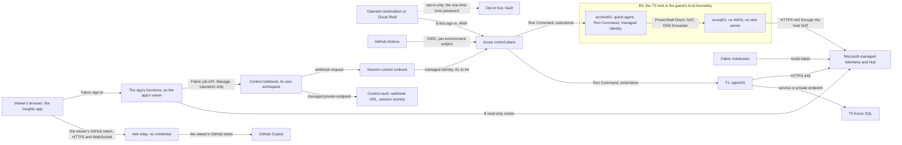
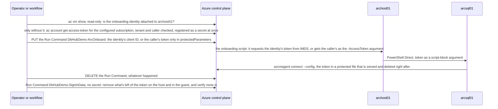

# Security model

How the demo protects your subscription, your sign-in, and its own secrets, and the risks it accepts. Decisions are in the [ADRs](adr/README.md), and every role with its exact actions is in [permissions](permissions.md). Last reviewed 2026-11-19.

## Scope and assumptions

- **A demo,** deployed by an identity that holds **Contributor** on the subscription. A dedicated demo subscription is recommended.
- **All data is synthetic** ("Contoso Care Operations"): no customer data, PHI, or PII.
- **Previews can change without notice:** Copilot in Database Hub, Database Agents (their behavior and target coverage), alerts, SQL Server on Azure VM monitoring, unified inventory, the Arc SQL monitoring setting, the telemetry endpoint and its schemas, and Fabric Apps with its Rayfin SDK and CLI, whose versions are pinned so a release can't change the app unreviewed. Database Hub itself is generally available. The demo never promises an AI's output, and the walkthrough has a fallback for every preview-dependent step ([limitations](limitations.md#preview-disclosures)).
- **Arc on a nested Hyper-V guest isn't explicitly documented.** If it doesn't work, the opt-in **evaluation-only** fallback is labeled as such everywhere.
- **Out of scope:** hardening the customer's own tenant; Fabric tenant configuration beyond the tenant settings in [prerequisites](prerequisites.md) (P4, P5, P12, P13, and the content security policy setting that Ask needs off); GitHub Copilot's processing of what a viewer asks, which their own Copilot plan governs; and the security of Microsoft-managed services.
- **The tenant's policies apply:** Azure Policy can add extensions to the demo's VMs (for example Defender for Endpoint, `MDE.Windows`), deploy Defender plans, and deny settings. Preflight lists them, read-only (`PREFLIGHT.POLICY.*`), and the scripts work around them rather than against them.

## Assets

| Asset | Why it matters |
|---|---|
| The Azure subscription and the demo resource group | Contributor rights there can create cost and change resources |
| T1's and the T2 host's local administrator access | Full control of the SQL Servers and, through the host, of the guest |
| The T2 guest's administrator password | Full control of the Arc-enabled SQL Server; it stays on the host, protected with DPAPI |
| The Jumpstart image's published default credential | Administrator of a new Jumpstart guest until its first boot replaces it, while the guest has no network ([the Jumpstart image](#the-jumpstart-image-jumpstartimage-mode-2026-11-05)) |
| The one-time T2 host password | Bastion sign-in to the host, and through it control of the guest; stored only in the opt-in Key Vault (`keyVault.enabled`), off by default |
| Arc onboarding tokens | Carry the caller's rights (Contributor) for about an hour ([the token handoff](#the-token-handoff)) |
| The bootstrap bundle, pinned media, and the Jumpstart image | The integrity of what the VMs install ([supply chain](#supply-chain)) |
| T1's managed identity | T3's and T4's administrator through the P6 group, and Cosmos DB Built-in Data Contributor on T5's account (a data-plane role) |
| The GitHub federated credential (optional, P7) | Lets workflows act as Contributor on the subscription |
| The Fabric workspaces and notebooks | Presenter tooling; the control notebook reads the session control's webhook and session secrets from its vault |
| SQL telemetry | Operational metadata, under each resource's ID (T1's VM, T3's database), so Azure RBAC on those resources governs who reads it |
| Script output, Run Command instance views, and deployment history | Where a secret could leak at run time; `Find-DemoSecretLeak` scans them (ADR 0009). `out/` is ignored by Git; don't publish its resource IDs |
| The `DbHubDemo` module and the VM-side scripts | Everything the operator and the VMs run; the module dot-sources `Private/*.ps1` alphabetically, so a second function with the same name would silently replace the first |
| The Insights app `APP_DatabaseHub_Insights` and its deploy record | Reads the history model as each viewer; its functions run as the app item's owner ([the Insights app](#the-insights-app)). The deploy stage `out/fabric-app` holds the item ID, the hosting URL, and the publishable key; Git holds only placeholders |
| Ask's chat relay `ca-<prefix>-<environment>-ask` | A public HTTPS and WebSocket endpoint between each viewer and their own GitHub Copilot session, with no credential and nothing kept ([Ask](#ask-the-copilot-chat-in-the-insights-app-2026-11-18)) |
| Each viewer's GitHub token for Ask | Acts as the viewer for their Copilot session (the OAuth App requests no scopes); kept in the browser's storage for the app's origin (its refresh token up to 6 months) and sent only to the relay |
| The T2 golden snapshot (`rg-<prefix>-golden`, optional) | A copy of the whole T2 host, secrets included, captured only after a clean sign-in scan and a password rotation ([residual risks](#residual-risks-accepted)) |
| The session control's webhook URL | A bearer secret for a bounded run or session ([the session control](#the-session-control)), kept only as the secret `dbhub-activity-webhook` in `kv-<prefix>-ctl-<suffix>`, which only the A3 users can read; Azure shows it once, and it expires after 90 days by default |
| The session control's identity `id-<prefix>-automation` | Starts and deallocates the demo's VMs, runs commands on them as SYSTEM, starts and stops T4, creates and deletes T4's read replica and T5's container, and writes the session's two secrets, at the demo resource group, the control's Automation account, and those secrets only ([its actions](permissions.md#the-on-demand-activity-control)) |
| The nightly safety stop's identity `id-<prefix>-<environment>-safetystop` | Reads the demo resource group, its VMs, T3's database, T4, and T5's container, and can only deallocate the VMs, stop T4, and delete T5's session-only container, at the demo resource group only: no start, no create, no Run Command, no data access ([its actions](permissions.md#the-nightly-safety-stop)). Its Automation account has local authentication off, so only its schedules start its runbook |

## Trust boundaries

| # | Boundary | Controls |
|---|---|---|
| B1 | GitHub → Azure (optional) | OIDC with one federated credential per GitHub environment; no branch or pull-request subjects for deploy, control, or destroy; SHA-pinned actions; concurrency groups; reviewers or typed confirmation for destructive workflows ([a public repository](#a-public-repository)) |
| B2 | Operator → Azure | Entra sign-in with the tenant's policies, such as MFA and Conditional Access (`PREFLIGHT.POLICY.MFA`). Every Azure CLI call passes `--subscription`, and `Invoke-DemoAz` refuses `az account set`, `az login`, `--ids`, `az ad`, `az rest` outside the configured subscription, and token requests with `--tenant`. Before any write, [the subscription guard](prerequisites.md#target-subscription-configuration-the-subscription-guard) checks the account and tenant through every authentication path and fails closed (ADR 0011). Only the Azure CLI's own token cache is written locally ([a separate profile](prerequisites.md#optional-a-separate-azure-cli-profile) can isolate it) |
| B3 | Azure control plane → VMs | Run Command and extensions only; protected parameters for anything sensitive, which reads never return; the scripts' Run Commands are deleted when they finish (the template's bootstrap loader stays, and holds no secret); no public IPs; Bastion only on demand. An instance view keeps the last 4 KB of output and error, which `SECURITY.SECRETSCAN.RUNCOMMANDS` scans |
| B4 | **T2 host → nested guest** | **The host is the guest's trust boundary:** whoever administers the host controls the guest. The guest can't reach the host's IMDS or wire server, so it can't get the host's managed-identity tokens: outbound block rules in the guest's firewall, `Add-VMNetworkAdapterAcl` deny rules that the host's virtual switch enforces (a guest administrator can't remove them), and DNS only through a forwarder on the host (ADR 0004). The host's guest agent stays on, so host automation works. `T2.GUEST.ISOLATION` checks it on every validation run while the host runs |
| B5 | VNet → internet | Deny inbound (`SECURITY.NETWORK.INBOUND` checks the VM and private-endpoint NSGs); outbound limited to HTTPS, KMS, and T1-to-T3 SQL ports, plus the platform traffic (DNS, IMDS, licensing) that NSGs allow by default; NSGs can't filter HTTPS by FQDN (ADR 0007) |
| B6 | Clients → T3 | Entra-only; TLS 1.2; a VNet rule or a private endpoint; no "Allow Azure services" |
| B7 | Tenant → Microsoft-managed services | Read-only telemetry and inventory flows; Database Hub needs subscription Reader, and T2's performance data also the Arc telemetry role (`Microsoft.AzureArcData/sqlServerInstances/getTelemetry/action`) |
| B8 | Viewer's browser (the Insights app) → Ask's relay → GitHub | The viewer's own GitHub token, over HTTPS and WebSocket; the relay serves only the app's hosting origin, holds no credential, and keeps nothing ([Ask](#ask-the-copilot-chat-in-the-insights-app-2026-11-18)). No notebook reaches GitHub |
| B9 | Operator → the opt-in Key Vault (`keyVault.enabled` only) | Off by default; Azure RBAC roles on the vault only, so it requires `assignRoles` ([permissions](permissions.md#the-key-vault-opt-in)); the firewall limited to `keyVault.allowedIpRanges` when set; soft delete, and purge protection on request; the password goes in from a private temporary file, never a command line, and the stop disables it. `SECURITY.SECRETS.KEYVAULT` and `SECURITY.RBAC.ROLEASSIGNMENTS` check it |
| B10 | The Insights app's functions → Database Hub and the Fabric job API | As the app item's owner: `estateOverview` reads 8 allowlisted, read-only Database Hub routes, filtered to the demo's resource group; Manage runs `NB_DatabaseHub_Control` only for a verified operator who confirms, and the control's runbook checks each request again ([the Insights app](#the-insights-app)) |

## The token handoff

Arc onboarding is the only flow that moves an access token across B3 and B4 ([ADR 0005](adr/0005-arc-onboarding-authentication.md)); the optional SQL Server product key and the one-time T2 host password take the same protected-parameter path to the host. When the least-privilege identity `id-<prefix>-<env>-arc-onboard` is attached to `archost01` (`deploy.ps1` creates it with `assignRoles = true`), the host requests that identity's token from its own IMDS, and no token of yours is used. Otherwise it's your own Azure Resource Manager token ([ADR 0009](adr/0009-secrets-handling.md)):

| Where the token is | Who can see it | For how long |
|---|---|---|
| The operator's PowerShell session (the caller's token only) | The operator; every log line and Actions mask hides it (`Register-DemoSecret`) | The run |
| The Run Command request body (the caller's token only) | Only the current user (a private temporary directory, sent as `--body @<file>`) | Until Azure accepts the request; the file is deleted right after |
| The Run Command's protected parameters (the caller's token only) | Nobody: reads never return them | Until the Run Command is deleted when it finishes |
| The host's `powershell.exe` command line (the caller's token only) | The host's local administrators; the Windows PowerShell event log, which records the command line by default; process-creation auditing, script block logging, and transcription when a policy turns them on; and endpoint protection, which can copy command lines off the VM | While the onboarding script runs (a few minutes) |
| The guest's config file for `azcmagent`, and the agent's memory | The guest's administrators | While `azcmagent connect` runs; the file is overwritten with zeros and deleted |
| Anywhere a copy survived | Whoever holds it, with the token's rights: Contributor for the caller's, only Azure Connected Machine Onboarding on the resource group for the identity's | Until it expires: about an hour for the caller's |

- **The scripts never write the token** to logs, outputs, or Run Command output. The sweep after onboarding (`DbHubDemo-SignInData`) removes what's left on the host and in the guest, clears the PowerShell and Application logs that hold the token (a **Warning**: endpoint protection may report a cleared log), and asks you to clear the Security log (**Manual action required**, with the command); it fails closed when it can't. If the guest's agent rejects the protected file, it gets the token on its command line once, and onboarding reports a **Warning**. A copy that endpoint protection sent off the VM stays there.
- **With the host identity,** your machine sends only a client ID, and a connect that Azure refuses while the new role assignment propagates is retried for up to 7.5 minutes. `configure-arc.ps1 -UseHostIdentity` requires the identity; `-UseCallerToken` skips it.
- **One token source:** every token the scripts request comes from `Get-DemoAccessToken` (`az account get-access-token --subscription <id>`, never `--tenant`), with its `tid` and `oid` claims checked against the context the guard validated, so a shared Azure CLI profile's default account can't supply it. Your tokens are registered as secrets when they're issued and sent only as SecureString bearer tokens to their own endpoints. Other tokens stay where they're issued: Fabric and Kusto tokens in the notebook session (the telemetry endpoint accepts the notebook's own `kusto` token, `HUB.TELEMETRY.TOKEN`, so the notebooks store no credential), and those T1's runner gets from its own managed identity for T3, T4, and T5.

## Your sign-in and tokens

**Where you sign in:**

- `az login` on your PC. Nothing for T2 or any other VM: no mode needs a sign-in beyond `az login`.
- The Rayfin CLI, for the Insights app, only when Fabric refuses your Azure CLI's token (`FABRIC.APP.TOKEN`): `deploy.ps1` then starts its browser sign-in at the beginning of the next run, and `./scripts/configure-fabric-app.ps1 -SignIn` runs it at once. Otherwise the app deploys with your `az login`.
- GitHub, for Ask, the Copilot chat in the Insights app: each viewer, once per browser (the app in the Fabric portal's frame and the app at its own address keep separate sign-ins), through GitHub's device flow and the OAuth App **Database Hub Insights Ask**, which requests no scopes. The browser keeps that sign-in for up to 6 months.

**What the scripts do with it:**

- Nothing from your sign-in is stored in the repository, the configuration, Key Vault, logs, or snapshots, or reused across redeploys. With `assignRoles: true`, Arc onboarding doesn't use your token at all ([the token handoff](#the-token-handoff)).
- Short-lived tokens travel only in memory or as protected Run Command parameters, and the Run Commands that carried them are deleted right after. A Run Command that receives the one-time host password or the SQL Server product key clears the VM's Windows PowerShell log afterward when that log recorded the value (a **Warning**, because endpoint protection may report it), and never the Security log.
- The one-time host password for interactive access (`./scripts/start-demo.ps1 -Interactive -ResetAdminPassword`) goes to your clipboard, never shown, or to the Key Vault opt-in. Without either, nothing is set: you choose one yourself with the portal's **Reset password** ([reset a Windows VM's password](https://learn.microsoft.com/troubleshoot/azure/virtual-machines/windows/reset-rdp)), which the demo never sees, logs, or stores. Either way, `stop-demo.ps1` rotates it to a value nobody keeps (a **Warning** with the portal's way when that can't run yet), and `deploy.ps1` is never **DONE** while a handover is unrotated ([ADR 0009](adr/0009-secrets-handling.md)).
- **Sign-in data on the VMs:** after every Arc onboarding, the scripts remove what's left and verify that none remains; the build fails if any remains, and so does an automatic sign-in that's still armed. The sweep looks, on each VM and in the T2 guest, in SQL Server setup's log folders, the temporary folders, PowerShell history and transcripts, the Run Command handlers' folders, the Azure VM and Connected Machine agents' logs, the demo's own folders, the PowerShell, Application, and Security event logs, Windows automatic sign-in (the LSA and Winlogon `DefaultPassword` values), and, in the T2 guest, where setup signed in, the browser and token broker caches. Azure's Windows provisioning leaves an LSA `DefaultPassword` secret on every VM it creates, with automatic sign-in off: the sweep deletes it, and so does T1's bootstrap on `sqlvm01` (its `AutoLogonSecret` step; [ADR 0009](adr/0009-secrets-handling.md#amendment-the-lsa-secret-azures-provisioning-leaves-2026-11-06)). `./scripts/check-sign-in-data.ps1` (`vm/bootstrap/Invoke-DemoSignInResidue.ps1`) checks any time and reports counts and locations only; `-Clean` removes what it finds, but it never clears the Security log itself: it gives you the command. The golden snapshot is captured only after a clean scan.

**What stays on your own PC and on GitHub:** your Azure CLI sign-in, and the Rayfin CLI's own sign-in if you made one. End them with `az logout` and, from the repository root, `./out/fabric-app/node_modules/.bin/rayfin logout` when you're done; the scripts never do that. Where you used Ask, two more stay, and `destroy.ps1` removes neither:

- **Your GitHub sign-in in each browser:** select **Sign out of GitHub** in the chat's account menu.
- **Your authorization of Database Hub Insights Ask on GitHub:** revoke it at [github.com/settings/applications](https://github.com/settings/applications), under **Authorized OAuth Apps**. Each viewer does this for their own account.

## Roles

[Permissions](permissions.md#role-matrix) lists every identity, its scope, its exact actions, and who grants it. What matters for security:

- **T1's managed identity is over-privileged by design:** T3's and T4's administrator through the P6 group, with Cosmos DB Built-in Data Contributor on T5's account. ADR 0008 has a hardened option for T3.
- **Two owner-approved exceptions to ADR 0008's Contributor-only default:** the nightly safety stop's custom role (9 actions) at the demo resource group, and the session control's two custom roles (30 and 2 actions) with Key Vault Secrets User on the control vault's three secrets (A1 to A4). `deploy.ps1` assigns them when the deployer is an Owner or User Access Administrator; otherwise an Owner runs `./scripts/grant-safety-stop.ps1` once. Every other role is optional: the presenters' roles and the Arc onboarding identity with `assignRoles`, the opt-in vault's roles with `keyVault.enabled`, and the GitHub identity's Contributor (P7).
- **Ask has no identity:** the relay has no managed identity, role, or secret. Each viewer signs in with their own GitHub account and authorizes **Database Hub Insights Ask** (no scopes), which an organization that restricts OAuth apps approves once.
- **The Insights app's functions run as the app item's owner,** the deployer: the live estate for every viewer, and Manage only for operators, the deployer and the members of the demo's admin group, refreshed at each `deploy.ps1` (`FABRIC.APP.OPERATORS`).

## Threats and mitigations (STRIDE)

| Threat | Example | Mitigation | Residual |
|---|---|---|---|
| Spoofing | A fork or another branch runs a deploy workflow as the Azure identity | Federated credentials match only `environment:<name>` subjects, and environments restrict deployment branches ([a public repository](#a-public-repository)) | Low |
| Spoofing | A guest process requests the host's managed-identity tokens | IMDS and the wire server blocked in the guest and by host-enforced port ACLs (B4) | Low; `T2.GUEST.ISOLATION` checks it |
| Spoofing | A sign-in to a new Jumpstart guest with the image's published credential or one of its SQL logins | Both are replaced or disabled before the guest has a network; `JumpstartImageCheck` warns about an enabled SQL login ([the Jumpstart image](#the-jumpstart-image-jumpstartimage-mode-2026-11-05)) | Low |
| Spoofing | A SecureString or credential converted with `[string]` becomes its type name (`System.Security.SecureString`, `System.Management.Automation.PSCredential`), which could become a VM's password | `Invoke-DemoVmRunCommand` refuses a type name as any Run Command value, and a SecureString that holds one, before any Azure call; the one-time host password needs at least 12 characters | Low |
| Tampering | Modified bootstrap chunks, media, Connected Machine agent package, .NET SDK zip, or Jumpstart image | Each is checked before use and deleted when a check fails ([supply chain](#supply-chain)); only Contributors can create Run Commands | Low; a newer Jumpstart image is trusted once it passes the image checks (`STATUS.T2.IMAGE`) |
| Tampering | A new function silently replaces an existing one with the same name | Static validation fails on a duplicate function name | Low |
| Repudiation | Who started a scenario, a session, or a destroy? | The Azure Activity Log; the Automation account's job history, with each request and who sent it; GitHub run history; `demo.scenario_runs`, with each run's ID and parameters; `validate.ps1`'s JSON lines | Low |
| Information disclosure | A token or password in logs, notebook outputs, Run Command instance views, the deployment history, or saved output | Redaction, `::add-mask::`, protected parameters, secret-free outputs, gitleaks, notebook output checks, and `Find-DemoSecretLeak` with `SECURITY.SECRETSCAN.OUTPUT`, `.RUNCOMMANDS`, and `.DEPLOYMENTS` (ADR 0009) | Low; instance views can be scanned only while the VMs run |
| Information disclosure | The caller's Arc token on the host's command line or in the guest | The host identity sends none; otherwise [the token handoff](#the-token-handoff) bounds and sweeps it | Medium for the caller's token; accepted (ADR 0005, ADR 0009) |
| Information disclosure | The SQL Server product key (`ProductKey` mode) | A protected parameter only; DPAPI on the host and deleted after setup; never written on the operator's side; `DBHUB_SQL_PRODUCT_KEY` is removed from the environment once read | Low |
| Information disclosure | The one-time T2 host password | Only in the opt-in vault (B9), or one you set in the portal, which the demo never sees; `stop-demo.ps1` rotates it either way | Low |
| Information disclosure | Leftovers in a guest built in the retired `PaygWizard` mode (before 2026-11-09): setup's sign-in data, an armed automatic sign-in with its LSA secret, or IE Enhanced Security Configuration off | They fail the sign-in data scan and block a golden capture (a **Warning** in `status.ps1`); the T2 host's next pass removes them, turns IE Enhanced Security Configuration back on, and rotates the guest's password ([ADR 0009](adr/0009-secrets-handling.md#phase-28-amendment-the-guests-one-automatic-sign-in-and-the-portal-password-reset-2026-10-29)) | Low: readable only by someone who can already take over the guest |
| Information disclosure | What a viewer asks in Ask, and what its tools return, reaches GitHub Copilot | Only questions, the model's names, and read-only tool results; never a token, a password, or a key ([Ask](#ask-the-copilot-chat-in-the-insights-app-2026-11-18)) | Accepted: the viewer's own plan governs it |
| Information disclosure | A viewer of the Insights app sees the live estate without Azure access of their own | Read-only, and filtered to the demo's resource group (B10) | Accepted: share the app only with people who may see the owner's view |
| Denial of service or cost | Runaway scenarios, forgotten VMs or Bastion | Bounds and a watchdog (ADR 0010); the auto-shutdown and the nightly safety stop (ADR 0024); budget alerts; Bastion's auto-removal, which `stop-demo.ps1` and `status.ps1` finish; expiry (ADR 0016); checked by `WORKLOAD.<target>.BOUNDS`, `COST.BUDGET`, `COST.AUTOSHUTDOWN`, `COST.SAFETYSTOP`, and `COST.BASTION` | Low |
| Denial of service | A policy's extension update (`MDE.Windows`) holds a VM's Run Commands for about 10 minutes | 409 Conflict is retried with backoff, and validation names the likely cause; preflight lists the policies that add extensions (`PREFLIGHT.POLICY.EXTENSIONS`) | Low; availability only |
| Denial of service or cost | Another client uses Ask's public relay | It holds no credential, so a client needs its own GitHub token, and its limits bound it ([Ask](#ask-the-copilot-chat-in-the-insights-app-2026-11-18)) | Low; it bills only while it runs |
| Elevation of privilege | A viewer who isn't an operator starts or stops a session through Manage | The caller's token is tied to this app and matched by object ID, and only the control's documented actions go, after a confirmation, or the request is copied instead; the runbook checks each request again ([the Insights app](#the-insights-app)) | Low; the identity proof is pending ([residual risks](#residual-risks-accepted)) |
| Elevation of privilege | Compromise of T1 yields T3's and T4's administrator rights and T5's data-plane access | A single-purpose server with synthetic data; a hardened option is documented (ADR 0008) | Medium; accepted |
| Elevation of privilege | The caller's Arc token carries Contributor rights on the subscription | The Onboarding-only host identity whenever it's attached; a dedicated demo subscription is recommended | Medium; accepted |
| Elevation of privilege | Role assignments or a Key Vault appear in the demo resource group | The default deployment creates no Key Vault there (the session control's is in `rg-<prefix>-control`), and no role assignment there except, when the deployer may, the nightly safety stop's custom role and the session control's A1, each for its own identity at exactly the group. `SECURITY.RBAC.ROLEASSIGNMENTS` allows only those, Reader, the Arc telemetry role, with `assignRoles` Azure Connected Machine Onboarding, and with `keyVault.enabled` the two Key Vault secrets roles on the opt-in vault; `SECURITY.SECRETS.KEYVAULT` allows only that vault (ADR 0008, ADR 0009) | Low |
| Elevation of privilege | Destructive SQL outside the demo databases | Scenario procedures and the watchdog act only in `ContosoCare`, on sessions tagged `ContosoCare.Demo/` | Low |

## Supply chain

- **Dependencies:** GitHub Actions are pinned by full commit SHA and updated by Dependabot (`.github/dependabot.yml`), which also covers NuGet, the .NET SDK, and Docker for the workload generator, and the dev container. The npm lock files (`fabric/app`, `ask-relay`), the relay's MCR base images, and the AVM modules and API versions in Bicep (Dependabot has no Bicep-registry ecosystem) are pinned and updated by hand; a Pester test keeps the base images in step with `config/versions.json`.
- **Pinned downloads,** in `config/versions.json`, each checked before use and deleted when a check fails: media by SHA-256; the Connected Machine agent, which has no published hash, by its Microsoft Authenticode signature (or a pinned SHA-256 when one is set), and the guest checks its copy's SHA-256 again; the Jumpstart image by URL, ETag, size, and Content-MD5, with Jumpstart's script that holds its published credential by commit and SHA-256; and the .NET SDK zip that `deploy.ps1` installs on Windows, over HTTPS from `builds.dotnet.microsoft.com`, by SHA-512 (`dotnetSdkInstall`), `dotnet.exe`'s Microsoft signature, and `dotnet --version`, before it creates anything (`DEPLOY.DOTNETSDK`) and before each later build.
- **The bootstrap bundle and the runner:** each chunk's SHA-256 is checked when it's written and again before assembly, and the bundle's before it's unpacked. The runner is built from this checkout by `deploy.ps1` with a .NET SDK that `workload-generator/global.json` accepts, as a deterministic zip with a SHA-256 manifest, sent in SHA-256-checked Run Command chunks, and run on the pinned .NET runtime, which the VMs check by its SHA-512.
- **Scanning:** gitleaks, pinned and checksum-verified, runs on every pull request (the job **Secret scan** in `.github/workflows/reusable-static-checks.yml`, over the full history with `--redact`) and as a pre-commit hook; `.gitleaks.toml` keeps every default rule and adds `jwt-any-delimiter` (ADR 0009). The repository is public: `setup-github-repo.ps1` turns on GitHub secret scanning with push protection, and CodeQL (`.github/workflows/codeql.yml`) runs on it, as it does in a private copy where the variable `CODE_SCANNING_ENABLED` is `true`. Run-time output is scanned with `Find-DemoSecretLeak`, UTF-16 logs included. PSScriptAnalyzer checks every PowerShell file, and the VM-side scripts under `vm/` for Windows PowerShell 5.1 too.
- **Ask's relay image:** public on GitHub Container Registry and pinned by digest, so nobody who deploys the demo builds it or runs GitHub Actions ([its provenance](#ask-the-copilot-chat-in-the-insights-app-2026-11-18)).
- **The Insights app's npm packages:** every package in `fabric/app` is pinned to an exact version and installed with `npm ci` from `package-lock.json`, with SHA-512 integrity (a Pester test enforces both). `npm run check:licenses` fails on a production dependency outside the permissive allow list, and the build writes `THIRD_PARTY_NOTICES.txt`. Fonts and libraries are bundled; the app loads nothing from a CDN.

## The Insights app

- **Sign-in:** Fabric SSO (Microsoft Entra ID) only; the app has no other identity provider ([Fabric authentication](https://learn.microsoft.com/fabric/apps/fabric-authentication)). Opened from its workspace item, it signs in through the portal with `initEmbeddedAuth`. Ask's GitHub sign-in is for each viewer's own Copilot session, not for the app.
- **Protected hosting:** `rayfin.yml` sets `staticHosting.assetAccess: protected`, so the host serves the bundle only to a signed-in user with permission on the item ([hosting](https://learn.microsoft.com/fabric/apps/hosting)); `configure-fabric-app.ps1` checks that an anonymous request gets HTTP 401 (`FABRIC.APP.HOSTING`). Public hosting would serve the bundle without sign-in, and wouldn't fix opening the hosted URL directly.
- **Data access:** one connector, `fabric-semanticmodel` with `executeQuery` only and delegated authentication, so every DAX query runs as the signed-in viewer and returns only what they can read ([connectors](https://learn.microsoft.com/fabric/apps/connectors)). The app builds DAX only from allow-listed values (target keys, validated dates), never from free text, and stores nothing. Its functions are `estateOverview`, which only reads the live estate ([Ask](#ask-the-copilot-chat-in-the-insights-app-2026-11-18)), and Manage's three.
- **Manage** acts only for an operator, the deployer or a member of the demo's admin group, after they confirm. Its function verifies the caller's token again with the app's own keys and ties it to this app; nothing the browser sends names the caller, and a token with an object ID matches an operator only on it (one without, on Fabric's sign-in email for this app, until the identity proof). It accepts only the control's documented actions and values, one request at a time, through the Fabric job API, with a token that can run and cancel the control's runs but not read its vault; the runbook checks each request again and records who sent it, and anything the function can't confirm falls back to copy mode, which sends nothing. No secret reaches the app: the webhook URL stays in Key Vault ([ADR 0029](adr/0029-insights-app-dba-console.md)).
- **No secrets in code or assets:** Git holds `${...}` placeholders, and real IDs go into the Git-ignored stage at deploy time. The bundle carries the backend URL and the publishable key, which are public by design (the backend still requires a Fabric sign-in), and the deploy step redacts the key from every result and log anyway; `public/dbhub-app.json` holds only links, the expected account, and the resource group's name, behind protected hosting.
- **Database Agent prompts:** the app writes prompt text from the data on screen and sends nothing to the agent; the user copies it into Database Hub's Database Agent, whose actions run only after the user's explicit approval ([FAQ](https://learn.microsoft.com/fabric/database/hub/faq)), and every prompt ends with "Don't change anything." or "Don't apply anything; propose only."
- **The deploy identity:** your own Azure CLI sign-in. `configure-fabric-app.ps1` gives each Rayfin command a token for its own audience alone (the Fabric API for `rayfin up`, the Power BI API for the connector's queries), as `RAYFIN_TOKEN` in that child process's environment only, registered for redaction and never logged or written to a file; a token for another audience is refused before anything runs, and every other Rayfin call removes an ambient `RAYFIN_TOKEN`. When the connector's direct route refuses the token, it goes only to Power BI's Execute Queries (`Invoke-DemoDaxQuery`, which refuses any URI outside `https://api.powerbi.com/v1.0/myorg`), and that refusal never starts a sign-in. Only when Fabric refuses it for `rayfin up` does the CLI's own cached sign-in (P14) deploy, which only a person signs in; the scripts never see that token or sign it out. The CLI's telemetry is off, and it runs from the app's stage, never through `npx`, so the lock file's npm overrides apply. There's no service principal and no secret.

## Ask, the Copilot chat in the Insights app (2026-11-18)

The chat runs on each viewer's own GitHub Copilot, through a relay that holds no credential ([ADR 0028](adr/0028-ask-copilot-in-the-insights-app.md), [the relay](../ask-relay/README.md)).

- **What reaches GitHub Copilot:** the viewer's questions; a guide to the history model (table, column, and measure names, never data); the answers of the read-only tools the viewer's Copilot calls: DAX results (at most 120 rows each) and the live estate (resource names, health counts, and security findings, for the demo's resource group only); and, when the viewer selects **Ask Copilot** or **Ask why**, that visual's title, DAX, and at most 200 of its rows. Never an Azure or Fabric token (the app's code never has one), a password, or a key.
- **The tools run in the page, as the viewer:** DAX goes through the app's delegated connector, so it returns only what the viewer may read, and only `EVALUATE` queries are accepted. The relay runs no tool, and turns every built-in Copilot tool, agent, and skill off.
- **The relay** (`ask-relay/`, an Azure Container App in the demo resource group) passes messages between the page and the viewer's Copilot session. It has no secret, registry credential, managed identity, or role; its only settings are the OAuth App's public client ID and the one origin it serves, the app's hosting origin, which it enforces on HTTP and WebSocket. It keeps nothing: conversations stay in memory for the session, and its logs hold event names and counts, never content or tokens (it redacts anything token-shaped). Its limits: 20 sessions, 40 turns and 60 minutes per session, a 150-second tool timeout, a 15-minute idle close, and per-client limits keyed on the address the ingress appends to `X-Forwarded-For` (4 sockets, a 10-second start, and 1 Copilot check at a time); one bad request can't drop every conversation ([its routes and limits](../ask-relay/README.md)).
- **The viewer's GitHub token:** from GitHub's device flow through the OAuth App **Database Hub Insights Ask** (owned by MarcBushong; no client secret exists), which requests no scopes. It's kept in the browser's storage for the app's origin and sent only to the relay over HTTPS, for the viewer's Copilot session and GitHub's account endpoints. It expires after 8 hours, and its refresh token (6 months) renews it through the relay, one tab at a time. **Sign out of GitHub** removes both from the browser, and every open tab follows; revoking **Database Hub Insights Ask** at [github.com/settings/applications](https://github.com/settings/applications) (**Authorized OAuth Apps**) ends them on GitHub's side ([your sign-in and tokens](#your-sign-in-and-tokens)).
- **The live estate:** the app's function reads 8 allowlisted, read-only Database Hub routes as the app item's owner, filtered to the demo's subscription and resource group, under ADR 0013's one narrow exception ([amendment](adr/0013-agent-experience.md#amendment-2026-11-18-the-ga-skill-and-one-narrow-exception)); its scope is written into the deploy stage, never into Git.
- **The image's provenance:** built only by this repository's workflow (`.github/workflows/ask-relay-image.yml`, `contents: read` and `packages: write`; never on a pull request or in a fork) and published to GitHub Container Registry as a public package; `config/versions.json` pins its digest (`askRelay.image`), which Azure Container Apps pulls anonymously. Its base images are pinned by digest, the runtime is distroless and non-root, and the image holds no secret ([the image](../ask-relay/README.md#the-image)). Its package is public, so anyone can pull it, from its first publish (2026-11-19), and the owner keeps it so: a public package can't be made private again, only deleted ([GitHub Docs](https://docs.github.com/packages/learn-github-packages/configuring-a-packages-access-control-and-visibility)).
- **What a tenant can tighten:** an organization's OAuth app policy decides whether its members may authorize the app, and the Fabric tenant setting "Enforce a strict content security policy for static-hosted Fabric Apps (preview)" blocks the page from reaching the relay (`ASK.CSP`, a **Warning**, never a **Fail**). `deploy.ps1` can't see a viewer's organization, so the Copilot dock says when its policy blocks the app, and what its owner approves.

## T4 and T5: PostgreSQL and Azure Cosmos DB

- **No secret exists:** T4's password authentication is off, so it has no administrator password ([ADR 0019](adr/0019-t4-postgresql-flexible-server.md)); T5's local (key) authentication (`disableLocalAuth`) and key-based metadata writes are off, so no account key works for data and nothing stores one ([ADR 0027](adr/0027-t5-cosmos-db.md), [role-based access control](https://learn.microsoft.com/azure/cosmos-db/how-to-connect-role-based-access-control)). Microsoft Entra is the only way into either; the P6 group is T4's administrator, as it is T3's.
- **No token travels:** T1's runner asks its own managed identity for each token (the `ossrdbms-aad` audience for T4, used as one connection's password and dropped with it; the `https://<account>.documents.azure.com` audience for T5, sent in each request's `Authorization` header over HTTPS) and keeps it in memory only. Nothing is written to disk, a log, or a Run Command, and your token never goes to T1.
- **Least privilege for the workload:** on T4, the runner's role `contosocare_runner` isn't an administrator: it has the demo's tables and functions in `contosocare`, and `pg_read_all_stats` (read-only statistics, for the live view) when the service allows it, and it can end only its own sessions; the session tools filter on `ContosoCare.Demo/` names in `contosocare` too. On T5, T1's identity has Cosmos DB Built-in Data Contributor on the account only (a data-plane role assignment, not an Azure role), and the runner acts only in `contosocare`/`patient-events`, on documents it wrote: a bounded set it deletes after `ru-storm`.
- **Network:** T4 has virtual network integration with no public access, TLS verified by host name (`VerifyFull`), and port 5432 open only from T1's subnet. T5 has public network access off in both network modes: a private endpoint in `snet-pe` with the `privatelink.documents.azure.com` zone is the only way in, and `snet-pe`'s network security group allows TCP 443 from T1's subnet only.
- **Database Hub's posture checks:** of the four PostgreSQL assessments, T4 is built to pass Entra authentication enabled and enforced and public network access disabled; of Cosmos DB's three, T5 is built to pass Microsoft Entra-only access and public network access. Customer-managed keys stay a suggestion on both (service-managed encryption) ([monitor PostgreSQL](https://learn.microsoft.com/fabric/database/hub/monitor-postgresql), [monitor Azure Cosmos DB](https://learn.microsoft.com/fabric/database/hub/monitor-cosmos-db)).

## The session control

The session control (formerly the on-demand activity control) behind the control notebook's **Run all**, in every deployment ([ADR 0026](adr/0026-one-run-all-session.md), [ADR 0020](adr/0020-on-demand-activity-control.md)):

- **The webhook URL is the only credential,** and it's treated as a secret everywhere: setup gets it from Webhook - Generate Uri, registers it for redaction, and passes it only as a secure template parameter in a private file that's deleted afterward; the template has no output. The notebook reads it from the vault for one request and prints only the HTTP status and the job ID; a failed request prints its error's type, never its text. `setup-activity-control.ps1 -RotateWebhook` replaces it, and `status.ps1` warns 14 days before it expires.
- **A request can't widen what runs:** the runbook accepts a JSON object of at most 4 KB with only known fields, allow-listed targets and scenarios from the catalog, capped durations, and one activity per target, and refuses anything else, and a run while another is active. Automation records each request as the job's input, so the notebook sends no credential header.
- **Every run has its own stop,** created before anything starts, and Stop now, the auto-stop, and the daily T4 safety stop go through Azure Resource Manager only, never Run Command.
- **The vault:** Standard, Azure RBAC, 7-day soft delete, and public network access by the tenant's policy (`control.vaultNetworkMode`): public with per-user roles, or `Disabled` and reached only through the control workspace's managed private endpoint. It has **no diagnostic settings, so there are no data-plane logs** of who read the secret ([Key Vault logging](https://learn.microsoft.com/azure/key-vault/general/logging)). Setup never adds a policy's exclusion tag.
- **The Automation account** keeps public network access and local authentication on, because webhooks need local authentication ([disable local authentication](https://learn.microsoft.com/azure/automation/disable-local-authentication)); it has no system-assigned identity, no variables, and no credentials. The runbooks call Azure Resource Manager only, with the user-assigned identity's token, which lives in one job's memory.
- **The identity's reach:** its custom role at the demo resource group and the control account only, and the session writer role at the two session secrets only ([permissions](permissions.md#the-on-demand-activity-control)). It deletes a server only when Azure reports it as T4's read replica, by its configured name, and creates and deletes only T5's container `contosocare/patient-events`, so its throughput bills only during a session; the container actions reach no account, key, network setting, or data ([ADR 0027](adr/0027-t5-cosmos-db.md#the-container-only-during-a-session-2026-11-19)).
- **The session's secrets hold no credential:** `dbhub-session-status` holds the session's plan and progress, and `dbhub-session-metrics` T4's and the replica's Azure Monitor metrics for the history; the runbook writes them through Azure Resource Manager, and the notebook reads them as data.
- **The busy marker is bounded:** the `DbHubBusy*` tags on the demo resource group defer the nightly stop for at most 3 hours past their last refresh, so an abandoned session is still stopped the same night ([ADR 0024](adr/0024-nightly-safety-stop.md)).

## The Jumpstart image (`JumpstartImage` mode, 2026-11-05)

The default T2 mode makes `arcsql01` from Arc Jumpstart ArcBox's prebuilt SQL Server 2022 Standard guest disk ([ArcBox ITPro docs](https://github.com/Azure/arc_jumpstart_docs/blob/71a945c619f78acb441c6470d76a9b58347169fe/docs/azure_jumpstart_arcbox/ITPro/_index.md)), with no person ([ADR 0006](adr/0006-sql-editions-and-licensing.md), [ADR 0009](adr/0009-secrets-handling.md)):

- **The download:** from Jumpstart's public storage over HTTPS, hashed while it streams and checked against the blob's own Content-MD5 and length, and against a pinned SHA-256 when one is set; a mismatch deletes the file, and the next run downloads it again. A newer image at the same URL (a new ETag) is used only after the guest passes the image checks (`JumpstartImageCheck`), with a **Warning** that names it (`STATUS.T2.IMAGE`).
- **The published default credential:** Jumpstart publishes it in its ArcBox docs. The host reads it at run time from Jumpstart's script at a pinned commit, on `raw.githubusercontent.com`, after it checks the script's SHA-256 (fail closed); no password text is in this repository. It stays in memory, registered for redaction, and is used once, over PowerShell Direct, while the guest's network adapter isn't connected.
- **Replaced before any network:** the first boot sets a random administrator password, stored on the host with DPAPI like the guest's password in every mode, and proves it before it keeps it; only then is the network adapter connected. Every enabled SQL login is disabled, `sa` with a random password that nobody keeps, `BUILTIN\Administrators` is sysadmin, and the image's sample database is dropped.
- **What's removed:** `C:\Jumpstart`, with licensed SQL Server media and ArcBox's sample files; Integration Services and Launchpad are stopped and disabled, and Integration Services is uninstalled; any Arc agent identity in the image is reset locally (`azcmagent disconnect --force-local-only`) before the guest has a network.
- **Unchanged:** the guest's isolation (B4), [the token handoff](#the-token-handoff), and the sign-in data sweep after onboarding (`GuestSignInCleanup`) run as in every mode. Deploying needs no Bastion, host password, or Key Vault.

## A public repository

The repository is public, so its Actions logs and artifacts are too. The live workflows take their IDs from environment secrets that GitHub masks, sign in with OpenID Connect, and mask every ID the configuration holds or a run learns; the federated credentials trust only `repo:<owner>/<repo>:environment:<name>`, so a fork or a pull request gets no token (no workflow uses `pull_request_target` or `workflow_run`); every run that reaches Azure waits for the owner as the environment's required reviewer, except the opt-in schedule environment's scheduled runs; and `setup-github-repo.ps1` applies the default branch's ruleset, secret scanning with push protection, private vulnerability reporting, and Dependabot alerts. No real ID, tenant domain, internal policy name, or resource-name suffix is in the repository ([ADR 0022](adr/0022-public-repository-and-github-actions-hardening.md)).

## Residual risks (accepted)

Besides the rows the STRIDE table marks as accepted (T1's identity, the caller's Arc token, and what Ask sends to GitHub Copilot):

- **The session control's webhook URL** starts a bounded run or session for whoever has it. It lives only in the control vault, A3 is per user, and the module's redaction rule and the gitleaks rule `azure-automation-webhook` catch its shape; reads of it aren't logged, but every run shows in the Automation account's job history, with its request body (ADR 0020, ADR 0026).
- **The control's identity can run commands as SYSTEM on the demo's VMs;** A1 limits it to the demo resource group, and its runbook builds every command from the allow-listed request only (ADR 0020).
- **The golden snapshot** holds secrets (the host's and guest's password hashes, the DPAPI-protected guest password, the captured Arc identity's key) for as long as it exists, and any Contributor on the subscription can create a disk from it; its export is blocked (`DenyAll`, public network access off). A restored copy boots air-gapped, resets its Arc identity locally, and rotates both passwords before it reaches a network; the restore stops with the guest air-gapped when the agent can't report its state, and an onboarding never deletes a Connected machine of that name (`StaleMachineConnected`). A file scan can't prove that deleted sign-in data is gone from free space, so a snapshot of a guest built in the retired `PaygWizard` mode can hold fragments of that build's sign-in, whose tokens expired within about an hour, until a capture after a zero fill (ADR 0009, ADR 0018).
- **Egress:** NSGs can't restrict HTTPS by FQDN (ADR 0007).
- **The Jumpstart guest:** licensing of a nested Windows guest isn't documented, and the demo doesn't activate its Windows but records its license state; a newer image at the same URL is trusted once it passes the image checks; and Jumpstart's environments are for evaluation, training, and demo purposes only (ADR 0006, [limitations](limitations.md#targets-and-licensing)).
- **Previews change** ([limitations](limitations.md#preview-disclosures)).
- **Scans have gaps:** Run Command instance views can be scanned only while the VMs run, and Actions logs and notebook exports only once someone downloads them; gitleaks can't read a UTF-16 file, so logs belong in the Git-ignored `out/`, where `Find-DemoSecretLeak` reads UTF-16 (ADR 0009).
- **The opt-in Key Vault** stays soft-deleted after destroy, with the one-time password's versions, for its retention period (7 days by default; the whole period with purge protection); a later deployment recovers it (ADR 0009).
- **The live estate** reads Database Hub routes that aren't a documented API, the repository's one narrow, read-only exception, and every viewer of the Insights app sees the app owner's view of the demo's resource group (resource names, health, and security findings), with or without Azure Reader (ADR 0013, ADR 0029).
- **Ask's relay is a public endpoint:** its origin check keeps other web pages out, not a client that sends the app's origin itself; such a client needs its own GitHub token, finds no credential, and is bounded by the relay's limits, whose compute bills the demo's subscription while it runs (ADR 0028).
- **Manage's sending mode,** until the identity proof, rests on two assumptions: that a caller's token is tied to this app and names them, and that the Fabric token the runtime mints may run and cancel the control notebook. When either fails, copy mode keeps working (ADR 0029).

## Pending live checks

The security checks that still need a running environment or a person; where a check exists, `validate.ps1` reports it as a **Warning** or **Manual action required** until then. Everything else that isn't proven live yet is in [limitations](limitations.md#not-proven-live-yet).

- A full run with an identity that holds only Contributor: deploy, operate, validate, and destroy, with `SECURITY.RBAC.ROLEASSIGNMENTS` showing that the caller can't assign roles (ADR 0008).
- `SECURITY.SECRETSCAN.RUNCOMMANDS` on running VMs, and a scan of downloaded Actions logs.
- `T2.GUEST.ISOLATION` on a running host, and the port ACLs on their own, with the guest's firewall temporarily off.
- The portal's **Reset password** path from a session without a clipboard, and, on a guest that an older guided stop left open, the cleanup of its automatic sign-in and the sign-in scan's checks for it.
- Manage's identity proof ([ADR 0029](adr/0029-insights-app-dba-console.md)): what a function sees of a signed-in caller, and whether the Fabric token the runtime mints may run and cancel the control notebook.

The live findings behind these controls are recorded in the [implementation report](implementation-report.md) and in ADRs [0012](adr/0012-validation-model.md) and [0018](adr/0018-fast-redeploy-parallel-tracks-golden-snapshot.md).
